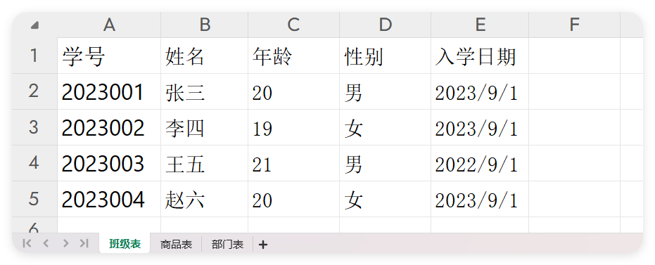
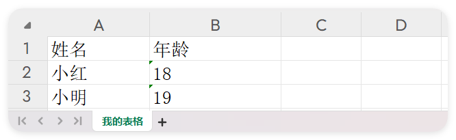

# $excel - 表格操作

- 更新时间:2026-10-22 10:55:46

> 表格（Excel .xlsx 文件）操作对象，脚本里叫 $excel。
> 
> 它能在手机上读取和生成 .xlsx 电子表格：把表格里的每一行读成"字符串数组的数组"，
> 也能把你整理好的二维数组写成一个新的表格文件。一个 xlsx 文件里可以有多个工作表（sheet）。


```javascript
var rows = $excel.read("/sdcard/Download/data.xlsx");
```


### 读取(路径)

> 读取第一个表格

- 参数 : 路径 {字符串} 表格文件路径，可填相对路径或绝对路径
- 返回 : {字符串[][]} 表格内容：二维数组；文件不存在时返回空数组
- 版本 : 1.7.8


```javascript
//读取第一个表格数据
var 数据 = $表格.读取("data.xlsx");
log(数据);
// 输出:
// [
//    ["学号","姓名","年龄","性别","入学日期"],
//    ["2023001","张三","20","男","2023-09-01"],
//    ["2023002","李四","19","女","2023-09-01"],
//    ["2023003","王五","21","男","2022-09-01"],
//    ["2023004","赵六","20","女","2023-09-01"]
// ]
```




### 读取(路径, 下标)

> 读取表格

- 参数 : 路径 {字符串} 表格文件路径
- 参数 : 下标 {整数} 要读取的工作表下标，从 0 开始（0=第一个表）
- 返回 : {String[][]} 指定工作表的内容，二维数组；不存在时返回空数组
- 版本 : 1.7.8


```javascript
//读取第2个表格数据
var 数据 = $表格.读取("data.xlsx", 1);
log(数据);
// 输出:
// [
//    ["商品ID","商品名称","商品单价","库存"],
//    ["P001","笔记本电脑","4999","10"],
//    ["P002","智能手机","3999","25"],
//    ["P003","平板电脑","2499","18"],
//    ["P004","无线耳机","799","50"]
// ]
```


### 数量(路径)

> 表格数量

- 参数 : 路径 {字符串} 表格文件路径
- 返回 : {整数} 工作表的个数；文件不存在时返回 0
- 版本 : 1.7.8


```javascript
//获取表格的数量
var 表格数量 = $表格.数量("data.xlsx");
log(表格数量);//输出:3
```


### 罗列(路径)

> 列表

- 参数 : 路径 {字符串} 表格文件路径
- 返回 : {字符串数组} 所有工作表名称组成的列表；文件不存在时返回空列表
- 版本 : 1.7.8


```javascript
//获取每个工作表的名称
var 表格列表 = $表格.罗列("data.xlsx");
log(表格列表);//输出:["班级表","商品表","部门表"]
```


### 遍历(表格路径, 数据回调)

> 遍历所有表格

- 参数 : 表格路径 {字符串} 表格文件路径
- 参数 : 数据回调 {function} 每读到一个工作表的回调，参数依次是工作表名、该表的二维数组数据
- 版本 : 1.7.8


```javascript
//遍历所有表格数据
$表格.遍历("data.xlsx", function(名称, 数据) {
    提示(名称, 数据); //名称 是工作表名，数据 是该表的二维数组
});
```


### 写入(表格名称, 表格数据, 保存路径)

> 写入表格

- 参数 : 表格名称 {字符串} 工作表的名字
- 参数 : 表格数据 {String[][]} 要写入的表格数据，二维字符串数组
- 参数 : 保存路径 {字符串} 保存到哪里，必须是绝对路径
- 版本 : 1.7.8


```javascript
//数据
var 表格数据 = [
    ["姓名", "年龄"],
    ["小红", "18"],//注意必须都是字符串类型
    ["小明", "19"]
];
//表名
var 表格名称 = "我的表格";
//路径(必须是绝对路径)
var 保存路径 = "/sdcard/demo.xlsx";
$表格.写入(表格名称, 表格数据, 保存路径);
```




