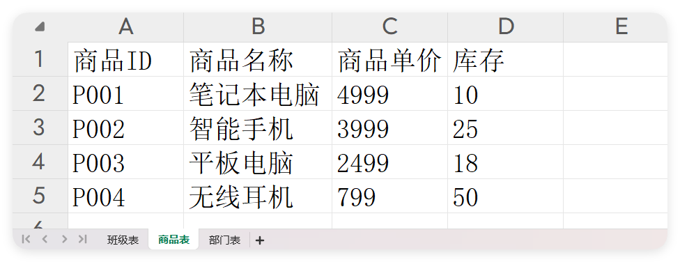

# $excel - 表格操作

- 更新时间:2026-10-22 10:55:47

> 表格（Excel .xlsx 文件）操作对象，脚本里叫 $excel。
> 
> 它能在手机上读取和生成 .xlsx 电子表格：把表格里的每一行读成"字符串数组的数组"，
> 也能把你整理好的二维数组写成一个新的表格文件。一个 xlsx 文件里可以有多个工作表（sheet）。


```javascript
var rows = $excel.read("/sdcard/Download/data.xlsx");
```


### read(path)

> 读取表格文件里"第一个工作表"的全部内容。
> 
> 每一行变成一个字符串数组，整个表格就是这些行组成的数组；所有单元格都按字符串读出。

- 参数 : path {String} 表格文件路径，可填相对路径或绝对路径
- 返回 : {String[][]} 表格内容：一个二维数组，外层每行是一个字符串数组；文件不存在时返回空数组
- 版本 : 1.7.8


```javascript
//读取第一个表格数据
var data = $excel.read("data.xlsx");//相对路径
log(data);
// 输出:
// [
//    ["学号","姓名","年龄","性别","入学日期"],
//    ["2023001","张三","20","男","2023-09-01"],
//    ["2023002","李四","19","女","2023-09-01"],
//    ["2023003","王五","21","男","2022-09-01"],
//    ["2023004","赵六","20","女","2023-09-01"]
// ]
```


### read(path, index)

> 读取表格文件里"指定第几个工作表"的全部内容。
> 
> 一个 xlsx 可以有多个工作表，用下标选择；下标从 0 开始，0 就是第一个表。

- 参数 : path {String} 表格文件路径
- 参数 : index {int} 要读取的工作表下标，从 0 开始（0=第一个表）
- 返回 : {String[][]} 指定工作表的内容，二维数组；文件或下标不存在时返回空数组
- 版本 : 1.7.8


```javascript
//读取第2个表格数据
var data = $excel.read("data.xlsx", 1);//相对路径
log(data);
// 输出:
// [
//    ["商品ID","商品名称","商品单价","库存"],
//    ["P001","笔记本电脑","4999","10"],
//    ["P002","智能手机","3999","25"],
//    ["P003","平板电脑","2499","18"],
//    ["P004","无线耳机","799","50"]
// ]
```




### num(path)

> 数一下这个表格文件里一共有多少个工作表（sheet）。

- 参数 : path {String} 表格文件路径
- 返回 : {int} 工作表的个数；文件不存在时返回 0
- 版本 : 1.7.8


```javascript
//获取表格的数量
var sheetNum = $excel.num("data.xlsx");//相对路径
log(sheetNum);//输出:3
```


### ls(path)

> 列出这个表格文件里所有工作表的名字。

- 参数 : path {String} 表格文件路径
- 返回 : {String[]} 所有工作表名称组成的列表；文件不存在时返回空列表
- 版本 : 1.7.8


```javascript
//获取每个工作表的名称
var sheetList = $excel.ls("data.xlsx");//相对路径
log(sheetList);//输出:["班级表","商品表","部门表"]
```


### loop(path, onSheet)

> 依次读取表格文件里的"每一个工作表"，每读到一个就回调一次。
> 
> 适合一次性把整个 xlsx 的所有 sheet 都处理掉，不用先数有几个表。

- 参数 : path {String} 表格文件路径
- 参数 : onSheet {function} 每读到一个工作表的回调，参数依次是工作表名、该表的二维数组数据
- 版本 : 1.7.8


```javascript
//遍历所有表格数据
var data = $excel.loop("data.xlsx", function(name, data) {
    alert(name, data); //name 是工作表名，data 是该表的二维数组数据
});
```


### write(sheetName, sheetData, path)

> 把一组二维数组数据写成一个新的 .xlsx 表格文件。
> 
> 注意：所有单元格内容都要是字符串；保存路径必须是可写的绝对路径。

- 参数 : sheetName {String} 工作表的名字
- 参数 : sheetData {String[][]} 要写入的表格数据，二维字符串数组
- 参数 : path {String} 保存到哪里，必须是绝对路径（如 /sdcard/demo.xlsx）
- 版本 : 1.7.8


```javascript
//数据
var sheetData = [
    ["姓名", "年龄"],
    ["小红", "18"],//注意必须都是字符串类型
    ["小明", "19"]
];
//表名
var sheetName = "我的表格";
//路径(必须是绝对路径)
var savePath = "/sdcard/demo.xlsx";
$excel.write(sheetName, sheetData, savePath);
```


