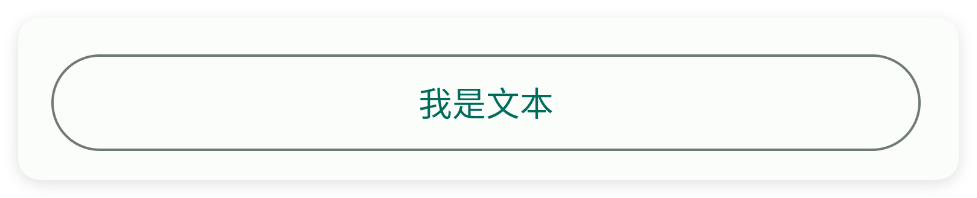
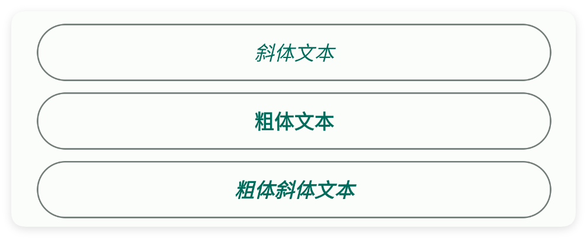
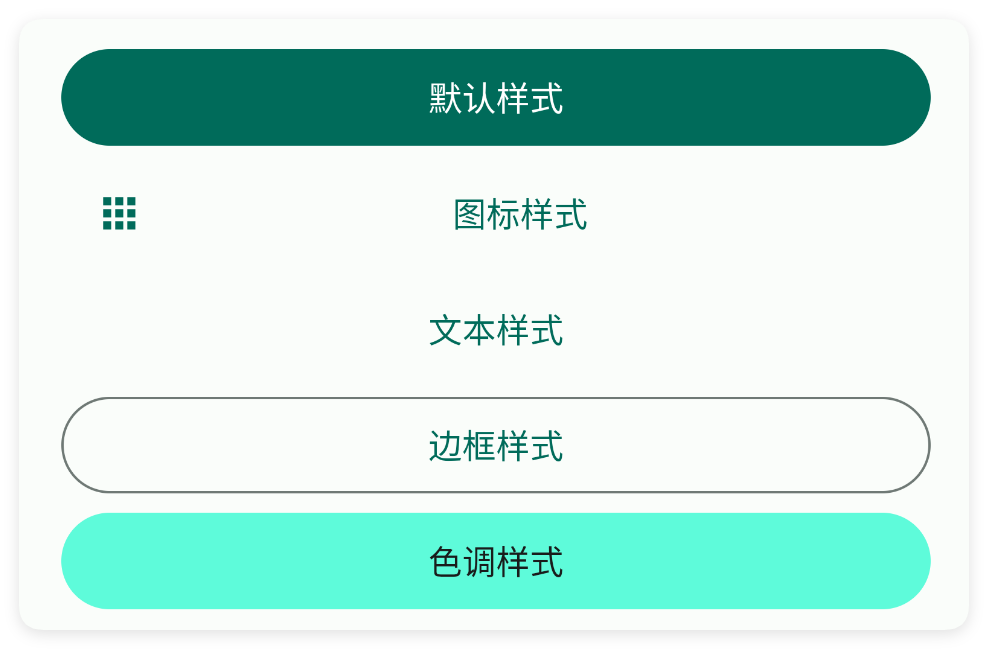
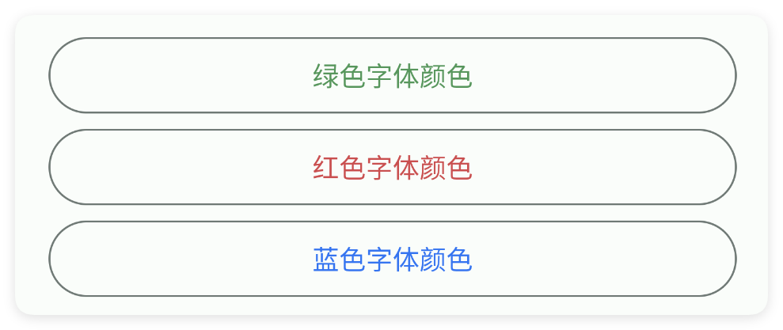
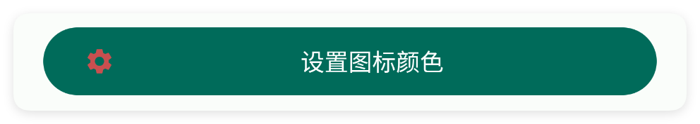
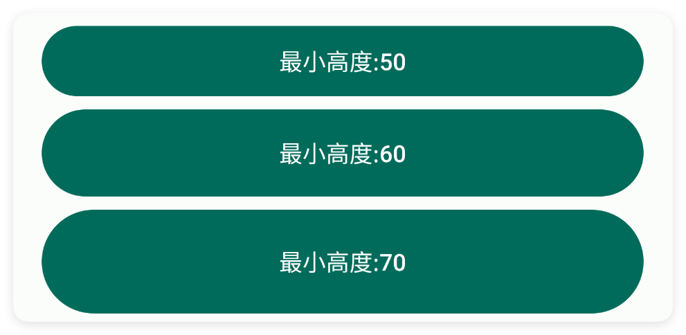
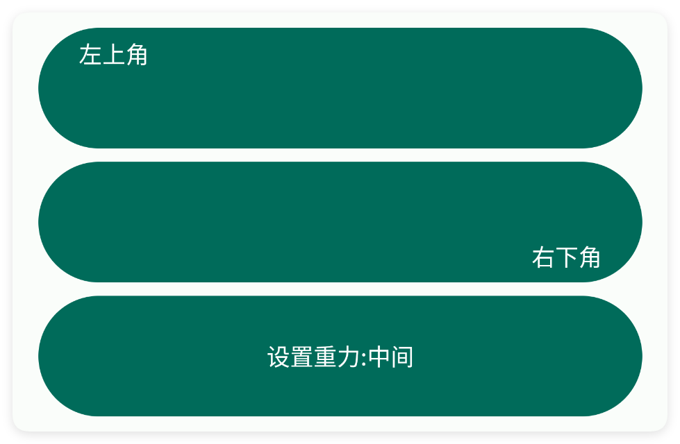

# 按钮

- 更新时间:2026-10-22 10:58:39

> 按钮-button
> 
> 按钮控件{XButton}是属于{XView}的子控件，因此{XView}中的所有方法，按钮控件都可以调用。


<div style="width: 100%; position: relative; padding-bottom: 56.25%; height: 0; overflow: hidden;">
  <iframe 
    src="//player.bilibili.com/player.html?isOutside=true&aid=116222184199618&bvid=BV1hEwJzfEBW&cid=36675257325&p=1" 
    style="position: absolute; top: 0; left: 0; width: 100%; height: 100%; border: none;"
    scrolling="no" 
    frameborder="no" 
    allowfullscreen="true">
  </iframe>
</div>

按钮是界面的最简单的元素，一般用于点击操作。


#### 示例：基础使用

其实按钮本身是没有点击事件的，由于它继承了父类{XView}，因此可以调用其父类中的函数来实现点击操作。

事实上，所有的组件都是继承自{XView}的，因此都可以调用{XView}中的方法。


```html
// 将布局写成字符串，无需另建 ui.xml 文件。
var 布局内容 = `
<界面>
    <状态条 />
    <按钮 标识="我的按钮" 文本="点击我试试" />
</界面>
`;
var 界面 = $界面.解析布局(布局内容);
界面.显示(); // 显示界面，后面的事件示例继续使用这个对象。
```

```html
// 接着上一段执行，继续使用已创建的界面对象。
//找到界面中的元素并且实现点击事件
界面.找控件("我的按钮").点击事件(function() {
    信息("我被点击了");
});
```


## 二、常用属性


### 文本 - 文本

> 设置文本


```html
// 用字符串保存布局；其中的属性就是本节演示的设置。
var 布局内容 = `
<界面>
    <状态条 />
    <按钮 宽="最大" 文本="我是文本" 风格="轮廓" />
</界面>
`;
var 界面 = $界面.解析布局(布局内容); // 解析布局并创建控件。
界面.显示(); // 显示界面，观察属性效果。
```




### 字体 - 字体

> 设置字体


```html
// 用字符串保存布局；其中的属性就是本节演示的设置。
var 布局内容 = `
<界面>
    <状态条 />
    <按钮 字体="斜体" 宽="最大" 文本="斜体文本" 风格="轮廓" />
    <按钮 字体="粗体" 宽="最大" 文本="粗体文本" 风格="轮廓" />
    <按钮 字体="粗体斜体" 宽="最大" 文本="粗体斜体文本" 风格="轮廓" />
</界面>
`;
var 界面 = $界面.解析布局(布局内容); // 解析布局并创建控件。
界面.显示(); // 显示界面，观察属性效果。
```




### 风格 - 样式

> 设置样式
> 
> 可选值有："文本(或文字)","轮廓(或者边框)","色调","图标"


```html
// 用字符串保存布局；其中的属性就是本节演示的设置。
var 布局内容 = `
<界面>
    <状态条 />
    <按钮 宽="最大" 文本="默认样式" />
    <按钮 宽="最大" 文本="图标样式" 风格="图标" />
    <按钮 宽="最大" 文本="文本样式" 风格="文本" />
    <按钮 宽="最大" 文本="边框样式" 风格="轮廓" />
    <按钮 宽="最大" 文本="色调样式" 风格="色调" />
</界面>
`;
var 界面 = $界面.解析布局(布局内容); // 解析布局并创建控件。
界面.显示(); // 显示界面，观察属性效果。
```




### 主题颜色 - 主题颜色

> 设置主题颜色


```html
// 用字符串保存布局；其中的属性就是本节演示的设置。
var 布局内容 = `
<界面>
    <状态条 />
    <按钮 宽="最大" 文本="绿色主题颜色" 主题颜色="#57965C" />
    <按钮 宽="最大" 文本="红色主题颜色" 主题颜色="#C94F4F" />
    <按钮 宽="最大" 文本="蓝色主题颜色" 主题颜色="#3574F0" />
</界面>
`;
var 界面 = $界面.解析布局(布局内容); // 解析布局并创建控件。
界面.显示(); // 显示界面，观察属性效果。
```


### 文本颜色 - 文本颜色

> 设置文本颜色


```html
// 用字符串保存布局；其中的属性就是本节演示的设置。
var 布局内容 = `
<界面>
    <状态条 />
    <按钮 宽="最大" 文本="绿色字体颜色" 文本颜色="#57965C" 风格="轮廓" />
    <按钮 宽="最大" 文本="红色字体颜色" 文本颜色="#C94F4F" 风格="轮廓" />
    <按钮 宽="最大" 文本="蓝色字体颜色" 文本颜色="#3574F0" 风格="轮廓" />
</界面>
`;
var 界面 = $界面.解析布局(布局内容); // 解析布局并创建控件。
界面.显示(); // 显示界面，观察属性效果。
```




### 涟漪颜色 - 涟漪颜色

> 设置涟漪颜色


```html
// 用字符串保存布局；其中的属性就是本节演示的设置。
var 布局内容 = `
<界面>
    <状态条 />
    <按钮 宽="最大" 文本="绿色涟漪颜色" 涟漪颜色="#57965C" 风格="轮廓" />
    <按钮 宽="最大" 文本="红色涟漪颜色" 涟漪颜色="#C94F4F" 风格="轮廓" />
    <按钮 宽="最大" 文本="蓝色涟漪颜色" 涟漪颜色="#3574F0" 风格="轮廓" />
</界面>
`;
var 界面 = $界面.解析布局(布局内容); // 解析布局并创建控件。
界面.显示(); // 显示界面，观察属性效果。
```


### 弧度 - 弧度

> 设置弧度


```html
// 用字符串保存布局；其中的属性就是本节演示的设置。
var 布局内容 = `
<界面>
    <状态条 />
    <按钮 宽="最大" 弧度="5" 文本="弧度:5" 风格="轮廓" />
    <按钮 宽="最大" 弧度="10" 文本="弧度:10" 风格="轮廓" />
    <按钮 宽="最大" 弧度="15" 文本="弧度:15" 风格="轮廓" />
</界面>
`;
var 界面 = $界面.解析布局(布局内容); // 解析布局并创建控件。
界面.显示(); // 显示界面，观察属性效果。
```


### 文本尺寸 - 文本尺寸

> 设置文本尺寸


```html
// 用字符串保存布局；其中的属性就是本节演示的设置。
var 布局内容 = `
<界面>
    <状态条 />
    <按钮 宽="最大" 文本="文本尺寸:10" 文本尺寸="10" 风格="轮廓" />
    <按钮 宽="最大" 文本="文本尺寸:13" 文本尺寸="13" 风格="轮廓" />
    <按钮 宽="最大" 文本="文本尺寸:16" 文本尺寸="16" 风格="轮廓" />
</界面>
`;
var 界面 = $界面.解析布局(布局内容); // 解析布局并创建控件。
界面.显示(); // 显示界面，观察属性效果。
```


### 图标 - 图标

> 设置图标
> 
> icon/图标：用于指定图标，可以填写图标库的名称，也可以填写图标的相对路径或者绝对路径


```html
// 用字符串保存布局；其中的属性就是本节演示的设置。
var 布局内容 = `
<界面>
    <状态条 />
    <按钮 图标="ic_settings_fill" 宽="最大" 文本="设置图标" />
</界面>
`;
var 界面 = $界面.解析布局(布局内容); // 解析布局并创建控件。
界面.显示(); // 显示界面，观察属性效果。
```


### 图标颜色 - 图标颜色

> 设置图标颜色


```html
// 用字符串保存布局；其中的属性就是本节演示的设置。
var 布局内容 = `
<界面>
    <状态条 />
    <按钮 图标="ic_settings_fill" 图标颜色="#C94F4F" 宽="最大" 文本="设置图标颜色" />
</界面>
`;
var 界面 = $界面.解析布局(布局内容); // 解析布局并创建控件。
界面.显示(); // 显示界面，观察属性效果。
```




### 图标尺寸 - 图标尺寸

> 设置图标尺寸


```html
// 用字符串保存布局；其中的属性就是本节演示的设置。
var 布局内容 = `
<界面>
    <状态条 />
    <按钮 图标="ic_settings_fill" 图标尺寸="18" 宽="最大" 文本="设置图标尺寸:10" />
    <按钮 图标="ic_settings_fill" 图标尺寸="20" 宽="最大" 文本="设置图标尺寸:20" />
    <按钮 图标="ic_settings_fill" 图标尺寸="30" 宽="最大" 文本="设置图标尺寸:30" />
</界面>
`;
var 界面 = $界面.解析布局(布局内容); // 解析布局并创建控件。
界面.显示(); // 显示界面，观察属性效果。
```


### 图标重力 - 图标重力

> 设置图标重力


```html
// 用字符串保存布局；其中的属性就是本节演示的设置。
var 布局内容 = `
<界面>
    <状态条 />
    <按钮 图标="ic_settings_fill" 图标重力="开始" 宽="最大" 文本="设置图标重力:开始" />
    <按钮 图标="ic_settings_fill" 图标重力="结束" 宽="最大" 文本="设置图标重力:结束" />
    <按钮 h="70" 图标="ic_settings_fill" 图标重力="上" 宽="最大"
        文本="设置图标重力:上方" />
</界面>
`;
var 界面 = $界面.解析布局(布局内容); // 解析布局并创建控件。
界面.显示(); // 显示界面，观察属性效果。
```


### 图标内边距 - 图标内边距

> 设置图标内边距


```html
// 用字符串保存布局；其中的属性就是本节演示的设置。
var 布局内容 = `
<界面>
    <状态条 />
    <按钮 图标="ic_settings_fill" 图标内边距="20" 宽="最大" 文本="设置图标内边距:20"
        重力="开始|中间" />
    <按钮 图标="ic_settings_fill" 图标内边距="30" 宽="最大" 文本="设置图标内边距:30"
        重力="开始|中间" />
    <按钮 图标="ic_settings_fill" 图标内边距="40" 宽="最大" 文本="设置图标内边距:40"
        重力="开始|中间" />
</界面>
`;
var 界面 = $界面.解析布局(布局内容); // 解析布局并创建控件。
界面.显示(); // 显示界面，观察属性效果。
```


### 最小宽度 - 最小宽度

> 设置最小宽度
> 
> 单位:dp


```html
// 用字符串保存布局；其中的属性就是本节演示的设置。
var 布局内容 = `
<界面>
    <状态条 />
    <按钮 文本="最小宽度:180" 最小宽度="180" />
    <按钮 文本="最小宽度:200" 最小宽度="200" />
    <按钮 文本="最小宽度:220" 最小宽度="220" />
</界面>
`;
var 界面 = $界面.解析布局(布局内容); // 解析布局并创建控件。
界面.显示(); // 显示界面，观察属性效果。
```


### 最小高度 - 最小高度

> 设置最小高度
> 
> 单位:dp


```html
// 用字符串保存布局；其中的属性就是本节演示的设置。
var 布局内容 = `
<界面>
    <状态条 />
    <按钮 宽="最大" 文本="最小高度:50" 最小高度="50" />
    <按钮 宽="最大" 文本="最小高度:60" 最小高度="60" />
    <按钮 宽="最大" 文本="最小高度:70" 最小高度="70" />
</界面>
`;
var 界面 = $界面.解析布局(布局内容); // 解析布局并创建控件。
界面.显示(); // 显示界面，观察属性效果。
```




### 内边距 - 内边距

> 设置内边距


```html
// 用字符串保存布局；其中的属性就是本节演示的设置。
var 布局内容 = `
<界面>
    <状态条 />
    <按钮 内边距="10" 宽="最大" 文本="内边距:10" />
    <按钮 内边距="20,10" 宽="最大" 文本="内边距:20,10" />
    <按钮 内边距="10,10,10,20" 宽="最大" 文本="内边距:10,10,10,20" />
</界面>
`;
var 界面 = $界面.解析布局(布局内容); // 解析布局并创建控件。
界面.显示(); // 显示界面，观察属性效果。
```


### 重力 - 重力

> 设置重力


```html
// 用字符串保存布局；其中的属性就是本节演示的设置。
var 布局内容 = `
<界面>
    <状态条 />
    <按钮 宽="最大" 文本="左上角" 最小高度="80" 重力="开始" />
    <按钮 宽="最大" 文本="右下角" 最小高度="80" 重力="结束|下" />
    <按钮 宽="最大" 文本="设置重力:中间" 最小高度="80" 重力="中间" />
</界面>
`;
var 界面 = $界面.解析布局(布局内容); // 解析布局并创建控件。
界面.显示(); // 显示界面，观察属性效果。
```




### 背景颜色 - 背景颜色

> 设置背景颜色


```html
// 用字符串保存布局；其中的属性就是本节演示的设置。
var 布局内容 = `
<界面>
    <状态条 />
    <按钮 宽="最大" 文本="绿色背景" 背景颜色="#57965C" />
    <按钮 宽="最大" 文本="红色背景" 背景颜色="#C94F4F" />
    <按钮 宽="最大" 文本="蓝色背景" 背景颜色="#3574F0" />
</界面>
`;
var 界面 = $界面.解析布局(布局内容); // 解析布局并创建控件。
界面.显示(); // 显示界面，观察属性效果。
```


### 背景图片 - 背景图片

> 设置背景图片


```html
// 用字符串保存布局；其中的属性就是本节演示的设置。
var 布局内容 = `
<界面>
    <状态条 />
    <按钮 宽="最大" 文本="我是按钮"
        背景图片="example/$ui - 交互界面/02.button-按钮/img/button_bg.png" />
</界面>
`;
var 界面 = $界面.解析布局(布局内容); // 解析布局并创建控件。
界面.显示(); // 显示界面，观察属性效果。
```


## 三、常用函数


### 设置重力(重力)

> 设置重力

- 参数 : 重力 {String} 例如:"中|下"


```javascript
//解析布局,获得界面对象
var 界面 = $ui.解析布局("./资源/主界面.xml");
//获得控件
var 按钮 = 界面.找控件("我的按钮");
//设置重力
按钮.设置重力("中|下");
```


### 设置字体(字体)

> 设置字体

- 参数 : 字体 {int} 字体类型(使用$界面中的常量,例如:$界面.加粗)


```javascript
//解析布局,获得界面对象
var 界面 = $ui.解析布局("./资源/主界面.xml");
//获得控件
var 按钮 = 界面.找控件("我的按钮");
//设置字体
按钮.设置字体($ui.加粗);//常用值：$界面.正常,$界面.斜体,$界面.加粗,$界面.加粗斜体
```


### 设置主题颜色(颜色值)

> 设置按钮背景着色
> 
> 由于打包后的apk可以选则不同的主题，那么我们就需要根据所选择的主题动态的获取颜色，详细请参考$颜色($color)的文档

- 参数 : 颜色值 Android ARGB 颜色整数


```javascript
//解析布局,获得ui对象
var 界面 = $ui.解析布局("./资源/主界面.xml");
//获得控件
var 按钮 = 界面.找控件("我的按钮");
//设置红色
按钮.设置主题颜色($颜色.红色);
//设置成主题的颜色(具体颜色请参考$颜色文档)
//按钮.设置主题颜色($颜色.解析("主题主颜色"));
```


### 设置主题颜色(颜色值)

> 设置按钮背景着色；支持颜色名、主题颜色名和十六进制颜色值

- 参数 : 颜色值 颜色名、主题颜色名或十六进制颜色值


```javascript
//解析布局,获得ui对象
var 界面 = $ui.解析布局("./资源/主界面.xml");
//获得控件
var 按钮 = 界面.找控件("我的按钮");
//设置红色
按钮.设置主题颜色("#FF0000");
```


### 设置文本(文本)

> 设置文本

- 参数 : 文本 {string} 文本


```javascript
//解析布局,获得ui对象
var 界面 = $ui.解析布局("./资源/主界面.xml");
//获得控件
var 按钮 = 界面.找控件("我的按钮");
//设置文字
按钮.设置文本("我是新的");
```


### 获取文本()

> 获得文本

- 返回 : 按钮当前文本；文本为空时返回空字符串


```javascript
//解析布局,获得ui对象
var 界面 = $ui.解析布局("./资源/主界面.xml");
//获得控件
var 按钮 = 界面.找控件("我的按钮");
//获得文字
var 文字 = 按钮.获取文本();
```


### 设置文本颜色(颜色)

> 设置文本颜色

- 参数 : 颜色 {string} 颜色


```javascript
//解析布局,获得ui对象
var 界面 = $ui.解析布局("./资源/主界面.xml");
//获得控件
var 按钮 = 界面.找控件("我的按钮");
//设置文本颜色
按钮.设置文本颜色("#FF0000");
```


### 设置文本颜色(颜色)

> 设置文本颜色

- 参数 : 颜色 {int} ARGB颜色值，例如 0xFFFF0000 表示红色


```javascript
//解析布局,获得ui对象
var 界面 = $ui.解析布局("./资源/主界面.xml");
//获得控件
var 按钮 = 界面.找控件("我的按钮");
//设置文本颜色
按钮.设置文本颜色($颜色.红色);
```


### 设置涟漪颜色(颜色)

> 设置涟漪颜色

- 参数 : 颜色 {int} 颜色


```javascript
//解析布局,获得ui对象
var 界面 = $ui.解析布局("./资源/主界面.xml");
//获得控件
var 按钮 = 界面.找控件("我的按钮");
//设置涟漪颜色
按钮.设置涟漪颜色($颜色.红色);
```


### 设置涟漪颜色(颜色)

> 设置涟漪颜色

- 参数 : 颜色 {string} 颜色


```javascript
//解析布局,获得ui对象
var 界面 = $ui.解析布局("./资源/主界面.xml");
//获得控件
var 按钮 = 界面.找控件("我的按钮");
//设置涟漪颜色
按钮.设置涟漪颜色("#FF0000");
```


### 设置弧度(弧度)

> 设置弧度

- 参数 : 弧度 {int} 弧度


```javascript
//解析布局,获得ui对象
var 界面 = $ui.解析布局("./资源/主界面.xml");
//获得控件
var 按钮 = 界面.找控件("我的按钮");
//设置弧度
按钮.设置弧度(13);
```


### 设置文本尺寸(尺寸)

> 设置文本尺寸

- 参数 : 尺寸 {float} 尺寸


```javascript
//解析布局,获得ui对象
var 界面 = $ui.解析布局("./资源/主界面.xml");
//获得控件
var 按钮 = 界面.找控件("我的按钮");
//设置文本尺寸
按钮.设置文本尺寸(13);
```


### 设置图标(图标)

> 设置图标

- 参数 : 图标 {string} 图标名称


```javascript
//解析布局,获得ui对象
var 界面 = $ui.解析布局("./资源/主界面.xml");
//获得控件
var 按钮 = 界面.找控件("我的按钮");
//设置图标
按钮.设置图标("logo_ag");
```


### 设置图标颜色(颜色)

> 设置图标颜色

- 参数 : 颜色 {int} 颜色


```javascript
//解析布局,获得ui对象
var 界面 = $ui.解析布局("./资源/主界面.xml");
//获得控件
var 按钮 = 界面.找控件("我的按钮");
//设置图标颜色
按钮.设置图标颜色($颜色.红色);
```


### 设置图标颜色(颜色)

> 设置图标颜色

- 参数 : 颜色 {string} 颜色


```javascript
//解析布局,获得ui对象
var 界面 = $ui.解析布局("./资源/主界面.xml");
//获得控件
var 按钮 = 界面.找控件("我的按钮");
//设置图标颜色
按钮.设置图标颜色("#FF0000");
```


### 设置图标尺寸(尺寸)

> 设置图标尺寸

- 参数 : 尺寸 {int} 尺寸


```javascript
//解析布局,获得ui对象
var 界面 = $ui.解析布局("./资源/主界面.xml");
//获得控件
var 按钮 = 界面.找控件("我的按钮");
//设置图标尺寸
按钮.设置图标尺寸(15);
```


### 设置图标内边距(内边距)

> 设置图标内边距

- 参数 : 内边距 {int} 内边距


```javascript
//解析布局,获得ui对象
var 界面 = $ui.解析布局("./资源/主界面.xml");
//获得控件
var 按钮 = 界面.找控件("我的按钮");
//设置图标内边距
按钮.设置图标内边距(15);
```


### 设置图标重力(重力)

> 设置图标重力
> 
> 可选值:上方(上|top)、左(开始|start|left)、右(结束|end|right)

- 参数 : 重力 {字符串} 重力


```javascript
//解析布局,获得ui对象
var 界面 = $ui.解析布局("./资源/主界面.xml");
//获得控件
var 按钮 = 界面.找控件("我的按钮");
//设置图标
按钮.设置图标("logo");
//设置图标重力
按钮.设置图标重力("上方");
```


