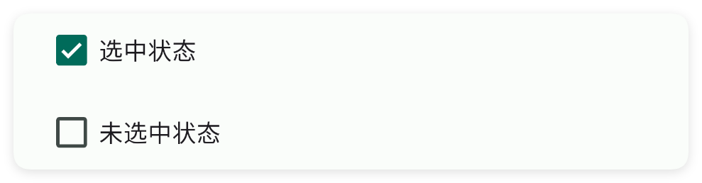
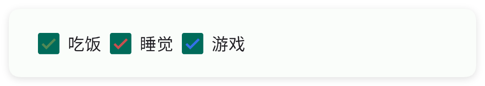
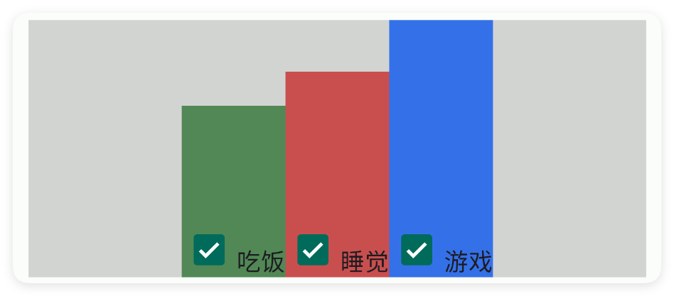

# 多选框

- 更新时间:2026-10-22 10:58:40

> 多选框-check
> 
> 原生类型:{com.google.android.material.checkbox.MaterialCheckBox}
> 
> 多选框控件{XCheck}是属于{XView}的子控件，因此{XView}中的所有方法，多选框控件都可以调用。


<div style="width: 100%; position: relative; padding-bottom: 56.25%; height: 0; overflow: hidden;">
  <iframe 
    src="//player.bilibili.com/player.html?isOutside=true&aid=116222184136428&bvid=BV1gEwJzfEBN&cid=36675258096&p=1" 
    style="position: absolute; top: 0; left: 0; width: 100%; height: 100%; border: none;"
    scrolling="no" 
    frameborder="no" 
    allowfullscreen="true">
  </iframe>
</div>

多选框一般用于：用户同意、配置多种选择、筛选数据等场景。


#### 示例:基础用法


```html
// 将布局写成字符串，无需另建 ui.xml 文件。
var 布局内容 = `
<界面>
    <状态条 />
    <线性布局 宽="最大" 方向="横向" 重力="中间">
        <多选框 标识="我的多选框" 文本="同意协议"/>
    </线性布局>
</界面>
`;
var 界面 = $界面.解析布局(布局内容);
界面.显示(); // 显示界面，后面的事件示例继续使用这个对象。
```

```javascript
// 接着上一段执行，继续使用已创建的界面对象。
//找到界面中的元素并且实现点击事件
界面.找控件("我的多选框").监听选中(function(选中了,原生对象) {
    if (选中了){
        信息("我被选中了");
    } else {
        信息("没有被选中");
    }
});
```


## 二、常用属性


### 文本 - 文本

> 设置文本


```html
// 用字符串保存布局；其中的属性就是本节演示的设置。
var 布局内容 = `
<界面>
    <状态条 />
    <多选框 文本="我是文本" />
</界面>
`;
var 界面 = $界面.解析布局(布局内容); // 解析布局并创建控件。
界面.显示(); // 显示界面，观察属性效果。
```


### 选中 - 选中

> 设置选中


```html
// 用字符串保存布局；其中的属性就是本节演示的设置。
var 布局内容 = `
<界面>
    <状态条 />
    <多选框 文本="选中状态" 选中="是" />
    <多选框 文本="未选中状态" 选中="否" />
</界面>
`;
var 界面 = $界面.解析布局(布局内容); // 解析布局并创建控件。
界面.显示(); // 显示界面，观察属性效果。
```




### 主题颜色 - 主题颜色

> 设置主题颜色


```html
// 用字符串保存布局；其中的属性就是本节演示的设置。
var 布局内容 = `
<界面>
    <状态条 />
    <线性布局 宽="最大" 方向="横向">
        <多选框 主题颜色="#518855" 文本="吃饭" 选中="是" />
        <多选框 主题颜色="#C94F4F" 文本="睡觉" 选中="是" />
        <多选框 主题颜色="#3471E9" 文本="游戏" 选中="是" />
    </线性布局>
</界面>
`;
var 界面 = $界面.解析布局(布局内容); // 解析布局并创建控件。
界面.显示(); // 显示界面，观察属性效果。
```


### 按钮颜色 - 按钮颜色

> 设置按钮颜色


```html
// 用字符串保存布局；其中的属性就是本节演示的设置。
var 布局内容 = `
<界面>
    <状态条 />
    <线性布局 宽="最大" 方向="横向">
        <多选框 按钮颜色="#518855" 文本="吃饭" 选中="是" />
        <多选框 按钮颜色="#C94F4F" 文本="睡觉" 选中="是" />
        <多选框 按钮颜色="#3471E9" 文本="游戏" 选中="是" />
    </线性布局>
</界面>
`;
var 界面 = $界面.解析布局(布局内容); // 解析布局并创建控件。
界面.显示(); // 显示界面，观察属性效果。
```




### 文本颜色 - 文本颜色

> 设置文本颜色


```html
// 用字符串保存布局；其中的属性就是本节演示的设置。
var 布局内容 = `
<界面>
    <状态条 />
    <线性布局 宽="最大" 方向="横向">
        <多选框 文本="吃饭" 文本颜色="#518855" 选中="是" />
        <多选框 文本="睡觉" 文本颜色="#C94F4F" 选中="是" />
        <多选框 文本="游戏" 文本颜色="#3471E9" 选中="是" />
    </线性布局>
</界面>
`;
var 界面 = $界面.解析布局(布局内容); // 解析布局并创建控件。
界面.显示(); // 显示界面，观察属性效果。
```


### 最小宽度 - 最小宽度

> 设置最小宽度
> 
> 单位:dp


```html
// 用字符串保存布局；其中的属性就是本节演示的设置。
var 布局内容 = `
<界面>
    <状态条 />
    <线性布局 dir="v" 宽="最大" 背景颜色="#55808080">
        <多选框 文本="吃饭" 最小宽度="100" 背景颜色="#518855" 选中="是" />
        <多选框 文本="睡觉" 最小宽度="120" 背景颜色="#C94F4F" 选中="是" />
        <多选框 文本="游戏" 最小宽度="150" 背景颜色="#3471E9" 选中="是" />
    </线性布局>
</界面>
`;
var 界面 = $界面.解析布局(布局内容); // 解析布局并创建控件。
界面.显示(); // 显示界面，观察属性效果。
```


### 最小高度 - 最小高度

> 设置最小高度
> 
> 单位:dp


```html
// 用字符串保存布局；其中的属性就是本节演示的设置。
var 布局内容 = `
<界面>
    <状态条 />
    <线性布局 宽="最大" 方向="横向" 背景颜色="#55808080" 重力="中间|下">
        <多选框 文本="吃饭" 最小高度="100" 背景颜色="#518855" 选中="是" 重力="下" />
        <多选框 文本="睡觉" 最小高度="120" 背景颜色="#C94F4F" 选中="是" 重力="下" />
        <多选框 文本="游戏" 最小高度="150" 背景颜色="#3471E9" 选中="是" 重力="下" />
    </线性布局>
</界面>
`;
var 界面 = $界面.解析布局(布局内容); // 解析布局并创建控件。
界面.显示(); // 显示界面，观察属性效果。
```




### 内边距 - 内边距

> 设置内边距
> 
> 单位:dp 顺序:左、上、右、下


```html
// 用字符串保存布局；其中的属性就是本节演示的设置。
var 布局内容 = `
<界面>
    <状态条 />
    <线性布局 宽="最大" 方向="横向" 背景颜色="#55808080">
        <多选框 内边距="10" 文本="吃饭" 背景颜色="#518855" 选中="是" />
        <多选框 内边距="20" 文本="睡觉" 背景颜色="#C94F4F" 选中="是" />
        <多选框 内边距="40" 文本="游戏" 背景颜色="#3471E9" 选中="是" />
    </线性布局>
</界面>
`;
var 界面 = $界面.解析布局(布局内容); // 解析布局并创建控件。
界面.显示(); // 显示界面，观察属性效果。
```


### 重力 - 重力

> 设置重力


```html
// 用字符串保存布局；其中的属性就是本节演示的设置。
var 布局内容 = `
<界面>
    <状态条 />
    <多选框 宽="最大" 文本="吃饭" 选中="是" 重力="开始" />
    <多选框 宽="最大" 文本="睡觉" 选中="是" 重力="中间" />
    <多选框 宽="最大" 文本="游戏" 选中="是" 重力="结束" />
</界面>
`;
var 界面 = $界面.解析布局(布局内容); // 解析布局并创建控件。
界面.显示(); // 显示界面，观察属性效果。
```


### 背景颜色 - 背景颜色

> 设置背景颜色


```html
// 用字符串保存布局；其中的属性就是本节演示的设置。
var 布局内容 = `
<界面>
    <状态条 />
    <线性布局 宽="最大" 方向="横向" 背景颜色="#55808080">
        <多选框 文本="吃饭" 背景颜色="#518855" 选中="是" />
        <多选框 文本="睡觉" 背景颜色="#C94F4F" 选中="是" />
        <多选框 文本="游戏" 背景颜色="#3471E9" 选中="是" />
    </线性布局>
</界面>
`;
var 界面 = $界面.解析布局(布局内容); // 解析布局并创建控件。
界面.显示(); // 显示界面，观察属性效果。
```


### 背景图片 - 背景图片

> 设置背景图片


```html
// 用字符串保存布局；其中的属性就是本节演示的设置。
var 布局内容 = `
<界面>
    <状态条 />
    <多选框 外边距="3" 宽="最大"
        文本="吃饭" 文本颜色="bg" 背景图片="example/$ui - 交互界面/03.check-复选框/img/bg01.png" 选中="是" />
    <多选框 外边距="3" 宽="最大"
        文本="游戏" 文本颜色="bg" 背景图片="example/$ui - 交互界面/03.check-复选框/img/bg02.png" 选中="是" />
    <多选框 外边距="3" 宽="最大"
        文本="睡觉" 文本颜色="bg" 背景图片="example/$ui - 交互界面/03.check-复选框/img/bg03.png" 选中="是" />
</界面>
`;
var 界面 = $界面.解析布局(布局内容); // 解析布局并创建控件。
界面.显示(); // 显示界面，观察属性效果。
```


### 存储关键字 - 应用内存储

> 应用内存储
> 
> 通过storeKey(存储关键字)指定一个存储布尔值的关键字，获取值时可以直接通过$storage($存储)获取布尔值。
> 
> 注意：不同的控件存储的类型不同，对于本控件(复选框)则存储的是布尔值类型，表达当前是否被勾选


```html
// 将布局写成字符串，无需另建 ui.xml 文件。
var 布局内容 =
    "<!-- 你必须在ui(界面)节点中通过store(存储)指定$storage($存储)的命名空间，等价于使用代码：var storage = $storage.create(\"MyAppCheck\"); -->\n" +
    "<界面 存储=\"MyAppCheck\">\n" +
    "    <状态条 />\n" +
    "    <!-- 使用storeKey(存储关键字)属性，指定关键字，等价于使用代码：var data = $storage.create(\"MyAppCheck\").getBool(\"eatFood\"); -->\n" +
    "    <!-- 使用storeDef(存储默认值)属性，指定默认值，等价于使用代码：var data = $storage.create(\"MyAppCheck\").getBool(\"eatFood\",true); -->\n" +
    "    <多选框 存储关键字=\"eatFood\" 存储默认值=\"true\" 宽=\"最大\" 文本=\"吃饭\" />\n" +
    "    <多选框 存储关键字=\"playGame\" 宽=\"最大\" 文本=\"游戏\" />\n" +
    "</界面>";
var 界面 = $界面.解析布局(布局内容);
界面.显示(); // 显示界面，后面的事件示例继续使用这个对象。
```


如果我们已经配置好了应用内存储，则可以直接获取数据：

注意：一、要使用应用内存储，必须在ui(界面)节点指定属性store(存储)的值，该值指定存储的命名空间；
二、不是所有的控件都支持应用内存储；
三、不同的控件存储的数据类型可能都不一致，例如：输入类型的控件存储的是字符串类型，开关、多选框存储的就是布尔类型的数据。


```javascript
//创建(或者加载)存储对象
var storage = $storage.create("MyAppCheck");//名称要一致
//获取数据
var data = storage.getBoolean("playGame",false);//数据类型是布尔值
```


## 三、常用函数


### 监听选中(回调)

> “监听选中”是 onCheck 的中文名字，作用完全一样：注册一个回调函数，
> 当用户勾选或取消勾选这个多选框时自动触发。
> 
> 如果你习惯用中文写脚本，就用这个名字；效果和 onCheck 一模一样。

- 参数 : 回调 {function(isChecked, view)} 回调函数；isChecked 为 true 表示勾选、false 表示取消勾选


```javascript
//先用一段 XML 创建界面，里面放一个带 id 的多选框
var ui = $ui.layout('<ui><statusbar/><check id="mCheck" text="同意协议"/></ui>');
ui.show(); //把界面显示出来
var mCheck = ui.id("mCheck"); //根据 id 拿到这个多选框控件
//注册监听：勾选状态一变就自动执行下面的函数
mCheck.监听选中(function(isChecked, view) {
    if (isChecked) { //true 表示现在被勾选了
        ui.toast("勾选成功");
    } else { //false 表示取消勾选了
        ui.toast("已取消勾选");
    }
});
```


### 是选中的()

> “是选中的”是 isChecked 的中文名字，作用完全一样：读取这个多选框现在有没有被勾上。
> 
> 返回 true 表示勾选，返回 false 表示没勾选。

- 返回 : {boolean} true 表示已勾选，false 表示未勾选


```javascript
//先用一段 XML 创建界面，里面放一个带 id 的多选框
var ui = $ui.layout('<ui><statusbar/><check id="mCheck" text="同意协议"/></ui>');
ui.show(); //把界面显示出来
var mCheck = ui.id("mCheck"); //根据 id 拿到这个多选框控件
var 是否勾选 = mCheck.是选中的(); //读取当前勾选状态
ui.toast("现在勾选状态是：" + 是否勾选); //弹出 true 或 false
```


### 设置选中(状态)

> “设置选中”是 check(true/false) 的中文名字，作用完全一样：用代码主动勾选或取消勾选。
> 
> 传 true 勾上，传 false 取消勾选。

- 参数 : 状态 {boolean} true（是）表示勾选，false（否）表示取消勾选


```javascript
//先用一段 XML 创建界面，里面放一个带 id 的多选框
var ui = $ui.layout('<ui><statusbar/><check id="mCheck" text="同意协议"/></ui>');
ui.show(); //把界面显示出来
var mCheck = ui.id("mCheck"); //根据 id 拿到这个多选框控件
mCheck.设置选中(true); //用代码把它勾上
```


### 设置重力(重力)

> “设置重力”是 setGravity 的中文名字，作用完全一样：
> 决定小方框和文字在多选框内部靠左、靠右还是居中。

- 参数 : 重力 {String} 对齐方式，例如 "中"、"左"、"右"、"中|下"


```javascript
//先用一段 XML 创建界面，里面放一个占满宽度的多选框
var ui = $ui.layout('<ui><statusbar/><check id="mCheck" text="靠左显示" w="max"/></ui>');
ui.show(); //把界面显示出来
var mCheck = ui.id("mCheck"); //根据 id 拿到这个多选框控件
mCheck.设置重力("中|下"); //水平居中、垂直靠下
```


### 设置文本(文本)

> “设置文本”是 setText 的中文名字，作用完全一样：修改多选框旁边显示的那行字。

- 参数 : 文本 {String} 要显示的新文字，例如 "我是文本"


```javascript
//先用一段 XML 创建界面，里面放一个带 id 的多选框
var ui = $ui.layout('<ui><statusbar/><check id="mCheck" text="原来的字"/></ui>');
ui.show(); //把界面显示出来
var mCheck = ui.id("mCheck"); //根据 id 拿到这个多选框控件
mCheck.设置文本("是否继续？"); //把旁边的文字改掉
```


### 获取文本()

> “获取文本”是 getText 的中文名字，作用完全一样：读出多选框旁边现在显示的那行字。
> 
> 没有文字时返回空字符串 ""。

- 返回 : {String} 多选框当前的文字；没有文字时返回空字符串 ""


```javascript
//先用一段 XML 创建界面，里面放一个带 id 的多选框
var ui = $ui.layout('<ui><statusbar/><check id="mCheck" text="同意协议"/></ui>');
ui.show(); //把界面显示出来
var mCheck = ui.id("mCheck"); //根据 id 拿到这个多选框控件
var 文本 = mCheck.获取文本(); //把旁边的文字读出来
ui.toast("文字是：" + 文本);
```


### 设置主题颜色(颜色)

> “设置主题颜色”是 setColor 的中文名字（字符串版本）：用颜色字符串改小方框的颜色。

- 参数 : 颜色 {String} 颜色字符串，例如 "#FF0000"


```javascript
//先用一段 XML 创建界面，里面放一个带 id 的多选框
var ui = $ui.layout('<ui><statusbar/><check id="mCheck" text="吃饭" check="true"/></ui>');
ui.show(); //把界面显示出来
var mCheck = ui.id("mCheck"); //根据 id 拿到这个多选框控件
mCheck.设置主题颜色("#FF0000"); //把小方框涂成红色
```


### 设置主题颜色(颜色)

> “设置主题颜色”是 setColor 的中文名字（颜色整数版本）：用 $color 预置颜色改小方框。

- 参数 : 颜色 {int} 安卓颜色整数，常用 $color.RED 等预置颜色


```javascript
//先用一段 XML 创建界面，里面放一个带 id 的多选框
var ui = $ui.layout('<ui><statusbar/><check id="mCheck" text="吃饭" check="true"/></ui>');
ui.show(); //把界面显示出来
var mCheck = ui.id("mCheck"); //根据 id 拿到这个多选框控件
mCheck.设置主题颜色($color.RED); //用预置红色给小方框上色
```


### 设置文本颜色(颜色)

> “设置文本颜色”是 setTextColor 的中文名字（字符串版本）：改旁边那行文字的颜色。

- 参数 : 颜色 {String} 颜色字符串，例如 "#FF0000"


```javascript
//先用一段 XML 创建界面，里面放一个带 id 的多选框
var ui = $ui.layout('<ui><statusbar/><check id="mCheck" text="吃饭"/></ui>');
ui.show(); //把界面显示出来
var mCheck = ui.id("mCheck"); //根据 id 拿到这个多选框控件
mCheck.设置文本颜色("#FF0000"); //把旁边的文字涂成红色
```


### 设置文本颜色(颜色)

> “设置文本颜色”是 setTextColor 的中文名字（颜色整数版本）：用 $color 预置颜色改文字颜色。

- 参数 : 颜色 {int} 安卓颜色整数，常用 $color.RED 等预置颜色


```javascript
//先用一段 XML 创建界面，里面放一个带 id 的多选框
var ui = $ui.layout('<ui><statusbar/><check id="mCheck" text="吃饭"/></ui>');
ui.show(); //把界面显示出来
var mCheck = ui.id("mCheck"); //根据 id 拿到这个多选框控件
mCheck.设置文本颜色($color.RED); //把旁边的文字涂成红色
```


### 设置背景颜色(颜色)

> “设置背景颜色”是 setBg 的中文名字（颜色整数版本）：用 $color 预置颜色改整块背景。

- 参数 : 颜色 {int} 安卓颜色整数，常用 $color.RED 等预置颜色


```javascript
//先用一段 XML 创建界面，里面放一个带 id 的多选框
var ui = $ui.layout('<ui><statusbar/><check id="mCheck" text="吃饭"/></ui>');
ui.show(); //把界面显示出来
var mCheck = ui.id("mCheck"); //根据 id 拿到这个多选框控件
mCheck.设置背景颜色($color.RED); //用预置红色把整块背景涂红
```


### 设置背景颜色(颜色)

> “设置背景颜色”是 setBg 的中文名字（字符串版本）：用颜色字符串改整块背景。

- 参数 : 颜色 {String} 颜色字符串，例如 "#FF0000"


```javascript
//先用一段 XML 创建界面，里面放一个带 id 的多选框
var ui = $ui.layout('<ui><statusbar/><check id="mCheck" text="吃饭"/></ui>');
ui.show(); //把界面显示出来
var mCheck = ui.id("mCheck"); //根据 id 拿到这个多选框控件
mCheck.设置背景颜色("#FF0000"); //把整块背景涂成红色
```


