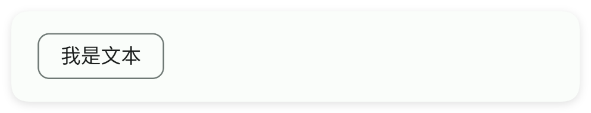
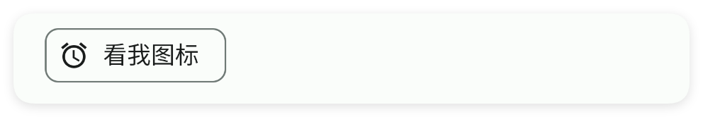
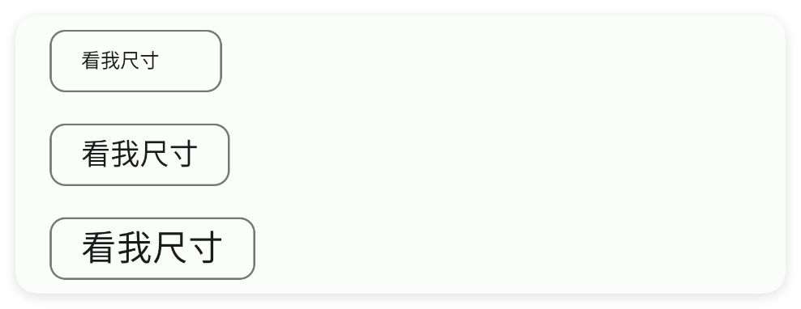
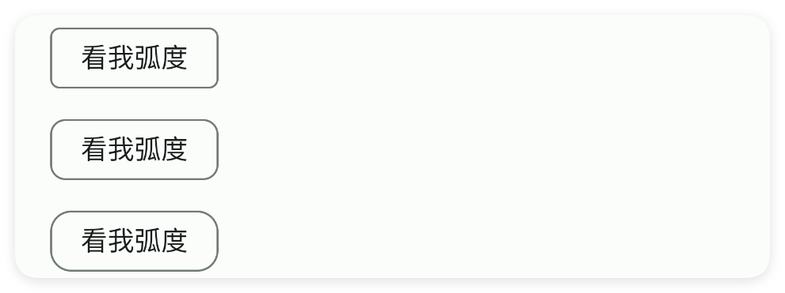
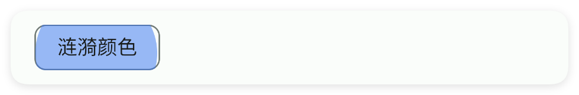
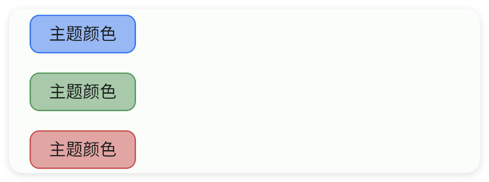
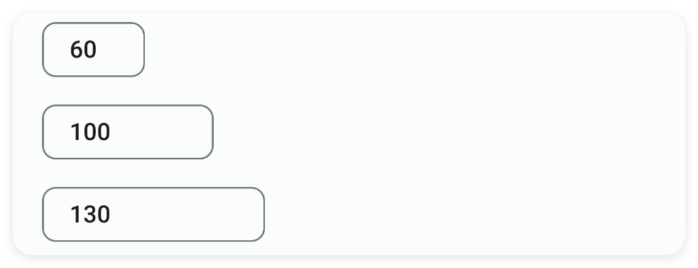

# 小片

- 更新时间:2026-10-22 10:58:40

> 小片-chip
> 
> 原生类型:{com.google.android.material.chip.Chip}
> 
> 可以当作小按钮来使用，也可以当作多选框来使用


<div style="width: 100%; position: relative; padding-bottom: 56.25%; height: 0; overflow: hidden;">
  <iframe 
    src="//player.bilibili.com/player.html?isOutside=true&aid=116224566500656&bvid=BV1UMwpzAEik&cid=36681746955&p=1" 
    style="position: absolute; top: 0; left: 0; width: 100%; height: 100%; border: none;"
    scrolling="no" 
    frameborder="no" 
    allowfullscreen="true">
  </iframe>
</div>

小片：可以用来显示一些小标签什么的，还是蛮好看的。

不过，也可以用来作为按钮使用。


## 一、常用属性


### 文本 - 文本

> 设置文本


```html
// 用字符串保存布局；其中的属性就是本节演示的设置。
var 布局内容 = `
<界面>
    <状态条 />
    <小片 文本="我是文本" />
</界面>
`;
var 界面 = $界面.解析布局(布局内容); // 解析布局并创建控件。
界面.显示(); // 显示界面，观察属性效果。
```




### 图标 - 图标

> 设置图标
> 
> icon/图标：用于指定图标，可以填写图标库的名称，也可以填写图标的相对路径或者绝对路径


```html
// 用字符串保存布局；其中的属性就是本节演示的设置。
var 布局内容 = `
<界面>
    <状态条 />
    <小片 图标="ic_access_alarms_fill" 文本="看我图标" />
</界面>
`;
var 界面 = $界面.解析布局(布局内容); // 解析布局并创建控件。
界面.显示(); // 显示界面，观察属性效果。
```




### 图标颜色 - 图标颜色

> 设置图标颜色


```html
// 用字符串保存布局；其中的属性就是本节演示的设置。
var 布局内容 = `
<界面>
    <状态条 />
    <小片 图标="ic_access_alarms_fill" 图标颜色="#57965C" 文本="看我图标颜色" />
</界面>
`;
var 界面 = $界面.解析布局(布局内容); // 解析布局并创建控件。
界面.显示(); // 显示界面，观察属性效果。
```


### 文本颜色 - 文本颜色

> 设置文本颜色


```html
// 用字符串保存布局；其中的属性就是本节演示的设置。
var 布局内容 = `
<界面>
    <状态条 />
    <小片 文本="看我颜色" 文本颜色="#C94F4F" />
</界面>
`;
var 界面 = $界面.解析布局(布局内容); // 解析布局并创建控件。
界面.显示(); // 显示界面，观察属性效果。
```


### 文本尺寸 - 文本尺寸

> 设置文本尺寸


```html
// 用字符串保存布局；其中的属性就是本节演示的设置。
var 布局内容 = `
<界面>
    <状态条 />
    <小片 文本="看我尺寸" 文本尺寸="10" />
    <小片 文本="看我尺寸" 文本尺寸="15" />
    <小片 文本="看我尺寸" 文本尺寸="18" />
</界面>
`;
var 界面 = $界面.解析布局(布局内容); // 解析布局并创建控件。
界面.显示(); // 显示界面，观察属性效果。
```




### 弧度 - 弧度

> 设置弧度


```html
// 用字符串保存布局；其中的属性就是本节演示的设置。
var 布局内容 = `
<界面>
    <状态条 />
    <小片 弧度="5" 文本="看我弧度" />
    <小片 弧度="8" 文本="看我弧度" />
    <小片 弧度="11" 文本="看我弧度" />
</界面>
`;
var 界面 = $界面.解析布局(布局内容); // 解析布局并创建控件。
界面.显示(); // 显示界面，观察属性效果。
```




### 可选中 - 可选中

> 设置可选中


```html
// 用字符串保存布局；其中的属性就是本节演示的设置。
var 布局内容 = `
<界面>
    <状态条 />
    <小片 可选中="是" 文本="我可以选中" />
</界面>
`;
var 界面 = $界面.解析布局(布局内容); // 解析布局并创建控件。
界面.显示(); // 显示界面，观察属性效果。
```


### 选中 - 是否选中

> 设置是否选中


```html
// 用字符串保存布局；其中的属性就是本节演示的设置。
var 布局内容 = `
<界面>
    <状态条 />
    <小片 可选中="是" 文本="我被选中了" 选中="是" />
    <小片 可选中="是" 文本="我没被选中" 选中="否" />
</界面>
`;
var 界面 = $界面.解析布局(布局内容); // 解析布局并创建控件。
界面.显示(); // 显示界面，观察属性效果。
```


### 显示选中图标 - 显示选中图标

> 设置显示选中图标


```html
// 用字符串保存布局；其中的属性就是本节演示的设置。
var 布局内容 = `
<界面>
    <状态条 />
    <小片 可选中="是" 文本="我可以选中" 显示选中图标="是" 选中="是" />
</界面>
`;
var 界面 = $界面.解析布局(布局内容); // 解析布局并创建控件。
界面.显示(); // 显示界面，观察属性效果。
```


### 选中图标颜色 - 选中图标颜色

> 设置选中图标颜色


```html
// 用字符串保存布局；其中的属性就是本节演示的设置。
var 布局内容 = `
<界面>
    <状态条 />
    <小片 可选中="是" 文本="我可以选中" 显示选中图标="是" 选中="是"
        选中图标颜色="#C94F4F" />
</界面>
`;
var 界面 = $界面.解析布局(布局内容); // 解析布局并创建控件。
界面.显示(); // 显示界面，观察属性效果。
```


### 可点击 - 是否可以点击

> 设置是否可以点击


```html
// 用字符串保存布局；其中的属性就是本节演示的设置。
var 布局内容 = `
<界面>
    <状态条 />
    <小片 可点击="是" 文本="我可以被点击" />
    <小片 可点击="否" 文本="我不能被点击" />
</界面>
`;
var 界面 = $界面.解析布局(布局内容); // 解析布局并创建控件。
界面.显示(); // 显示界面，观察属性效果。
```


### 显示关闭按钮 - 是否显示关闭按钮

> 设置是否显示关闭按钮


```html
// 用字符串保存布局；其中的属性就是本节演示的设置。
var 布局内容 = `
<界面>
    <状态条 />
    <小片 文本="我可以被点击" 显示关闭按钮="是" />
</界面>
`;
var 界面 = $界面.解析布局(布局内容); // 解析布局并创建控件。
界面.显示(); // 显示界面，观察属性效果。
```


### 关闭按钮颜色 - 关闭按钮的颜色

> 设置关闭按钮的颜色


```html
// 用字符串保存布局；其中的属性就是本节演示的设置。
var 布局内容 = `
<界面>
    <状态条 />
    <小片 关闭按钮颜色="#C94F4F" 文本="我可以被点击" 显示关闭按钮="是" />
</界面>
`;
var 界面 = $界面.解析布局(布局内容); // 解析布局并创建控件。
界面.显示(); // 显示界面，观察属性效果。
```


### 涟漪颜色 - 涟漪颜色

> 设置涟漪颜色


```html
// 用字符串保存布局；其中的属性就是本节演示的设置。
var 布局内容 = `
<界面>
    <状态条 />
    <小片 可点击="是" 文本="涟漪颜色" 涟漪颜色="#3574F0" />
</界面>
`;
var 界面 = $界面.解析布局(布局内容); // 解析布局并创建控件。
界面.显示(); // 显示界面，观察属性效果。
```




### 主题颜色 - 主题颜色

> 设置主题颜色


```html
// 用字符串保存布局；其中的属性就是本节演示的设置。
var 布局内容 = `
<界面>
    <状态条 />
    <小片 主题颜色="#3574F0" 文本="主题颜色" />
    <小片 主题颜色="#57965C" 文本="主题颜色" />
    <小片 主题颜色="#C94F4F" 文本="主题颜色" />
</界面>
`;
var 界面 = $界面.解析布局(布局内容); // 解析布局并创建控件。
界面.显示(); // 显示界面，观察属性效果。
```




### 最小宽度 - 最小宽度

> 设置最小宽度
> 
> 单位:dp


```html
// 用字符串保存布局；其中的属性就是本节演示的设置。
var 布局内容 = `
<界面>
    <状态条 />
    <小片 文本="60" 最小宽度="60" />
    <小片 文本="100" 最小宽度="100" />
    <小片 文本="130" 最小宽度="130" />
</界面>
`;
var 界面 = $界面.解析布局(布局内容); // 解析布局并创建控件。
界面.显示(); // 显示界面，观察属性效果。
```




### 最小高度 - 最小高度

> 设置最小高度
> 
> 单位:dp


```html
// 用字符串保存布局；其中的属性就是本节演示的设置。
var 布局内容 = `
<界面>
    <状态条 />
    <线性布局 宽="最大" 方向="横向" 重力="中间|下">
        <!--对于小片而言，重力属性几乎没有任何效果-->
        <小片 文本="60" 最小高度="60" 重力="下" />
        <小片 文本="100" 最小高度="100" 重力="下" />
        <小片 文本="130" 最小高度="130" 重力="下" />
    </线性布局>
</界面>
`;
var 界面 = $界面.解析布局(布局内容); // 解析布局并创建控件。
界面.显示(); // 显示界面，观察属性效果。
```


### 内边距 - 内边距

> 设置内边距
> 
> 单位:dp


```html
// 用字符串保存布局；其中的属性就是本节演示的设置。
var 布局内容 = `
<界面>
    <状态条 />
    <线性布局 宽="最大" 方向="横向">
        <小片 内边距="10" 文本="10" />
        <小片 内边距="20" 文本="20" />
        <小片 内边距="30" 文本="30" />
    </线性布局>
</界面>
`;
var 界面 = $界面.解析布局(布局内容); // 解析布局并创建控件。
界面.显示(); // 显示界面，观察属性效果。
```


## 二、常用函数


### 设置选中(状态)

> “设置选中”是 check(true/false) 的中文名字，作用完全一样：用代码主动选中或取消选中小片。

- 参数 : 状态 {boolean} true（是）表示选中，false（否）表示取消选中


```javascript
//先用一段 XML 创建界面，里面放一个可选中的小片
var ui = $ui.layout('<ui><statusbar/><chip id="mChip" text="推荐" checkable="true"/></ui>');
ui.show(); //把界面显示出来
var mChip = ui.id("mChip"); //根据 id 拿到这个小片
mChip.设置选中(true); //用代码把它选中
```


### 是选中的()

> “是选中的”是 isChecked 的中文名字，作用完全一样：读出小片现在有没有被选中。

- 返回 : {boolean} true 表示选中，false 表示未选中


```javascript
//先用一段 XML 创建界面，里面放一个可选中的小片
var ui = $ui.layout('<ui><statusbar/><chip id="mChip" text="推荐" checkable="true"/></ui>');
ui.show(); //把界面显示出来
var mChip = ui.id("mChip"); //根据 id 拿到这个小片
var 是否 = mChip.是选中的(); //读取选中状态
ui.toast("选中状态：" + 是否);
```


### 关闭事件(回调)

> “关闭事件”是 onClose 的中文名字，作用完全一样：
> 监听小片右上角小叉号被点击的事件。

- 参数 : 回调 {function(view)} 回调函数；view 是安卓原生对象，一般用不到


```javascript
//先用一段 XML 创建界面，里面放一个带关闭按钮的小片
var ui = $ui.layout('<ui><statusbar/><chip id="mChip" text="可关闭" showCloseIcon="true"/></ui>');
ui.show(); //把界面显示出来
var mChip = ui.id("mChip"); //根据 id 拿到这个小片
mChip.关闭事件(function(view) { //用户点小叉号时自动执行
    ui.toast("关闭了");
});
```


### 选中事件(回调)

> “选中事件”是 onCheck 的中文名字，作用完全一样：监听小片被选中或取消选中。

- 参数 : 回调 {function(isChecked)} 回调函数；isChecked 为 true 表示选中、false 表示取消


```javascript
//先用一段 XML 创建界面，里面放一个可选中的小片
var ui = $ui.layout('<ui><statusbar/><chip id="mChip" text="推荐" checkable="true"/></ui>');
ui.show(); //把界面显示出来
var mChip = ui.id("mChip"); //根据 id 拿到这个小片
mChip.选中事件(function(选中状态) { //状态一变就自动执行
    if (选中状态) { //true 表示选中
        ui.toast("选中了");
    } else { //false 表示取消
        ui.toast("取消了");
    }
});
```


### 设置文本(文本)

> “设置文本”是 setText 的中文名字，作用完全一样：修改小片中间显示的那行字。

- 参数 : 文本 {String} 要显示的新文字


```javascript
//先用一段 XML 创建界面，里面放一个带 id 的小片
var ui = $ui.layout('<ui><statusbar/><chip id="mChip" text="原来"/></ui>');
ui.show(); //把界面显示出来
var mChip = ui.id("mChip"); //根据 id 拿到这个小片
mChip.设置文本("新的名字"); //把文字改掉
```


### 获取文本()

> “获取文本”是 getText 的中文名字，作用完全一样：读出小片中间现在显示的那行字。

- 返回 : {String} 小片当前文字；没有文字时返回空字符串 ""


```javascript
//先用一段 XML 创建界面，里面放一个带 id 的小片
var ui = $ui.layout('<ui><statusbar/><chip id="mChip" text="推荐"/></ui>');
ui.show(); //把界面显示出来
var mChip = ui.id("mChip"); //根据 id 拿到这个小片
var 文本 = mChip.获取文本(); //读出文字
ui.toast("文字是：" + 文本);
```


### 设置文本颜色(颜色)

> “设置文本颜色”是 setTextColor 的中文名字：改小片中间那行文字的颜色。

- 参数 : 颜色 {String} 颜色字符串，例如 "#FF0000"


```javascript
//先用一段 XML 创建界面，里面放一个带 id 的小片
var ui = $ui.layout('<ui><statusbar/><chip id="mChip" text="推荐"/></ui>');
ui.show(); //把界面显示出来
var mChip = ui.id("mChip"); //根据 id 拿到这个小片
mChip.设置文本颜色("#3574F0"); //把文字涂成蓝色
```


### 设置文本尺寸(尺寸)

> “设置文本尺寸”是 setTextSize 的中文名字：改小片文字的字号，单位 sp。

- 参数 : 尺寸 {float} 字号大小，单位 sp


```javascript
//先用一段 XML 创建界面，里面放一个带 id 的小片
var ui = $ui.layout('<ui><statusbar/><chip id="mChip" text="推荐"/></ui>');
ui.show(); //把界面显示出来
var mChip = ui.id("mChip"); //根据 id 拿到这个小片
mChip.设置文本尺寸(15); //把文字设成 15sp
```


### 设置弧度(弧度)

> “设置弧度”是 setRadius 的中文名字：改小片四个角的圆角大小，单位 dp。

- 参数 : 弧度 {float} 圆角半径，单位 dp


```javascript
//先用一段 XML 创建界面，里面放一个带 id 的小片
var ui = $ui.layout('<ui><statusbar/><chip id="mChip" text="圆角"/></ui>');
ui.show(); //把界面显示出来
var mChip = ui.id("mChip"); //根据 id 拿到这个小片
mChip.设置弧度(20); //把角弄圆
```


### 设置图标(图标)

> “设置图标”是 setIcon 的中文名字：在小片文字左边放一个小图标。

- 参数 : 图标 {String} 图标名（图标库里的名字）或图片路径


```javascript
//先用一段 XML 创建界面，里面放一个带 id 的小片
var ui = $ui.layout('<ui><statusbar/><chip id="mChip" text="收藏"/></ui>');
ui.show(); //把界面显示出来
var mChip = ui.id("mChip"); //根据 id 拿到这个小片
mChip.设置图标("ic_favorite_border_fill"); //放一个心形图标
```


### 设置图标颜色(颜色)

> “设置图标颜色”是 setIconTint 的中文名字：改左边小图标的颜色。

- 参数 : 颜色 {String} 颜色字符串，例如 "#FF0000"


```javascript
//先用一段 XML 创建界面，里面放一个带图标的小片
var ui = $ui.layout('<ui><statusbar/><chip id="mChip" icon="ic_favorite_border_fill" text="收藏"/></ui>');
ui.show(); //把界面显示出来
var mChip = ui.id("mChip"); //根据 id 拿到这个小片
mChip.设置图标颜色("#3574F0"); //把图标涂成蓝色
```


### 设置可选(可选)

> “设置可选”是 setCheckable 的中文名字：打开或关小小片的“可选中”能力。

- 参数 : 可选 {Boolean} true（是）表示允许选中，false（否）表示只是普通按钮


```javascript
//先用一段 XML 创建界面，里面放一个小片
var ui = $ui.layout('<ui><statusbar/><chip id="mChip" text="推荐"/></ui>');
ui.show(); //把界面显示出来
var mChip = ui.id("mChip"); //根据 id 拿到这个小片
mChip.设置可选(true); //打开可选中
```


### 设置显示选中图标(显示)

> “设置显示选中图标”是 setShowCheckIcon 的中文名字：选中后是否在左边显示对勾。

- 参数 : 显示 {Boolean} true（是）表示显示对勾，false（否）表示不显示


```javascript
//先用一段 XML 创建界面，里面放一个可选中的小片
var ui = $ui.layout('<ui><statusbar/><chip id="mChip" text="推荐" checkable="true"/></ui>');
ui.show(); //把界面显示出来
var mChip = ui.id("mChip"); //根据 id 拿到这个小片
mChip.设置显示选中图标(true); //选中时显示对勾
```


### 设置选中图标颜色(颜色)

> “设置选中图标颜色”是 setCheckIconTint 的中文名字：改对勾图标的颜色。

- 参数 : 颜色 {String} 颜色字符串，例如 "#FF0000"


```javascript
//先用一段 XML 创建界面，里面放一个可选中的小片
var ui = $ui.layout('<ui><statusbar/><chip id="mChip" text="推荐" checkable="true"/></ui>');
ui.show(); //把界面显示出来
var mChip = ui.id("mChip"); //根据 id 拿到这个小片
mChip.设置选中图标颜色("#57965C"); //把对勾涂成绿色
```


### 设置可点击(可点击)

> “设置可点击”是 setClickable 的中文名字：打开或关闭小片能不能被点。

- 参数 : 可点击 {Boolean} true（是）表示能点，false（否）表示点不动


```javascript
//先用一段 XML 创建界面，里面放一个小片
var ui = $ui.layout('<ui><statusbar/><chip id="mChip" text="点我"/></ui>');
ui.show(); //把界面显示出来
var mChip = ui.id("mChip"); //根据 id 拿到这个小片
mChip.设置可点击(false); //让它点不动
```


### 设置显示关闭按钮(显示)

> “设置显示关闭按钮”是 setShowCloseIcon 的中文名字：显示或隐藏右上角小叉号。

- 参数 : 显示 {Boolean} true（是）表示显示关闭按钮，false（否）表示隐藏


```javascript
//先用一段 XML 创建界面，里面放一个小片
var ui = $ui.layout('<ui><statusbar/><chip id="mChip" text="标签"/></ui>');
ui.show(); //把界面显示出来
var mChip = ui.id("mChip"); //根据 id 拿到这个小片
mChip.设置显示关闭按钮(true); //显示小叉号
```


### 设置关闭图标颜色(颜色)

> “设置关闭图标颜色”是 setCloseIconTint 的中文名字：改小叉号的颜色。

- 参数 : 颜色 {String} 颜色字符串，例如 "#FF0000"


```javascript
//先用一段 XML 创建界面，里面放一个带关闭按钮的小片
var ui = $ui.layout('<ui><statusbar/><chip id="mChip" text="标签" showCloseIcon="true"/></ui>');
ui.show(); //把界面显示出来
var mChip = ui.id("mChip"); //根据 id 拿到这个小片
mChip.设置关闭图标颜色("#57965C"); //把小叉号涂成绿色
```


### 设置涟漪颜色(颜色)

> “设置涟漪颜色”是 setRipper 的中文名字：改手指按下时水波纹的颜色。

- 参数 : 颜色 {String} 颜色字符串，例如 "#FF0000"


```javascript
//先用一段 XML 创建界面，里面放一个可点击的小片
var ui = $ui.layout('<ui><statusbar/><chip id="mChip" text="点我" clickable="true"/></ui>');
ui.show(); //把界面显示出来
var mChip = ui.id("mChip"); //根据 id 拿到这个小片
mChip.设置涟漪颜色("#3574F0"); //波纹涂成蓝色
```


### 设置主题颜色(颜色)

> “设置主题颜色”是 setColor 的中文名字：改小片整块的底色和边框色。

- 参数 : 颜色 {String} 颜色字符串，例如 "#FF0000"


```javascript
//先用一段 XML 创建界面，里面放一个小片
var ui = $ui.layout('<ui><statusbar/><chip id="mChip" text="推荐"/></ui>');
ui.show(); //把界面显示出来
var mChip = ui.id("mChip"); //根据 id 拿到这个小片
mChip.设置主题颜色("#57965C"); //整片涂成绿色
```


### 设置最小宽度(宽度)

> “设置最小宽度”是 setMinW 的中文名字：限定小片最窄有多宽，单位 dp。

- 参数 : 宽度 {int} 最小宽度，单位 dp


```javascript
//先用一段 XML 创建界面，里面放一个小片
var ui = $ui.layout('<ui><statusbar/><chip id="mChip" text="短"/></ui>');
ui.show(); //把界面显示出来
var mChip = ui.id("mChip"); //根据 id 拿到这个小片
mChip.设置最小宽度(100); //至少 100dp 宽
```


### 设置最小高度(高度)

> “设置最小高度”是 setMinH 的中文名字：限定小片最矮有多高，单位 dp。

- 参数 : 高度 {int} 最小高度，单位 dp


```javascript
//先用一段 XML 创建界面，里面放一个小片
var ui = $ui.layout('<ui><statusbar/><chip id="mChip" text="短"/></ui>');
ui.show(); //把界面显示出来
var mChip = ui.id("mChip"); //根据 id 拿到这个小片
mChip.设置最小高度(50); //至少 50dp 高
```


### 设置内边距(左, 上, 右, 下)

> “设置内边距”是 setPadding 的中文名字：同时设四周留白，依次是左、上、右、下，单位 dp。

- 参数 : 左 {int} 左边距，单位 dp
- 参数 : 上 {int} 上边距，单位 dp
- 参数 : 右 {int} 右边距，单位 dp
- 参数 : 下 {int} 下边距，单位 dp


```javascript
//先用一段 XML 创建界面，里面放一个小片
var ui = $ui.layout('<ui><statusbar/><chip id="mChip" text="宽松点"/></ui>');
ui.show(); //把界面显示出来
var mChip = ui.id("mChip"); //根据 id 拿到这个小片
mChip.设置内边距(20, 10, 20, 10); //左20 上10 右20 下10
```


