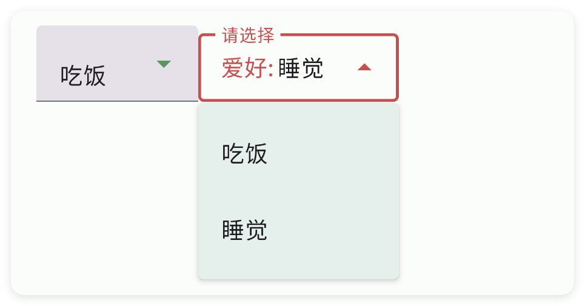
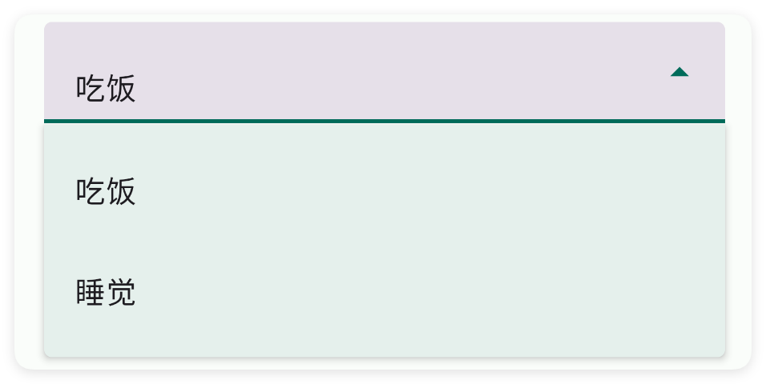
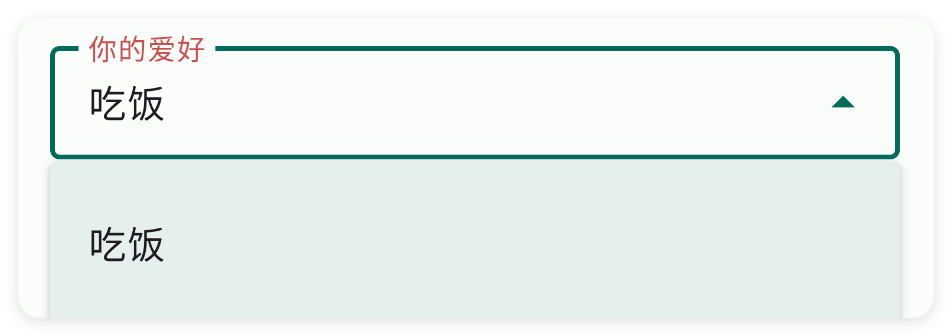
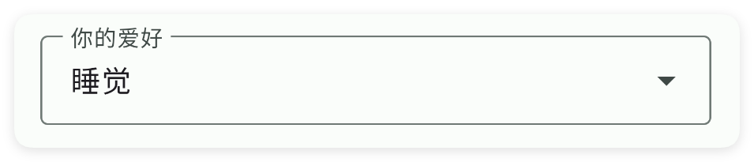
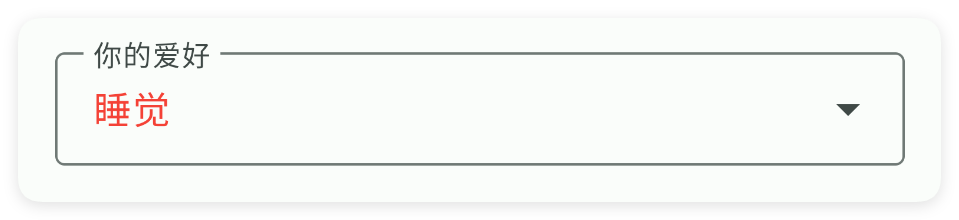
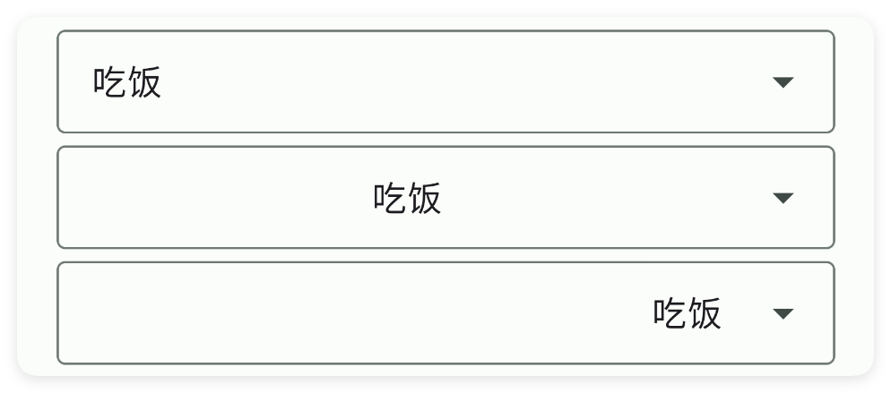

# 下拉框

- 更新时间:2026-10-22 10:58:40

> 下拉框-drop
> 
> 布局原生类型:{com.google.android.material.textfield.TextInputLayout}
> 组件原生类型:{com.google.android.material.textfield.MaterialAutoCompleteTextView}


<div style="width: 100%; position: relative; padding-bottom: 56.25%; height: 0; overflow: hidden;">
  <iframe 
    src="//player.bilibili.com/player.html?isOutside=true&aid=116224616831101&bvid=BV1UuwpzaEKK&cid=36681878033&p=1" 
    style="position: absolute; top: 0; left: 0; width: 100%; height: 100%; border: none;"
    scrolling="no" 
    frameborder="no" 
    allowfullscreen="true">
  </iframe>
</div>

下拉框类似于一个小菜单，点一下才会展开让你选，核心用途就是帮你方便、规范地挑东西。




## 一、基础用法


```html
// 将布局写成字符串，无需另建 ui.xml 文件。
var layoutXml =
    "<ui>\n" +
    "    <statusbar />\n" +
    "    <linear w=\"max\" padding=\"15\" gravity=\"center\" h=\"max\">\n" +
    "        <drop id=\"mDrop\" w=\"max\">\n" +
    "            <!-- 添加选项 -->\n" +
    "            <item text=\"吃饭\" />\n" +
    "            <item text=\"睡觉\" />\n" +
    "            <item text=\"电影\" />\n" +
    "        </drop>\n" +
    "    </linear>\n" +
    "</ui>";
var ui = $ui.layout(layoutXml);
ui.show(); // 显示界面，后面的事件示例继续使用这个对象。
```

```javascript
//解析布局
// 接着上一段执行，继续使用已创建的界面对象。
//为下拉框添加选中事件
ui.id("mDrop").onCheck(function(value, index) {
    info("选中下标为:" + index + "的元素:" + value);
});
```


## 二、常用属性


### 项目 - 子选项

> 设置子选项
> 
> 子选项使用项目标签，只有文本一个属性


```html
// 用字符串保存布局；其中的属性就是本节演示的设置。
var 布局内容 = `
<界面>
    <状态条 />
    <下拉框 宽="最大">
        <选项 文本="吃饭" />
        <选项 文本="睡觉" />
    </下拉框>
</界面>
`;
var 界面 = $界面.解析布局(布局内容); // 解析布局并创建控件。
界面.显示(); // 显示界面，观察属性效果。
```




### 风格 - 样式

> 设置样式
> 
> 可选:填充,边框(或轮廓)


```html
// 用字符串保存布局；其中的属性就是本节演示的设置。
var 布局内容 = `
<界面>
    <状态条 />
    <下拉框 宽="最大" 风格="边框">
        <选项 文本="吃饭" />
        <选项 文本="睡觉" />
    </下拉框>
</界面>
`;
var 界面 = $界面.解析布局(布局内容); // 解析布局并创建控件。
界面.显示(); // 显示界面，观察属性效果。
```


### 主题颜色 - 主题颜色

> 设置主题颜色


```html
// 用字符串保存布局；其中的属性就是本节演示的设置。
var 布局内容 = `
<界面>
    <状态条 />
    <下拉框 主题颜色="#F44236" 宽="最大" 提示="你的爱好" 风格="边框" 默认="睡觉">
        <选项 文本="吃饭" />
        <选项 文本="睡觉" />
    </下拉框>
</界面>
`;
var 界面 = $界面.解析布局(布局内容); // 解析布局并创建控件。
界面.显示(); // 显示界面，观察属性效果。
```


### 提示 - 提示文字

> 设置提示文字


```html
// 用字符串保存布局；其中的属性就是本节演示的设置。
var 布局内容 = `
<界面>
    <状态条 />
    <下拉框 宽="最大" 提示="你的爱好" 风格="边框">
        <选项 文本="吃饭" />
        <选项 文本="睡觉" />
    </下拉框>
</界面>
`;
var 界面 = $界面.解析布局(布局内容); // 解析布局并创建控件。
界面.显示(); // 显示界面，观察属性效果。
```


### 提示颜色 - 提示颜色

> 设置提示颜色


```html
// 用字符串保存布局；其中的属性就是本节演示的设置。
var 布局内容 = `
<界面>
    <状态条 />
    <下拉框 宽="最大" 提示="你的爱好" 提示颜色="#C94F4F" 文本="吃饭" 风格="边框">
        <选项 文本="吃饭" />
        <选项 文本="睡觉" />
    </下拉框>
</界面>
`;
var 界面 = $界面.解析布局(布局内容); // 解析布局并创建控件。
界面.显示(); // 显示界面，观察属性效果。
```




### 默认 - 默认文字

> 设置默认文字


```html
// 用字符串保存布局；其中的属性就是本节演示的设置。
var 布局内容 = `
<界面>
    <状态条 />
    <下拉框 宽="最大" 提示="你的爱好" 风格="边框" 默认="睡觉">
        <选项 文本="吃饭" />
        <选项 文本="睡觉" />
    </下拉框>
</界面>
`;
var 界面 = $界面.解析布局(布局内容); // 解析布局并创建控件。
界面.显示(); // 显示界面，观察属性效果。
```


### 文本 - 文本

> 设置文本


```html
// 用字符串保存布局；其中的属性就是本节演示的设置。
var 布局内容 = `
<界面>
    <状态条 />
    <下拉框 宽="最大" 提示="你的爱好" 文本="睡觉" 风格="边框">
        <选项 文本="吃饭" />
        <选项 文本="睡觉" />
    </下拉框>
</界面>
`;
var 界面 = $界面.解析布局(布局内容); // 解析布局并创建控件。
界面.显示(); // 显示界面，观察属性效果。
```




### 文本颜色 - 文字的颜色

> 设置文字的颜色


```html
// 用字符串保存布局；其中的属性就是本节演示的设置。
var 布局内容 = `
<界面>
    <状态条 />
    <下拉框 宽="最大" 提示="你的爱好" 文本颜色="#F44236" 风格="边框" 默认="睡觉">
        <选项 文本="吃饭" />
        <选项 文本="睡觉" />
    </下拉框>
</界面>
`;
var 界面 = $界面.解析布局(布局内容); // 解析布局并创建控件。
界面.显示(); // 显示界面，观察属性效果。
```




### 文本尺寸 - 文本尺寸

> 设置文本尺寸
> 
> 单位:dp


```html
// 用字符串保存布局；其中的属性就是本节演示的设置。
var 布局内容 = `
<界面>
    <状态条 />
    <下拉框 宽="最大" 文本尺寸="18" 风格="边框" 默认="睡觉">
        <选项 文本="吃饭" />
        <选项 文本="睡觉" />
    </下拉框>
    <下拉框 宽="最大" 文本尺寸="25" 风格="边框" 默认="睡觉">
        <选项 文本="吃饭" />
        <选项 文本="睡觉" />
    </下拉框>
</界面>
`;
var 界面 = $界面.解析布局(布局内容); // 解析布局并创建控件。
界面.显示(); // 显示界面，观察属性效果。
```


### 前缀 - 前缀

> 设置前缀


```html
// 用字符串保存布局；其中的属性就是本节演示的设置。
var 布局内容 = `
<界面>
    <状态条 />
    <下拉框 前缀="邮箱：" 宽="最大" 文本="123456789@qq.com" 文本尺寸="18">
        <选项 文本="123456789@qq.com" />
        <选项 文本="222333555@qq.com" />
    </下拉框>
</界面>
`;
var 界面 = $界面.解析布局(布局内容); // 解析布局并创建控件。
界面.显示(); // 显示界面，观察属性效果。
```


### 前缀颜色 - 前缀颜色

> 设置前缀颜色


```html
// 用字符串保存布局；其中的属性就是本节演示的设置。
var 布局内容 = `
<界面>
    <状态条 />
    <下拉框 前缀="邮箱：" 前缀颜色="#C94F4F" 宽="最大" 文本="123456789@qq.com"
        文本尺寸="18">
        <选项 文本="123456789@qq.com" />
        <选项 文本="222333555@qq.com" />
    </下拉框>
</界面>
`;
var 界面 = $界面.解析布局(布局内容); // 解析布局并创建控件。
界面.显示(); // 显示界面，观察属性效果。
```


### 后缀 - 后缀

> 设置后缀


```html
// 用字符串保存布局；其中的属性就是本节演示的设置。
var 布局内容 = `
<界面>
    <状态条 />
    <下拉框 前缀="邮箱：" 后缀="@qq.com" 宽="最大" 文本="123456789" 文本尺寸="18">
        <选项 文本="123456789" />
        <选项 文本="222333555" />
    </下拉框>
</界面>
`;
var 界面 = $界面.解析布局(布局内容); // 解析布局并创建控件。
界面.显示(); // 显示界面，观察属性效果。
```


### 后缀颜色 - 后缀颜色

> 设置后缀颜色


```html
// 用字符串保存布局；其中的属性就是本节演示的设置。
var 布局内容 = `
<界面>
    <状态条 />
    <下拉框 前缀="邮箱：" 后缀="@qq.com" 后缀颜色="#C94F4F" 宽="最大" 文本="123456789"
        文本尺寸="18">
        <选项 文本="123456789" />
        <选项 文本="222333555" />
    </下拉框>
</界面>
`;
var 界面 = $界面.解析布局(布局内容); // 解析布局并创建控件。
界面.显示(); // 显示界面，观察属性效果。
```


### 隐藏图标 - 是否隐藏后面的倒三角图标

> 是否隐藏后面的倒三角图标


```html
// 用字符串保存布局；其中的属性就是本节演示的设置。
var 布局内容 = `
<界面>
    <状态条 />
    <下拉框 宽="最大" 隐藏图标="是" 风格="边框">
        <选项 文本="吃饭" />
        <选项 文本="睡觉" />
    </下拉框>
</界面>
`;
var 界面 = $界面.解析布局(布局内容); // 解析布局并创建控件。
界面.显示(); // 显示界面，观察属性效果。
```


### 重力 - 布局重力

> 设置布局重力


```html
// 用字符串保存布局；其中的属性就是本节演示的设置。
var 布局内容 = `
<界面>
    <状态条 />
    <下拉框 宽="最大" 重力="开始" 风格="边框" 默认="吃饭">
        <选项 文本="吃饭" />
        <选项 文本="睡觉" />
    </下拉框>
    <下拉框 宽="最大" 重力="中间" 风格="边框" 默认="吃饭">
        <选项 文本="吃饭" />
        <选项 文本="睡觉" />
    </下拉框>
    <下拉框 宽="最大" 重力="结束" 风格="边框" 默认="吃饭">
        <选项 文本="吃饭" />
        <选项 文本="睡觉" />
    </下拉框>
</界面>
`;
var 界面 = $界面.解析布局(布局内容); // 解析布局并创建控件。
界面.显示(); // 显示界面，观察属性效果。
```




### 内边距 - 布局内边距

> 设置布局内边距
> 
> 单位:dp


```html
// 用字符串保存布局；其中的属性就是本节演示的设置。
var 布局内容 = `
<界面>
    <状态条 />
    <下拉框 宽="最大" 内边距="10" 风格="边框" 默认="吃饭">
        <选项 文本="吃饭" />
        <选项 文本="睡觉" />
    </下拉框>
    <下拉框 宽="最大" 内边距="20" 风格="边框" 默认="吃饭">
        <选项 文本="吃饭" />
        <选项 文本="睡觉" />
    </下拉框>
</界面>
`;
var 界面 = $界面.解析布局(布局内容); // 解析布局并创建控件。
界面.显示(); // 显示界面，观察属性效果。
```


### 背景颜色 - 背景颜色

> 设置背景颜色


```html
// 用字符串保存布局；其中的属性就是本节演示的设置。
var 布局内容 = `
<界面>
    <状态条 />
    <下拉框 宽="最大" 背景颜色="#57965C" 风格="边框" 默认="吃饭">
        <选项 文本="吃饭" />
        <选项 文本="睡觉" />
    </下拉框>
</界面>
`;
var 界面 = $界面.解析布局(布局内容); // 解析布局并创建控件。
界面.显示(); // 显示界面，观察属性效果。
```


### 背景图片 - 背景图片

> 设置背景图片


```html
// 用字符串保存布局；其中的属性就是本节演示的设置。
var 布局内容 = `
<界面>
    <状态条 />
    <下拉框 宽="最大" 背景图片="example/$ui - 交互界面/05.drop-下拉框/img/img.png" 风格="边框" 默认="吃饭">
        <选项 文本="吃饭" />
        <选项 文本="睡觉" />
    </下拉框>
</界面>
`;
var 界面 = $界面.解析布局(布局内容); // 解析布局并创建控件。
界面.显示(); // 显示界面，观察属性效果。
```


### 存储关键字 - 应用内存储

> 应用内存储
> 
> 通过storeKey(存储关键字)指定一个存储字符串的关键字，获取值时可以直接通过$storage($存储)获取字符串。
> 
> 注意：不同的控件存储的类型不同，对于本控件(输入框)则存储的是字符串类型，表达当前选中的内容


```html
// 用字符串保存布局；其中的属性就是本节演示的设置。
var 布局内容 = `
<界面><状态条/><!-- 你必须在ui(界面)节点中通过store(存储)指定$storage($存储)的命名空间，等价于使用代码：var storage = $storage.create("MyDrop"); -->
<界面 存储="MyDrop">
    <状态栏 />
    <!-- 使用storeKey(存储关键字)属性，指定关键字，等价于使用代码：var data = $storage.create("MyDrop").getStr("文本"); -->
    <!-- 使用storeDef(存储默认值)属性，指定关键字，等价于使用代码：var data = $storage.create("MyDrop").getStr("文本","吃饭"); -->
    <下拉框 存储关键字="文本" 存储默认值="吃饭">
        <选项 文本="吃饭"/>
        <选项 文本="睡觉"/>
        <选项 文本="游戏"/>
    </下拉框>
</界面></界面>
`;
var 界面 = $界面.解析布局(布局内容); // 解析布局并创建控件。
界面.显示(); // 显示界面，观察属性效果。
```


如果我们已经配置好了应用内存储，则可以直接获取数据：

注意：一、要使用应用内存储，必须在ui(界面)节点指定属性store(存储)的值，该值指定存储的命名空间；
二、不是所有的控件都支持应用内存储；
三、不同的控件存储的数据类型可能都不一致，例如：输入类型的控件存储的是字符串类型，开关、多选框存储的就是布尔类型的数据。


```javascript
//创建(或者加载)存储对象
var storage = $storage.create("MyDrop");//名称要一致
//获取数据
var data = storage.getStr("文本","吃饭");//数据类型是字符串
```


## 三、常用函数


### 监听选中(回调)

> “监听选中”是 onCheck 的中文名字：用户选了某项时自动触发回调。
> 
> 回调收到两个参数：选中项的文字、它的下标（从 0 开始）。

- 参数 : 回调 {function(title, index)} 回调函数；title 是选中项文字，index 是下标（从 0 开始）


```javascript
//先用一段 XML 创建界面，里面放一个带两个选项的下拉框
var ui = $ui.layout('<ui><statusbar/><drop id="mDrop" w="max"><item text="吃饭"/><item text="睡觉"/></drop></ui>');
ui.show(); //把界面显示出来
var drop = ui.id("mDrop"); //根据 id 拿到这个下拉框
drop.监听选中(function(title, index) { //用户选中时自动执行
    ui.toast("选中：" + title);
});
```


### 设置文字(文本)

> “设置文字”是 setText 的中文名字：用代码直接设置下拉框当前显示的文字。

- 参数 : 文本 {String} 要显示的文字


```javascript
//先用一段 XML 创建界面，里面放一个下拉框
var ui = $ui.layout('<ui><statusbar/><drop id="mDrop" w="max"><item text="吃饭"/><item text="睡觉"/></drop></ui>');
ui.show(); //把界面显示出来
var drop = ui.id("mDrop"); //根据 id 拿到这个下拉框
drop.设置文字("选项1"); //直接显示这几个字
```


### 获取文字()

> “获取文字”是 getText 的中文名字：读出下拉框当前显示的文字。

- 返回 : {String} 下拉框当前显示的文字；为空时返回空字符串 ""


```javascript
//先用一段 XML 创建界面，里面放一个下拉框
var ui = $ui.layout('<ui><statusbar/><drop id="mDrop" w="max" def="吃饭"><item text="吃饭"/><item text="睡觉"/></drop></ui>');
ui.show(); //把界面显示出来
var drop = ui.id("mDrop"); //根据 id 拿到这个下拉框
var 文字 = drop.获取文字(); //读出当前文字
ui.toast("当前是：" + 文字);
```


### 刷新(数据)

> “刷新”是 flush 的中文名字：用一组新选项整体替换下拉框里的列表。

- 参数 : 数据 {String[]} 新的选项文字数组


```javascript
//先用一段 XML 创建界面，里面放一个空下拉框
var ui = $ui.layout('<ui><statusbar/><drop id="mDrop" w="max"/></ui>');
ui.show(); //把界面显示出来
var drop = ui.id("mDrop"); //根据 id 拿到这个下拉框
drop.刷新(["张三", "李四", "王五"]); //整体替换选项
```


### 获取下标()

> “获取下标”是 getIndex 的中文名字：读出当前选中的是第几个选项，下标从 0 开始。
> 
> 没匹配到选项时返回 -1。

- 返回 : {int} 当前选中项的下标（从 0 开始）；没匹配到选项时返回 -1
- 版本 : 1.9.6


```javascript
//先用一段 XML 创建界面，里面放一个下拉框
var ui = $ui.layout('<ui><statusbar/><drop id="mDrop" w="max"><item text="张三"/><item text="李四"/><item text="王五"/></drop></ui>');
ui.show(); //把界面显示出来
var drop = ui.id("mDrop"); //根据 id 拿到这个下拉框
var 下标 = drop.获取下标(); //读出当前下标
ui.toast("选中第 " + (下标 + 1) + " 项");
```


### 设置下标(下标)

> “设置下标”是 setIndex 的中文名字：用下标选中第几个选项，下标从 0 开始。

- 参数 : 下标 {int} 要选中的下标，从 0 开始
- 版本 : 1.9.6


```javascript
//先用一段 XML 创建界面，里面放一个下拉框
var ui = $ui.layout('<ui><statusbar/><drop id="mDrop" w="max"><item text="张三"/><item text="李四"/><item text="王五"/></drop></ui>');
ui.show(); //把界面显示出来
var drop = ui.id("mDrop"); //根据 id 拿到这个下拉框
drop.设置下标(2); //选中第 3 项（下标 2，也就是“王五”）
```


