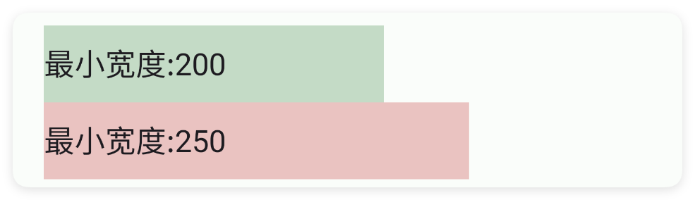
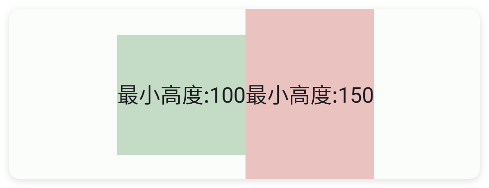
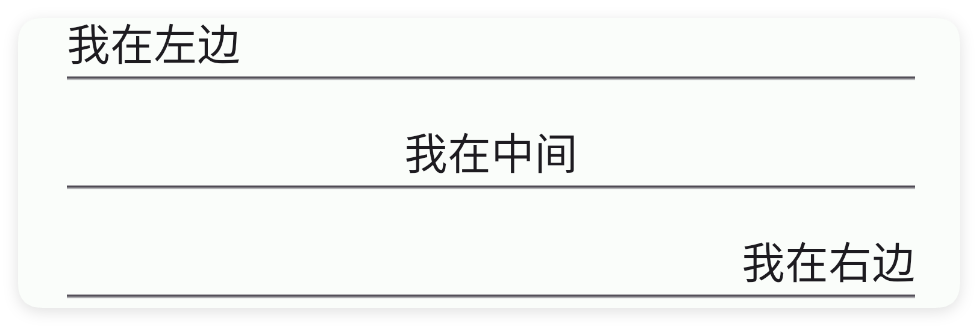
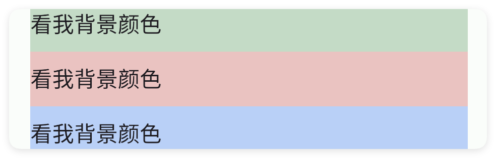

# 编辑框

- 更新时间:2026-10-22 10:58:40

> 编辑框-edit
> 
> 原生类型:{androidx.appcompat.widget.AppCompatEditText}


<div style="width: 100%; position: relative; padding-bottom: 56.25%; height: 0; overflow: hidden;">
  <iframe 
    src="//player.bilibili.com/player.html?isOutside=true&aid=116224683939813&bvid=BV1ztwpzJEfn&cid=36682073516&p=1" 
    style="position: absolute; top: 0; left: 0; width: 100%; height: 100%; border: none;"
    scrolling="no" 
    frameborder="no" 
    allowfullscreen="true">
  </iframe>
</div>

这是一种小巧的输入框

edit比input输入框更加小巧一些，是安卓原生拓展库的组件，而input输入框是M3风格的组件。


```html
// 用字符串保存布局；其中的属性就是本节演示的设置。
var layoutXml = "<ui>\r\n    <statusbar />\r\n    <linear dir=\"h\" w=\"max\">\r\n        <edit text=\"我是\" textColor=\"#57965C\" />\r\n        <edit text=\"一个\" />\r\n        <edit text=\"简约的\" textColor=\"#C94F4F\" />\r\n        <edit text=\"编辑框\" textColor=\"#3574F0\" />\r\n    </linear>\r\n</ui>";
var ui = $ui.layout(layoutXml); // 解析布局并创建控件。
ui.show(); // 显示界面，观察属性效果。
```


## 一、常用属性


### 提示 - 提示文本

> 设置提示文本


```html
// 用字符串保存布局；其中的属性就是本节演示的设置。
var 布局内容 = `
<界面>
    <状态条 />
    <编辑框 提示="提示文本" 宽="最大" />
</界面>
`;
var 界面 = $界面.解析布局(布局内容); // 解析布局并创建控件。
界面.显示(); // 显示界面，观察属性效果。
```


### 文本 - 文本

> 设置文本


```html
// 用字符串保存布局；其中的属性就是本节演示的设置。
var 布局内容 = `
<界面>
    <状态条 />
    <编辑框 文本="我是文本" 宽="最大" />
</界面>
`;
var 界面 = $界面.解析布局(布局内容); // 解析布局并创建控件。
界面.显示(); // 显示界面，观察属性效果。
```


### 文本颜色 - 文本颜色

> 设置文本颜色


```html
// 用字符串保存布局；其中的属性就是本节演示的设置。
var 布局内容 = `
<界面>
    <状态条 />
    <编辑框 文本="我是文本" 文本颜色="#C94F4F" 宽="最大" />
</界面>
`;
var 界面 = $界面.解析布局(布局内容); // 解析布局并创建控件。
界面.显示(); // 显示界面，观察属性效果。
```


### 默认 - 默认文本

> 设置默认文本


```html
// 用字符串保存布局；其中的属性就是本节演示的设置。
var 布局内容 = `
<界面>
    <状态条 />
    <编辑框 默认="默认文本" 宽="最大" />
</界面>
`;
var 界面 = $界面.解析布局(布局内容); // 解析布局并创建控件。
界面.显示(); // 显示界面，观察属性效果。
```


### 类型 - 输入内容的类型

> 输入内容的类型
> 
> 可选值:
> 密码:密码,
> 数字:数字,
> 手机号:手机号


```html
// 用字符串保存布局；其中的属性就是本节演示的设置。
var 布局内容 = `
<界面>
    <状态条 />
    <!--密码类型-->
    <编辑框 文本="123456???" 类型="密码" 宽="最大" />
    <!--数字类型-->
    <编辑框 文本="123" 类型="数字" 宽="最大" />
    <!--手机号码类型-->
    <编辑框 文本="15047070177" 类型="电话" 宽="最大" />
</界面>
`;
var 界面 = $界面.解析布局(布局内容); // 解析布局并创建控件。
界面.显示(); // 显示界面，观察属性效果。
```


### 尺寸 - 文本尺寸

> 设置文本尺寸


```html
// 用字符串保存布局；其中的属性就是本节演示的设置。
var 布局内容 = `
<界面>
    <状态条 />
    <编辑框 文本="文本尺寸:10" 文本尺寸="10" 宽="最大" />
    <编辑框 文本="文本尺寸:15" 文本尺寸="15" 宽="最大" />
</界面>
`;
var 界面 = $界面.解析布局(布局内容); // 解析布局并创建控件。
界面.显示(); // 显示界面，观察属性效果。
```


### 最小宽度 - 最小宽度

> 设置最小宽度
> 
> 单位:dp


```html
// 用字符串保存布局；其中的属性就是本节演示的设置。
var 布局内容 = `
<界面>
    <状态条 />
    <编辑框 背景颜色="#5557965C" 最小宽度="200" 文本="最小宽度:200" />
    <编辑框 背景颜色="#55C94F4F" 最小宽度="250" 文本="最小宽度:250" />
</界面>
`;
var 界面 = $界面.解析布局(布局内容); // 解析布局并创建控件。
界面.显示(); // 显示界面，观察属性效果。
```




### 最小高度 - 最小高度

> 设置最小高度
> 
> 单位:dp


```html
// 用字符串保存布局；其中的属性就是本节演示的设置。
var 布局内容 = `
<界面>
    <状态条 />
    <线性布局 方向="横向" 重力="中间" 宽="最大">
        <编辑框 背景颜色="#5557965C" 最小高度="100" 文本="最小高度:100" />
        <编辑框 背景颜色="#55C94F4F" 最小高度="150" 文本="最小高度:150" />
    </线性布局>
</界面>
`;
var 界面 = $界面.解析布局(布局内容); // 解析布局并创建控件。
界面.显示(); // 显示界面，观察属性效果。
```




### 重力 - 布局重力

> 设置布局重力


```html
// 用字符串保存布局；其中的属性就是本节演示的设置。
var 布局内容 = `
<界面>
    <状态条 />
    <!--为了演示效果，宽度设置到最大 w=max -->
    <编辑框 重力="开始|中间" 文本="我在左边" 宽="最大" />
    <编辑框 重力="中间" 文本="我在中间" 宽="最大" />
    <编辑框 重力="结束|中间" 文本="我在右边" 宽="最大" />
</界面>
`;
var 界面 = $界面.解析布局(布局内容); // 解析布局并创建控件。
界面.显示(); // 显示界面，观察属性效果。
```




### 内边距 - 布局内边距

> 设置布局内边距


```html
// 用字符串保存布局；其中的属性就是本节演示的设置。
var 布局内容 = `
<界面>
    <状态条 />
    <编辑框 背景颜色="#5557965C" 内边距="10,0,20,30" 文本="看我内边距" />
</界面>
`;
var 界面 = $界面.解析布局(布局内容); // 解析布局并创建控件。
界面.显示(); // 显示界面，观察属性效果。
```


### 背景颜色 - 背景颜色

> 设置背景颜色


```html
// 用字符串保存布局；其中的属性就是本节演示的设置。
var 布局内容 = `
<界面>
    <状态条 />
    <编辑框 背景颜色="#5557965C" 文本="看我背景颜色" 宽="最大" />
    <编辑框 背景颜色="#55C94F4F" 文本="看我背景颜色" 宽="最大" />
    <编辑框 背景颜色="#553574F0" 文本="看我背景颜色" 宽="最大" />
</界面>
`;
var 界面 = $界面.解析布局(布局内容); // 解析布局并创建控件。
界面.显示(); // 显示界面，观察属性效果。
```




### 背景图片 - 背景图片

> 设置背景图片


```html
// 用字符串保存布局；其中的属性就是本节演示的设置。
var 布局内容 = `
<界面>
    <状态条 />
    <编辑框 背景图片="example/$ui - 交互界面/06.edit-编辑框/img/bg-edit.png"
        文本="看我背景图片" 文本颜色="#FFFFFF" 宽="最大" />
</界面>
`;
var 界面 = $界面.解析布局(布局内容); // 解析布局并创建控件。
界面.显示(); // 显示界面，观察属性效果。
```


### 存储关键字 - 应用内存储

> 应用内存储
> 
> 通过storeKey(存储关键字)指定一个存储字符串的关键字，获取值时可以直接通过$storage($存储)获取字符串。
> 
> 注意：不同的控件存储的类型不同，对于本控件(编辑框)则存储的是字符串类型，表达当前输入的内容


```html
// 用字符串保存布局；其中的属性就是本节演示的设置。
var 布局内容 = `
<界面><状态条/><!-- 你必须在ui(界面)节点中通过store(存储)指定$storage($存储)的命名空间，等价于使用代码：var storage = $storage.create("MyAppEdit"); -->
<界面 存储="MyAppEdit">
    <状态栏 />
    <!-- 使用storeKey(存储关键字)属性，指定关键字，等价于使用代码：var data = $storage.create("MyAppEdit").getStr("我爱吃饭"); -->
    <!-- 使用storeDef(存储默认值)属性，指定关键字，等价于使用代码：var data = $storage.create("MyAppEdit").getStr("我爱吃饭","吃饭"); -->
    <编辑框 存储关键字="eatFoodStr" 存储默认值="我爱吃饭" 文本="吃饭" />
    <编辑框 存储关键字="playGameStr" 存储默认值="我爱游戏" 文本="游戏" />
</界面></界面>
`;
var 界面 = $界面.解析布局(布局内容); // 解析布局并创建控件。
界面.显示(); // 显示界面，观察属性效果。
```


如果我们已经配置好了应用内存储，则可以直接获取数据：

注意：一、要使用应用内存储，必须在ui(界面)节点指定属性store(存储)的值，该值指定存储的命名空间；
二、不是所有的控件都支持应用内存储；
三、不同的控件存储的数据类型可能都不一致，例如：输入类型的控件存储的是字符串类型，开关、多选框存储的就是布尔类型的数据。


```javascript
//创建(或者加载)存储对象
var storage = $storage.create("MyAppEdit");//名称要一致
//获取数据
var data = storage.getStr("我爱吃饭","未必");//数据类型是字符串
```


## 二、常用函数


### 获取文字()

> “获取文字”是 getText 的中文名字：读出用户在编辑框里输入的全部内容。

- 返回 : {String} 编辑框里的文字；为空时返回空字符串 ""


```javascript
//先用一段 XML 创建界面，里面放一个带 id 的编辑框
var ui = $ui.layout('<ui><statusbar/><edit id="mEdit" hint="请输入用户名" w="max"/></ui>');
ui.show(); //把界面显示出来
var edit = ui.id("mEdit"); //根据 id 拿到这个编辑框
var 内容 = edit.获取文字(); //读出输入的内容
ui.toast("你输入的是：" + 内容);
```


### 设置错误(提示)

> “设置错误”是 setError 的中文名字：在编辑框下方显示一条红色错误提示。

- 参数 : 提示 {String} 要显示的错误提示文字


```javascript
//先用一段 XML 创建界面，里面放一个带 id 的编辑框
var ui = $ui.layout('<ui><statusbar/><edit id="mEdit" hint="请输入用户名" w="max"/></ui>');
ui.show(); //把界面显示出来
var edit = ui.id("mEdit"); //根据 id 拿到这个编辑框
if (edit.getText() === "") { //如果用户没填
    edit.设置错误("用户名不能为空"); //红字提示
}
```


### 设置文字(文本)

> “设置文字”是 setText 的中文名字：用代码直接把编辑框内容替换成指定文字。

- 参数 : 文本 {String} 要填入的新文字


```javascript
//先用一段 XML 创建界面，里面放一个带 id 的编辑框
var ui = $ui.layout('<ui><statusbar/><edit id="mEdit" w="max"/></ui>');
ui.show(); //把界面显示出来
var edit = ui.id("mEdit"); //根据 id 拿到这个编辑框
edit.设置文字("默认填好的内容"); //替换内容
```


### 监听文本改变(回调)

> “监听文本改变”是 onChanged 的中文名字：内容每变一次就自动触发回调。
> 
> 回调第一个参数是最新整段文字。

- 参数 : 回调 {function(text, start, before, count)} 回调；text 是最新整段文字
- 版本 : 1.8.0


```javascript
//先用一段 XML 创建界面，里面放一个带 id 的编辑框
var ui = $ui.layout('<ui><statusbar/><edit id="mEdit" hint="边打边看" w="max"/></ui>');
ui.show(); //把界面显示出来
var edit = ui.id("mEdit"); //根据 id 拿到这个编辑框
edit.监听文本改变(function(text, start, before, count) { //内容一变就执行
    log("现在内容是：" + text);
});
```


### 监听文本改变后(回调)

> “监听文本改变后”是 onChangedAfter 的中文名字：一次输入动作结束后触发回调。

- 参数 : 回调 {function(text)} 回调；text 是最新整段文字
- 版本 : 1.8.0


```javascript
//先用一段 XML 创建界面，里面放一个带 id 的编辑框
var ui = $ui.layout('<ui><statusbar/><edit id="mEdit" hint="输完密码" type="pass" w="max"/></ui>');
ui.show(); //把界面显示出来
var edit = ui.id("mEdit"); //根据 id 拿到这个编辑框
edit.监听文本改变后(function(text) { //输入结束后触发
    log("最终输入：" + text);
});
```


### 监听文本改变前(回调)

> “监听文本改变前”是 onChangedBefore 的中文名字：内容还没改之前先触发回调。

- 参数 : 回调 {function(text, start, count, after)} 回调；text 是改之前的旧整段文字
- 版本 : 1.8.0


```javascript
//先用一段 XML 创建界面，里面放一个带 id 的编辑框
var ui = $ui.layout('<ui><statusbar/><edit id="mEdit" hint="看着我变化" w="max"/></ui>');
ui.show(); //把界面显示出来
var edit = ui.id("mEdit"); //根据 id 拿到这个编辑框
edit.监听文本改变前(function(text, start, count, after) { //改之前触发
    log("改之前：" + text);
});
```


### 设置提示(提示)

> “设置提示”是 setHint 的中文名字：改编辑框里灰色的占位提示文字。

- 参数 : 提示 {String} 新的占位提示文字
- 版本 : 1.9.3


```javascript
//先用一段 XML 创建界面，里面放一个带 id 的编辑框
var ui = $ui.layout('<ui><statusbar/><edit id="mEdit" w="max"/></ui>');
ui.show(); //把界面显示出来
var edit = ui.id("mEdit"); //根据 id 拿到这个编辑框
edit.设置提示("请输入手机号"); //改灰色提示
```


### 设置文本颜色(颜色)

> “设置文本颜色”是 setTextColor 的中文名字：改编辑框里输入文字的颜色。

- 参数 : 颜色 {String} 颜色字符串，例如 "#FF0000"
- 版本 : 1.9.3


```javascript
//先用一段 XML 创建界面，里面放一个带 id 的编辑框
var ui = $ui.layout('<ui><statusbar/><edit id="mEdit" text="我是红色字" w="max"/></ui>');
ui.show(); //把界面显示出来
var edit = ui.id("mEdit"); //根据 id 拿到这个编辑框
edit.设置文本颜色("#FF0000"); //把字涂红
```


### 设置文本尺寸(尺寸)

> “设置文本尺寸”是 setSize 的中文名字：改编辑框文字字号，单位 sp。

- 参数 : 尺寸 {Number} 字号大小，单位 sp
- 版本 : 1.9.3


```javascript
//先用一段 XML 创建界面，里面放一个带 id 的编辑框
var ui = $ui.layout('<ui><statusbar/><edit id="mEdit" text="看看大小" w="max"/></ui>');
ui.show(); //把界面显示出来
var edit = ui.id("mEdit"); //根据 id 拿到这个编辑框
edit.设置文本尺寸(20); //20sp
```


### 设置文字尺寸(尺寸)


### 设置最小宽度(宽度)

> “设置最小宽度”是 setMinW 的中文名字：限定编辑框最窄有多宽，单位 dp。

- 参数 : 宽度 {Number} 最小宽度，单位 dp
- 版本 : 1.9.3


```javascript
//先用一段 XML 创建界面，里面放一个带 id 的编辑框
var ui = $ui.layout('<ui><statusbar/><edit id="mEdit" w="max"/></ui>');
ui.show(); //把界面显示出来
var edit = ui.id("mEdit"); //根据 id 拿到这个编辑框
edit.设置最小宽度(200); //至少 200dp 宽
```


### 设置最小高度(高度)

> “设置最小高度”是 setMinH 的中文名字：限定编辑框最矮有多高，单位 dp。

- 参数 : 高度 {Number} 最小高度，单位 dp
- 版本 : 1.9.3


```javascript
//先用一段 XML 创建界面，里面放一个带 id 的编辑框
var ui = $ui.layout('<ui><statusbar/><edit id="mEdit" w="max"/></ui>');
ui.show(); //把界面显示出来
var edit = ui.id("mEdit"); //根据 id 拿到这个编辑框
edit.设置最小高度(120); //至少 120dp 高
```


### 设置重力(重力)

> “设置重力”是 setGravity 的中文名字：决定输入文字在框内靠左、居中还是靠右。

- 参数 : 重力 {String} 对齐方式，例如 "中"、"左"、"右"、"右|中"
- 版本 : 1.9.3


```javascript
//先用一段 XML 创建界面，里面放一个占满宽度的编辑框
var ui = $ui.layout('<ui><statusbar/><edit id="mEdit" text="居中" w="max"/></ui>');
ui.show(); //把界面显示出来
var edit = ui.id("mEdit"); //根据 id 拿到这个编辑框
edit.设置重力("中"); //文字水平居中
```


### 设置背景颜色(颜色)

> “设置背景颜色”是 setBg 的中文名字：改编辑框整块的底色。

- 参数 : 颜色 {String} 颜色字符串，例如 "#FF0000"
- 版本 : 1.9.3


```javascript
//先用一段 XML 创建界面，里面放一个带 id 的编辑框
var ui = $ui.layout('<ui><statusbar/><edit id="mEdit" w="max"/></ui>');
ui.show(); //把界面显示出来
var edit = ui.id("mEdit"); //根据 id 拿到这个编辑框
edit.设置背景颜色("#EAF0FF"); //淡蓝色底色
```


