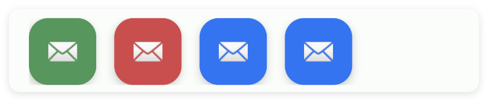
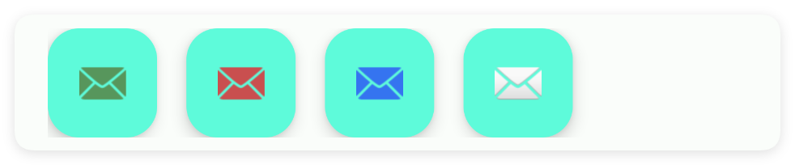

# 悬浮按钮

- 更新时间:2026-10-22 10:58:40

> 悬浮按钮-fab
> 
> 原生类型:{com.google.android.material.floatingactionbutton.FloatingActionButton}


<div style="width: 100%; position: relative; padding-bottom: 56.25%; height: 0; overflow: hidden;">
  <iframe 
    src="//player.bilibili.com/player.html?isOutside=true&aid=116224818289928&bvid=BV1qDwHz1EtH&cid=36682402038&p=1" 
    style="position: absolute; top: 0; left: 0; width: 100%; height: 100%; border: none;"
    scrolling="no" 
    frameborder="no" 
    allowfullscreen="true">
  </iframe>
</div>

一般配合帧布局：将按钮放在帧布局的上层来实现悬浮效果。


## 一、常用属性


### 动画 - 动画

> 设置动画


```html
// 将布局保存为字符串；标签表示控件，标签中的属性决定显示效果。
var 布局内容 = `
<界面>
    <状态条 />
    <锚点布局 宽="最大">
        <应用条布局 宽="最大">
            <应用条 副标题="悬浮按钮" 宽="最大" 标识="mAppbar" 标题="Fab"
                滑动标识="滑动|进入时总是可见" 返回="是" />
        </应用条布局>
        <滑动布局 宽="最大" 行为="应用条" 高="最大">
            <线性布局 内边距="20,20,20,100" 宽="最大" 高="最大">
                <文本 高="1000" 文本="请滑动界面" />
                <!--自动显示隐藏-->
                <文本 上外边距="20" 可选择="是"
                    文本="自动显示隐藏\n在锚点布局(coord)中可以配置一个悬浮按钮自动显示和隐藏\n1.必须在coord布局中\n2.必须要设置行为=悬浮按钮:意思是开启悬浮按钮的自动显示和隐藏\n\n我们可以把锚点布局(coord)理解成一个升级版的帧布局(frame):通过布局重力属性可以控制悬浮按钮的位置"
                    重力="中间|开始" />
            </线性布局>
        </滑动布局>
        <!--
        在锚点布局(coord)中可以配置一个悬浮按钮自动显示和隐藏
        1.必须在锚点布局(coord)布局中
        2.必须要设置‘行为’="悬浮按钮":开启悬浮按钮的自动显示和隐藏
        我们可以把锚点布局(coord)理解成一个升级版的帧布局(frame):通过‘布局重力’属性可以控制悬浮按钮的位置
        -->
        <悬浮按钮 图标="ic_build_fill" 外边距="25" 布局重力="结束|下" 提示="构建" 行为="悬浮按钮" />
    </锚点布局>
</界面>
`;
// 解析布局后得到界面对象，显示它即可查看本节属性的效果。
var 界面 = $界面.解析布局(布局内容);
界面.显示();
```


### 主题颜色 - 主题颜色

> 设置主题颜色


```html
// 将布局保存为字符串；标签表示控件，标签中的属性决定显示效果。
var 布局内容 = `
<界面>
    <状态条 />
    <线性布局 宽="最大" 方向="横向">
        <悬浮按钮 主题颜色="#57965C" 右外边距="15" />
        <悬浮按钮 主题颜色="#C94F4F" 右外边距="15" />
        <悬浮按钮 主题颜色="#3574F0" 右外边距="15" />
        <悬浮按钮 主题颜色="#3574F0" />
    </线性布局>
</界面>
`;
// 解析布局后得到界面对象，显示它即可查看本节属性的效果。
var 界面 = $界面.解析布局(布局内容);
界面.显示();
```




### 图标 - 图标

> 设置图标
> 
> icon/图标：用于指定图标，可以填写图标库的名称，也可以填写图标的相对路径或者绝对路径


```html
// 将布局保存为字符串；标签表示控件，标签中的属性决定显示效果。
var 布局内容 = `
<界面>
    <状态条 />
    <悬浮按钮 图标="ic_image_outline" />
</界面>
`;
// 解析布局后得到界面对象，显示它即可查看本节属性的效果。
var 界面 = $界面.解析布局(布局内容);
界面.显示();
```




### 路径 - 路径图标

> 设置路径图标


```html
// 将布局保存为字符串；标签表示控件，标签中的属性决定显示效果。
// 若布局引用图片、视频或其他资源，请先准备文件并改成实际可用的路径。
var 布局内容 = `
<界面>
    <状态条 />
    <悬浮按钮 路径="example/$ui - 交互界面/07.fab-悬浮按钮/img/fab-icon.png" />
</界面>
`;
// 解析布局后得到界面对象，显示它即可查看本节属性的效果。
var 界面 = $界面.解析布局(布局内容);
界面.显示();
```




### 图标颜色 - 图标颜色

> 设置图标颜色


```html
// 将布局保存为字符串；标签表示控件，标签中的属性决定显示效果。
var 布局内容 = `
<界面>
    <状态条 />
    <线性布局 宽="最大" 方向="横向">
        <悬浮按钮 右外边距="15" 图标颜色="#57965C" />
        <悬浮按钮 右外边距="15" 图标颜色="#C94F4F" />
        <悬浮按钮 右外边距="15" 图标颜色="#3574F0" />
        <悬浮按钮 />
    </线性布局>
</界面>
`;
// 解析布局后得到界面对象，显示它即可查看本节属性的效果。
var 界面 = $界面.解析布局(布局内容);
界面.显示();
```




### 提示 - 提示

> 设置提示
> 
> 安卓8+才支持这个配置


```html
// 将布局保存为字符串；标签表示控件，标签中的属性决定显示效果。
var 布局内容 = `
<界面>
    <状态条 />
    <悬浮按钮 图标="ic_build_fill" 提示="构建" />
</界面>
`;
// 解析布局后得到界面对象，显示它即可查看本节属性的效果。
var 界面 = $界面.解析布局(布局内容);
界面.显示();
```


### 弧度 - 弧度

> 设置弧度


```html
// 将布局保存为字符串；标签表示控件，标签中的属性决定显示效果。
var 布局内容 = `
<界面>
    <状态条 />
    <线性布局 宽="最大" 方向="横向">
        <悬浮按钮 右外边距="15" 弧度="10" />
        <悬浮按钮 右外边距="15" 弧度="15" />
        <悬浮按钮 右外边距="15" 弧度="20" />
        <悬浮按钮 弧度="25" />
    </线性布局>
</界面>
`;
// 解析布局后得到界面对象，显示它即可查看本节属性的效果。
var 界面 = $界面.解析布局(布局内容);
界面.显示();
```


### 尺寸 - 尺寸

> 设置尺寸


```html
// 将布局保存为字符串；标签表示控件，标签中的属性决定显示效果。
var 布局内容 = `
<界面>
    <状态条 />
    <线性布局 宽="最大" 方向="横向">
        <悬浮按钮 右外边距="15" 尺寸="30" />
        <悬浮按钮 右外边距="15" 尺寸="35" />
        <悬浮按钮 右外边距="15" 尺寸="40" />
        <悬浮按钮 尺寸="45" />
    </线性布局>
</界面>
`;
// 解析布局后得到界面对象，显示它即可查看本节属性的效果。
var 界面 = $界面.解析布局(布局内容);
界面.显示();
```


## 二、常用函数


### 显示()

> 显示悬浮按钮


```javascript
//解析布局,获得界面对象
var 界面 = $ui.解析布局("./主界面.xml");
//获取控件
var 悬浮按钮 = 界面.找控件("我的悬浮按钮");
//显示控件
悬浮按钮.显示();
```


### 隐藏()

> 隐藏悬浮按钮


```javascript
//解析布局,获得界面对象
var 界面 = $ui.解析布局("./主界面.xml");
//获取控件
var 悬浮按钮 = 界面.找控件("我的悬浮按钮");
//隐藏控件
悬浮按钮.隐藏();
```


### 设置主题颜色(颜色)

> 设置主题颜色

- 参数 : 颜色 {String} 颜色值


```javascript
//解析布局,获得界面对象
var 界面 = $ui.解析布局("./主界面.xml");
//获取控件
var 悬浮按钮 = 界面.找控件("我的悬浮按钮");
//设置主题颜色
悬浮按钮.设置主题颜色("#FF0000");
```


### 设置图标(图标)

> 设置图标

- 参数 : 图标 {String} 图标名称


```javascript
//解析布局,获得界面对象
var 界面 = $ui.解析布局("./主界面.xml");
//获取控件
var 悬浮按钮 = 界面.找控件("我的悬浮按钮");
//设置图标
悬浮按钮.设置图标("logo_ag");
```


### 设置提示(提示)

> 设置提示信息

- 参数 : 提示 {String} 提示信息


```javascript
//解析布局,获得界面对象
var 界面 = $ui.解析布局("./主界面.xml");
//获取控件
var 悬浮按钮 = 界面.找控件("我的悬浮按钮");
//设置提示信息
悬浮按钮.设置提示("开始执行");
```


### 设置路径(图标路径)

> 设置图标路径

- 参数 : 图标路径 {String} 图标路径


```javascript
//解析布局,获得界面对象
var 界面 = $ui.解析布局("./主界面.xml");
//获取控件
var 悬浮按钮 = 界面.找控件("我的悬浮按钮");
//设置图标路径
悬浮按钮.设置路径("/res/icon.png");
```


### 设置颜色(颜色)

> 设置图标颜色

- 参数 : 颜色 {String} 图标颜色


```javascript
//解析布局,获得界面对象
var 界面 = $ui.解析布局("./主界面.xml");
//获取控件
var 悬浮按钮 = 界面.找控件("我的悬浮按钮");
//设置图标颜色
悬浮按钮.设置颜色("#C94F4F");
```


### 设置弧度(弧度)

> 设置弧度

- 参数 : 弧度 {Number} 圆角弧度


```javascript
//解析布局,获得界面对象
var 界面 = $ui.解析布局("./主界面.xml");
//获取控件
var 悬浮按钮 = 界面.找控件("我的悬浮按钮");
//设置弧度
悬浮按钮.设置弧度(10);
```


### 设置尺寸(尺寸)

> 设置尺寸

- 参数 : 尺寸 {Number} 尺寸大小


```javascript
//解析布局,获得界面对象
var 界面 = $ui.解析布局("./主界面.xml");
//获取控件
var 悬浮按钮 = 界面.找控件("我的悬浮按钮");
//设置尺寸
悬浮按钮.设置尺寸(30);
```


