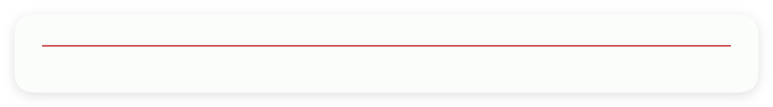
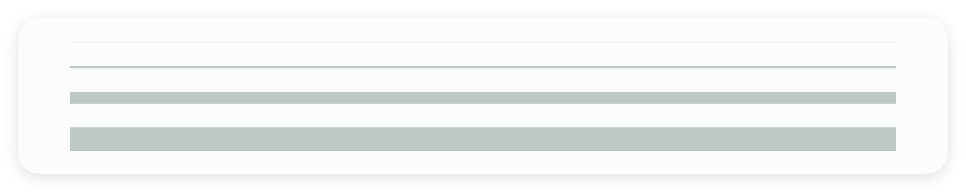

# 分割线

- 更新时间:2026-10-22 10:58:40

> 分割线-hr
> 
> 原生类型:{com.google.android.material.divider.MaterialDivider}


<div style="width: 100%; position: relative; padding-bottom: 56.25%; height: 0; overflow: hidden;">
  <iframe 
    src="//player.bilibili.com/player.html?isOutside=true&aid=116224835001989&bvid=BV1nCwHznEqK&cid=36682468412&p=1" 
    style="position: absolute; top: 0; left: 0; width: 100%; height: 100%; border: none;"
    scrolling="no" 
    frameborder="no" 
    allowfullscreen="true">
  </iframe>
</div>

最简单的组件，没有之一。


## 一、常用属性


### 颜色 - 颜色

> 设置颜色


```html
// 将布局保存为字符串；标签表示控件，标签中的属性决定显示效果。
var 布局内容 = `
<界面>
    <状态条 />
    <分割线 主题颜色="#C94F4F" />
</界面>
`;
// 解析布局后得到界面对象，显示它即可查看本节属性的效果。
var 界面 = $界面.解析布局(布局内容);
界面.显示();
```




### 尺寸 - 粗细（单位为 dp）

> 设置粗细（单位为 dp）


```html
// 将布局保存为字符串；标签表示控件，标签中的属性决定显示效果。
var 布局内容 = `
<界面>
    <状态条 />
    <!--允许设置小数，达到最小的尺寸 尺寸=0.1 -->
    <分割线 外边距="5" 尺寸="0.1" />
    <分割线 外边距="5" 尺寸="1" />
    <分割线 外边距="5" 尺寸="5" />
    <分割线 外边距="5" 尺寸="10" />
</界面>
`;
// 解析布局后得到界面对象，显示它即可查看本节属性的效果。
var 界面 = $界面.解析布局(布局内容);
界面.显示();
```




### 开始边距 - 开始边距(dp)

> 设置开始边距(dp)


```html
// 将布局保存为字符串；标签表示控件，标签中的属性决定显示效果。
var 布局内容 = `
<界面>
    <状态条 />
    <分割线 开始边距="100" />
</界面>
`;
// 解析布局后得到界面对象，显示它即可查看本节属性的效果。
var 界面 = $界面.解析布局(布局内容);
界面.显示();
```


### 结束边距 - 结束边距(dp)

> 设置结束边距(dp)


```html
// 将布局保存为字符串；标签表示控件，标签中的属性决定显示效果。
var 布局内容 = `
<界面>
    <状态条 />
    <分割线 结束边距="100" />
</界面>
`;
// 解析布局后得到界面对象，显示它即可查看本节属性的效果。
var 界面 = $界面.解析布局(布局内容);
界面.显示();
```


## 二、常用函数


### 设置粗细(粗细)

> 设置分割线的粗细。
> 
> 输入 Number 数字，单位为 dp（随屏幕密度换算的尺寸单位），可以传小数，建议使用非负数。
> 内部先换算成像素，再向上取整为整数；例如很细的线最终仍按整数像素绘制。
> 传入 null 时会记录参数为空的提示，不会更新尺寸。
> 返回类型为 void，没有可供保存的返回值；更新会提交到界面线程，不表示调用结束时已经完成重绘。

- 参数 : 粗细 {Number} 粗细，单位为 dp；传 null 时不更新。


```javascript
// 创建包含分割线的界面，这段示例不需要额外的布局文件。
var 界面 = $界面.解析布局("<界面><状态条 /><分割线 标识=\"示例分割线\" 宽=\"最大\" /></界面>");
var 分割线 = 界面.找控件("示例分割线");
// 按布局中的名字找到分割线，然后修改粗细。
分割线.设置粗细(2);
界面.显示(); // 显示界面，查看设置后的效果。
```


### 设置开始边距(开始边距)

> 设置分割线的开始边距。
> 
> 输入 Number 数字，单位为 dp（随屏幕密度换算的尺寸单位），可以传小数，建议使用非负数。
> 内部先换算成像素，再向上取整为整数；例如很细的线最终仍按整数像素绘制。
> 传入 null 时会记录参数为空的提示，不会更新尺寸。
> 开始边距是线条起点向内缩进的距离；通常在左边，界面从右向左排版时对应右边。
> 返回类型为 void，没有可供保存的返回值；更新会提交到界面线程，不表示调用结束时已经完成重绘。

- 参数 : 开始边距 {Number} 开始边距，单位为 dp；传 null 时不更新。


```javascript
// 创建包含分割线的界面，这段示例不需要额外的布局文件。
var 界面 = $界面.解析布局("<界面><状态条 /><分割线 标识=\"示例分割线\" 宽=\"最大\" /></界面>");
var 分割线 = 界面.找控件("示例分割线");
// 按布局中的名字找到分割线，然后修改开始边距。
分割线.设置开始边距(16);
界面.显示(); // 显示界面，查看设置后的效果。
```


### 设置结束边距(结束边距)

> 设置分割线的结束边距。
> 
> 输入 Number 数字，单位为 dp（随屏幕密度换算的尺寸单位），可以传小数，建议使用非负数。
> 内部先换算成像素，再向上取整为整数；例如很细的线最终仍按整数像素绘制。
> 传入 null 时会记录参数为空的提示，不会更新尺寸。
> 结束边距是线条终点向内缩进的距离；通常在右边，界面从右向左排版时对应左边。
> 返回类型为 void，没有可供保存的返回值；更新会提交到界面线程，不表示调用结束时已经完成重绘。

- 参数 : 结束边距 {Number} 结束边距，单位为 dp；传 null 时不更新。


```javascript
// 创建包含分割线的界面，这段示例不需要额外的布局文件。
var 界面 = $界面.解析布局("<界面><状态条 /><分割线 标识=\"示例分割线\" 宽=\"最大\" /></界面>");
var 分割线 = 界面.找控件("示例分割线");
// 按布局中的名字找到分割线，然后修改结束边距。
分割线.设置结束边距(16);
界面.显示(); // 显示界面，查看设置后的效果。
```


### 设置主题颜色(颜色)

> 设置分割线的颜色。
> 
> 输入 String 字符串，例如带有 # 的六位颜色值。请把颜色放在引号内，不能直接写成数字。
> 颜色解析失败时会记录提示，不会把分割线改成该颜色。
> 返回类型为 void，没有可供保存的返回值；更新会提交到界面线程，不表示调用结束时已经完成重绘。

- 参数 : 颜色 {String} 颜色字符串，例如 "#C94F4F"。


```javascript
// 创建包含分割线的界面，这段示例不需要额外的布局文件。
var 界面 = $界面.解析布局("<界面><状态条 /><分割线 标识=\"示例分割线\" 宽=\"最大\" /></界面>");
var 分割线 = 界面.找控件("示例分割线");
// 按布局中的名字找到分割线，然后修改颜色。
分割线.设置主题颜色("#C94F4F");
界面.显示(); // 显示界面，查看设置后的效果。
```


