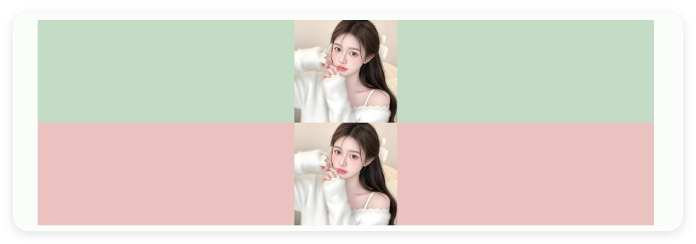

# 图片与图标

- 更新时间:2026-10-22 10:58:40

> 图片-img
> 
> 常用于显示图片或者图标
> 
> 原生类型:{com.google.android.material.imageview.ShapeableImageView}


<div style="width: 100%; position: relative; padding-bottom: 56.25%; height: 0; overflow: hidden;">
  <iframe 
    src="//player.bilibili.com/player.html?isOutside=true&aid=116224885267453&bvid=BV1FywHzSE2q&cid=36682664737&p=1" 
    style="position: absolute; top: 0; left: 0; width: 100%; height: 100%; border: none;"
    scrolling="no" 
    frameborder="no" 
    allowfullscreen="true">
  </iframe>
</div>

图片(图标)：用于显示图片或者图标


## 一、常用属性


### 弧度 - 圆弧半径

> 设置圆弧半径
> 
> 单位:dp


```html
// 用字符串保存布局；标签表示控件，属性控制控件的外观或初始状态。
// 示例用到的本地资源需要提前准备，请把文件路径改为项目中的实际路径。
var 布局内容 = `
<界面>
    <状态条 />
    <线性布局 宽="最大" 方向="横向" 重力="中间">
        <图片 右外边距="15" 宽="60" 弧度="10"
            路径="example/$ui - 交互界面/09.img-图片图标/img/img_3.png" 高="60" />
        <图片 右外边距="15" 宽="60" 弧度="20"
            路径="example/$ui - 交互界面/09.img-图片图标/img/img_3.png" 高="60" />
        <图片 宽="60" 弧度="30"
            路径="example/$ui - 交互界面/09.img-图片图标/img/img_3.png" 高="60" />
    </线性布局>
</界面>
`;
// 解析布局得到界面对象，再显示界面。
var 界面 = $界面.解析布局(布局内容);
界面.显示();
```


### 链接 - 图片链接

> 设置图片链接


```html
// 用字符串保存布局；标签表示控件，属性控制控件的外观或初始状态。
// 网络内容需要可用的地址和网络连接；请按实际情况替换示例地址。
// XML 属性中的 & 要写成 &amp;，解析后才会还原为网址中的 &。
var 布局内容 = `
<界面>
    <状态条 />
    <图片 宽="60" 弧度="30" 链接="https://q1.qlogo.cn/g?b=qq&amp;nk=2540645055&amp;s=100" 高="60" />
</界面>
`;
// 解析布局得到界面对象，再显示界面。
var 界面 = $界面.解析布局(布局内容);
界面.显示();
```


### 边框宽度 - 边框宽度

> 设置边框宽度
> 
> 单位:dp


```html
// 用字符串保存布局；标签表示控件，属性控制控件的外观或初始状态。
// 示例用到的本地资源需要提前准备，请把文件路径改为项目中的实际路径。
var 布局内容 = `
<界面>
    <状态条 />
    <线性布局 宽="最大" 方向="横向" 重力="中间">
        <!-- 原图 -->
        <图片 宽="60" 路径="example/$ui - 交互界面/09.img-图片图标/img/img.png" 高="60" />
        <!-- 设置边框的图 -->
        <图片 右外边距="15" 宽="60" 左外边距="15"
            路径="example/$ui - 交互界面/09.img-图片图标/img/img.png" 边框宽度="10" 高="60" />
    </线性布局>
</界面>
`;
// 解析布局得到界面对象，再显示界面。
var 界面 = $界面.解析布局(布局内容);
界面.显示();
```


### 边框颜色 - 边框颜色

> 设置边框颜色


```html
// 用字符串保存布局；标签表示控件，属性控制控件的外观或初始状态。
// 示例用到的本地资源需要提前准备，请把文件路径改为项目中的实际路径。
var 布局内容 = `
<界面>
    <状态条 />
    <线性布局 宽="最大" 方向="横向" 重力="中间">
        <!--原图-->
        <图片 宽="60" 路径="example/$ui - 交互界面/09.img-图片图标/img/img.png"
            高="60" />
        <!--设置边框的图-->
        <图片 右外边距="15" 宽="60" 左外边距="15"
            路径="example/$ui - 交互界面/09.img-图片图标/img/img.png" 边框宽度="10"
            高="60" />
        <!--设置边框颜色的图-->
        <图片 宽="60" 路径="example/$ui - 交互界面/09.img-图片图标/img/img.png"
            边框宽度="10" 边框颜色="#553574F0" 高="60" />
    </线性布局>
</界面>
`;
// 解析布局得到界面对象，再显示界面。
var 界面 = $界面.解析布局(布局内容);
界面.显示();
```


### 拉伸类型 - 拉伸类型

> 设置拉伸类型
> 
> 可选(忽略大小写,可忽略下划线):中心适配, 开始适配, 结束适配, 横竖轴适配, 居中, 中心裁剪, 内部居中, 矩阵


```html
// 用字符串保存布局；标签表示控件，属性控制控件的外观或初始状态。
var 布局内容 = `
<界面>
    <状态条 />
    <图片 拉伸类型="横竖轴适配"/>
</界面>
`;
// 解析布局得到界面对象，再显示界面。
var 界面 = $界面.解析布局(布局内容);
界面.显示();
```


### 图片颜色 - 图片填充颜色

> 设置图片填充颜色


```html
// 用字符串保存布局；标签表示控件，属性控制控件的外观或初始状态。
// 示例用到的本地资源需要提前准备，请把文件路径改为项目中的实际路径。
var 布局内容 = `
<界面>
    <状态条 />
    <线性布局 宽="最大" 方向="横向" 重力="中间">
        <!--原图-->
        <图片 右外边距="15" 宽="60"
            路径="example/$ui - 交互界面/09.img-图片图标/img/boy.png" 高="60" />
        <!--设置填充颜色的图-->
        <图片 图片颜色="#57965C" 右外边距="15" 宽="60"
            路径="example/$ui - 交互界面/09.img-图片图标/img/boy.png" 高="60" />
        <图片 图片颜色="#C94F4F" 宽="60"
            路径="example/$ui - 交互界面/09.img-图片图标/img/boy.png" 高="60" />
    </线性布局>
</界面>
`;
// 解析布局得到界面对象，再显示界面。
var 界面 = $界面.解析布局(布局内容);
界面.显示();
```


### 路径 - 图片本地路径

> 设置图片本地路径


```html
// 用字符串保存布局；标签表示控件，属性控制控件的外观或初始状态。
// 示例用到的本地资源需要提前准备，请把文件路径改为项目中的实际路径。
var 布局内容 = `
<界面>
    <状态条 />
    <线性布局 宽="最大" 方向="横向" 重力="中间">
        <图片 右外边距="15" 宽="60"
            路径="example/$ui - 交互界面/09.img-图片图标/img/img_5.png" 高="100" />
    </线性布局>
</界面>
`;
// 解析布局得到界面对象，再显示界面。
var 界面 = $界面.解析布局(布局内容);
界面.显示();
```


### 资源 - 图片或图标路径

> 设置图片或图标路径
> 
> icon/图标：用于指定图标，可以填写图标库的名称，也可以填写图标的相对路径或者绝对路径


```html
// 用字符串保存布局；标签表示控件，属性控制控件的外观或初始状态。
// 示例用到的本地资源需要提前准备，请把文件路径改为项目中的实际路径。
var 布局内容 = `
<界面>
    <状态条 />
    <线性布局 宽="最大" 方向="横向" 重力="中间">
        <!--使用src(资源)来设置图标-->
        <图片 宽="30" 资源="ic_near_me_fill" 高="30" />
        <!--使用icon(图标)来设置图标-->
        <图片 图标="ic_adb_fill" 宽="30" 左外边距="15" 高="30" />
    </线性布局>
</界面>
`;
// 解析布局得到界面对象，再显示界面。
var 界面 = $界面.解析布局(布局内容);
界面.显示();
```


### 旋转角度 - 旋转角度

> 设置旋转角度


```html
// 用字符串保存布局；标签表示控件，属性控制控件的外观或初始状态。
// 示例用到的本地资源需要提前准备，请把文件路径改为项目中的实际路径。
var 布局内容 = `
<界面>
    <状态条 />
    <线性布局 宽="最大" 方向="横向" 重力="中间">
        <图片 宽="60" 角度="10"
            路径="example/$ui - 交互界面/09.img-图片图标/img/img_4.png" 高="60" />
        <图片 右外边距="15" 宽="60" 左外边距="15" 角度="30"
            路径="example/$ui - 交互界面/09.img-图片图标/img/img_4.png" 高="60" />
        <图片 宽="60" 角度="60"
            路径="example/$ui - 交互界面/09.img-图片图标/img/img_4.png" 高="60" />
    </线性布局>
</界面>
`;
// 解析布局得到界面对象，再显示界面。
var 界面 = $界面.解析布局(布局内容);
界面.显示();
```


### 旋转速度 - 自动旋转的倍速

> 设置自动旋转的倍速


```html
// 用字符串保存布局；标签表示控件，属性控制控件的外观或初始状态。
var 布局内容 = `
<界面>
    <状态条 />
    <图片 旋转速度="3"/>
</界面>
`;
// 解析布局得到界面对象，再显示界面。
var 界面 = $界面.解析布局(布局内容);
界面.显示();
```


### 自动旋转 - 是否自动旋转

> 是否自动旋转


```html
// 用字符串保存布局；标签表示控件，属性控制控件的外观或初始状态。
// 示例用到的本地资源需要提前准备，请把文件路径改为项目中的实际路径。
var 布局内容 = `
<界面>
    <状态条 />
    <线性布局 宽="最大" 方向="横向" 重力="中间">
        <图片 宽="60" 自动旋转="是" 资源="ic_audiotrack_outline" 高="60" />
        <图片 右外边距="15" 宽="60" 左外边距="15" 旋转速度="10" 自动旋转="是"
            资源="ic_audiotrack_outline" 高="60" />
        <图片 宽="60" 旋转速度="20" 自动旋转="是" 资源="ic_audiotrack_outline"
            高="60" />
    </线性布局>
</界面>
`;
// 解析布局得到界面对象，再显示界面。
var 界面 = $界面.解析布局(布局内容);
界面.显示();
```


### 内边距 - 内边距

> 设置内边距


```html
// 用字符串保存布局；标签表示控件，属性控制控件的外观或初始状态。
// 示例用到的本地资源需要提前准备，请把文件路径改为项目中的实际路径。
var 布局内容 = `
<界面>
    <状态条 />
    <线性布局 宽="最大" 方向="横向" 重力="中间">
        <图片 宽="60" 路径="example/$ui - 交互界面/09.img-图片图标/img/img_6.png"
            高="60" />
        <图片 内边距="5" 右外边距="15" 宽="60" 左外边距="15"
            路径="example/$ui - 交互界面/09.img-图片图标/img/img_6.png" 高="60" />
        <图片 内边距="10" 宽="60"
            路径="example/$ui - 交互界面/09.img-图片图标/img/img_6.png" 高="60" />
    </线性布局>
</界面>
`;
// 解析布局得到界面对象，再显示界面。
var 界面 = $界面.解析布局(布局内容);
界面.显示();
```


### 背景颜色 - 背景颜色

> 设置背景颜色


```html
// 用字符串保存布局；标签表示控件，属性控制控件的外观或初始状态。
// 示例用到的本地资源需要提前准备，请把文件路径改为项目中的实际路径。
var 布局内容 = `
<界面>
    <状态条 />
    <图片 宽="最大" 背景颜色="#5557965C"
        路径="example/$ui - 交互界面/09.img-图片图标/img/img_7.png" 高="60" />
    <图片 宽="最大" 背景颜色="#55C94F4F"
        路径="example/$ui - 交互界面/09.img-图片图标/img/img_7.png" 高="60" />
</界面>
`;
// 解析布局得到界面对象，再显示界面。
var 界面 = $界面.解析布局(布局内容);
界面.显示();
```




### 背景图片 - 背景图片

> 设置背景图片


```html
// 用字符串保存布局；标签表示控件，属性控制控件的外观或初始状态。
// 示例用到的本地资源需要提前准备，请把文件路径改为项目中的实际路径。
var 布局内容 = `
<界面>
    <状态条 />
    <图片 宽="最大" 弧度="30"
        背景图片="example/$ui - 交互界面/09.img-图片图标/img/img_8.png"
        路径="example/$ui - 交互界面/09.img-图片图标/img/img_9.png" 高="最小" />
</界面>
`;
// 解析布局得到界面对象，再显示界面。
var 界面 = $界面.解析布局(布局内容);
界面.显示();
```


## 二、常用函数


### 设置弧度(弧度)

> 设置弧度

- 参数 : 弧度 {Number} 弧度
- 版本 : 1.9.4


```javascript
//解析布局,获得界面对象
var 界面 = $ui.解析布局("./主界面.xml");
//获取控件
var 图片 = 界面.找控件("我的图片");
//设置弧度
图片.设置弧度(30);
```


### 设置边框宽度(边框宽度)

> 设置边框宽度

- 参数 : 边框宽度 {Number} 边框宽度
- 版本 : 1.9.4


```javascript
//解析布局,获得界面对象
var 界面 = $ui.解析布局("./主界面.xml");
//获取控件
var 图片 = 界面.找控件("我的图片");
//设置边框宽度
图片.设置边框宽度(10);
```


### 设置边框颜色(边框颜色)

> 设置边框颜色

- 参数 : 边框颜色 {String} 边框颜色
- 版本 : 1.9.4


```javascript
//解析布局,获得界面对象
var 界面 = $ui.解析布局("./主界面.xml");
//获取控件
var 图片 = 界面.找控件("我的图片");
//设置边框颜色
图片.设置边框颜色("#C94F4F");
```


### 设置填充颜色(填充颜色)

> 设置填充颜色

- 参数 : 填充颜色 {String} 填充颜色
- 版本 : 1.9.4


```javascript
//解析布局,获得界面对象
var 界面 = $ui.解析布局("./主界面.xml");
//获取控件
var 图片 = 界面.找控件("我的图片");
//设置填充颜色
图片.设置填充颜色("#C94F4F");
```


### 设置背景颜色(背景颜色)

> 设置背景颜色

- 参数 : 背景颜色 {String} 背景颜色
- 版本 : 1.9.4


```javascript
//解析布局,获得界面对象
var 界面 = $ui.解析布局("./主界面.xml");
//获取控件
var 图片 = 界面.找控件("我的图片");
//设置背景颜色
图片.设置背景颜色("#C94F4F");
```


### 自动旋转(是否旋转)

> 图片自动旋转

- 参数 : 是否旋转 {boolean} 是否旋转


```javascript
//解析布局,获得界面对象
var 界面 = $ui.解析布局("./主界面.xml");
//获取控件
var 图片 = 界面.找控件("我的图片");
//设置图片自动旋转
图片.自动旋转(是);
```


### 自动旋转(是否旋转, 速度)

> 图片自动旋转

- 参数 : 是否旋转 {boolean} 是否旋转
- 参数 : 速度 {float} 旋转速度


```javascript
//解析布局,获得界面对象
var 界面 = $ui.解析布局("./主界面.xml");
//获取控件
var 图片 = 界面.找控件("我的图片");
//设置图片自动旋转
图片.自动旋转(是, 10);
```


### 设置角度(角度)

> 设置角度

- 参数 : 角度 {float} 角度值


```javascript
//解析布局,获得界面对象
var 界面 = $ui.解析布局("./主界面.xml");
//获取控件
var 图片 = 界面.找控件("我的图片");
//设置角度
图片.设置角度(45);
```


### 设置图标(图标)

> 设置图标

- 参数 : 图标 {string} 图标名称


```javascript
//解析布局,获得界面对象
var 界面 = $ui.解析布局("./主界面.xml");
//获取控件
var 图片 = 界面.找控件("我的图片");
//设置图标
图片.设置图标("logo_ag");
```


### 设置链接(链接)

> 设置图片链接

- 参数 : 链接 {string} 图片链接地址


```javascript
//解析布局,获得界面对象
var 界面 = $ui.解析布局("./主界面.xml");
//获取控件
var 图片 = 界面.找控件("我的图片");
//设置图片链接
图片.设置链接("https://www.baidu.com/icon.png");
```


### 设置路径(路径)

> 设置图片路径

- 参数 : 路径 {string} 图片路径


```javascript
//解析布局,获得界面对象
var 界面 = $ui.解析布局("./主界面.xml");
//获取控件
var 图片 = 界面.找控件("我的图片");
//设置图片路径
图片.设置路径("./资源/图片01.png");
```


### 设置图片(位图)

> 设置图片

- 参数 : 位图 {bitmap} 图片位图


```javascript
//解析布局,获得界面对象
var 界面 = $ui.解析布局("./主界面.xml");
//获取控件
var 图片 = 界面.找控件("我的图片");
//设置图片
var 图片对象 = $图片.读取("./资源/图片01.png");
图片.设置图片(图片对象.获得位图());
```


### 获取图片()

> 获取图片

- 返回 : {bitmap} 获取到的图片位图


```javascript
//解析布局,获得界面对象
var 界面 = $ui.解析布局("./主界面.xml");
//获取控件
var 图片 = 界面.找控件("我的图片");
//获取图片
var 位图 = 图片.获取图片();
//构建图片对象
var 图片对象 = $图片.打开(位图);
```


