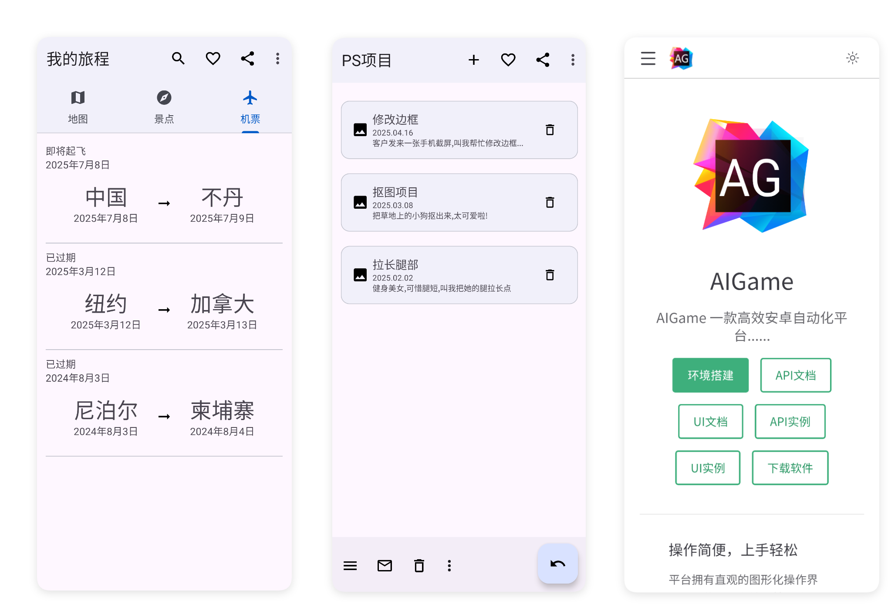
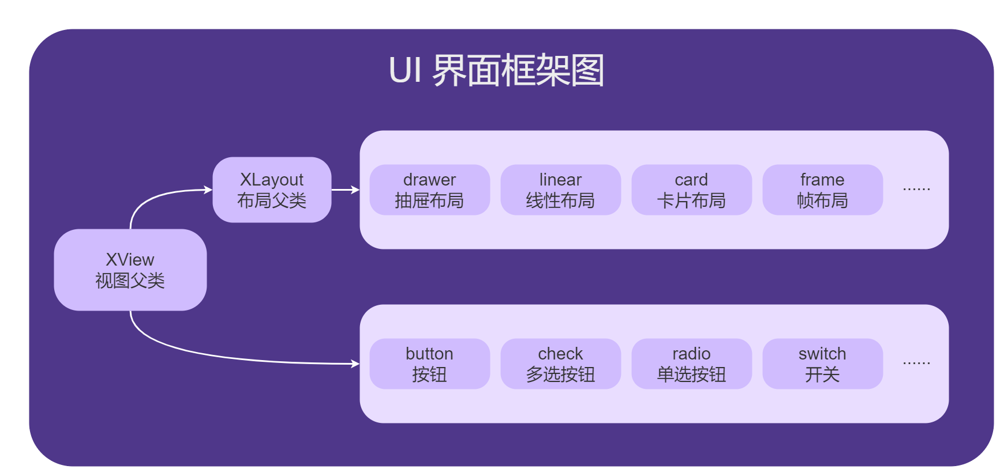

# UI框架

- 更新时间:2026-10-22 10:58:38

  <iframe 
    src="//player.bilibili.com/player.html?isOutside=true&aid=116221966031641&bvid=BV1XZwJzwEKg&cid=36673818242&p=1" 
    style="position: absolute; top: 0; left: 0; width: 100%; height: 100%; border: none;"
    scrolling="no" 
    frameborder="no" 
    allowfullscreen="true">
  </iframe>

UI框架是基于谷歌[Material 3](https://m3.material.io/)进行拓展，封装了全部控件以及布局。 甚至封装了组件式的控件，可以帮助开发者快速完成界面开发。

与此同时，提供了大量界面模板，你可以在软件示例中找到，也可以在本文档中找到。

#### UI框架设计图

UI框架中最大的类是XView类，其余的所有视图都是XView的子类，因此XView类中的所有方法都可以被其子类调用。
其中XLayout是XView的子类，也是所有布局类型的父类，所以XLayout类的所有方法都可以被其子类调用。

例如1：XView类中有'click(点击监听)'方法，这个方法可以监听点击事件，因此所有的子组件都可以调用这个方法监听点击事件。

例如2：XLayout类中有'addView(添加视图)'方法，这个方法可以使得布局动态添加一个子视图，'linear(线性布局)'是XLayout的子类，因此可以调用'addView'方法添加子视图。

