# 输入框

- 更新时间:2026-10-22 10:58:41

> 输入框-input
> 
> 组件原生类型:{com.google.android.material.textfield.TextInputEditText}
> 
> 布局原生类型:{com.google.android.material.textfield.TextInputLayout}


<div style="width: 100%; position: relative; padding-bottom: 56.25%; height: 0; overflow: hidden;">
  <iframe 
    src="//player.bilibili.com/player.html?isOutside=true&aid=116224918820312&bvid=BV1XFwpzBEy7&cid=36682794569&p=1" 
    style="position: absolute; top: 0; left: 0; width: 100%; height: 100%; border: none;"
    scrolling="no" 
    frameborder="no" 
    allowfullscreen="true">
  </iframe>
</div>

输入框：一个可以输入文字的地方。


## 一、基础用法


## 二、常用属性


### 风格 - 样式

> 设置样式
> 
> 可选:填充,轮廓


```html
// 用字符串保存布局；其中的属性就是本节演示的设置。
var 布局内容 = `
<界面>
    <状态条 />
    <线性布局 宽="最大" 方向="竖向" 重力="中间">
        <输入框 宽="最大" 文本="轮廓样式" 风格="边框" />
        <输入框 宽="最大" 文本="填充样式" 风格="填充" />
    </线性布局>
</界面>
`;
var 界面 = $界面.解析布局(布局内容); // 解析布局并创建控件。
界面.显示(); // 显示界面，观察属性效果。
```


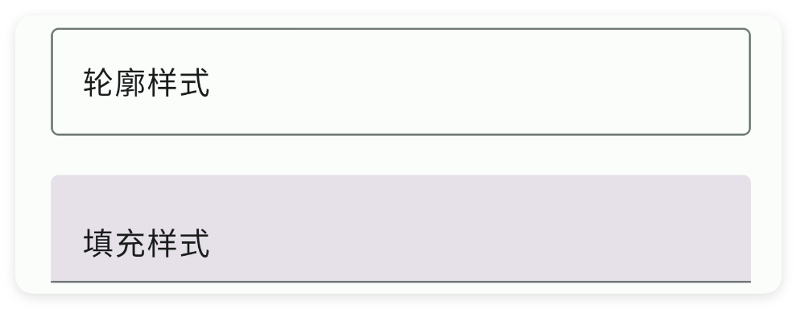

### 提示 - 提示文本

> 提示文本


```html
// 用字符串保存布局；其中的属性就是本节演示的设置。
var 布局内容 = `
<界面>
    <状态条 />
    <输入框 宽="最大" 提示="请输入" />
</界面>
`;
var 界面 = $界面.解析布局(布局内容); // 解析布局并创建控件。
界面.显示(); // 显示界面，观察属性效果。
```


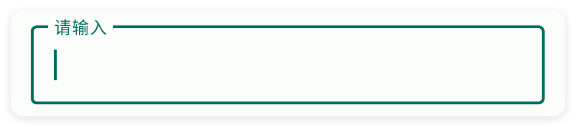

### 文本 - 文本

> 设置文本


```html
// 用字符串保存布局；其中的属性就是本节演示的设置。
var 布局内容 = `
<界面>
    <状态条 />
    <输入框 宽="最大" 文本="我是文本" />
</界面>
`;
var 界面 = $界面.解析布局(布局内容); // 解析布局并创建控件。
界面.显示(); // 显示界面，观察属性效果。
```


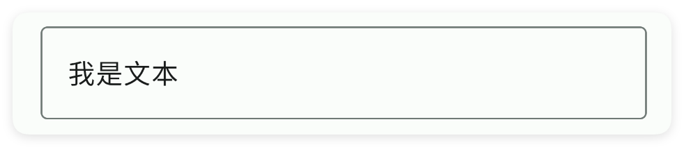

### 默认 - 文本

> 设置文本


```html
// 用字符串保存布局；其中的属性就是本节演示的设置。
var 布局内容 = `
<界面>
    <状态条 />
    <输入框 宽="最大" 默认="我是文本" />
</界面>
`;
var 界面 = $界面.解析布局(布局内容); // 解析布局并创建控件。
界面.显示(); // 显示界面，观察属性效果。
```


### 文本颜色 - 文本颜色

> 设置文本颜色


```html
// 用字符串保存布局；其中的属性就是本节演示的设置。
var 布局内容 = `
<界面>
    <状态条 />
    <输入框 宽="最大" 文本="我是文本" 文本颜色="#57965C" />
</界面>
`;
var 界面 = $界面.解析布局(布局内容); // 解析布局并创建控件。
界面.显示(); // 显示界面，观察属性效果。
```


### 文本尺寸 - 文本尺寸

> 设置文本尺寸


```html
// 用字符串保存布局；其中的属性就是本节演示的设置。
var 布局内容 = `
<界面>
    <状态条 />
    <线性布局 宽="最大" 方向="竖向" 重力="中间">
        <输入框 宽="最大" 文本="尺寸:10" 文本尺寸="10" />
        <输入框 宽="最大" 文本="尺寸:20" 文本尺寸="20" />
    </线性布局>
</界面>
`;
var 界面 = $界面.解析布局(布局内容); // 解析布局并创建控件。
界面.显示(); // 显示界面，观察属性效果。
```


### 字数 - 字数限制

> 设置字数限制


```html
// 用字符串保存布局；其中的属性就是本节演示的设置。
var 布局内容 = `
<界面>
    <状态条 />
    <输入框 字数="10" 宽="最大" 文本="123" />
</界面>
`;
var 界面 = $界面.解析布局(布局内容); // 解析布局并创建控件。
界面.显示(); // 显示界面，观察属性效果。
```


### 最大行数 - 最大行数

> 最大行数


```html
// 用字符串保存布局；其中的属性就是本节演示的设置。
var 布局内容 = `
<界面>
    <状态条 />
    <输入框 宽="最大" 最大行数="5" />
</界面>
`;
var 界面 = $界面.解析布局(布局内容); // 解析布局并创建控件。
界面.显示(); // 显示界面，观察属性效果。
```


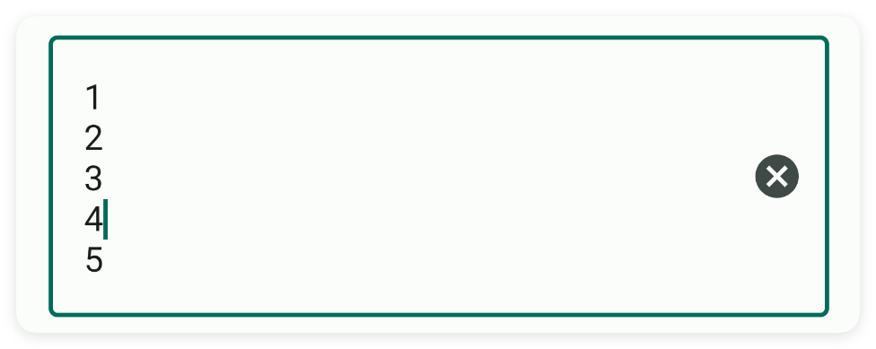

### 最小行数 - 最少行数

> 最少行数


```html
// 用字符串保存布局；其中的属性就是本节演示的设置。
var 布局内容 = `
<界面>
    <状态条 />
    <输入框 宽="最大" 最小行数="3" />
</界面>
`;
var 界面 = $界面.解析布局(布局内容); // 解析布局并创建控件。
界面.显示(); // 显示界面，观察属性效果。
```


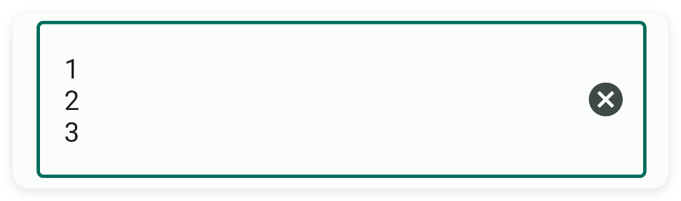

### 单行模式 - 单行模式

> 单行模式


```html
// 用字符串保存布局；其中的属性就是本节演示的设置。
var 布局内容 = `
<界面>
    <状态条 />
    <文本 可选择="是" 文本="设置单行模式 单行模式=是" 重力="中间" 高="50" />
    <输入框 单行模式="是" 宽="最大" />
</界面>
`;
var 界面 = $界面.解析布局(布局内容); // 解析布局并创建控件。
界面.显示(); // 显示界面，观察属性效果。
```


### 帮助 - 帮助文字

> 帮助文字


```html
// 用字符串保存布局；其中的属性就是本节演示的设置。
var 布局内容 = `
<界面>
    <状态条 />
    <输入框 宽="最大" 帮助="请输入名称" />
</界面>
`;
var 界面 = $界面.解析布局(布局内容); // 解析布局并创建控件。
界面.显示(); // 显示界面，观察属性效果。
```


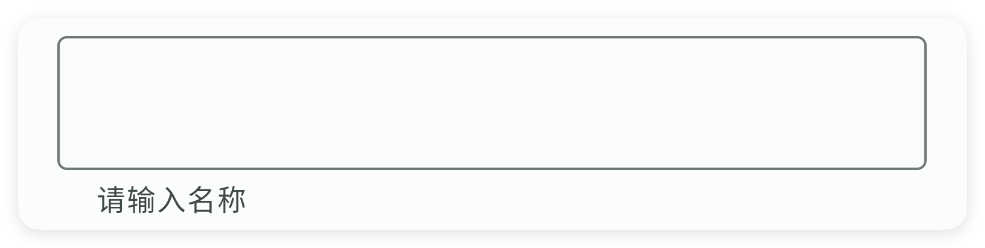

### 前缀 - 前缀

> 设置前缀


```html
// 用字符串保存布局；其中的属性就是本节演示的设置。
var 布局内容 = `
<界面>
    <状态条 />
    <输入框 前缀="邮箱:" 宽="最大" />
</界面>
`;
var 界面 = $界面.解析布局(布局内容); // 解析布局并创建控件。
界面.显示(); // 显示界面，观察属性效果。
```


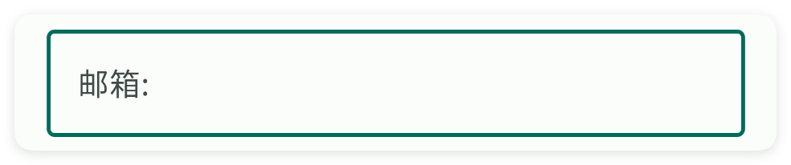

### 前缀颜色 - 前缀颜色

> 设置前缀颜色


```html
// 用字符串保存布局；其中的属性就是本节演示的设置。
var 布局内容 = `
<界面>
    <状态条 />
    <输入框 前缀="邮箱:" 前缀颜色="#C94F4F" 宽="最大" />
</界面>
`;
var 界面 = $界面.解析布局(布局内容); // 解析布局并创建控件。
界面.显示(); // 显示界面，观察属性效果。
```


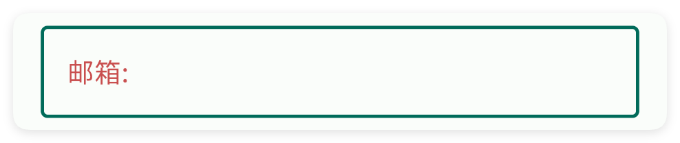

### 后缀 - 后缀

> 设置后缀


```html
// 用字符串保存布局；其中的属性就是本节演示的设置。
var 布局内容 = `
<界面>
    <状态条 />
    <输入框 后缀="@qq.com" 宽="最大" />
</界面>
`;
var 界面 = $界面.解析布局(布局内容); // 解析布局并创建控件。
界面.显示(); // 显示界面，观察属性效果。
```


### 后缀颜色 - 后缀颜色

> 设置后缀颜色


```html
// 用字符串保存布局；其中的属性就是本节演示的设置。
var 布局内容 = `
<界面>
    <状态条 />
    <输入框 后缀="@qq.com" 后缀颜色="#C94F4F" 宽="最大" />
</界面>
`;
var 界面 = $界面.解析布局(布局内容); // 解析布局并创建控件。
界面.显示(); // 显示界面，观察属性效果。
```


### 类型 - 输入类型

> 设置输入类型
> 
> 可选:密码,数字,手机号


```html
// 用字符串保存布局；其中的属性就是本节演示的设置。
var 布局内容 = `
<界面>
    <状态条 />
    <线性布局 宽="最大" 方向="竖向" 重力="中间">
        <!--密码-->
        <输入框 宽="最大" 文本="abcdefg" 类型="密码" />
        <!--数字-->
        <输入框 宽="最大" 文本="3.1415926" 类型="数字" />
        <!--号码-->
        <输入框 宽="最大" 文本="123593749723" 类型="号码" />
    </线性布局>
</界面>
`;
var 界面 = $界面.解析布局(布局内容); // 解析布局并创建控件。
界面.显示(); // 显示界面，观察属性效果。
```


### 主题颜色 - 主题颜色

> 设置主题颜色


```html
// 用字符串保存布局；其中的属性就是本节演示的设置。
var 布局内容 = `
<界面>
    <状态条 />
    <输入框 主题颜色="#C94F4F" 宽="最大" 文本="主题颜色:红色" />
</界面>
`;
var 界面 = $界面.解析布局(布局内容); // 解析布局并创建控件。
界面.显示(); // 显示界面，观察属性效果。
```


### 边框颜色 - 边框颜色

> 设置边框颜色


```html
// 用字符串保存布局；其中的属性就是本节演示的设置。
var 布局内容 = `
<界面>
    <状态条 />
    <输入框 宽="最大" 文本="边框颜色:红色" 边框颜色="#C94F4F" />
</界面>
`;
var 界面 = $界面.解析布局(布局内容); // 解析布局并创建控件。
界面.显示(); // 显示界面，观察属性效果。
```


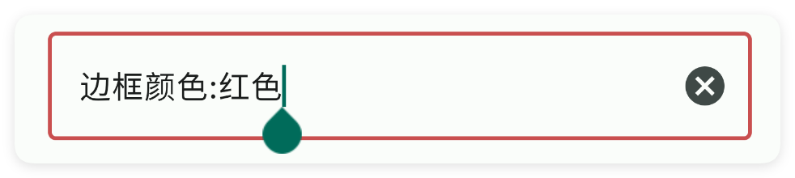

### 边框宽度 - 边框宽度

> 设置边框宽度


```html
// 用字符串保存布局；其中的属性就是本节演示的设置。
var 布局内容 = `
<界面>
    <状态条 />
    <输入框 宽="最大" 文本="边框加厚" 边框宽度="10" />
</界面>
`;
var 界面 = $界面.解析布局(布局内容); // 解析布局并创建控件。
界面.显示(); // 显示界面，观察属性效果。
```


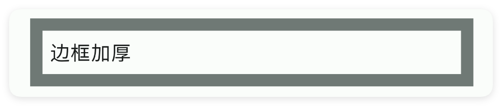

### 弧度 - 弧度

> 设置弧度


```html
// 用字符串保存布局；其中的属性就是本节演示的设置。
var 布局内容 = `
<界面>
    <状态条 />
    <输入框 宽="最大" 弧度="25" 文本="设置四角弧度" />
    <输入框 宽="最大" 弧度="5,20" 文本="设置同角弧度" />
    <输入框 宽="最大" 弧度="30,10,10,30" 文本="定制对角度弧度" />
</界面>
`;
var 界面 = $界面.解析布局(布局内容); // 解析布局并创建控件。
界面.显示(); // 显示界面，观察属性效果。
```


### 内边距 - 布局内边距

> 设置布局内边距


```html
// 用字符串保存布局；其中的属性就是本节演示的设置。
var 布局内容 = `
<界面>
    <状态条 />
    <输入框 内边距="15" 宽="最大" 文本="内边距:15" />
    <输入框 内边距="25" 宽="最大" 文本="内边距:25" />
</界面>
`;
var 界面 = $界面.解析布局(布局内容); // 解析布局并创建控件。
界面.显示(); // 显示界面，观察属性效果。
```


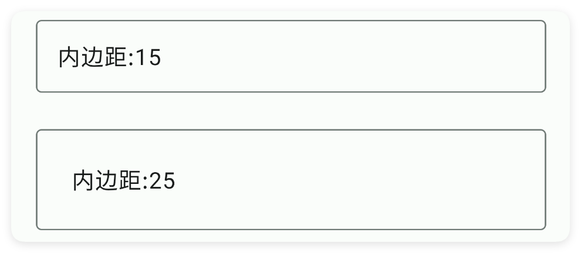

### 重力 - 布局重力

> 布局重力


```html
// 用字符串保存布局；其中的属性就是本节演示的设置。
var 布局内容 = `
<界面>
    <状态条 />
    <输入框 宽="最大" 文本="开始" 重力="开始" />
    <输入框 宽="最大" 文本="结束" 重力="结束" />
</界面>
`;
var 界面 = $界面.解析布局(布局内容); // 解析布局并创建控件。
界面.显示(); // 显示界面，观察属性效果。
```


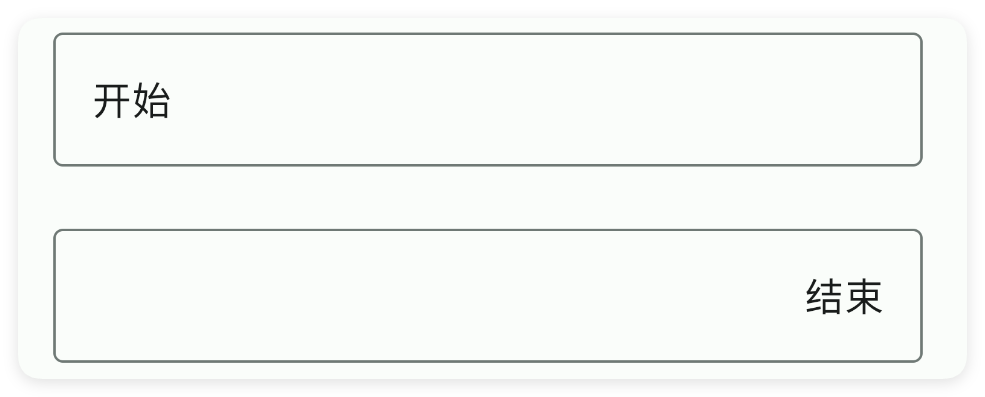

### 背景颜色 - 背景颜色

> 设置背景颜色


```html
// 用字符串保存布局；其中的属性就是本节演示的设置。
var 布局内容 = `
<界面>
    <状态条 />
    <输入框 宽="最大" 文本="看我背景" 背景颜色="#57965C" />
</界面>
`;
var 界面 = $界面.解析布局(布局内容); // 解析布局并创建控件。
界面.显示(); // 显示界面，观察属性效果。
```


### 背景图片 - 背景图片

> 设置背景图片


```html
// 用字符串保存布局；其中的属性就是本节演示的设置。
var 布局内容 = `
<界面>
    <状态条 />
    <输入框 宽="最大" 文本="看我背景"
        背景图片="example/$ui - 交互界面/10.input-输入框/img/img.png" />
</界面>
`;
var 界面 = $界面.解析布局(布局内容); // 解析布局并创建控件。
界面.显示(); // 显示界面，观察属性效果。
```


### 存储关键字 - 应用内存储

> 应用内存储
> 
> 通过storeKey(存储关键字)指定一个存储字符串的关键字，获取值时可以直接通过$storage($存储)获取字符串。
> 
> 注意：不同的控件存储的类型不同，对于本控件(输入框)则存储的是字符串类型，表达当前输入的内容


```html
// 用字符串保存布局；其中的属性就是本节演示的设置。
var 布局内容 = `
<界面><状态条/><!-- 你必须在ui(界面)节点中通过store(存储)指定$storage($存储)的命名空间，等价于使用代码：var storage = $storage.create("MyAppInput"); -->
<界面 存储="MyAppInput">
    <状态栏 />
    <!-- 使用storeKey(存储关键字)属性，指定关键字，等价于使用代码：var data = $storage.create("MyAppInput").getStr("eatFoodStr"); -->
    <!-- 使用storeDef(存储默认值)属性，指定关键字，等价于使用代码：var data = $storage.create("MyAppInput").getStr("eatFoodStr","我爱吃饭"); -->
    <输入框 存储关键字="eatFoodStr" 存储默认值="我爱吃饭" 文本="吃饭" />
    <输入框 存储关键字="playGameStr" 存储默认值="我爱游戏" 文本="游戏" />
</界面></界面>
`;
var 界面 = $界面.解析布局(布局内容); // 解析布局并创建控件。
界面.显示(); // 显示界面，观察属性效果。
```


如果我们已经配置好了应用内存储，则可以直接获取数据：

注意：一、要使用应用内存储，必须在ui(界面)节点指定属性store(存储)的值，该值指定存储的命名空间；
二、不是所有的控件都支持应用内存储；
三、不同的控件存储的数据类型可能都不一致，例如：输入类型的控件存储的是字符串类型，开关、多选框存储的就是布尔类型的数据。


```javascript
//创建(或者加载)存储对象
var storage = $storage.create("MyAppInput");//名称要一致
//获取数据
var data = storage.getStr("我爱吃饭","未必");//数据类型是字符串
```


## 三、常用函数


### 设置单行模式(单行模式)

> “设置单行模式”是 setSingleLine 的中文名字：锁定输入框只能一行，不能换行。

- 参数 : 单行模式 {Boolean} true（是）表示单行，false（否）表示多行
- 版本 : 1.9.4


```javascript
//先用一段 XML 创建界面，里面放一个带 id 的输入框
var ui = $ui.layout('<ui><statusbar/><input id="mInput" hint="请输入账号" w="max"/></ui>');
ui.show(); //把界面显示出来
var input = ui.id("mInput"); //根据 id 拿到这个输入框
input.设置单行模式(true); //锁定单行
```


### 设置提示(提示)

> “设置提示”是 setHint 的中文名字：改输入框上浮动的灰色提示文字。

- 参数 : 提示 {String} 新的浮动提示文字


```javascript
//先用一段 XML 创建界面，里面放一个带 id 的输入框
var ui = $ui.layout('<ui><statusbar/><input id="mInput" w="max"/></ui>');
ui.show(); //把界面显示出来
var input = ui.id("mInput"); //根据 id 拿到这个输入框
input.设置提示("请输入名字"); //改浮动提示
```


### 设置背景颜色(颜色)

> “设置背景颜色”是 setBgColor 的中文名字：改输入框整块的填充底色。

- 参数 : 颜色 {String} 颜色字符串，例如 "#FF0000"


```javascript
//先用一段 XML 创建界面，里面放一个带 id 的输入框
var ui = $ui.layout('<ui><statusbar/><input id="mInput" w="max"/></ui>');
ui.show(); //把界面显示出来
var input = ui.id("mInput"); //根据 id 拿到这个输入框
input.设置背景颜色("#FFE0E0"); //浅粉底色
```


### 设置边框颜色(颜色)

> “设置边框颜色”是 setStrokeColor 的中文名字：改输入框外框的颜色。

- 参数 : 颜色 {String} 颜色字符串，例如 "#FF0000"
- 版本 : 1.5.3


```javascript
//先用一段 XML 创建界面，里面放一个带 id 的外框输入框
var ui = $ui.layout('<ui><statusbar/><input id="mInput" style="outline" w="max"/></ui>');
ui.show(); //把界面显示出来
var input = ui.id("mInput"); //根据 id 拿到这个输入框
input.设置边框颜色("#FF0000"); //边框涂红
```


### 设置边框宽度(宽度)

> “设置边框宽度”是 setStrokeWidth 的中文名字：改边框粗细，单位 dp。

- 参数 : 宽度 {Number} 边框粗细，单位 dp
- 版本 : 1.5.3


```javascript
//先用一段 XML 创建界面，里面放一个带 id 的外框输入框
var ui = $ui.layout('<ui><statusbar/><input id="mInput" style="outline" w="max"/></ui>');
ui.show(); //把界面显示出来
var input = ui.id("mInput"); //根据 id 拿到这个输入框
input.设置边框宽度(3); //3dp 粗
```


### 设置弧度(左上, 上右, 左下, 右下)

> “设置弧度”是 setRadius 的中文名字：分别设四个角的圆角，依次左上、右上、左下、右下，单位 dp。

- 参数 : 左上 {Number} 左上角弧度，单位 dp
- 参数 : 上右 {Number} 右上角弧度，单位 dp
- 参数 : 左下 {Number} 左下角弧度，单位 dp
- 参数 : 右下 {Number} 右下角弧度，单位 dp
- 版本 : 1.5.3


```javascript
//先用一段 XML 创建界面，里面放一个带 id 的输入框
var ui = $ui.layout('<ui><statusbar/><input id="mInput" w="max"/></ui>');
ui.show(); //把界面显示出来
var input = ui.id("mInput"); //根据 id 拿到这个输入框
input.设置弧度(20, 20, 5, 5); //上圆下方
```


### 设置文字(文本)

> “设置文字”是 setText 的中文名字：用代码直接把输入框内容替换成指定文字。

- 参数 : 文本 {String} 要填入的新文字


```javascript
//先用一段 XML 创建界面，里面放一个带 id 的输入框
var ui = $ui.layout('<ui><statusbar/><input id="mInput" w="max"/></ui>');
ui.show(); //把界面显示出来
var input = ui.id("mInput"); //根据 id 拿到这个输入框
input.设置文字("默认填好的内容"); //替换内容
```


### 获取文字()

> “获取文字”是 getText 的中文名字：读出输入框里输入的全部内容。

- 返回 : {String} 输入框里的文字；为空时返回空字符串 ""


```javascript
//先用一段 XML 创建界面，里面放一个带 id 的输入框
var ui = $ui.layout('<ui><statusbar/><input id="mInput" hint="用户名" w="max"/></ui>');
ui.show(); //把界面显示出来
var input = ui.id("mInput"); //根据 id 拿到这个输入框
var 内容 = input.获取文字(); //读出内容
ui.toast("你输入了：" + 内容);
```


### 设置错误(提示)

> “设置错误”是 setError 的中文名字：在输入框下方显示一条红色错误提示。

- 参数 : 提示 {String} 要显示的错误提示文字


```javascript
//先用一段 XML 创建界面，里面放一个带 id 的输入框
var ui = $ui.layout('<ui><statusbar/><input id="mInput" hint="用户名" w="max"/></ui>');
ui.show(); //把界面显示出来
var input = ui.id("mInput"); //根据 id 拿到这个输入框
if (input.getText() === "") { //没填时
    input.设置错误("用户名不能为空"); //红字提示
}
```


### 获取编辑框()

> “获取编辑框”是 getEditText 的中文名字：拿到输入框内部的安卓原生对象，一般小白用不到。

- 返回 : {TextInputEditText} 安卓原生输入框对象


```javascript
//先用一段 XML 创建界面，里面放一个带 id 的输入框
var ui = $ui.layout('<ui><statusbar/><input id="mInput" w="max"/></ui>');
ui.show(); //把界面显示出来
var input = ui.id("mInput"); //根据 id 拿到这个输入框
var editText = input.获取编辑框(); //拿到原生对象
ui.toast("拿到了");
```


### 监听文本改变(回调)

> “监听文本改变”是 onChanged 的中文名字：内容每变一次就自动触发回调。

- 参数 : 回调 {function(text, start, before, count)} 回调；text 是最新整段文字
- 版本 : 1.8.0


```javascript
//先用一段 XML 创建界面，里面放一个带 id 的输入框
var ui = $ui.layout('<ui><statusbar/><input id="mInput" hint="边打边看" w="max"/></ui>');
ui.show(); //把界面显示出来
var input = ui.id("mInput"); //根据 id 拿到这个输入框
input.监听文本改变(function(text, start, before, count) { //一变就执行
    log("现在是：" + text);
});
```


### 监听文本改变后(回调)

> “监听文本改变后”是 onChangedAfter 的中文名字：一次输入动作结束后触发回调。

- 参数 : 回调 {function(text)} 回调；text 是最新整段文字
- 版本 : 1.8.0


```javascript
//先用一段 XML 创建界面，里面放一个带 id 的输入框
var ui = $ui.layout('<ui><statusbar/><input id="mInput" hint="输完密码" type="pass" w="max"/></ui>');
ui.show(); //把界面显示出来
var input = ui.id("mInput"); //根据 id 拿到这个输入框
input.监听文本改变后(function(text) { //输入结束后触发
    log("最终：" + text);
});
```


### 监听文本改变前(回调)

> “监听文本改变前”是 onChangedBefore 的中文名字：内容还没改之前先触发回调。

- 参数 : 回调 {function(text, start, count, after)} 回调；text 是改之前的旧整段文字
- 版本 : 1.8.0


```javascript
//先用一段 XML 创建界面，里面放一个带 id 的输入框
var ui = $ui.layout('<ui><statusbar/><input id="mInput" hint="看着我变化" w="max"/></ui>');
ui.show(); //把界面显示出来
var input = ui.id("mInput"); //根据 id 拿到这个输入框
input.监听文本改变前(function(text, start, count, after) { //改之前触发
    log("改之前：" + text);
});
```


### 监听焦点改变(回调)

> “监听焦点改变”是 onFocusChange 的中文名字：点进/点出输入框时触发回调。
> 
> 回调参数 true 表示获得焦点（键盘弹出），false 表示失去焦点。

- 参数 : 回调 {function(hasFocus)} 回调；hasFocus 为 true 表示获得焦点、false 表示失去
- 版本 : 1.8.2


```javascript
//先用一段 XML 创建界面，里面放一个带 id 的输入框
var ui = $ui.layout('<ui><statusbar/><input id="mInput" hint="点我试试" w="max"/></ui>');
ui.show(); //把界面显示出来
var input = ui.id("mInput"); //根据 id 拿到这个输入框
input.监听焦点改变(function(hasFocus) { //点进/点出时触发
    if (hasFocus) {
        ui.toast("获得焦点了");
    } else {
        ui.toast("失去焦点了");
    }
});
```


