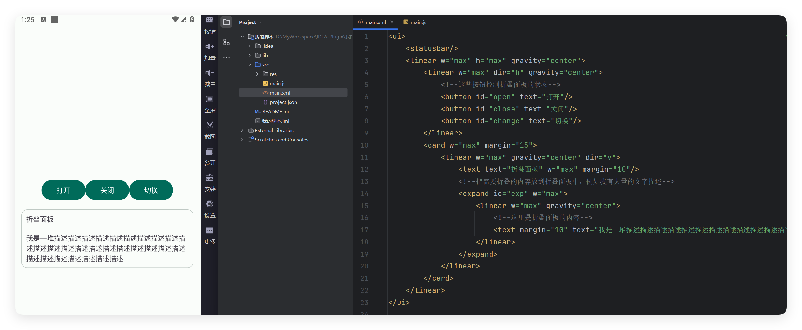

# 案例-折叠文本

- 更新时间:2026-10-22 10:58:38


折叠面板案例：假如有大量的文本需要显示，就可以使用折叠面板来减空间占用。




## 第一步：创建折叠面板界面


```html
// 把布局写成字符串；引号内是控件名称和属性，修改属性值即可练习。
var layoutXml =
    "<ui>\n" +
    "    <statusbar/>\n" +
    "    <linear w=\"max\" h=\"max\" gravity=\"center\">\n" +
    "        <linear w=\"max\" dir=\"h\" gravity=\"center\">\n" +
    "            <!--这些按钮控制折叠面板的状态-->\n" +
    "            <button id=\"open\" text=\"打开\"/>\n" +
    "            <button id=\"close\" text=\"关闭\"/>\n" +
    "            <button id=\"change\" text=\"切换\"/>\n" +
    "        </linear>\n" +
    "        <card w=\"max\" margin=\"15\">\n" +
    "            <linear w=\"max\" gravity=\"center\" dir=\"v\">\n" +
    "                <text text=\"折叠面板\" w=\"max\" margin=\"10\"/>\n" +
    "                <!--把需要折叠的内容放到折叠面板中，例如我有大量的文字描述-->\n" +
    "                <expand id=\"exp\" w=\"max\">\n" +
    "                    <linear w=\"max\" gravity=\"center\">\n" +
    "                        <!--这里是折叠面板的内容-->\n" +
    "                        <text margin=\"10\" text=\"我是一堆描述描述描述描述描述描述描述描述描述描述描述描述描述描述描述描述描述描述描述描述描述描述描述描述描述描述描述描述\"/>\n" +
    "                    </linear>\n" +
    "                </expand>\n" +
    "            </linear>\n" +
    "        </card>\n" +
    "    </linear>\n" +
    "</ui>";
// 解析字符串，得到管理这张界面的对象；接着显示界面。
var ui = $ui.layout(layoutXml);
ui.show();
```


## 第二步：连接按钮和折叠面板

将这一段接在上一个示例后面，在同一次脚本运行中执行。这里继续使用上一步创建的 ui 对象，
不需要另建布局文件。id 是控件在布局中的名字，通过它找到按钮和折叠面板。
按钮被点击时才会执行 function 中的内容；注册事件本身不会立即打开或关闭面板。


```html
// 先运行上一个示例，再执行这里的代码。
var exp = ui.id("exp"); // 找到要控制的折叠面板。
var openButton = ui.id("open"); // 找到“打开”按钮。
var closeButton = ui.id("close"); // 找到“关闭”按钮。
var changeButton = ui.id("change"); // 找到“切换”按钮。
// 如果改动过布局中的 id，要同时修改上面的名字；找不到控件时不要继续调用它。
if (exp != null && openButton != null && closeButton != null && changeButton != null) {
    openButton.click(function () {
        exp.open(); // 显示面板里的内容。
    });
    closeButton.click(function () {
        exp.close(); // 收起面板里的内容。
    });
    changeButton.click(function () {
        exp.change(); // 打开的面板会收起，收起的面板会打开。
    });
}
```


