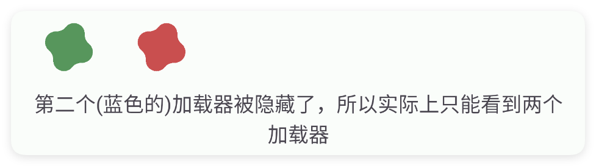

# 加载

- 更新时间:2026-10-22 10:58:41

> 加载器-load


<div style="width: 100%; position: relative; padding-bottom: 56.25%; height: 0; overflow: hidden;">
  <iframe 
    src="//player.bilibili.com/player.html?isOutside=true&aid=116225036262735&bvid=BV1erwszEE1r&cid=36683251823&p=1" 
    style="position: absolute; top: 0; left: 0; width: 100%; height: 100%; border: none;"
    scrolling="no" 
    frameborder="no" 
    allowfullscreen="true">
  </iframe>
</div>

加载器一般配合帧布局使用，显示在其他组件的上方。


## 二、常用属性


### color - 主题颜色

> 设置主题颜色


```html
// 将布局保存为字符串；标签表示控件，标签中的属性决定显示效果。
var 布局内容 = `
<界面>
    <状态条 />
    <线性布局 宽="最大" 方向="横向">
        <加载 右外边距="15" 颜色="#57965C" />
        <加载 右外边距="15" 颜色="#3574F0" />
        <加载 颜色="#C94F4F" />
    </线性布局>
</界面>
`;
// 解析布局后得到界面对象，显示它即可查看本节属性的效果。
var 界面 = $界面.解析布局(布局内容);
界面.显示();
```


### colors - 主题颜色组

> 设置主题颜色组


```html
// 将布局保存为字符串；标签表示控件，标签中的属性决定显示效果。
var 布局内容 = `
<界面>
    <状态条 />
    <加载 颜色组="#57965C,#3574F0,#C94F4F,#FFC31F,#F501F5" />
</界面>
`;
// 解析布局后得到界面对象，显示它即可查看本节属性的效果。
var 界面 = $界面.解析布局(布局内容);
界面.显示();
```


### size - 尺寸

> 设置尺寸


```html
// 将布局保存为字符串；标签表示控件，标签中的属性决定显示效果。
var 布局内容 = `
<界面>
    <状态条 />
    <线性布局 宽="最大" 方向="横向">
        <加载 右外边距="15" 尺寸="20" />
        <加载 右外边距="15" 尺寸="25" />
        <加载 尺寸="30" />
    </线性布局>
</界面>
`;
// 解析布局后得到界面对象，显示它即可查看本节属性的效果。
var 界面 = $界面.解析布局(布局内容);
界面.显示();
```


### show - 显示状态

> 设置显示状态


```html
// 将布局保存为字符串；标签表示控件，标签中的属性决定显示效果。
var 布局内容 = `
<界面>
    <状态条 />
    <线性布局 宽="最大" 方向="横向">
        <加载 右外边距="15" 显示="是" 颜色="#57965C" />
        <!--第二个加载器被隐藏了，所以实际上只能看到两个加载器-->
        <加载 右外边距="15" 显示="false" 颜色="#3574F0" />
        <加载 颜色="#C94F4F" />
    </线性布局>
    <文本 可选择="是" 文本="第二个(蓝色的)加载器被隐藏了，所以实际上只能看到两个加载器" 重力="中间"
        高="50" />
</界面>
`;
// 解析布局后得到界面对象，显示它即可查看本节属性的效果。
var 界面 = $界面.解析布局(布局内容);
界面.显示();
```




## 三、常用函数


### 设置颜色(颜色)

> “设置颜色”是 setColor 的中文名字：改转圈小圆圈的颜色。

- 参数 : 颜色 {String} 颜色字符串，例如 "#FF0000"


```javascript
//先用一段 XML 创建界面，里面放一个带 id 的加载圈
var ui = $ui.layout('<ui><statusbar/><load id="mLoad"/></ui>');
ui.show(); //把界面显示出来
var load = ui.id("mLoad"); //根据 id 拿到这个加载圈
load.设置颜色("#C94F4F"); //涂红
```


### 设置尺寸(尺寸)

> “设置尺寸”是 setSize 的中文名字：改转圈小圆圈的大小，单位 dp。

- 参数 : 尺寸 {Number} 圆圈大小，单位 dp


```javascript
//先用一段 XML 创建界面，里面放一个带 id 的加载圈
var ui = $ui.layout('<ui><statusbar/><load id="mLoad"/></ui>');
ui.show(); //把界面显示出来
var load = ui.id("mLoad"); //根据 id 拿到这个加载圈
load.设置尺寸(40); //放大到 40dp
```


### 显示()

> “显示”是 show 的中文名字：让转圈加载圈显示出来并开始转圈。


```javascript
//先用一段 XML 创建界面：一个加载圈（默认先藏起来）加一个按钮
var ui = $ui.layout('<ui><statusbar/><load id="mLoad" show="false"/><button id="btn" text="开始加载"/></ui>');
ui.show(); //把界面显示出来
var load = ui.id("mLoad"); //根据 id 拿到这个加载圈
ui.id("btn").click(function() {
    load.显示(); //显示转圈
});
```


### 隐藏()

> “隐藏”是 hide 的中文名字：把转圈加载圈藏掉，不再占位置。


```javascript
//先用一段 XML 创建界面：一个加载圈加一个按钮
var ui = $ui.layout('<ui><statusbar/><load id="mLoad"/><button id="btn" text="加载完"/></ui>');
ui.show(); //把界面显示出来
var load = ui.id("mLoad"); //根据 id 拿到这个加载圈
ui.id("btn").click(function() {
    load.隐藏(); //把转圈藏掉
});
```


