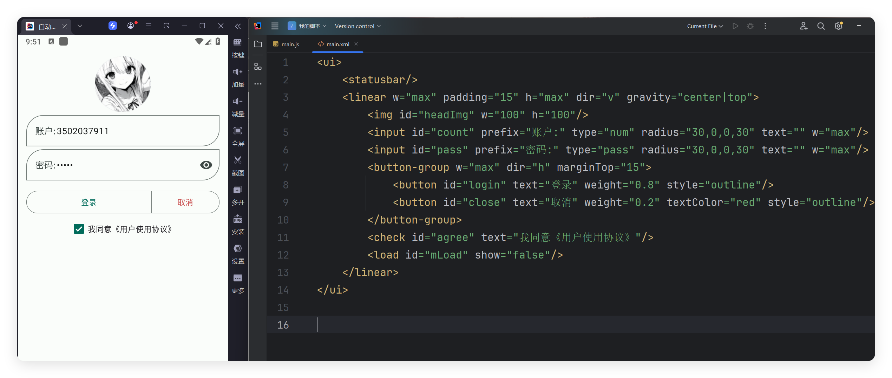

# 案例-登录界面

- 更新时间:2026-10-22 10:58:41


这是登录表单和加载提示的演示，不包含服务器验证；演示提示不代表账户已经登录。




## 第一步：创建界面布局


```html
// 先创建布局；下一段脚本继续使用这里的 ui 对象。
var layoutXml =
    "<ui>\n" +
    "    <statusbar/>\n" +
    "    <linear w=\"max\" padding=\"15\" h=\"max\" dir=\"v\" gravity=\"center|top\">\n" +
    "        \n" +
    "        <input id=\"count\" prefix=\"账户:\" type=\"num\" radius=\"30,0,0,30\" text=\"\" w=\"max\"/>\n" +
    "        <input id=\"pass\" prefix=\"密码:\" type=\"pass\" radius=\"30,0,0,30\" text=\"\" w=\"max\"/>\n" +
    "        <button-group w=\"max\" dir=\"h\" marginTop=\"15\">\n" +
    "            <button id=\"login\" text=\"登录\" weight=\"0.8\" style=\"outline\"/>\n" +
    "            <button id=\"close\" text=\"取消\" weight=\"0.2\" textColor=\"red\" style=\"outline\"/>\n" +
    "        </button-group>\n" +
    "        <check id=\"agree\" text=\"我同意《用户使用协议》\"/>\n" +
    "        <load id=\"mLoad\" show=\"false\"/>\n" +
    "    </linear>\n" +
    "</ui>";
var ui = $ui.layout(layoutXml); // 这里只解析，绑定完事件后再显示。
```


## 第二步：绑定事件并显示界面


```javascript
var storage = $storage.create("我的登录案例");
// 接在上一段后运行，沿用已创建的 ui，不需要 main.xml 文件。
//开始写代码
var headImg = ui.id("headImg");//头像
var count = ui.id("count");//账户
var pass = ui.id("pass");//密码
var login = ui.id("login");
var close = ui.id("close");
var mLoad = ui.id("mLoad");
var agree = ui.id("agree");
var getQqHeadUrl = function (qq) {
    return "https://q.qlogo.cn/headimg_dl?dst_uin=" + qq + "&spec=100";
}
count.onFocusChange(function(hasFocus) {
    if (!hasFocus) {
        //设置QQ头像
        var url = getQqHeadUrl(count.getText());
        headImg.setUrl(url);
    }
});
agree.onCheck(function(isChecked, view) {
    storage.putBool("agree", isChecked);
});
//取消登录
close.click(function() {
    ui.finish();
});
// 点击按钮，演示输入检查和加载提示。
login.click(function() {
    if (!agree.isChecked()) {
        agree.snack("请同意协议");
        return;
    }
    mLoad.show();//先显示加载中
    sleep(2000);//正在执行
    // 读取输入；本示例不会向服务器发送登录请求。
    var qq = count.getText();//账户
    var ps = pass.getText();//密码
    if (String(qq) !== "") {
        storage.putStr("qq", qq);
    }
    if (String(ps) === "") {
        mLoad.hide();
        pass.snack("请先输入演示密码");
        return;
    }
    // 此处只模拟等待，不进行账户验证。
    sleep(2000);//正在执行。。。
    mLoad.hide();//关闭
    mLoad.snack("演示结束：尚未连接登录服务");
});
// 显示前恢复上次保存的账号；不保存或恢复密码。
if (storage.getStr("qq") != null && String(storage.getStr("qq")) !== "") {
    count.setText(storage.getStr("qq"));
    //加载qq头像
    headImg.setUrl(getQqHeadUrl(storage.getStr("qq")));
}
ui.show();//显示界面
```


