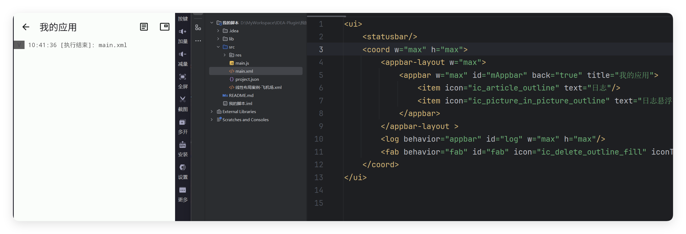

# 案例-日志框架

- 更新时间:2026-10-22 10:58:41


一个简单的日志框架综合案例




## Xml代码


```javascript
// 将布局内容作为字符串传入解析方法；返回值是可查找控件的界面对象。
var layout =
    "<ui>\n" +
    "    <statusbar/>\n" +
    "    <coord w=\"max\" h=\"max\">\n" +
    "        <appbar-layout w=\"max\">\n" +
    "            <appbar w=\"max\" id=\"mAppbar\" back=\"true\" title=\"我的应用\">\n" +
    "                <item icon=\"ic_article_outline\" text=\"日志\"/>\n" +
    "                <item icon=\"ic_picture_in_picture_outline\" text=\"日志悬浮窗\"/>\n" +
    "            </appbar>\n" +
    "        </appbar-layout >\n" +
    "        <log behavior=\"appbar\" id=\"log\" w=\"max\" h=\"max\"/>\n" +
    "        <fab behavior=\"fab\" id=\"fab\" icon=\"ic_delete_outline_fill\" iconTint=\"red\" layoutGravity=\"bottom|end\" margin=\"30\"/>\n" +
    "    </coord>\n" +
    "</ui>\n";
var ui = $ui.layout(layout);
```


## Js代码


```javascript
var ui = $ui.layout("main.xml");
var mAppbar = ui.id("mAppbar");
mAppbar.back(function(){
   ui.finish();
});
mAppbar.menu(function(txt){
    if (txt==="日志"){
        //显示日志主界面
        $log.activity();
    }
    if (txt==="日志悬浮窗"){
        //显示日志悬浮窗
        $log.floaty();
    }
});
//悬浮按钮
var fab = ui.id("fab");
fab.click(function() {
    //删除日志缓存
    $log.delete();
});
//显示界面
ui.show();
```


