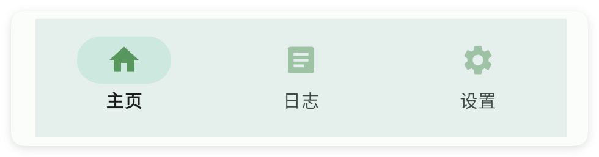
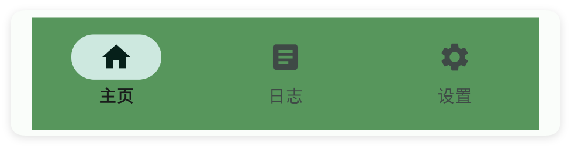

# 导航栏

- 更新时间:2026-10-22 10:58:41

> 导航栏-nav
> 
> 原生类型:{com.google.android.material.bottomnavigation.BottomNavigationView}


导航栏：一般用于与多页布局(pager)联动，实现界面的跳转


```html
// 用字符串保存布局；标签表示控件，属性控制控件的外观或初始状态。
var layoutXml =
    "<ui>\n" +
    "    <statusbar />\n" +
    "    <!-- 我习惯性把导航栏放在底部因此设置重力 gravity=\"bottom\" -->\n" +
    "    <linear w=\"max\" h=\"max\" dir=\"v\" gravity=\"bottom\">\n" +
    "        <nav w=\"max\">\n" +
    "            <menu text=\"主页\" icon=\"ic_home\" />\n" +
    "            <menu text=\"设置\" icon=\"ic_set\" />\n" +
    "            <menu text=\"菜单\" icon=\"ic_menu\" />\n" +
    "        </nav>\n" +
    "    </linear>\n" +
    "</ui>";
// 解析布局得到界面对象，再显示界面。
var ui = $ui.layout(layoutXml);
ui.show();
```


## 一、基础用法


```html
// 用字符串保存布局；标签表示控件，属性控制控件的外观或初始状态。
var layoutXml =
    "<ui>\n" +
    "    <statusbar />\n" +
    "    <!-- 我习惯性把导航栏放在底部因此设置重力 gravity=\"bottom\" -->\n" +
    "    <linear w=\"max\" h=\"max\" dir=\"v\" gravity=\"bottom\">\n" +
    "        <!-- 给导航栏设置id id=\"mNav\" -->\n" +
    "        <nav id=\"mNav\" w=\"max\">\n" +
    "            <menu text=\"菜单1\" icon=\"ic_home\" />\n" +
    "            <menu text=\"菜单2\" icon=\"ic_search\" />\n" +
    "            <menu text=\"菜单3\" icon=\"ic_set\" />\n" +
    "        </nav>\n" +
    "    </linear>\n" +
    "</ui>";
// 解析布局得到界面对象，再显示界面。
var ui = $ui.layout(layoutXml);
ui.show();
```

```javascript
// 接在上一段布局示例后执行，继续使用已经创建的 ui 对象。
//获取控件
var nav = ui.id("mNav");
//监听菜单事件
nav.menu(function(title){
    toast(title);
});
```


## 二、常用属性


### 菜单 - 菜单

> 设置菜单


```html
// 用字符串保存布局；标签表示控件，属性控制控件的外观或初始状态。
var 布局内容 = `
<界面>
    <状态条 />
    <!--显示方式:
        有空间:如果有空间,则显示
        总是:总是显示
        从不:从不显示
        带文本:与文本一起显示
        -->
    <导航栏 宽="最大">
        <菜单 文本="菜单1" 图标="ag_logo" 图标颜色="#FF0000" 显示方式="有空间" />
        <菜单 文本="菜单2" 显示方式="有空间" />
        <菜单 文本="菜单3" 显示方式="总是" />
        <菜单 文本="菜单3" 显示方式="从不" />
        <菜单 文本="菜单3" 显示方式="带文本" />
    </导航栏>
</界面>
`;
// 解析布局得到界面对象，再显示界面。
var 界面 = $界面.解析布局(布局内容);
界面.显示();
```


### 图标颜色 - 图标颜色

> 设置图标颜色
> 
> icon/图标：用于指定图标，可以填写图标库的名称，也可以填写图标的相对路径或者绝对路径


```html
// 用字符串保存布局；标签表示控件，属性控制控件的外观或初始状态。
var 布局内容 = `
<界面>
    <状态条 />
    <导航栏 图标颜色="#57965C" 宽="最大">
        <菜单 图标="ic_home_fill" 文本="主页" />
        <菜单 图标="ic_article_fill" 文本="日志" />
        <菜单 图标="ic_settings_fill" 文本="设置" />
    </导航栏>
</界面>
`;
// 解析布局得到界面对象，再显示界面。
var 界面 = $界面.解析布局(布局内容);
界面.显示();
```




### 文本颜色 - 文本颜色

> 设置文本颜色


```html
// 用字符串保存布局；标签表示控件，属性控制控件的外观或初始状态。
var 布局内容 = `
<界面>
    <状态条 />
    <导航栏 宽="最大" 文本颜色="#57965C">
        <菜单 图标="ic_home_fill" 文本="主页" />
        <菜单 图标="ic_article_fill" 文本="日志" />
        <菜单 图标="ic_settings_fill" 文本="设置" />
    </导航栏>
</界面>
`;
// 解析布局得到界面对象，再显示界面。
var 界面 = $界面.解析布局(布局内容);
界面.显示();
```


### 选中颜色 - 选中后图标颜色

> 设置选中后图标颜色


```html
// 用字符串保存布局；标签表示控件，属性控制控件的外观或初始状态。
var 布局内容 = `
<界面>
    <状态条 />
    <导航栏 宽="最大" 选中颜色="#57965C">
        <菜单 图标="ic_home_fill" 文本="主页" />
        <菜单 图标="ic_article_fill" 文本="日志" />
        <菜单 图标="ic_settings_fill" 文本="设置" />
    </导航栏>
</界面>
`;
// 解析布局得到界面对象，再显示界面。
var 界面 = $界面.解析布局(布局内容);
界面.显示();
```


### 背景颜色 - 背景颜色

> 设置背景颜色


```html
// 用字符串保存布局；标签表示控件，属性控制控件的外观或初始状态。
var 布局内容 = `
<界面>
    <状态条 />
    <导航栏 宽="最大" 背景颜色="#57965C">
        <菜单 图标="ic_home_fill" 文本="主页" />
        <菜单 图标="ic_article_fill" 文本="日志" />
        <菜单 图标="ic_settings_fill" 文本="设置" />
    </导航栏>
</界面>
`;
// 解析布局得到界面对象，再显示界面。
var 界面 = $界面.解析布局(布局内容);
界面.显示();
```




### 背景图片 - 背景图片

> 设置背景图片


```html
// 用字符串保存布局；标签表示控件，属性控制控件的外观或初始状态。
// 示例用到的本地资源需要提前准备，请把文件路径改为项目中的实际路径。
var 布局内容 = `
<界面>
    <状态条 />
    <导航栏 宽="最大" 背景图片="example/$ui - 交互界面/14.nav-导航栏/img/img.png">
        <菜单 图标="ic_home_fill" 文本="主页" />
        <菜单 图标="ic_article_fill" 文本="日志" />
        <菜单 图标="ic_settings_fill" 文本="设置" />
    </导航栏>
</界面>
`;
// 解析布局得到界面对象，再显示界面。
var 界面 = $界面.解析布局(布局内容);
界面.显示();
```


## 三、常用函数


### 设置背景颜色(颜色)

> 设置背景颜色

- 参数 : 颜色 {数字} 文本颜色值
- 版本 : 1.8.2


```javascript
//解析布局,获得界面对象
var 界面 = $ui.解析布局("./资源/主界面.xml");
//获取控件
var 导航栏 = 界面.找控件("我的导航栏");
//设置背景颜色
导航栏.设置背景颜色($颜色.红色);
```


### 设置背景颜色(颜色)

> 设置背景颜色

- 参数 : 颜色 {字符串} 颜色字符串
- 版本 : 1.8.2


```javascript
//解析布局,获得界面对象
var 界面 = $ui.解析布局("./资源/主界面.xml");
//获取控件
var 导航栏 = 界面.找控件("我的导航栏");
//设置背景颜色
导航栏.设置背景颜色("#1E1F22");
```


### 设置图标颜色(颜色)

> 设置图标颜色

- 参数 : 颜色 {数字} 文本颜色值
- 版本 : 1.8.2


```javascript
//解析布局,获得界面对象
var 界面 = $ui.解析布局("./资源/主界面.xml");
//获取控件
var 导航栏 = 界面.找控件("我的导航栏");
//设置图标颜色
导航栏.设置图标颜色($颜色.红色);
```


### 设置图标颜色(颜色)

> 设置图标颜色

- 参数 : 颜色 {字符串} 颜色字符串
- 版本 : 1.8.2


```javascript
//解析布局,获得界面对象
var 界面 = $ui.解析布局("./资源/主界面.xml");
//获取控件
var 导航栏 = 界面.找控件("我的导航栏");
//设置图标颜色
导航栏.设置图标颜色("#1E1F22");
```


### 设置文本颜色(颜色)

> 设置文本颜色

- 参数 : 颜色 {数字} 文本颜色值
- 版本 : 1.8.2


```javascript
//解析布局,获得界面对象
var 界面 = $ui.解析布局("./资源/主界面.xml");
//获取控件
var 导航栏 = 界面.找控件("我的导航栏");
//设置文本颜色
导航栏.设置文本颜色($颜色.红色);
```


### 设置文本颜色(颜色)

> 设置文本颜色

- 参数 : 颜色 {字符串} 颜色字符串
- 版本 : 1.8.2


```javascript
//解析布局,获得界面对象
var 界面 = $ui.解析布局("./资源/主界面.xml");
//获取控件
var 导航栏 = 界面.找控件("我的导航栏");
//设置文本颜色
导航栏.设置文本颜色("#1E1F22");
```


### 设置选中颜色(颜色)

> 设置选中颜色

- 参数 : 颜色 {数字} 文本颜色值
- 版本 : 1.8.2


```javascript
//解析布局,获得界面对象
var 界面 = $ui.解析布局("./资源/主界面.xml");
//获取控件
var 导航栏 = 界面.找控件("我的导航栏");
//设置选中颜色
导航栏.设置选中颜色($颜色.红色);
```


### 设置选中颜色(颜色)

> 设置选中颜色

- 参数 : 颜色 {字符串} 颜色字符串
- 版本 : 1.8.2


```javascript
//解析布局,获得界面对象
var 界面 = $ui.解析布局("./资源/主界面.xml");
//获取控件
var 导航栏 = 界面.找控件("我的导航栏");
//设置选中颜色
导航栏.设置选中颜色("#1E1F22");
```


### 选中(索引)

> 选中指定菜单

- 参数 : 索引 {int} 菜单索引


```javascript
//解析布局,获得界面对象
var 界面 = $ui.解析布局("./主界面.xml");
//获取控件
var 导航栏 = 界面.找控件("我的导航栏");
//选中指定菜单
导航栏.选中(0);
```


### 菜单(回调)

> 监听菜单事件

- 参数 : 回调 {function(标题){}} 菜单点击事件回调


```javascript
//解析布局,获得界面对象
var 界面 = $ui.解析布局("./主界面.xml");
//获取控件
var 导航栏 = 界面.找控件("我的导航栏");
//监听菜单事件
导航栏.菜单(function(标题){
    土司(标题);
});
```


