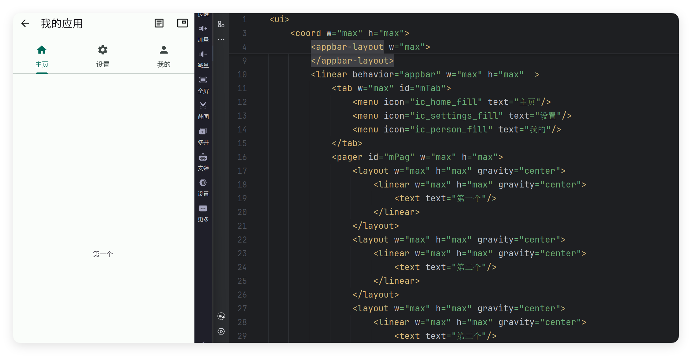

# 案例-标签联动

- 更新时间:2026-10-22 10:58:41


此案例演示如何使用多页布局和标签布局进行联动




## 第一步：创建界面布局


```html
// 先创建布局；下一段脚本继续使用这里的 ui 对象。
var layoutXml =
    "<ui>\n" +
    "    <statusbar/>\n" +
    "    <coord w=\"max\" h=\"max\">\n" +
    "        <appbar-layout w=\"max\">\n" +
    "            <appbar w=\"max\" id=\"mAppbar\" back=\"true\" title=\"我的应用\">\n" +
    "                <item icon=\"ic_article_outline\" text=\"日志\"/>\n" +
    "                <item icon=\"ic_picture_in_picture_outline\" text=\"日志悬浮窗\"/>\n" +
    "            </appbar>\n" +
    "        </appbar-layout>\n" +
    "        <linear behavior=\"appbar\" w=\"max\" h=\"max\"  >\n" +
    "            <tab w=\"max\" id=\"mTab\">\n" +
    "                <menu icon=\"ic_home_fill\" text=\"主页\"/>\n" +
    "                <menu icon=\"ic_settings_fill\" text=\"设置\"/>\n" +
    "                <menu icon=\"ic_person_fill\" text=\"我的\"/>\n" +
    "            </tab>\n" +
    "            <pager id=\"mPag\" w=\"max\" h=\"max\">\n" +
    "                <layout w=\"max\" h=\"max\" gravity=\"center\">\n" +
    "                    <linear w=\"max\" h=\"max\" gravity=\"center\">\n" +
    "                        <text text=\"第一个\"/>\n" +
    "                    </linear>\n" +
    "                </layout>\n" +
    "                <layout w=\"max\" h=\"max\" gravity=\"center\">\n" +
    "                    <linear w=\"max\" h=\"max\" gravity=\"center\">\n" +
    "                        <text text=\"第二个\"/>\n" +
    "                    </linear>\n" +
    "                </layout>\n" +
    "                <layout w=\"max\" h=\"max\" gravity=\"center\">\n" +
    "                    <linear w=\"max\" h=\"max\" gravity=\"center\">\n" +
    "                        <text text=\"第三个\"/>\n" +
    "                    </linear>\n" +
    "                </layout>\n" +
    "            </pager>\n" +
    "        </linear>\n" +
    "    </coord>\n" +
    "</ui>";
var ui = $ui.layout(layoutXml); // 这里只解析，绑定完事件后再显示。
```


## 第二步：绑定标签和页面


```javascript
// 接在上一段后运行，沿用已创建的 ui，不需要 main.xml 文件。
var mAppbar = ui.id("mAppbar");
mAppbar.back(function() {
    ui.finish();
});
//将多页布局和标签布局绑定联动
var mPag = ui.id("mPag");
var mTab = ui.id("mTab");
mPag.bind(mTab);
//显示界面
ui.show();
```


