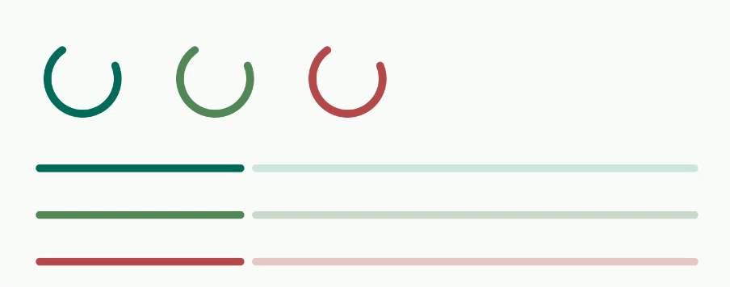
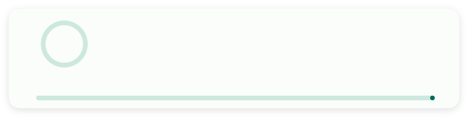
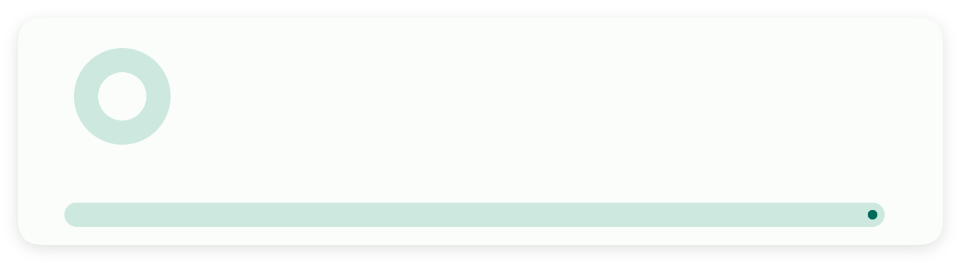
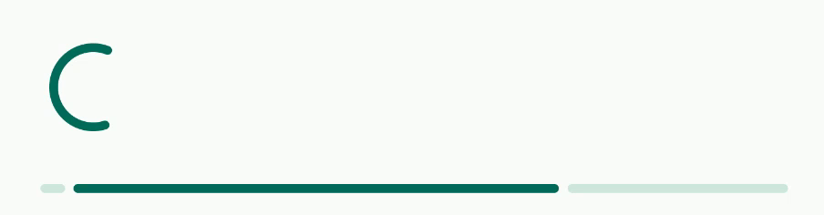
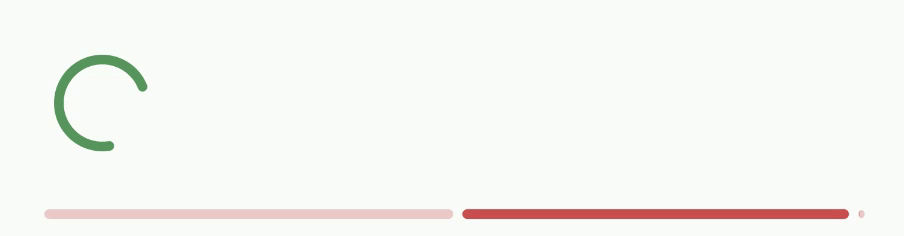
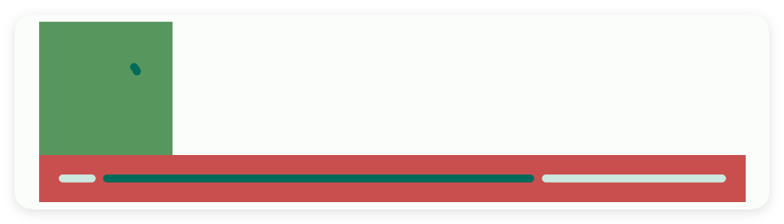

# 进度条

- 更新时间:2026-10-22 10:58:41

> 进度条-progress
> 
> 圆形原生类型:{com.google.android.material.progressindicator.CircularProgressIndicator}
> 线性原生类型:{com.google.android.material.progressindicator.LinearProgressIndicator}


<div style="width: 100%; position: relative; padding-bottom: 56.25%; height: 0; overflow: hidden;">
  <iframe 
    src="//player.bilibili.com/player.html?isOutside=true&aid=116227754168602&bvid=BV1p3wtziEEV&cid=36697608028&p=1" 
    style="position: absolute; top: 0; left: 0; width: 100%; height: 100%; border: none;"
    scrolling="no" 
    frameborder="no" 
    allowfullscreen="true">
  </iframe>
</div>

进度条：比如下载进度，游戏进度，进度条就是用来显示进度的控件





```html
// 用字符串保存布局；标签表示控件，属性控制控件的外观或初始状态。
var layoutXml =
    "<ui>\n" +
    "    <statusbar />\n" +
    "    <linear w=\"max\" padding=\"10\">\n" +
    "        <linear w=\"max\" dir=\"h\">\n" +
    "            <progress w=\"max\" padding=\"10\" run=\"true\" />\n" +
    "            <progress w=\"max\" color=\"#518855\" padding=\"10\" run=\"true\" />\n" +
    "            <progress w=\"max\" color=\"#B44A4A\" padding=\"10\" run=\"true\" />\n" +
    "        </linear>\n" +
    "        <progress w=\"max\" style=\"line\" run=\"true\" padding=\"10\" />\n" +
    "        <progress w=\"max\" style=\"line\" color=\"#518855\" padding=\"10\" run=\"true\" />\n" +
    "        <progress w=\"max\" style=\"line\" color=\"#B44A4A\" padding=\"10\" run=\"true\" />\n" +
    "    </linear>\n" +
    "</ui>";
// 解析布局得到界面对象，再显示界面。
var ui = $ui.layout(layoutXml);
ui.show();
```


## 一、基础用法


```html
// 用字符串保存布局；标签表示控件，属性控制控件的外观或初始状态。
var layoutXml =
    "<ui>\n" +
    "    <statusbar />\n" +
    "    <linear w=\"max\" padding=\"10\">\n" +
    "        <!-- 指定进度条的id -->\n" +
    "        <progress id=\"circularProgress\" w=\"max\"/>\n" +
    "        <progress id=\"lineProgress\" w=\"max\" style=\"line\"/>\n" +
    "    </linear>\n" +
    "</ui>";
// 解析布局得到界面对象，再显示界面。
var ui = $ui.layout(layoutXml);
ui.show();
```

```javascript
//解析布局
var ui = $ui.layout("ui.xml");
ui.show();//显示界面
//获取圆形/线性进度条
var cp = ui.id("circularProgress");
var lp = ui.id("lineProgress");
//动态模拟进度条的走动
for (var i = 1; i <= 10; i++) {
    sleep(150);
    //[核心]:设置进度
    cp.setProgress(i * 10);
    lp.setProgress(i * 10);
}
```


## 二、常用属性


### 可见 - 可见性

> 设置可见性


```html
// 用字符串保存布局；标签表示控件，属性控制控件的外观或初始状态。
var 布局内容 = `
<界面>
    <状态条 />
    <进度条 可见="否" />
</界面>
`;
// 解析布局得到界面对象，再显示界面。
var 界面 = $界面.解析布局(布局内容);
界面.显示();
```


### 风格 - 样式

> 设置样式


```html
// 用字符串保存布局；标签表示控件，属性控制控件的外观或初始状态。
var 布局内容 = `
<界面>
    <状态条 />
    <进度条 风格="直线" />
</界面>
`;
// 解析布局得到界面对象，再显示界面。
var 界面 = $界面.解析布局(布局内容);
界面.显示();
```




### 厚度 - 厚度

> 设置厚度


```html
// 用字符串保存布局；标签表示控件，属性控制控件的外观或初始状态。
var 布局内容 = `
<界面>
    <状态条 />
    <进度条 厚度="10" />
</界面>
`;
// 解析布局得到界面对象，再显示界面。
var 界面 = $界面.解析布局(布局内容);
界面.显示();
```




### 动画 - 动画

> 设置动画


```html
// 用字符串保存布局；标签表示控件，属性控制控件的外观或初始状态。
var 布局内容 = `
<界面>
    <状态条 />
    <进度条 动画="是" />
</界面>
`;
// 解析布局得到界面对象，再显示界面。
var 界面 = $界面.解析布局(布局内容);
界面.显示();
```




### 颜色 - 颜色

> 设置颜色


```html
// 用字符串保存布局；标签表示控件，属性控制控件的外观或初始状态。
var 布局内容 = `
<界面>
    <状态条 />
    <进度条 颜色="#FF0000" />
</界面>
`;
// 解析布局得到界面对象，再显示界面。
var 界面 = $界面.解析布局(布局内容);
界面.显示();
```




### 内边距 - 内边距

> 设置内边距


```html
// 用字符串保存布局；标签表示控件，属性控制控件的外观或初始状态。
var 布局内容 = `
<界面>
    <状态条 />
    <进度条 内边距="0,0,0,0" />
</界面>
`;
// 解析布局得到界面对象，再显示界面。
var 界面 = $界面.解析布局(布局内容);
界面.显示();
```


### 背景颜色 - 背景颜色

> 设置背景颜色


```html
// 用字符串保存布局；标签表示控件，属性控制控件的外观或初始状态。
var 布局内容 = `
<界面>
    <状态条 />
    <进度条 背景颜色="#1E1F22" />
</界面>
`;
// 解析布局得到界面对象，再显示界面。
var 界面 = $界面.解析布局(布局内容);
界面.显示();
```




### 背景图片 - 背景图片

> 设置背景图片


```html
// 用字符串保存布局；标签表示控件，属性控制控件的外观或初始状态。
// 示例用到的本地资源需要提前准备，请把文件路径改为项目中的实际路径。
var 布局内容 = `
<界面>
    <状态条 />
    <进度条 背景图片="./资源/图片01.png" />
</界面>
`;
// 解析布局得到界面对象，再显示界面。
var 界面 = $界面.解析布局(布局内容);
界面.显示();
```


### 存储关键字 - 应用内存储

> 应用内存储
> 
> 通过storeKey(存储关键字)指定一个存储整数的关键字，获取值时可以直接通过$storage($存储)获取进度值。
> 
> 注意：不同的控件存储的类型不同，对于本控件(进度条)则存储的是整数类型，表达当前进度值


```html
// 用字符串保存布局；标签表示控件，属性控制控件的外观或初始状态。
var 布局内容 =
    "<!-- 你必须在ui(界面)节点中通过store(存储)指定$storage($存储)的命名空间，等价于使用代码：var storage = $storage.create(\"MyAppProgress\"); -->\n" +
    "<界面 存储=\"MyAppInput\">\n" +
    "    <状态栏 />\n" +
    "    <!-- 使用storeKey(存储关键字)属性，指定关键字，等价于使用代码：var data = $storage.create(\"MyAppProgress\").getInt(\"进度\"); -->\n" +
    "    <!-- 使用storeDef(存储默认值)属性，指定关键字，等价于使用代码：var data = $storage.create(\"MyAppProgress\").getInt(\"进度\",50); -->\n" +
    "    <进度条 存储关键字=\"进度\" 存储默认值=\"50\" />\n" +
    "</界面>";
// 解析布局得到界面对象，再显示界面。
var 界面 = $界面.解析布局(布局内容);
界面.显示();
```


如果我们已经配置好了应用内存储，则可以直接获取数据：

注意：一、要使用应用内存储，必须在ui(界面)节点指定属性store(存储)的值，该值指定存储的命名空间；
二、不是所有的控件都支持应用内存储；
三、不同的控件存储的数据类型可能都不一致，例如：输入类型的控件存储的是字符串类型，开关、多选框存储的就是布尔类型的数据。


```javascript
//创建(或者加载)存储对象
var storage = $storage.create("MyAppProgress");//名称要一致
//获取数据
var data = storage.getInt("progress",50);//数据类型是整数
```


## 三、常用函数


### 设置进度(进度值)

> “设置进度”是 setProgress 的中文名字：让进度条走到指定数值（0 到 100）。

- 参数 : 进度值 {Number} 进度值，0 到最大值（默认 100）


```javascript
var ui = $ui.layout('<ui><statusbar/><progress id="mProgress" w="max"/></ui>');
ui.show(); //把界面显示出来
var progress = ui.id("mProgress"); //根据 id 拿到进度条
progress.设置进度(50); //走到一半
```


### 设置最大值(最大值)

> “设置最大值”是 setMax 的中文名字：改进度条满格是多少。

- 参数 : 最大值 {Number} 最大值


```javascript
var ui = $ui.layout('<ui><statusbar/><progress id="mProgress" w="max"/></ui>');
ui.show(); //把界面显示出来
var progress = ui.id("mProgress"); //根据 id 拿到进度条
progress.设置最大值(200); //满格改成 200
```


### 获取进度()

> “获取进度”是 getProgress 的中文名字：读出进度条当前走到了多少。

- 返回 : {Number} 当前进度值


```javascript
var ui = $ui.layout('<ui><statusbar/><progress id="mProgress" w="max"/></ui>');
ui.show(); //把界面显示出来
var progress = ui.id("mProgress"); //根据 id 拿到进度条
progress.setProgress(60);
var now = progress.获取进度(); //读出当前值
log("当前进度:" + now);
```


### 显示()

> “显示”是 show 的中文名字：让进度条显示出来。


```javascript
var ui = $ui.layout('<ui><statusbar/><progress id="mProgress" w="max" visible="false"/><button id="btn" text="显示"/></ui>');
ui.show(); //把界面显示出来
var progress = ui.id("mProgress"); //根据 id 拿到进度条
ui.id("btn").click(function() {
    progress.显示(); //显示
});
```


### 隐藏()

> “隐藏”是 hide 的中文名字：把进度条藏掉。


```javascript
var ui = $ui.layout('<ui><statusbar/><progress id="mProgress" w="max"/><button id="btn" text="隐藏"/></ui>');
ui.show(); //把界面显示出来
var progress = ui.id("mProgress"); //根据 id 拿到进度条
ui.id("btn").click(function() {
    progress.隐藏(); //隐藏
});
```


