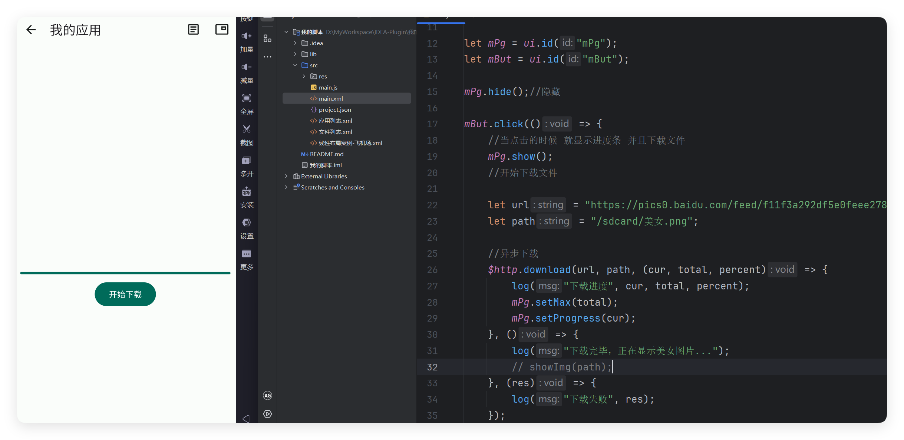

# 案例-下载图片

- 更新时间:2026-10-22 10:58:41


进度条下载案例，当点击按钮的时候，我将异步下载一个图片，并且显示进度到进度条上。




## Xml代码


```javascript
// 将布局内容作为字符串传入解析方法；返回值是可查找控件的界面对象。
var layout =
    "<ui>\n" +
    "    <statusbar/>\n" +
    "    <coord w=\"max\" h=\"max\">\n" +
    "        <appbar-layout w=\"max\">\n" +
    "            <appbar w=\"max\" id=\"mAppbar\" back=\"true\" title=\"我的应用\">\n" +
    "                <item icon=\"ic_article_outline\" text=\"日志\"/>\n" +
    "                <item icon=\"ic_picture_in_picture_outline\" text=\"日志悬浮窗\"/>\n" +
    "            </appbar>\n" +
    "        </appbar-layout>\n" +
    "        <linear behavior=\"appbar\" w=\"max\" h=\"max\" gravity=\"center\">\n" +
    "            <progress id=\"mPg\" style=\"line\" padding=\"10\"/>\n" +
    "            <button id=\"mBut\" text=\"开始下载\"/>\n" +
    "        </linear>\n" +
    "    </coord>\n" +
    "</ui>\n";
var ui = $ui.layout(layout);
```


## Js代码


```javascript
var ui = $ui.layout("main.xml");
var mAppbar = ui.id("mAppbar");
mAppbar.back(function() {
    ui.finish();
});
//显示界面
ui.show();
var mPg = ui.id("mPg");
var mBut = ui.id("mBut");
mPg.hide();//隐藏
mBut.click(function() {
    //当点击的时候 就显示进度条 并且下载文件
    mPg.show();
    //开始下载文件
    var url = "https://pics0.baidu.com/feed/f11f3a292df5e0feee2783e88baf3fa75fdf727e.jpeg?token=4afc91463326e4f4a44e2cde691a54a0";
    var path = "/sdcard/美女.png";
    //异步下载
    $http.download(url, path, function(cur, total, percent) {
        log("下载进度", cur, total, percent);
        mPg.setMax(total);
        mPg.setProgress(cur);
    }, function() {
        log("下载完毕，正在显示美女图片...");
        // showImg(path);
    }, function(res) {
        log("下载失败", res);
    });
});
```


