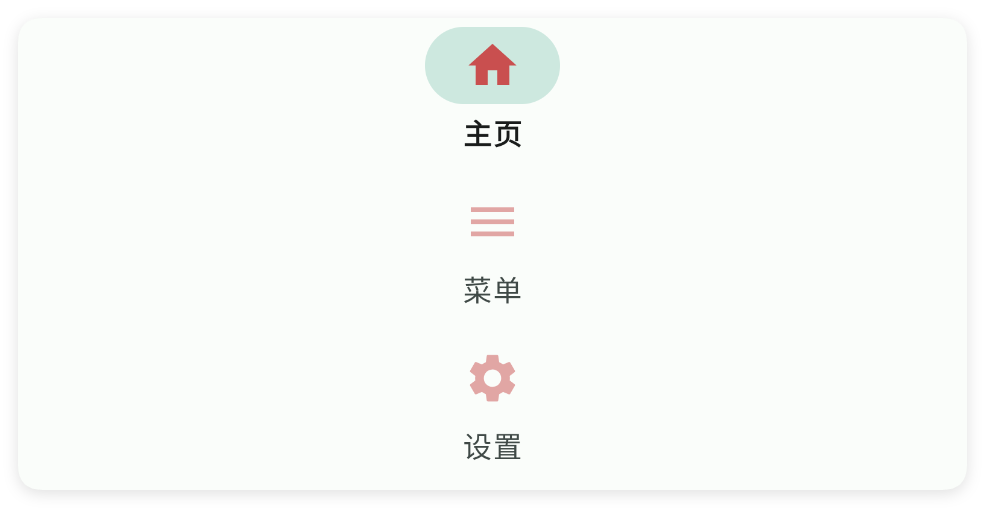
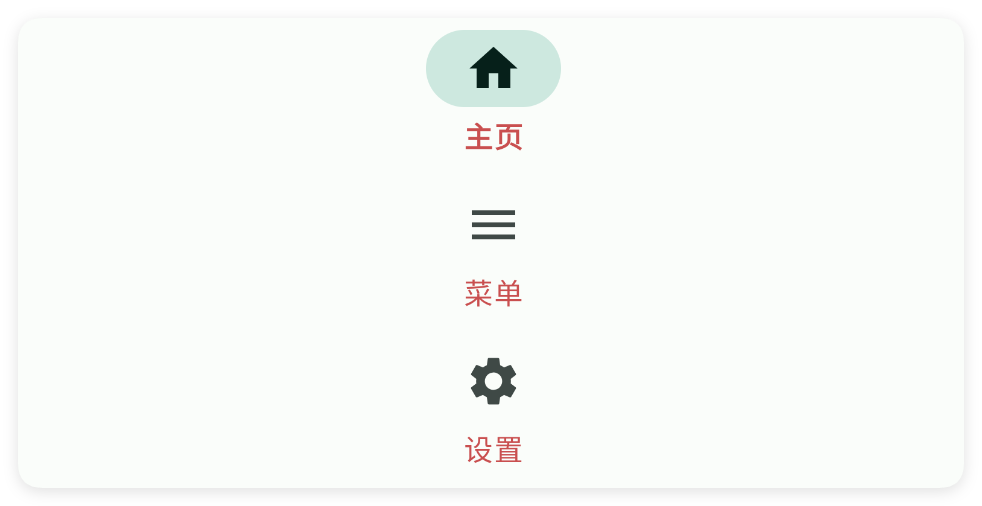
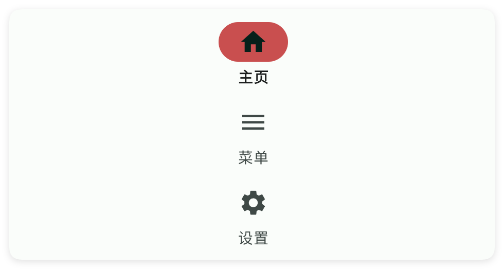
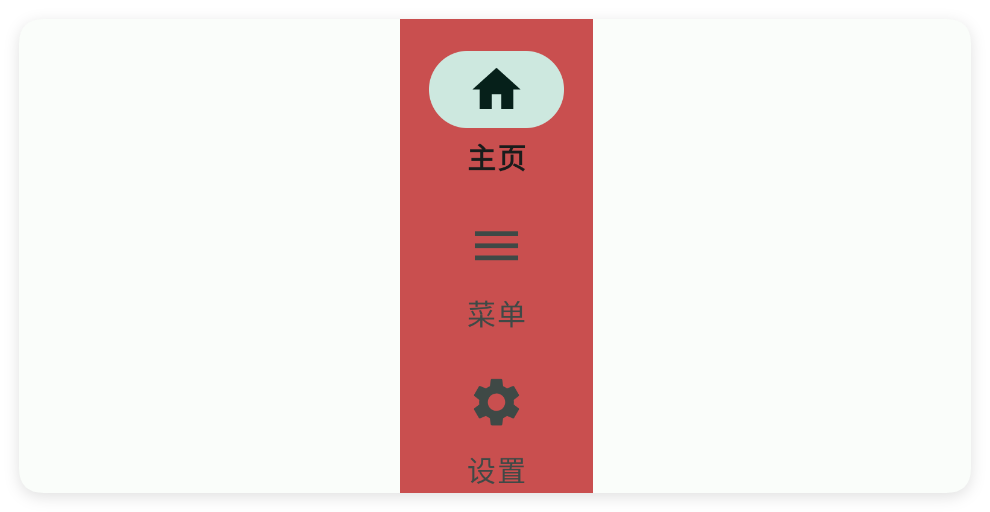

# 轨道

- 更新时间:2026-10-22 10:58:42

> 轨道-rail
> 
> 这个控件和nav导航栏控件很像，只不过是竖向排列的
> 
> 原生类型:{com.google.android.material.navigationrail.NavigationRailView}


<div style="width: 100%; position: relative; padding-bottom: 56.25%; height: 0; overflow: hidden;">
  <iframe 
    src="//player.bilibili.com/player.html?isOutside=true&aid=116230539187708&bvid=BV1G9wKztEGT&cid=36706190262&p=1" 
    style="position: absolute; top: 0; left: 0; width: 100%; height: 100%; border: none;"
    scrolling="no" 
    frameborder="no" 
    allowfullscreen="true">
  </iframe>
</div>

轨道：和导航栏、工具栏、应用条很相似，但是这个组件是竖着的。


## 一、常用属性


### 图标颜色 - 图标颜色

> 设置图标颜色


```html
// 用字符串保存布局；标签表示控件，属性控制控件的外观或初始状态。
var 布局内容 = `
<界面>
    <状态条 />
    <轨道 图标颜色="#C94F4F" 左外边距="80">
        <菜单 图标="ic_home_fill" 文本="主页" />
        <菜单 图标="ic_menu_fill" 文本="菜单" />
        <菜单 图标="ic_settings_fill" 文本="设置" />
    </轨道>
</界面>
`;
// 解析布局得到界面对象，再显示界面。
var 界面 = $界面.解析布局(布局内容);
界面.显示();
```




### 文本颜色 - 文本颜色

> 设置文本颜色


```html
// 用字符串保存布局；标签表示控件，属性控制控件的外观或初始状态。
var 布局内容 = `
<界面>
    <状态条 />
    <轨道 左外边距="160" 文本颜色="#C94F4F">
        <菜单 图标="ic_home_fill" 文本="主页" />
        <菜单 图标="ic_menu_fill" 文本="菜单" />
        <菜单 图标="ic_settings_fill" 文本="设置" />
    </轨道>
</界面>
`;
// 解析布局得到界面对象，再显示界面。
var 界面 = $界面.解析布局(布局内容);
界面.显示();
```




### 选中颜色 - 选中后图标颜色

> 设置选中后图标颜色


```html
// 用字符串保存布局；标签表示控件，属性控制控件的外观或初始状态。
var 布局内容 = `
<界面>
    <状态条 />
    <轨道 左外边距="240" 选中颜色="#C94F4F">
        <菜单 图标="ic_home_fill" 文本="主页" />
        <菜单 图标="ic_menu_fill" 文本="菜单" />
        <菜单 图标="ic_settings_fill" 文本="设置" />
    </轨道>
</界面>
`;
// 解析布局得到界面对象，再显示界面。
var 界面 = $界面.解析布局(布局内容);
界面.显示();
```




### 背景颜色 - 背景颜色

> 设置背景颜色


```html
// 用字符串保存布局；标签表示控件，属性控制控件的外观或初始状态。
var 布局内容 = `
<界面>
    <状态条 />
    <轨道 背景颜色="#C94F4F">
        <菜单 图标="ic_home_fill" 文本="主页" />
        <菜单 图标="ic_menu_fill" 文本="菜单" />
        <菜单 图标="ic_settings_fill" 文本="设置" />
    </轨道>
</界面>
`;
// 解析布局得到界面对象，再显示界面。
var 界面 = $界面.解析布局(布局内容);
界面.显示();
```




### 背景图片 - 背景图片

> 设置背景图片


```html
// 用字符串保存布局；标签表示控件，属性控制控件的外观或初始状态。
// 示例用到的本地资源需要提前准备，请把文件路径改为项目中的实际路径。
var 布局内容 = `
<界面>
    <状态条 />
    <轨道 左外边距="80" 背景图片="example/$ui - 交互界面/18.rail-轨道/img/img.png">
        <菜单 图标="ic_home_fill" 文本="主页" />
        <菜单 图标="ic_menu_fill" 文本="菜单" />
        <菜单 图标="ic_settings_fill" 文本="设置" />
    </轨道>
</界面>
`;
// 解析布局得到界面对象，再显示界面。
var 界面 = $界面.解析布局(布局内容);
界面.显示();
```


## 二、常用函数


### 设置背景颜色(颜色)

> “设置背景颜色（整数）”是 setBg(Number) 的中文名字：用 $color 预置颜色改轨道背景。

- 参数 : 颜色 {Number} 安卓颜色整数，常用 $color.BLACK 等预置颜色
- 版本 : 1.8.2


```javascript
var ui = $ui.layout('<ui><statusbar/><rail id="mRail" w="60"><menu text="主页"/><menu text="菜单"/></rail></ui>');
ui.show(); //把界面显示出来
var rail = ui.id("mRail"); //根据 id 拿到这个轨道栏
rail.设置背景颜色($color.BLACK); //涂黑
```


### 设置背景颜色(颜色)

> “设置背景颜色（字符串）”是 setBg(CharSequence) 的中文名字：用颜色字符串改轨道背景。

- 参数 : 颜色 {String} 颜色字符串，例如 "#FF0000"
- 版本 : 1.8.2


```javascript
var ui = $ui.layout('<ui><statusbar/><rail id="mRail" w="60"><menu text="主页"/><menu text="菜单"/></rail></ui>');
ui.show(); //把界面显示出来
var rail = ui.id("mRail"); //根据 id 拿到这个轨道栏
rail.设置背景颜色("#1E1F22"); //深灰
```


### 设置图标颜色(颜色)

> “设置图标颜色（整数）”是 setIconTint(Number) 的中文名字：用 $color 改图标颜色。

- 参数 : 颜色 {Number} 安卓颜色整数，常用 $color.WHITE 等预置颜色
- 版本 : 1.8.2


```javascript
var ui = $ui.layout('<ui><statusbar/><rail id="mRail" w="60"><menu text="主页"/><menu text="菜单"/></rail></ui>');
ui.show(); //把界面显示出来
var rail = ui.id("mRail"); //根据 id 拿到这个轨道栏
rail.设置图标颜色($color.WHITE); //涂白
```


### 设置图标颜色(颜色)

> “设置图标颜色（字符串）”是 setIconTint(CharSequence) 的中文名字：用颜色字符串改图标颜色。

- 参数 : 颜色 {String} 颜色字符串，例如 "#FF0000"
- 版本 : 1.8.2


```javascript
var ui = $ui.layout('<ui><statusbar/><rail id="mRail" w="60"><menu text="主页"/><menu text="菜单"/></rail></ui>');
ui.show(); //把界面显示出来
var rail = ui.id("mRail"); //根据 id 拿到这个轨道栏
rail.设置图标颜色("#FFFFFF"); //涂白
```


### 设置文本颜色(颜色)

> “设置文本颜色（整数）”是 setTextColor(Number) 的中文名字：用 $color 改菜单文字颜色。

- 参数 : 颜色 {Number} 安卓颜色整数，常用 $color.WHITE 等预置颜色
- 版本 : 1.8.2


```javascript
var ui = $ui.layout('<ui><statusbar/><rail id="mRail" w="60"><menu text="主页"/><menu text="菜单"/></rail></ui>');
ui.show(); //把界面显示出来
var rail = ui.id("mRail"); //根据 id 拿到这个轨道栏
rail.设置文本颜色($color.WHITE); //涂白
```


### 设置文本颜色(颜色)

> “设置文本颜色（字符串）”是 setTextColor(CharSequence) 的中文名字：用颜色字符串改菜单文字颜色。

- 参数 : 颜色 {String} 颜色字符串，例如 "#FF0000"
- 版本 : 1.8.2


```javascript
var ui = $ui.layout('<ui><statusbar/><rail id="mRail" w="60"><menu text="主页"/><menu text="菜单"/></rail></ui>');
ui.show(); //把界面显示出来
var rail = ui.id("mRail"); //根据 id 拿到这个轨道栏
rail.设置文本颜色("#FFFFFF"); //涂白
```


### 设置选中颜色(颜色)

> “设置选中颜色（整数）”是 setCheckColor(Number) 的中文名字：用 $color 改选中高亮条颜色。

- 参数 : 颜色 {Number} 安卓颜色整数，常用 $color.RED 等预置颜色
- 版本 : 1.8.2


```javascript
var ui = $ui.layout('<ui><statusbar/><rail id="mRail" w="60"><menu text="主页"/><menu text="菜单"/></rail></ui>');
ui.show(); //把界面显示出来
var rail = ui.id("mRail"); //根据 id 拿到这个轨道栏
rail.设置选中颜色($color.RED); //涂红
```


### 设置选中颜色(颜色)

> “设置选中颜色（字符串）”是 setCheckColor(CharSequence) 的中文名字：用颜色字符串改选中高亮条。

- 参数 : 颜色 {String} 颜色字符串，例如 "#FF0000"
- 版本 : 1.8.2


```javascript
var ui = $ui.layout('<ui><statusbar/><rail id="mRail" w="60"><menu text="主页"/><menu text="菜单"/></rail></ui>');
ui.show(); //把界面显示出来
var rail = ui.id("mRail"); //根据 id 拿到这个轨道栏
rail.设置选中颜色("#FF0000"); //涂红
```


### 选中(索引)

> “选中”是 check 的中文名字：代码里主动选中轨道栏里第几个菜单。

- 参数 : 索引 {Number} 要选中的菜单下标，从 0 开始


```javascript
var ui = $ui.layout('<ui><statusbar/><rail id="mRail" w="60"><menu text="主页"/><menu text="菜单"/><menu text="设置"/></rail></ui>');
ui.show(); //把界面显示出来
var rail = ui.id("mRail"); //根据 id 拿到这个轨道栏
rail.选中(2); //选中第三个
```


### 菜单(回调)

> “菜单”是 menu 的中文名字：监听用户点了轨道栏里哪个菜单，回调里拿到菜单文字。

- 参数 : 回调 {function} 点击回调，参数是被点菜单的文字


```javascript
var ui = $ui.layout('<ui><statusbar/><rail id="mRail" w="60"><menu text="主页"/><menu text="菜单"/><menu text="设置"/></rail></ui>');
ui.show(); //把界面显示出来
var rail = ui.id("mRail"); //根据 id 拿到这个轨道栏
rail.菜单(function(title) {
    log("你点了:" + title);
});
```


