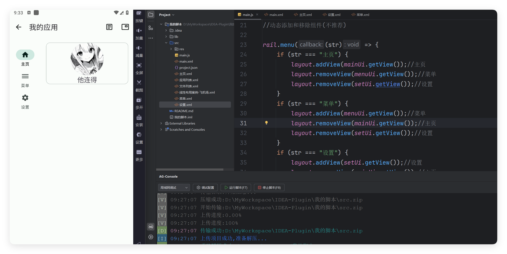

# 案例-动态组件

- 更新时间:2026-10-22 10:58:42


<div style="width: 100%; position: relative; padding-bottom: 56.25%; height: 0; overflow: hidden;">
  <iframe 
    src="//player.bilibili.com/player.html?isOutside=true&aid=116230555965486&bvid=BV1GQwKzfEiL&cid=36706191400&p=1" 
    style="position: absolute; top: 0; left: 0; width: 100%; height: 100%; border: none;"
    scrolling="no" 
    frameborder="no" 
    allowfullscreen="true">
  </iframe>
</div>

本案例将演示如何动态添加和移除布局组件。




## Xml代码

位于 /项目/main.xml


```javascript
// 将布局内容作为字符串传入解析方法；返回值是可查找控件的界面对象。
var layout =
    "<ui>\n" +
    "    <statusbar/>\n" +
    "    <coord w=\"max\" h=\"max\">\n" +
    "        <appbar-layout w=\"max\">\n" +
    "            <appbar w=\"max\" id=\"mAppbar\" back=\"true\" title=\"我的应用\">\n" +
    "                <item icon=\"ic_article_outline\" text=\"日志\"/>\n" +
    "                <item icon=\"ic_picture_in_picture_outline\" text=\"日志悬浮窗\"/>\n" +
    "            </appbar>\n" +
    "        </appbar-layout>\n" +
    "        <linear behavior=\"appbar\" dir=\"h\" w=\"max\" h=\"max\" gravity=\"start\">\n" +
    "            <rail id=\"rail\" weight=\"0.1\">\n" +
    "                <menu icon=\"ic_home_fill\" text=\"主页\"/>\n" +
    "                <menu icon=\"ic_dehaze_outline\" text=\"菜单\"/>\n" +
    "                <menu icon=\"ic_settings_fill\" text=\"设置\"/>\n" +
    "            </rail>\n" +
    "            <!--布局主体-->\n" +
    "            <linear id=\"layout\" gravity=\"center|top\" weight=\"0.9\" h=\"max\">\n" +
    "            </linear>\n" +
    "        </linear>\n" +
    "    </coord>\n" +
    "</ui>\n";
var ui = $ui.layout(layout);
```


## Xml代码 - 主页

位于 /项目/主页.xml


```javascript
// 将布局内容作为字符串传入解析方法；返回值是可查找控件的界面对象。
var layout =
    "<ui>\n" +
    "    <linear id=\"layout\" gravity=\"center|top\" h=\"max\" w=\"max\">\n" +
    "        <card w=\"max\" margin=\"15\">\n" +
    "            <linear dir=\"v\" w=\"max\" gravity=\"center|top\">\n" +
    "                \n" +
    "                <text text=\"他连得\" size=\"20\"/>\n" +
    "            </linear>\n" +
    "        </card>\n" +
    "    </linear>\n" +
    "</ui>\n";
var ui = $ui.layout(layout);
```


## Xml代码 - 菜单

位于 /项目/菜单.xml


```javascript
// 将布局内容作为字符串传入解析方法；返回值是可查找控件的界面对象。
var layout =
    "<ui>\n" +
    "    <linear id=\"layout\" gravity=\"center|top\" h=\"max\" w=\"max\">\n" +
    "        <!--设置选项-->\n" +
    "        <text gravity=\"center\" h=\"50\" selectable=\"true\" text=\"设置选项 item标签\" />\n" +
    "        <drop w=\"max\">\n" +
    "            <item text=\"吃饭\" />\n" +
    "            <item text=\"睡觉\" />\n" +
    "        </drop>\n" +
    "        <!--设置风格-->\n" +
    "        <text gravity=\"center\" h=\"50\" selectable=\"true\" text=\"设置风格 style=outline\" />\n" +
    "        <drop style=\"outline\" w=\"max\">\n" +
    "            <item text=\"吃饭\" />\n" +
    "            <item text=\"睡觉\" />\n" +
    "        </drop>\n" +
    "        <!--设置主题颜色-->\n" +
    "        <text gravity=\"center\" h=\"50\" selectable=\"true\" text=\"设置主题颜色 color=颜色\" />\n" +
    "        <drop style=\"outline\" color=\"#F44236\" def=\"睡觉\" hint=\"你的爱好\" w=\"max\">\n" +
    "            <item text=\"吃饭\" />\n" +
    "            <item text=\"睡觉\" />\n" +
    "        </drop>\n" +
    "    </linear>\n" +
    "</ui>\n";
var ui = $ui.layout(layout);
```


## Xml代码 - 设置

位于 /项目/设置.xml


```javascript
// 将布局内容作为字符串传入解析方法；返回值是可查找控件的界面对象。
var layout =
    "<ui>\n" +
    "    <linear id=\"layout\" gravity=\"center|top\" h=\"max\" w=\"max\">\n" +
    "        <button style=\"outline\" text=\"斜体文本\" typeface=\"italic\" w=\"max\" />\n" +
    "        <button style=\"outline\" text=\"粗体文本\" typeface=\"bold\" w=\"max\" />\n" +
    "        <button style=\"outline\" text=\"粗体斜体文本\" typeface=\"bold_italic\" w=\"max\" />\n" +
    "        <check check=\"true\" color=\"#518855\" text=\"吃饭\" />\n" +
    "        <check check=\"true\" color=\"#C94F4F\" text=\"睡觉\" />\n" +
    "        <check check=\"true\" color=\"#3471E9\" text=\"游戏\" />\n" +
    "        <chip text=\"看我尺寸\" textSize=\"10\" />\n" +
    "        <chip text=\"看我尺寸\" textSize=\"15\" />\n" +
    "        <chip text=\"看我尺寸\" textSize=\"18\" />\n" +
    "    </linear>\n" +
    "</ui>\n";
var ui = $ui.layout(layout);
```


## JS代码


```javascript
var ui = $ui.layout("main.xml");
var mAppbar = ui.id("mAppbar");
mAppbar.back(function() {
    ui.finish();
});
//XView当中的XLayout类型
var layout = ui.id("layout");
var rail = ui.id("rail");
//解析三个布局(UI)
var mainUi = $ui.layout("主页.xml");
var menuUi = $ui.layout("菜单.xml");
var setUi = $ui.layout("设置.xml");
//先默认显示主页
layout.addView(mainUi.getView());//主页
//动态添加和移除组件(不推荐)
rail.menu(function(str) {
    if (str === "主页") {
        layout.addView(mainUi.getView());//主页
        layout.removeView(menuUi.getView());//菜单
        layout.removeView(setUi.getView());//设置
    }
    if (str === "菜单") {
        layout.addView(menuUi.getView());//菜单
        layout.removeView(mainUi.getView());//主页
        layout.removeView(setUi.getView());//设置
    }
    if (str === "设置") {
        layout.addView(setUi.getView());//设置
        layout.removeView(mainUi.getView());//主页
        layout.removeView(menuUi.getView());//菜单
    }
});
//显示界面(为了保证不出错)
ui.show();
```


