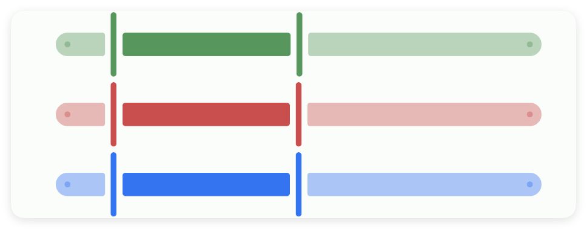
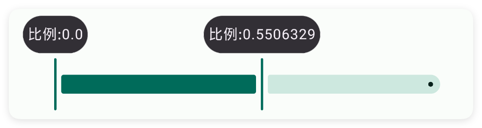

# 范围

- 更新时间:2026-10-22 10:58:42

> 范围-range
> 
> 原生类型:{com.google.android.material.slider.RangeSlider}


<div style="width: 100%; position: relative; padding-bottom: 56.25%; height: 0; overflow: hidden;">
  <iframe 
    src="//player.bilibili.com/player.html?isOutside=true&aid=116230639851454&bvid=BV1VDwKz8EUJ&cid=36706519694&p=1" 
    style="position: absolute; top: 0; left: 0; width: 100%; height: 100%; border: none;"
    scrolling="no" 
    frameborder="no" 
    allowfullscreen="true">
  </iframe>
</div>

范围条：用来选择范围的滑动条。


## 一、常用属性


### 开始值 - 开始值

> 设置开始值


```html
// 将布局保存为字符串；标签表示控件，标签中的属性决定显示效果。
var 布局内容 = `
<界面>
    <状态条 />
    <范围 宽="最大" 开始值="0" 结束值="100" />
</界面>
`;
// 解析布局后得到界面对象，显示它即可查看本节属性的效果。
var 界面 = $界面.解析布局(布局内容);
界面.显示();
```


### 结束值 - 结束值

> 设置结束值


```html
// 将布局保存为字符串；标签表示控件，标签中的属性决定显示效果。
var 布局内容 = `
<界面>
    <状态条 />
    <范围 宽="最大" 开始值="0" 结束值="100" />
</界面>
`;
// 解析布局后得到界面对象，显示它即可查看本节属性的效果。
var 界面 = $界面.解析布局(布局内容);
界面.显示();
```


### 左初始值 - 左初始值

> 设置左初始值


```html
// 将布局保存为字符串；标签表示控件，标签中的属性决定显示效果。
var 布局内容 = `
<界面>
    <状态条 />
    <范围 宽="最大" 左初始值="10" 开始值="0" 结束值="100" />
    <范围 宽="最大" 左初始值="20" 开始值="0" 结束值="100" />
</界面>
`;
// 解析布局后得到界面对象，显示它即可查看本节属性的效果。
var 界面 = $界面.解析布局(布局内容);
界面.显示();
```


### 右初始值 - 右初始值

> 设置右初始值


```html
// 将布局保存为字符串；标签表示控件，标签中的属性决定显示效果。
var 布局内容 = `
<界面>
    <状态条 />
    <范围 右初始值="50" 宽="最大" 左初始值="10" 开始值="0" 结束值="100" />
    <范围 右初始值="50" 宽="最大" 左初始值="20" 开始值="0" 结束值="100" />
</界面>
`;
// 解析布局后得到界面对象，显示它即可查看本节属性的效果。
var 界面 = $界面.解析布局(布局内容);
界面.显示();
```


### 进步值 - 进步值

> 设置进步值


```html
// 将布局保存为字符串；标签表示控件，标签中的属性决定显示效果。
var 布局内容 = `
<界面>
    <状态条 />
    <范围 右初始值="50" 宽="最大" 左初始值="10" 开始值="0" 结束值="100" 进步值="1" />
</界面>
`;
// 解析布局后得到界面对象，显示它即可查看本节属性的效果。
var 界面 = $界面.解析布局(布局内容);
界面.显示();
```


### 主题颜色 - 主题颜色

> 设置主题颜色


```html
// 将布局保存为字符串；标签表示控件，标签中的属性决定显示效果。
var 布局内容 = `
<界面>
    <状态条 />
    <范围 主题颜色="#57965C" 右初始值="50" 宽="最大" 左初始值="10" 开始值="0"
        结束值="100" />
    <范围 主题颜色="#C94F4F" 右初始值="50" 宽="最大" 左初始值="10" 开始值="0"
        结束值="100" />
    <范围 主题颜色="#3574F0" 右初始值="50" 宽="最大" 左初始值="10" 开始值="0"
        结束值="100" />
</界面>
`;
// 解析布局后得到界面对象，显示它即可查看本节属性的效果。
var 界面 = $界面.解析布局(布局内容);
界面.显示();
```




### 标签 - 标签文字

> 设置标签文字


```html
// 将布局保存为字符串；标签表示控件，标签中的属性决定显示效果。
var 布局内容 = `
<界面>
    <状态条 />
    <范围 宽="最大" 标签="比例:" />
</界面>
`;
// 解析布局后得到界面对象，显示它即可查看本节属性的效果。
var 界面 = $界面.解析布局(布局内容);
界面.显示();
```




### 标签尾部 - 标签文字尾部

> 设置标签文字尾部


```html
// 将布局保存为字符串；标签表示控件，标签中的属性决定显示效果。
var 布局内容 = `
<界面>
    <状态条 />
    <范围 宽="最大" 标签尾部="%" />
</界面>
`;
// 解析布局后得到界面对象，显示它即可查看本节属性的效果。
var 界面 = $界面.解析布局(布局内容);
界面.显示();
```


### 背景颜色 - 背景颜色

> 设置背景颜色


```html
// 将布局保存为字符串；标签表示控件，标签中的属性决定显示效果。
var 布局内容 = `
<界面>
    <状态条 />
    <范围 宽="最大" 背景颜色="#57965C" />
    <范围 宽="最大" 背景颜色="#C94F4F" />
    <范围 宽="最大" 背景颜色="#3574F0" />
</界面>
`;
// 解析布局后得到界面对象，显示它即可查看本节属性的效果。
var 界面 = $界面.解析布局(布局内容);
界面.显示();
```


### 背景图片 - 背景图片

> 设置背景图片


```html
// 将布局保存为字符串；标签表示控件，标签中的属性决定显示效果。
// 若布局引用图片、视频或其他资源，请先准备文件并改成实际可用的路径。
var 布局内容 = `
<界面>
    <状态条 />
    <范围 宽="最大" 背景图片="example/$ui - 交互界面/19.range-范围条/img/img.png" />
</界面>
`;
// 解析布局后得到界面对象，显示它即可查看本节属性的效果。
var 界面 = $界面.解析布局(布局内容);
界面.显示();
```


## 二、常用函数


### 标签格式化(回调)

> “标签格式化”是 onLabel 的中文名字：自定义拖动时弹出小标签上显示的文字。

- 参数 : 回调 {function} 格式化函数，参数是当前数值，返回要显示的文字


```javascript
var ui = $ui.layout('<ui><statusbar/><range id="mRange" w="max" from="0" to="100"/></ui>');
ui.show(); //把界面显示出来
var range = ui.id("mRange"); //根据 id 拿到这个范围条
range.标签格式化(function(value) {
    return "¥" + value;
});
```


### 监听变化(回调)

> “监听变化”是 onChange 的中文名字：拖动范围条时回调，并告诉你当前开始值和结束值。

- 参数 : 回调 {function} 变化回调，参数依次为当前开始值、当前结束值


```javascript
var ui = $ui.layout('<ui><statusbar/><range id="mRange" w="max" from="0" to="100"/></ui>');
ui.show(); //把界面显示出来
var range = ui.id("mRange"); //根据 id 拿到这个范围条
range.监听变化(function(from, to) {
    log("当前范围:" + from + " ~ " + to);
});
```


### 获取范围()

> “获取范围”是 getRange 的中文名字：读出当前选的范围，返回 [开始值, 结束值]。

- 返回 : {Array} 长度为 2 的数组，[开始值, 结束值]


```javascript
var ui = $ui.layout('<ui><statusbar/><range id="mRange" w="max" from="0" to="100"/></ui>');
ui.show(); //把界面显示出来
var range = ui.id("mRange"); //根据 id 拿到这个范围条
range.setData(20, 80);
var r = range.获取范围(); //读出来
log("从" + r[0] + "到" + r[1]);
```


### 设置数据(开始, 结束)

> “设置数据”是 setData 的中文名字：代码里直接设左右两个圆点的位置。

- 参数 : 开始 {Number} 左边（开始）的值
- 参数 : 结束 {Number} 右边（结束）的值，必须比开始大


```javascript
var ui = $ui.layout('<ui><statusbar/><range id="mRange" w="max" from="0" to="100"/></ui>');
ui.show(); //把界面显示出来
var range = ui.id("mRange"); //根据 id 拿到这个范围条
range.设置数据(20, 80); //左 20，右 80
```


