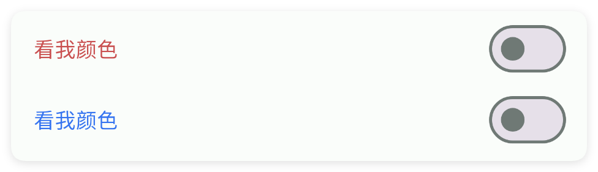
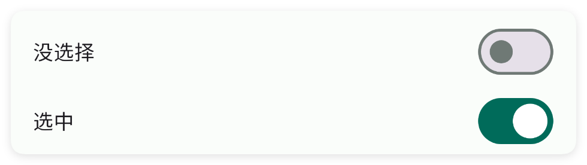
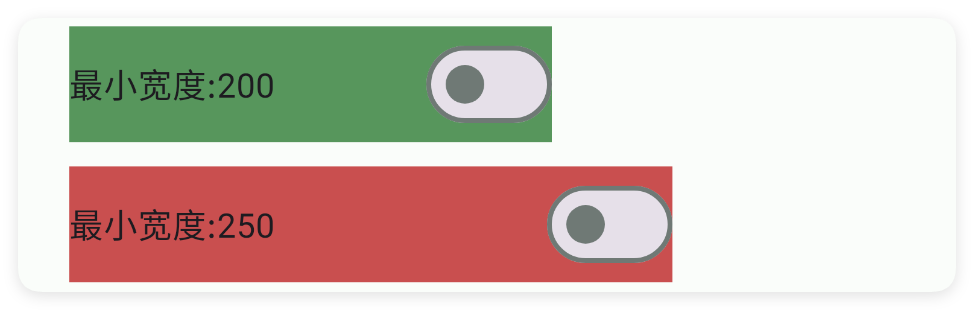
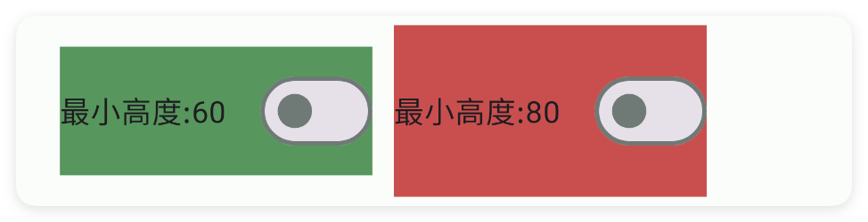
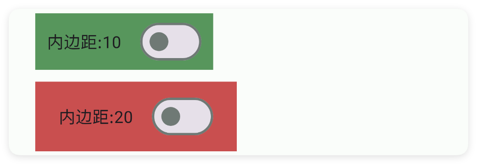
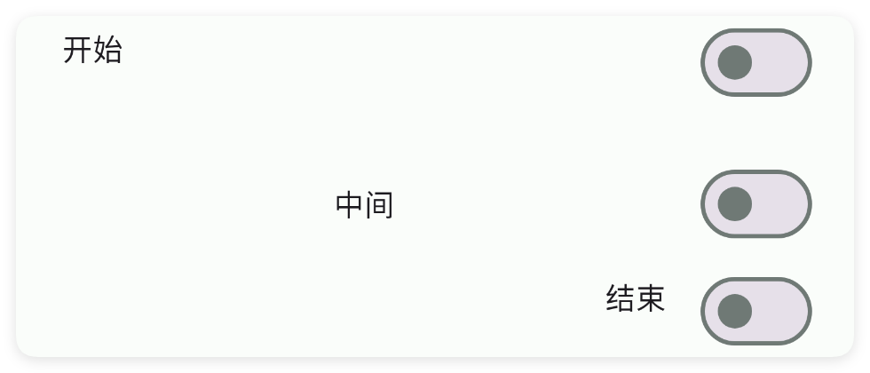
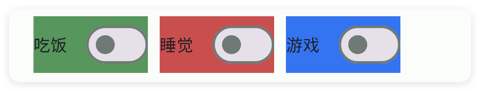
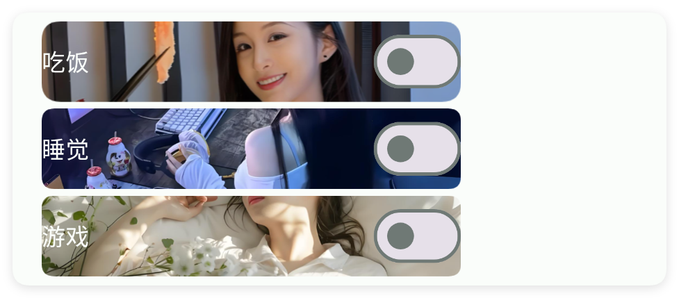

# 开关

- 更新时间:2026-10-22 10:58:42

> 开关-switch
> 
> 原生类型:{com.google.android.material.materialswitch.MaterialSwitch}


<div style="width: 100%; position: relative; padding-bottom: 56.25%; height: 0; overflow: hidden;">
  <iframe 
    src="//player.bilibili.com/player.html?isOutside=true&aid=116230723737632&bvid=BV1bEwKzHEW2&cid=36706845515&p=1" 
    style="position: absolute; top: 0; left: 0; width: 100%; height: 100%; border: none;"
    scrolling="no" 
    frameborder="no" 
    allowfullscreen="true">
  </iframe>
</div>

开关：顾名思义，就是开关的意思，只有打开或者关闭两种状态。


## 一、常用属性


### 主题颜色 - 主题颜色

> 设置主题颜色


```html
// 用字符串保存布局；其中的属性就是本节演示的设置。
var 布局内容 = `
<界面>
    <状态条 />
    <线性布局 宽="最大" 方向="横向">
        <开关 主题颜色="#57965C" 外边距="5" 文本="吃饭" />
        <开关 主题颜色="#C94F4F" 外边距="5" 文本="睡觉" />
        <开关 主题颜色="#3574F0" 外边距="5" 文本="游戏" />
    </线性布局>
    <线性布局 宽="最大" 方向="横向">
        <开关 主题颜色="#57965C" 外边距="5" 文本="吃饭" 选中="是" />
        <开关 主题颜色="#C94F4F" 外边距="5" 文本="睡觉" 选中="是" />
        <开关 主题颜色="#3574F0" 外边距="5" 文本="游戏" 选中="是" />
    </线性布局>
</界面>
`;
var 界面 = $界面.解析布局(布局内容); // 解析布局并创建控件。
界面.显示(); // 显示界面，观察属性效果。
```


### 文本 - 文本

> 设置文本


```html
// 用字符串保存布局；其中的属性就是本节演示的设置。
var 布局内容 = `
<界面>
    <状态条 />
    <开关 宽="最大" 文本="我是文本" />
</界面>
`;
var 界面 = $界面.解析布局(布局内容); // 解析布局并创建控件。
界面.显示(); // 显示界面，观察属性效果。
```


### 文本尺寸 - 文本尺寸

> 设置文本尺寸


```html
// 用字符串保存布局；其中的属性就是本节演示的设置。
var 布局内容 = `
<界面>
    <状态条 />
    <开关 宽="最大" 文本="我的尺寸:10" 文本尺寸="10" />
    <开关 宽="最大" 文本="我的尺寸:17" 文本尺寸="17" />
</界面>
`;
var 界面 = $界面.解析布局(布局内容); // 解析布局并创建控件。
界面.显示(); // 显示界面，观察属性效果。
```


### 文本颜色 - 文本颜色

> 设置文本颜色


```html
// 用字符串保存布局；其中的属性就是本节演示的设置。
var 布局内容 = `
<界面>
    <状态条 />
    <开关 宽="最大" 文本="看我颜色" 文本颜色="#C94F4F" />
    <开关 宽="最大" 文本="看我颜色" 文本颜色="#3574F0" />
</界面>
`;
var 界面 = $界面.解析布局(布局内容); // 解析布局并创建控件。
界面.显示(); // 显示界面，观察属性效果。
```




### 选中 - 是否选中

> 设置是否选中


```html
// 用字符串保存布局；其中的属性就是本节演示的设置。
var 布局内容 = `
<界面>
    <状态条 />
    <开关 宽="最大" 文本="没选择" 选中="否" />
    <开关 宽="最大" 文本="选中" 选中="是" />
</界面>
`;
var 界面 = $界面.解析布局(布局内容); // 解析布局并创建控件。
界面.显示(); // 显示界面，观察属性效果。
```




### 最小宽度 - 最小宽度

> 设置最小宽度


```html
// 用字符串保存布局；其中的属性就是本节演示的设置。
var 布局内容 = `
<界面>
    <状态条 />
    <线性布局 宽="最大" 方向="竖向">
        <!--为了看清效果，这里设置背景颜色-->
        <开关 外边距="5" 文本="最小宽度:200" 最小宽度="200" 背景颜色="#57965C" />
        <开关 外边距="5" 文本="最小宽度:250" 最小宽度="250" 背景颜色="#C94F4F" />
    </线性布局>
</界面>
`;
var 界面 = $界面.解析布局(布局内容); // 解析布局并创建控件。
界面.显示(); // 显示界面，观察属性效果。
```




### 最小高度 - 最小高度

> 设置最小高度


```html
// 用字符串保存布局；其中的属性就是本节演示的设置。
var 布局内容 = `
<界面>
    <状态条 />
    <线性布局 宽="最大" 方向="横向">
        <!--为了看清效果，这里设置背景颜色-->
        <开关 外边距="5" 文本="最小高度:60" 最小高度="60" 背景颜色="#57965C" />
        <开关 外边距="5" 文本="最小高度:80" 最小高度="80" 背景颜色="#C94F4F" />
    </线性布局>
</界面>
`;
var 界面 = $界面.解析布局(布局内容); // 解析布局并创建控件。
界面.显示(); // 显示界面，观察属性效果。
```




### 内边距 - 内边距

> 设置内边距
> 
> 参数顺序:左,上,右,下(单位:dp)


```html
// 用字符串保存布局；其中的属性就是本节演示的设置。
var 布局内容 = `
<界面>
    <状态条 />
    <线性布局 宽="最大" 方向="竖向">
        <!--为了看清效果，这里设置背景颜色-->
        <开关 内边距="10" 外边距="5" 文本="内边距:10" 背景颜色="#57965C" />
        <开关 内边距="20" 外边距="5" 文本="内边距:20" 背景颜色="#C94F4F" />
    </线性布局>
</界面>
`;
var 界面 = $界面.解析布局(布局内容); // 解析布局并创建控件。
界面.显示(); // 显示界面，观察属性效果。
```




### 重力 - 重力

> 设置重力
> 
> 可选值参考重力参数表


```html
// 用字符串保存布局；其中的属性就是本节演示的设置。
var 布局内容 = `
<界面>
    <状态条 />
    <线性布局 宽="最大" 方向="竖向">
        <开关 外边距="5" 宽="最大" 文本="开始" 重力="start" />
        <开关 外边距="5" 宽="最大" 文本="中间" 重力="中间" />
        <开关 外边距="5" 宽="最大" 文本="结束" 重力="end" />
    </线性布局>
</界面>
`;
var 界面 = $界面.解析布局(布局内容); // 解析布局并创建控件。
界面.显示(); // 显示界面，观察属性效果。
```




### 背景颜色 - 背景颜色

> 设置背景颜色


```html
// 用字符串保存布局；其中的属性就是本节演示的设置。
var 布局内容 = `
<界面>
    <状态条 />
    <线性布局 宽="最大" 方向="横向">
        <开关 外边距="5" 文本="吃饭" 背景颜色="#57965C" />
        <开关 外边距="5" 文本="睡觉" 背景颜色="#C94F4F" />
        <开关 外边距="5" 文本="游戏" 背景颜色="#3574F0" />
    </线性布局>
</界面>
`;
var 界面 = $界面.解析布局(布局内容); // 解析布局并创建控件。
界面.显示(); // 显示界面，观察属性效果。
```




### 背景图片 - 背景图片

> 设置背景图片


```html
// 用字符串保存布局；其中的属性就是本节演示的设置。
var 布局内容 = `
<界面>
    <状态条 />
    <线性布局 宽="最大" 方向="竖向">
        <!--
        文本颜色="背景" 是一种动态设置文本颜色的方式，表示当前字体颜色是背景颜色。
        -->
        <开关 外边距="2" 宽="250" 文本="吃饭" 文本颜色="背景"
            背景图片="example/$ui - 交互界面/03.check-复选框/img/bg01.png" />
        <开关 外边距="2" 宽="250" 文本="睡觉" 文本颜色="背景"
            背景图片="example/$ui - 交互界面/03.check-复选框/img/bg02.png" />
        <开关 外边距="2" 宽="250" 文本="游戏" 文本颜色="背景"
            背景图片="example/$ui - 交互界面/03.check-复选框/img/bg03.png" />
    </线性布局>
</界面>
`;
var 界面 = $界面.解析布局(布局内容); // 解析布局并创建控件。
界面.显示(); // 显示界面，观察属性效果。
```




### 存储关键字 - 应用内存储

> 应用内存储
> 
> 通过storeKey(存储关键字)指定一个存储布尔值的关键字，获取值时可以直接通过$storage($存储)获取布尔值。
> 
> 注意：不同的控件存储的类型不同，对于本控件(开关)则存储的是布尔值类型，表达当前是否被打开


```html
// 将布局写成字符串，无需另建 ui.xml 文件。
var 布局内容 =
    "<!-- 你必须在ui(界面)节点中通过store(存储)指定$storage($存储)的命名空间，等价于使用代码：var storage = $storage.create(\"MyAppSwitch\"); -->\n" +
    "<界面 存储=\"MyAppSwitch\">\n" +
    "    <状态条 />\n" +
    "    <!-- 使用storeKey(存储关键字)属性，指定关键字，等价于使用代码：var eat = $storage.create(\"MyAppSwitch\").getBool(\"喜欢吃饭\"); -->\n" +
    "    <!-- 使用storeDef(存储默认值)属性，指定默认值，等价于使用代码：var eat = $storage.create(\"MyAppSwitch\").getBool(\"喜欢吃饭\",true); -->\n" +
    "    <开关 存储默认值=\"是\" 存储关键字=\"喜欢吃饭\" 文本=\"热爱干饭\" />\n" +
    "</界面>";
var 界面 = $界面.解析布局(布局内容);
界面.显示(); // 显示界面，后面的事件示例继续使用这个对象。
```


如果我们已经配置好了应用内存储，则可以直接获取数据：

注意：一、要使用应用内存储，必须在ui(界面)节点指定属性store(存储)的值，该值指定存储的命名空间；
二、不是所有的控件都支持应用内存储；
三、不同的控件存储的数据类型可能都不一致，例如：输入类型的控件存储的是字符串类型，开关、多选框存储的就是布尔类型的数据。


```javascript
//创建(或者加载)存储对象
var storage = $storage.create("MyAppSwitch");//名称要一致
//获取数据
var data = storage.getBoolean("loveEat",false);//数据类型是布尔值
```


## 二、常用函数


### 设置选中(状态)

> “设置选中”是 check 的中文名字：代码里直接把开关拨到打开或关闭。

- 参数 : 状态 {Boolean} true 打开，false 关闭


```javascript
var ui = $ui.layout('<ui><statusbar/><switch id="mSwitch" text="WiFi"/></ui>');
ui.show(); //把界面显示出来
var sw = ui.id("mSwitch"); //根据 id 拿到这个开关
sw.设置选中(true); //拨到打开
```


### 是选中的()

> “是选中的”是 isChecked 的中文名字：读出开关现在是打开还是关闭。

- 返回 : {boolean} true 表示打开，false 表示关闭
- 版本 : 1.8.2


```javascript
var ui = $ui.layout('<ui><statusbar/><switch id="mSwitch" text="WiFi"/></ui>');
ui.show(); //把界面显示出来
var sw = ui.id("mSwitch"); //根据 id 拿到这个开关
if (sw.是选中的()) {
    log("开关是打开的");
}
```


### 监听选中(回调)

> “监听选中”是 onCheck 的中文名字：用户拨动开关时回调，并告诉你现在是开还是关。

- 参数 : 回调 {function} 状态变化回调，参数 true 打开 / false 关闭；传 null 取消


```javascript
var ui = $ui.layout('<ui><statusbar/><switch id="mSwitch" text="WiFi"/></ui>');
ui.show(); //把界面显示出来
var sw = ui.id("mSwitch"); //根据 id 拿到这个开关
sw.监听选中(function(checked) {
    if (checked) {
        log("打开了");
    } else {
        log("关闭了");
    }
});
```


### 设置重力(重力)

> “设置重力”是 setGravity 的中文名字：设开关在那一行里靠哪边对齐。

- 参数 : 重力 {String} 对齐方式，例如 "center"、"left"、"right|bottom"


```javascript
var ui = $ui.layout('<ui><statusbar/><switch id="mSwitch" w="max" text="居中"/></ui>');
ui.show(); //把界面显示出来
var sw = ui.id("mSwitch"); //根据 id 拿到这个开关
sw.设置重力("center"); //整体居中
```


### 设置文本(文本)

> “设置文本”是 setText 的中文名字：代码里改开关旁边显示的那行字。

- 参数 : 文本 {String} 要显示的文字


```javascript
var ui = $ui.layout('<ui><statusbar/><switch id="mSwitch" text="旧字"/></ui>');
ui.show(); //把界面显示出来
var sw = ui.id("mSwitch"); //根据 id 拿到这个开关
sw.设置文本("是否开启省电模式"); //改成新字
```


### 获取文本()

> “获取文本”是 getText 的中文名字：读出开关旁边现在显示的那行字。

- 返回 : {String} 开关旁边的文字，没有则为空串


```javascript
var ui = $ui.layout('<ui><statusbar/><switch id="mSwitch" text="省电模式"/></ui>');
ui.show(); //把界面显示出来
var sw = ui.id("mSwitch"); //根据 id 拿到这个开关
var text = sw.获取文本();
log("开关旁边写的是:" + text);
```


### 设置主题颜色(颜色)

> “设置主题颜色”是 setColor 的中文名字：换开关打开时那道横条和小圆点的颜色。

- 参数 : 颜色 {String} 颜色字符串，例如 "#3574F0"


```javascript
var ui = $ui.layout('<ui><statusbar/><switch id="mSwitch" text="WiFi"/></ui>');
ui.show(); //把界面显示出来
var sw = ui.id("mSwitch"); //根据 id 拿到这个开关
sw.设置主题颜色("#3574F0"); //主题色变蓝
```


### 设置文本颜色(颜色)

> “设置文本颜色”是 setTextColor 的中文名字：换开关旁边那行字的颜色。

- 参数 : 颜色 {String} 颜色字符串，例如 "#FF0000"


```javascript
var ui = $ui.layout('<ui><statusbar/><switch id="mSwitch" text="WiFi"/></ui>');
ui.show(); //把界面显示出来
var sw = ui.id("mSwitch"); //根据 id 拿到这个开关
sw.设置文本颜色("#FF0000"); //文字变红
```


