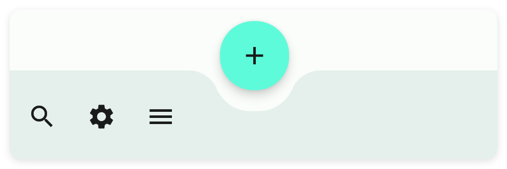
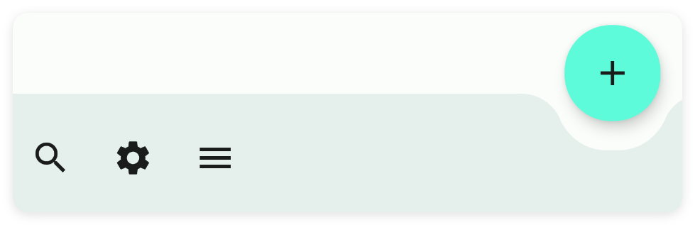
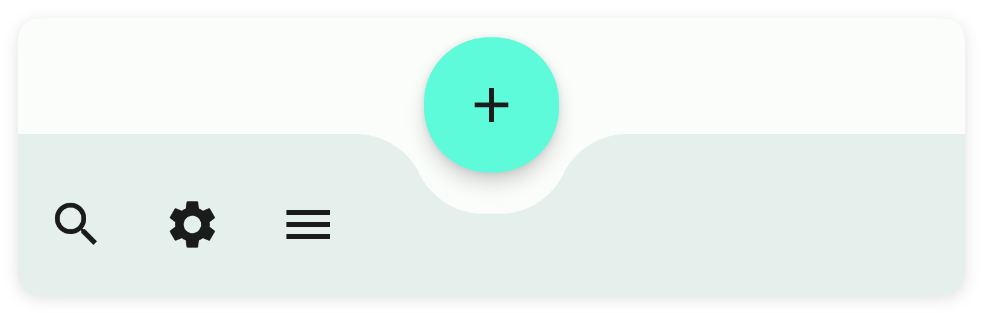

# 工具栏

- 更新时间:2026-10-22 10:58:42

> 工具栏-toolbar
> 
> 原生类型:{com.google.android.material.bottomappbar.BottomAppBar}


<div style="width: 100%; position: relative; padding-bottom: 56.25%; height: 0; overflow: hidden;">
  <iframe 
    src="//player.bilibili.com/player.html?isOutside=true&aid=116230807687629&bvid=BV1ybwKzyEt9&cid=36707238993&p=1" 
    style="position: absolute; top: 0; left: 0; width: 100%; height: 100%; border: none;"
    scrolling="no" 
    frameborder="no" 
    allowfullscreen="true">
  </iframe>
</div>

一般放在布局的最下方作为工具条




## 一、常用属性


### 背景颜色 - 背景颜色

> 设置背景颜色
> 
> icon/图标：用于指定图标，可以填写图标库的名称，也可以填写图标的相对路径或者绝对路径


```html
// 用字符串保存布局；标签表示控件，属性控制控件的外观或初始状态。
var 布局内容 = `
<界面>
    <状态条 />
    <工具条 宽="最大" 背景颜色="#C94F4F">
        <菜单 图标="ic_home_fill" 文本="主页" />
        <菜单 图标="ic_settings_fill" 文本="设置" />
        <菜单 图标="ic_more_horiz_fill" 文本="更多" />
    </工具条>
</界面>
`;
// 解析布局得到界面对象，再显示界面。
var 界面 = $界面.解析布局(布局内容);
界面.显示();
```


### 背景图片 - 背景图片

> 设置背景图片


```html
// 用字符串保存布局；标签表示控件，属性控制控件的外观或初始状态。
// 示例用到的本地资源需要提前准备，请把文件路径改为项目中的实际路径。
var 布局内容 = `
<界面>
    <状态条 />
    <工具条 宽="最大" 背景图片="example/$ui - 交互界面/26.toolbar-工具条/img/img.png">
        <菜单 图标="ic_home_fill" 文本="主页" />
        <菜单 图标="ic_settings_fill" 文本="设置" />
        <菜单 图标="ic_more_horiz_fill" 文本="更多" />
    </工具条>
</界面>
`;
// 解析布局得到界面对象，再显示界面。
var 界面 = $界面.解析布局(布局内容);
界面.显示();
```


## 二、锚定系统

在M3的布局中有一种很有趣的锚定系统，它允许多个组件通过锚定来进行布局的调整，类似于船舶停靠在码头。

在这里我将实现最常用的fab(悬浮按钮)和toolbar(应用条)的锚定系统，值得提醒的是：有一件比较遗憾的事情，目前锚点系统中，只有toolbar(工具条)可以和fab(悬浮按钮)组成联动效果。


示例代码：


```html
// 用字符串保存布局；标签表示控件，属性控制控件的外观或初始状态。
var 布局内容 = `
<界面>
    <状态条 />
    <!--
    anchor属性是所有控件都有的属性，但是使用anchorLayout属性必须要被coord锚点布局包才可以
    -->
    <锚点布局 宽="最大" 高="max">
        <!--应用标题栏-->
        <应用条布局 宽="最大">
            <!--
            back:开启返回按钮
            scrollFlags:配置滚动布局滚动时的动画标记
            -->
            <应用条 副标题="工具条" 宽="最大" 标识="mAppbar" 标题="Toolbar"
                滑动标识="滑动|进入时总是可见" 返回="是" />
        </应用条布局>
        <!--
        锚点="nested" 指的是:给滑动布局(nested)取一个驿站名称为'nested'
        行为="应用条" 只要是在 coord 中的布局都可以设置 behavior 属性，该属性只有两个值：fab(悬浮按钮)和appbar(应用条)
        当(behavior)行为设置为(appbar)应用条时，(nested)滑动布局会自动拼接到(appbar)应用标下方，而不会覆盖应用条。
        -->
        <滑动布局 宽="最大" 背景颜色="bg" 行为="应用条" 锚点="nested" 高="max">
            <!--
            下外边距="75" 刚好显示在工具条(toolbar)上面，免得工具条(toolbar)遮盖到线性布局(linear)的内容
            -->
            <线性布局 下外边距="75" 宽="最大" 方向="竖向" 重力="中间">
                <文本 文本="文本1" 高="210" />
                <文本 文本="文本2" 高="210" />
                <文本 文本="文本3" 高="210" />
                <文本 文本="文本4" 高="210" />
                <文本 文本="文本5" 高="210" />
            </线性布局>
        </滑动布局>
        <!--
        锚点控件="nested" 指的是:锚定到名称为'nested'的布局上
        锚点="toolbar" 给工具条(toolbar)取一个驿站名称为'toolbar'
        锚点重力="中间|下" 只有被coord(锚点布局)包裹的子控件可以设置这个属性，用来指定相对于锚点布局的对齐方式
        按钮模式="外部" 用来配置停靠在(toolbar)工具条上(fab)悬浮按钮的停靠方式，有两种值：in(内部) 和 out(外部)
        -->
        <工具条 按钮重力="中间" 宽="最大" 布局重力="下" 按钮动画="滑动" 按钮弧度="25"
            按钮模式="外部" 锚点="toolbar" 锚点控件="nested" 锚点重力="中间|下" 高="75">
            <菜单 图标="ic_search_fill" 文本="搜搜" />
            <菜单 图标="ic_settings_fill" 文本="设置" />
            <菜单 图标="ic_menu_fill" 文本="菜单" />
        </工具条>
        <!--
        这里我让(fab)悬浮按钮锚定到(toolbar)工作条的布局上，同时在(toolbar)工作条的布局上设置悬浮按钮的样式，
        然而(toolbar)工作条能够专门和(fab)悬浮按一起联动，实现凹陷的效果。
        锚点控件="toolbar" 锚定到名称为'toolbar'的布局上
        -->
        <悬浮按钮 图标="ic_add_outline" 图标颜色="txt" 弧度="27" 锚点控件="toolbar" />
        <!--
        在上面的布局中，锚定的顺序是 fab(悬浮按钮) -> toolbar(工具条) ->  linear(线性布局)
        这一切都必须在coord(锚点布局)中，否则锚定关系将无效
        -->
    </锚点布局>
</界面>
`;
// 解析布局得到界面对象，再显示界面。
var 界面 = $界面.解析布局(布局内容);
界面.显示();
```


### 设置按钮模式


```html
// 用字符串保存布局；标签表示控件，属性控制控件的外观或初始状态。
var 布局内容 = `
<界面>
    <状态条 />
    <锚点布局 宽="最大" 高="max">
        <应用条布局 宽="最大">
            <应用条 副标题="工具条" 宽="最大" 标识="mAppbar" 标题="Toolbar"
                滑动标识="滑动|进入时总是可见" 返回="是" />
        </应用条布局>
        <滑动布局 宽="最大" 背景颜色="bg" 行为="应用条" 锚点="nested" 高="max">
            <线性布局 下外边距="75" 宽="最大" 方向="竖向" 重力="中间">
                <文本 文本="文本1" 高="210" />
                <文本 文本="文本2" 高="210" />
                <文本 文本="文本3" 高="210" />
                <文本 文本="文本4" 高="210" />
                <文本 文本="文本5" 高="210" />
            </线性布局>
        </滑动布局>
        <!--
        设置按钮模式：按钮模式="外部"
        -->
        <工具条 按钮重力="中间" 宽="最大" 布局重力="下" 按钮动画="滑动" 按钮弧度="25"
            按钮模式="外部" 锚点="toolbar" 锚点控件="nested" 锚点重力="中间|下" 高="75">
            <菜单 图标="ic_search_fill" 文本="搜搜" />
            <菜单 图标="ic_settings_fill" 文本="设置" />
            <菜单 图标="ic_menu_fill" 文本="菜单" />
        </工具条>
        <悬浮按钮 图标="ic_add_outline" 图标颜色="txt" 弧度="27" 锚点控件="toolbar" />
    </锚点布局>
</界面>
`;
// 解析布局得到界面对象，再显示界面。
var 界面 = $界面.解析布局(布局内容);
界面.显示();
```


#### 按钮模式：(in)内部


```html
// 用字符串保存布局；标签表示控件，属性控制控件的外观或初始状态。
var 布局内容 = `
<界面>
    <状态条 />
    <工具条 宽="最大" 按钮模式="内部" />
</界面>
`;
// 解析布局得到界面对象，再显示界面。
var 界面 = $界面.解析布局(布局内容);
界面.显示();
```


#### 按钮模式：(out)外部


```html
// 用字符串保存布局；标签表示控件，属性控制控件的外观或初始状态。
var 布局内容 = `
<界面>
    <状态条 />
    <工具条 宽="最大" 按钮模式="外部" />
</界面>
`;
// 解析布局得到界面对象，再显示界面。
var 界面 = $界面.解析布局(布局内容);
界面.显示();
```


### 设置按钮重力


```html
// 用字符串保存布局；标签表示控件，属性控制控件的外观或初始状态。
var 布局内容 = `
<界面>
    <状态条 />
    <锚点布局 宽="最大" 高="max">
        <应用条布局 宽="最大">
            <应用条 副标题="工具条" 宽="最大" 标识="mAppbar" 标题="Toolbar"
                滑动标识="滑动|进入时总是可见" 返回="是" />
        </应用条布局>
        <滑动布局 宽="最大" 背景颜色="bg" 行为="应用条" 锚点="nested" 高="max">
            <线性布局 下外边距="75" 宽="最大" 方向="竖向" 重力="中间">
                <文本 文本="文本1" 高="210" />
                <文本 文本="文本2" 高="210" />
                <文本 文本="文本3" 高="210" />
                <文本 文本="文本4" 高="210" />
                <文本 文本="文本5" 高="210" />
            </线性布局>
        </滑动布局>
        <!--
        设置按钮重力：按钮重力="中间"
        -->
        <工具条 按钮重力="中间" 宽="最大" 布局重力="下" 按钮动画="滑动" 按钮弧度="25"
            按钮模式="外部" 锚点="toolbar" 锚点控件="nested" 锚点重力="中间|下" 高="75">
            <菜单 图标="ic_search_fill" 文本="搜搜" />
            <菜单 图标="ic_settings_fill" 文本="设置" />
            <菜单 图标="ic_menu_fill" 文本="菜单" />
        </工具条>
        <悬浮按钮 图标="ic_add_outline" 图标颜色="txt" 弧度="27" 锚点控件="toolbar" />
    </锚点布局>
</界面>
`;
// 解析布局得到界面对象，再显示界面。
var 界面 = $界面.解析布局(布局内容);
界面.显示();
```


#### 按钮重力：(center)中间


```html
// 用字符串保存布局；标签表示控件，属性控制控件的外观或初始状态。
var 布局内容 = `
<界面>
    <状态条 />
    <工具条 按钮重力="中间" 宽="最大" />
</界面>
`;
// 解析布局得到界面对象，再显示界面。
var 界面 = $界面.解析布局(布局内容);
界面.显示();
```


#### 按钮重力：(end)结束


```html
// 用字符串保存布局；标签表示控件，属性控制控件的外观或初始状态。
var 布局内容 = `
<界面>
    <状态条 />
    <工具条 按钮重力="结束" 宽="最大" />
</界面>
`;
// 解析布局得到界面对象，再显示界面。
var 界面 = $界面.解析布局(布局内容);
界面.显示();
```




### 设置按钮外边距(中间)

该属性需要指定fabGravity(按钮重力)=center(中间)


```html
// 用字符串保存布局；标签表示控件，属性控制控件的外观或初始状态。
var 布局内容 = `
<界面>
    <状态条 />
    <锚点布局 宽="最大" 高="max">
        <应用条布局 宽="最大">
            <应用条 副标题="工具条" 宽="最大" 标识="mAppbar" 标题="Toolbar"
                滑动标识="滑动|进入时总是可见" 返回="是" />
        </应用条布局>
        <滑动布局 宽="最大" 背景颜色="bg" 行为="应用条" 锚点="nested" 高="max">
            <线性布局 下外边距="75" 宽="最大" 方向="竖向" 重力="中间">
                <文本 文本="文本1" 高="210" />
                <文本 文本="文本2" 高="210" />
                <文本 文本="文本3" 高="210" />
                <文本 文本="文本4" 高="210" />
                <文本 文本="文本5" 高="210" />
            </线性布局>
        </滑动布局>
        <!--
        设置按钮外边距：按钮边距="10"
        -->
        <工具条 按钮重力="中间" 按钮边距="10" 宽="最大" 布局重力="下" 按钮动画="滑动"
            按钮弧度="25" 按钮模式="外部" 锚点="toolbar" 锚点控件="nested" 锚点重力="中间|下"
            高="75">
            <菜单 图标="ic_search_fill" 文本="搜搜" />
            <菜单 图标="ic_settings_fill" 文本="设置" />
            <菜单 图标="ic_menu_fill" 文本="菜单" />
        </工具条>
        <悬浮按钮 图标="ic_add_outline" 图标颜色="txt" 弧度="27" 锚点控件="toolbar" />
    </锚点布局>
</界面>
`;
// 解析布局得到界面对象，再显示界面。
var 界面 = $界面.解析布局(布局内容);
界面.显示();
```


#### 按钮外边距：10


```html
// 用字符串保存布局；标签表示控件，属性控制控件的外观或初始状态。
var 布局内容 = `
<界面>
    <状态条 />
    <工具条 按钮边距="10" 宽="最大" />
</界面>
`;
// 解析布局得到界面对象，再显示界面。
var 界面 = $界面.解析布局(布局内容);
界面.显示();
```


#### 按钮外边距：30


```html
// 用字符串保存布局；标签表示控件，属性控制控件的外观或初始状态。
var 布局内容 = `
<界面>
    <状态条 />
    <工具条 按钮边距="30" 宽="最大" />
</界面>
`;
// 解析布局得到界面对象，再显示界面。
var 界面 = $界面.解析布局(布局内容);
界面.显示();
```


### 设置按钮外边距(结束)

该属性需要指定fabGravity(按钮重力)=end(结束)


```html
// 用字符串保存布局；标签表示控件，属性控制控件的外观或初始状态。
var 布局内容 = `
<界面>
    <状态条 />
    <锚点布局 宽="最大" 高="max">
        <应用条布局 宽="最大">
            <应用条 副标题="工具条" 宽="最大" 标识="mAppbar" 标题="Toolbar"
                滑动标识="滑动|进入时总是可见" 返回="是" />
        </应用条布局>
        <滑动布局 宽="最大" 背景颜色="bg" 行为="应用条" 锚点="nested" 高="max">
            <线性布局 下外边距="75" 宽="最大" 方向="竖向" 重力="中间">
                <文本 文本="文本1" 高="210" />
                <文本 文本="文本2" 高="210" />
                <文本 文本="文本3" 高="210" />
                <文本 文本="文本4" 高="210" />
                <文本 文本="文本5" 高="210" />
            </线性布局>
        </滑动布局>
        <!--
        设置按钮外边距：按钮结束边距="10"
        -->
        <工具条 按钮结束边距="10" 按钮重力="结束" 宽="最大" 布局重力="下" 按钮动画="滑动"
            按钮弧度="25" 按钮模式="外部" 锚点="toolbar" 锚点控件="nested" 锚点重力="中间|下"
            高="75">
            <菜单 图标="ic_search_fill" 文本="搜搜" />
            <菜单 图标="ic_settings_fill" 文本="设置" />
            <菜单 图标="ic_menu_fill" 文本="菜单" />
        </工具条>
        <悬浮按钮 图标="ic_add_outline" 图标颜色="txt" 弧度="27" 锚点控件="toolbar" />
    </锚点布局>
</界面>
`;
// 解析布局得到界面对象，再显示界面。
var 界面 = $界面.解析布局(布局内容);
界面.显示();
```


#### 按钮结束外边距：10


```html
// 用字符串保存布局；标签表示控件，属性控制控件的外观或初始状态。
var 布局内容 = `
<界面>
    <状态条 />
    <工具条 按钮结束边距="10" 宽="最大" />
</界面>
`;
// 解析布局得到界面对象，再显示界面。
var 界面 = $界面.解析布局(布局内容);
界面.显示();
```


#### 按钮结束外边距：30


```html
// 用字符串保存布局；标签表示控件，属性控制控件的外观或初始状态。
var 布局内容 = `
<界面>
    <状态条 />
    <工具条 按钮结束边距="30" 宽="最大" />
</界面>
`;
// 解析布局得到界面对象，再显示界面。
var 界面 = $界面.解析布局(布局内容);
界面.显示();
```


### 设置按钮弧度


```html
// 用字符串保存布局；标签表示控件，属性控制控件的外观或初始状态。
var 布局内容 = `
<界面>
    <状态条 />
    <锚点布局 宽="最大" 高="max">
        <应用条布局 宽="最大">
            <应用条 副标题="工具条" 宽="最大" 标识="mAppbar" 标题="Toolbar"
                滑动标识="滑动|进入时总是可见" 返回="是" />
        </应用条布局>
        <滑动布局 宽="最大" 背景颜色="bg" 行为="应用条" 锚点="nested" 高="max">
            <线性布局 下外边距="75" 宽="最大" 方向="竖向" 重力="中间">
                <文本 文本="文本1" 高="210" />
                <文本 文本="文本2" 高="210" />
                <文本 文本="文本3" 高="210" />
                <文本 文本="文本4" 高="210" />
                <文本 文本="文本5" 高="210" />
            </线性布局>
        </滑动布局>
        <!--
        设置按钮弧度：按钮弧度="25"
        -->
        <工具条 按钮重力="中间" 宽="最大" 布局重力="下" 按钮动画="滑动" 按钮弧度="25"
            按钮模式="外部" 锚点="toolbar" 锚点控件="nested" 锚点重力="中间|下" 高="75">
            <菜单 图标="ic_search_fill" 文本="搜搜" />
            <菜单 图标="ic_settings_fill" 文本="设置" />
            <菜单 图标="ic_menu_fill" 文本="菜单" />
        </工具条>
        <悬浮按钮 图标="ic_add_outline" 图标颜色="txt" 弧度="27" 锚点控件="toolbar" />
    </锚点布局>
</界面>
`;
// 解析布局得到界面对象，再显示界面。
var 界面 = $界面.解析布局(布局内容);
界面.显示();
```


#### 按钮弧度：10


```html
// 用字符串保存布局；标签表示控件，属性控制控件的外观或初始状态。
var 布局内容 = `
<界面>
    <状态条 />
    <工具条 宽="最大" 按钮弧度="10" />
</界面>
`;
// 解析布局得到界面对象，再显示界面。
var 界面 = $界面.解析布局(布局内容);
界面.显示();
```


#### 按钮弧度：30


```html
// 用字符串保存布局；标签表示控件，属性控制控件的外观或初始状态。
var 布局内容 = `
<界面>
    <状态条 />
    <工具条 宽="最大" 按钮弧度="30" />
</界面>
`;
// 解析布局得到界面对象，再显示界面。
var 界面 = $界面.解析布局(布局内容);
界面.显示();
```




## 三、常用函数


### 菜单(回调)

> 监听菜单事件

- 参数 : 回调 {function(标题){}} 菜单点击事件


```javascript
//监听菜单事件
工具栏.菜单(function(标题){
    控制台.日志(标题);
});
```


