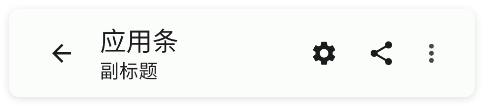
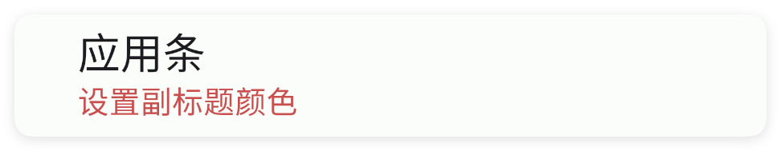
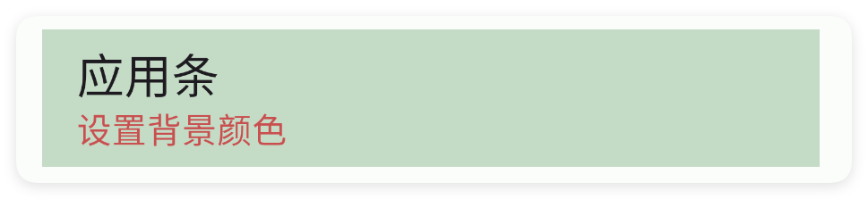
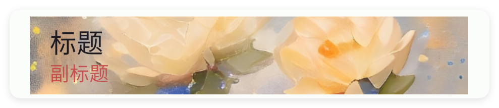
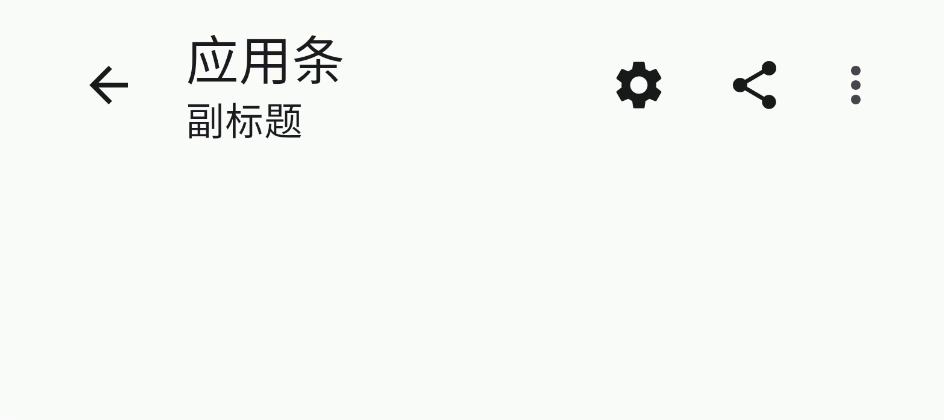
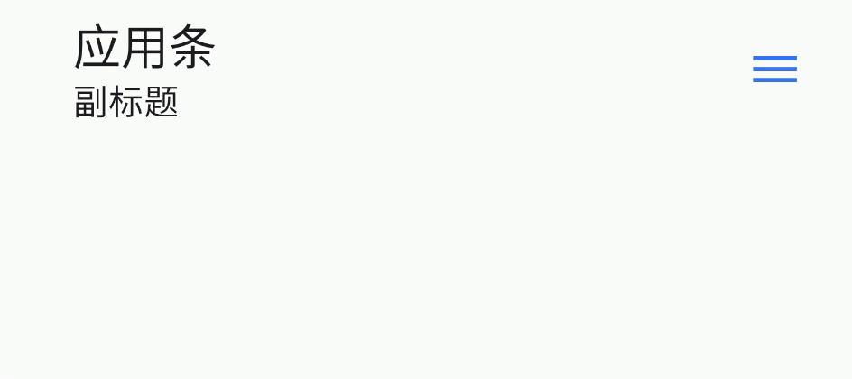
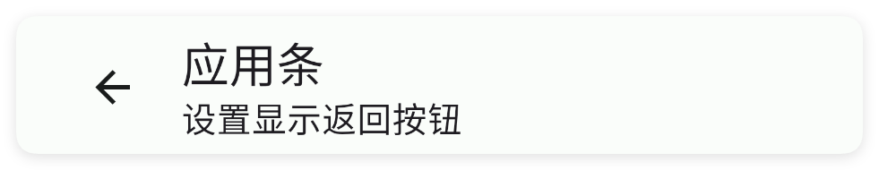
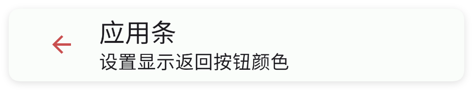

# 应用条

- 更新时间:2026-10-22 10:58:39

> 应用条-appbar
> 
> 原生类型:{com.google.android.material.appbar.MaterialToolbar}
> 
> 在使用的时候最好配合[appbar-layout]组件一起使用


<div style="width: 100%; position: relative; padding-bottom: 56.25%; height: 0; overflow: hidden;">
  <iframe 
    src="//player.bilibili.com/player.html?isOutside=true&aid=116222150710414&bvid=BV1XjwJzcE8L&cid=36674996205&p=1" 
    style="position: absolute; top: 0; left: 0; width: 100%; height: 100%; border: none;"
    scrolling="no" 
    frameborder="no" 
    allowfullscreen="true">
  </iframe>
</div>

应用条是一个软件的顶部条，用来显示标题、操作按钮等。




## 一、常用属性


### title - 标题

> 设置标题


```html
// 用字符串保存布局；其中的属性就是本节演示的设置。
var layoutXml = `
<ui>
    <statusbar />
    <appbar-layout w="max">
        <appbar title="标题" w="max" />
    </appbar-layout>
</ui>
`;
var ui = $ui.layout(layoutXml); // 解析布局并创建控件。
ui.show(); // 显示界面，观察属性效果。
```


### subTitle - 副标题

> 设置副标题


```html
// 用字符串保存布局；其中的属性就是本节演示的设置。
var layoutXml = `
<ui>
    <statusbar />
    <appbar-layout w="max">
        <appbar subTitle="副标题" title="标题" w="max" />
    </appbar-layout>
</ui>
`;
var ui = $ui.layout(layoutXml); // 解析布局并创建控件。
ui.show(); // 显示界面，观察属性效果。
```


### titleColor - 标题颜色

> 设置标题颜色


```html
// 用字符串保存布局；其中的属性就是本节演示的设置。
var layoutXml = `
<ui>
    <statusbar />
    <appbar-layout w="max">
        <appbar title="标题" titleColor="#C94F4F" w="max" />
    </appbar-layout>
</ui>
`;
var ui = $ui.layout(layoutXml); // 解析布局并创建控件。
ui.show(); // 显示界面，观察属性效果。
```




### subTitleColor - 副标题颜色

> 设置副标题颜色


```html
// 用字符串保存布局；其中的属性就是本节演示的设置。
var layoutXml = `
<ui>
    <statusbar />
    <appbar-layout w="max">
        <appbar subTitle="设置副标题颜色" subTitleColor="#C94F4F" title="应用条"
            w="max" />
    </appbar-layout>
</ui>
`;
var ui = $ui.layout(layoutXml); // 解析布局并创建控件。
ui.show(); // 显示界面，观察属性效果。
```




### icon - 图标

> 设置图标


```html
// 用字符串保存布局；其中的属性就是本节演示的设置。
var layoutXml = `
<ui>
    <statusbar />
    <appbar-layout w="max">
        <appbar icon="ic_message_outline" subTitle="设置图标" title="应用条" w="max" />
    </appbar-layout>
</ui>
`;
var ui = $ui.layout(layoutXml); // 解析布局并创建控件。
ui.show(); // 显示界面，观察属性效果。
```


### iconTint - 图标颜色

> 设置图标颜色


```html
// 用字符串保存布局；其中的属性就是本节演示的设置。
var layoutXml = `
<ui>
    <statusbar />
    <appbar-layout w="max">
        <appbar icon="ic_message_outline" iconTint="#C94F4F" subTitle="设置图标颜色"
            title="应用条" w="max" />
    </appbar-layout>
</ui>
`;
var ui = $ui.layout(layoutXml); // 解析布局并创建控件。
ui.show(); // 显示界面，观察属性效果。
```


### bg - 背景颜色

> 设置背景颜色


```html
// 用字符串保存布局；其中的属性就是本节演示的设置。
var layoutXml = `
<ui>
    <statusbar />
    <appbar-layout w="max">
        <appbar bg="#5557965C" subTitle="设置背景颜色" subTitleColor="#C94F4F"
            title="应用条" w="max" />
    </appbar-layout>
</ui>
`;
var ui = $ui.layout(layoutXml); // 解析布局并创建控件。
ui.show(); // 显示界面，观察属性效果。
```




### bgImg - 背景图片

> 设置背景图片


```html
// 用字符串保存布局；其中的属性就是本节演示的设置。
var layoutXml = `
<ui>
    <statusbar />
    <appbar-layout w="max">
        <appbar bgImg="example/$ui - 交互界面/01.appbar-应用条/img/bg-appbar.png"
            subTitle="副标题" subTitleColor="#C94F4F" title="标题" w="max" />
    </appbar-layout>
</ui>
`;
var ui = $ui.layout(layoutXml); // 解析布局并创建控件。
ui.show(); // 显示界面，观察属性效果。
```




### menu - 菜单节点

> 菜单节点
> 
> menu节点中拥有如下属性：
> 
> - text/文本/文字: 设置文本
> - icon/图标: 设置图标
> - iconTint/iconColor/图标颜色: 设置图标颜色
> - showAction/显示方式: 设置菜单显示方式(always/一直:总是显示;ifroom/有空间:如果有空间才显示;never/从不:从不显示;withtext/带文字:携带文本显示)
> - item {xml} 子菜单节点
> - more/moreIcon/更多/更多图标: 用来指定多级菜单图标（默认图标是三个点样式）
> - moreTint/moreIconTint/moreColor/moreIconColor/更多颜色: 指定多级子菜单图标的颜色
> 
> item节点拥有如下属性：
> 
> - text/文本/文字: 设置选项文本
> - item/menu/选项/项目/菜单: {标签} 为子菜单设置子菜单节点(因此item节点中可以嵌套写自己的item子菜单节点)
> 
> :::info 属性提示
> 例如：“moreTint/moreIconTint/moreColor/moreIconColor/更多颜色”指的是在该标签中可以使用其中任何一个属性名称来表达设置更多图标的颜色。
> 
> 例如：moreTint="#C94F4F" 或者 moreIconColor="#C94F4F" 或者 更多颜色="#C94F4F" 都是等价的表达方式。
> :::


```html
// 用字符串保存布局；其中的属性就是本节演示的设置。
var layoutXml = `
<ui>
    <statusbar />
    <!--设置主菜单-->
    <appbar-layout w="max">
        <appbar subTitle="副标题" title="应用条" w="max">
            <menu icon="ic_settings_fill" text="设置" />
            <!-- menu、item、都可以作为菜单选项 -->
            <menu icon="ic_share_fill" text="分享" />
            <!-- menu标签也等价于item标签 -->
            <item icon="ic_article_fill" text="日志" />
        </appbar>
    </appbar-layout>
</ui>
`;
var ui = $ui.layout(layoutXml); // 解析布局并创建控件。
ui.show(); // 显示界面，观察属性效果。
```


#### 设置主菜单颜色


```html
// 用字符串保存布局；其中的属性就是本节演示的设置。
var layoutXml = `
<ui>
    <statusbar />
    <!--设置主菜单颜色-->
    <appbar-layout w="max">
        <appbar subTitle="副标题" title="应用条" w="max">
            <menu icon="ic_settings_fill" iconTint="#3574F0" text="设置" />
            <menu icon="ic_share_fill" iconTint="#C94F4F" text="分享" />
            <!-- menu标签也等价于item标签 -->
            <item icon="ic_article_fill" iconTint="#57965C" text="日志" />
        </appbar>
    </appbar-layout>
</ui>
`;
var ui = $ui.layout(layoutXml); // 解析布局并创建控件。
ui.show(); // 显示界面，观察属性效果。
```


#### 设置多级菜单


```html
// 用字符串保存布局；其中的属性就是本节演示的设置。
var layoutXml = `
<ui>
    <statusbar />
    <!--设置多级菜单-->
    <appbar-layout w="max">
        <!--
        在应用条(appbar)中所有的标签中的文本(text)属性值不能重复
        因为在监听菜单的时候只会根据(text)文本属性值进行匹配
        -->
        <appbar subTitle="副标题" title="应用条" w="max">
            <menu icon="ic_settings_fill" text="设置" />
            <!-- menu标签也等价于item标签 -->
            <item icon="ic_share_fill" text="分享" />
            <!--在menu中可以使用item配置多级子标签-->
            <menu text="更多">
                <item text="关于软件" />
                <item text="检查更新" />
                <!--在item标签中还可以嵌套使用item作为子标签-->
                <item text="更多选项">
                    <item text="关于软件11" />
                    <item text="检查更新22" />
                </item>
            </menu>
        </appbar>
    </appbar-layout>
</ui>
`;
var ui = $ui.layout(layoutXml); // 解析布局并创建控件。
ui.show(); // 显示界面，观察属性效果。
```




#### 设置多级菜单图标


```html
// 用字符串保存布局；其中的属性就是本节演示的设置。
var layoutXml = `
<ui>
    <statusbar />
    <!--设置多级菜单图标-->
    <appbar-layout w="max">
        <!--
        在应用条(appbar)中所有的标签中的文本(text)属性值不能重复
        因为在监听菜单的时候只会根据(text)文本属性值进行匹配
        -->
        <appbar subTitle="副标题" title="应用条" w="max">
            <!--设置多级菜单的图标
            more=图标 (或者moreIcon)
            moreTint=图标颜色 (或者moreIconTint、moreIconColor)
            -->
            <menu more="ic_dehaze_outline" moreTint="#3574F0" text="更多">
                <item text="关于软件" />
                <item text="检查更新" />
                <!--在item标签中还可以嵌套使用item作为子标签-->
                <item text="更多选项">
                    <item text="关于软件11" />
                    <item text="检查更新22" />
                </item>
            </menu>
        </appbar>
    </appbar-layout>
</ui>
`;
var ui = $ui.layout(layoutXml); // 解析布局并创建控件。
ui.show(); // 显示界面，观察属性效果。
```




### back - 启用返回按钮

> 设置启用返回按钮


```html
// 用字符串保存布局；其中的属性就是本节演示的设置。
var layoutXml = `
<ui>
    <statusbar />
    <appbar-layout w="max">
        <appbar back="true" subTitle="设置显示返回按钮" title="应用条" w="max" />
    </appbar-layout>
</ui>
`;
var ui = $ui.layout(layoutXml); // 解析布局并创建控件。
ui.show(); // 显示界面，观察属性效果。
```




### backTint - 返回按钮颜色

> 设置返回按钮颜色


```html
// 用字符串保存布局；其中的属性就是本节演示的设置。
var layoutXml = `
<ui>
    <statusbar />
    <appbar-layout w="max">
        <appbar back="true" backTint="#C94F4F" subTitle="设置显示返回按钮颜色"
            title="应用条" w="max" />
    </appbar-layout>
</ui>
`;
var ui = $ui.layout(layoutXml); // 解析布局并创建控件。
ui.show(); // 显示界面，观察属性效果。
```




### padding - 内边距

> 设置内边距


```html
// 用字符串保存布局；其中的属性就是本节演示的设置。
var layoutXml = `
<ui>
    <!-- 状态栏 -->
    <statusbar />
    <!-- 应用条需要配合此布局才能生效 -->
    <appbar-layout w="max">
        <appbar title="我是标题" subTitle="我没有内边距" w="max" />
    </appbar-layout>
    <!-- 分割线 -->
    <hr />
    <appbar-layout w="max">
        <!--padding顺序是:左,上,右,下-->
        <!--padding只设置一个值：则设置所有方向的内边距-->
        <!--padding只设置两个值：则设置左右和上下方向的内边距-->
        <appbar padding="50" title="我是标题" subTitle="我有内边距" w="max" />
    </appbar-layout>
</ui>
`;
var ui = $ui.layout(layoutXml); // 解析布局并创建控件。
ui.show(); // 显示界面，观察属性效果。
```


## 二、常用函数


### setTitle(title)

> 设置标题

- 参数 : title {string} 标题


```javascript
//解析布局,获得ui对象
var ui = $ui.layout("./mUI.xml");
//拿到控件
var appbar = ui.id("appbar");
//设置标题
appbar.setTitle("标题");
```


### setSubTitle(subTitle)

> 设置副标题

- 参数 : subTitle {string} 副标题


```javascript
//解析布局,获得ui对象
var ui = $ui.layout("./mUI.xml");
//拿到控件
var appbar = ui.id("appbar");
//设置副标题
appbar.setSubTitle("副标题");
```


### setTitleColor(color)

> 设置标题颜色

- 参数 : color {int} 颜色值


```javascript
//解析布局,获得ui对象
var ui = $ui.layout("./mUI.xml");
//拿到控件
var appbar = ui.id("appbar");
//设置标题颜色
appbar.setTitleColor($color.RED);
```


### setTitleColor(color)

> 设置标题颜色

- 参数 : color {string} 颜色值


```javascript
//解析布局,获得ui对象
var ui = $ui.layout("./mUI.xml");
//拿到控件
var appbar = ui.id("appbar");
//设置标题颜色
appbar.setTitleColor("#1E1F22");
```


### setSubTitleColor(color)

> 设置副标题颜色

- 参数 : color {int} 颜色值


```javascript
//解析布局,获得ui对象
var ui = $ui.layout("./mUI.xml");
//拿到控件
var appbar = ui.id("appbar");
//设置副标题颜色
appbar.setSubTitleColor($color.RED);
```


### setSubTitleColor(color)

> 设置副标题颜色

- 参数 : color {string} 颜色值


```javascript
//解析布局,获得ui对象
var ui = $ui.layout("./mUI.xml");
//拿到控件
var appbar = ui.id("appbar");
//设置副标题颜色
appbar.setSubTitleColor("#1E1F22");
```


### setBack(back)

> 设置显示返回按钮

- 参数 : back {Boolean} 是否显示返回按钮


```javascript
//解析布局,获得ui对象
var ui = $ui.layout("./mUI.xml");
//拿到控件
var appbar = ui.id("appbar");
//设置显示返回按钮
appbar.setBack(true);
```


### setBackTint(color)

> 设置显示返回按钮颜色

- 参数 : color {String} 返回按钮颜色


```javascript
//解析布局,获得ui对象
var ui = $ui.layout("./mUI.xml");
//拿到控件
var appbar = ui.id("appbar");
//设置显示返回按钮颜色
appbar.setBackTint("#C94F4F");
```


### setIcon(icon)

> 设置图标

- 参数 : icon {String} 图标


```javascript
//解析布局,获得ui对象
var ui = $ui.layout("./mUI.xml");
//拿到控件
var appbar = ui.id("appbar");
//设置图标
appbar.setIcon("ic_person_outline_fill");
```


### setIconTint(icon)

> 设置图标颜色

- 参数 : icon {String} 图标


```javascript
//解析布局,获得ui对象
var ui = $ui.layout("./mUI.xml");
//拿到控件
var appbar = ui.id("appbar");
//设置图标颜色
appbar.setIconTint("#B54747");
```


### clickIcon(callback)

> 设置图标点击事件

- 参数 : callback {function() {}} 图标点击事件


```javascript
//解析布局,获得ui对象
var ui = $ui.layout("./mUI.xml");
//拿到控件
var appbar = ui.id("appbar");
//设置图标点击事件
appbar.clickIcon(function() {
    info("我被点击了");
});
```


### setBg(color)

> 设置背景颜色

- 参数 : color {int} 颜色值


```javascript
//解析布局,获得ui对象
var ui = $ui.layout("./mUI.xml");
//拿到控件
var appbar = ui.id("appbar");
//设置背景颜色
appbar.setBg($color.RED);
```


### setBg(color)

> 设置背景颜色

- 参数 : color {string} 颜色值


```javascript
//解析布局,获得ui对象
var ui = $ui.layout("./mUI.xml");
//拿到控件
var appbar = ui.id("appbar");
//设置背景颜色
appbar.setBg("#1E1F22");
```


### back(callback)

> 监听返回事件

- 参数 : callback {function(view) {}} 返回按钮点击事件


```javascript
//解析布局,获得ui对象
var ui = $ui.layout("./mUI.xml");
//拿到控件
var appbar = ui.id("appbar");
//返回按钮点击事件
appbar.back(function(view) {
    //一般标题的返回按钮就是退出界面:
    ui.finish();
});
```


### menu(callback)

> 监听菜单事件

- 参数 : callback {function(title) {}} 菜单点击事件


```javascript
//解析布局,获得ui对象
var ui = $ui.layout("./mUI.xml");
//拿到控件
var appbar = ui.id("appbar");
//返回菜单点击事件
appbar.menu(function(title) {
    if(title == "菜单1"){
          //菜单1点击事件
    }
});
```


### bind(drawer)

> 绑定drawer

- 参数 : drawer {drawer}


```javascript
//解析布局,获得ui对象
var ui = $ui.layout("./mUI.xml");
//拿到控件
var appbar = ui.id("appbar");
var drawer = ui.id("drawer");
//让appbar与drawer联动
appbar.bind(drawer);
```


