# 按钮

- 更新时间:2026-10-22 10:58:39

> 按钮-button
> 
> 按钮控件{XButton}是属于{XView}的子控件，因此{XView}中的所有方法，按钮控件都可以调用。


<div style="width: 100%; position: relative; padding-bottom: 56.25%; height: 0; overflow: hidden;">
  <iframe 
    src="//player.bilibili.com/player.html?isOutside=true&aid=116222184199618&bvid=BV1hEwJzfEBW&cid=36675257325&p=1" 
    style="position: absolute; top: 0; left: 0; width: 100%; height: 100%; border: none;"
    scrolling="no" 
    frameborder="no" 
    allowfullscreen="true">
  </iframe>
</div>

按钮是界面的最简单的元素，一般用于点击操作。


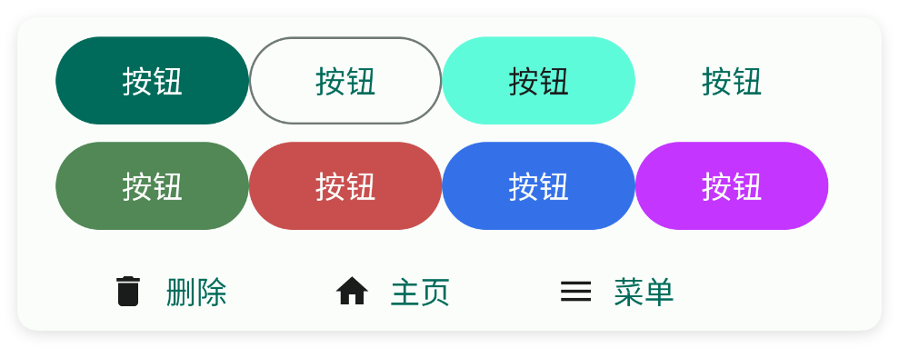

## 一、基础使用

其实按钮本身是没有点击事件的，由于它继承了父类{XView}，因此可以调用其父类中的函数来实现点击操作。

事实上，所有的组件都是继承自{XView}的，因此都可以调用{XView}中的方法。


```html
// 将布局写成字符串，无需另建 ui.xml 文件。
var layoutXml = `
<ui>
    <statusbar />
    <button id="mBut" text="点击我试试" />
</ui>
`;
var ui = $ui.layout(layoutXml);
ui.show(); // 显示界面，后面的事件示例继续使用这个对象。
```

```html
// 接着上一段执行，继续使用已创建的界面对象。
//找到界面中的元素并且实现点击事件
ui.id("mBut").click(function() {
    info("我被点击了");
});
```


## 二、常用属性


### text - 文本

> 设置文本


```html
// 用字符串保存布局；其中的属性就是本节演示的设置。
var layoutXml = `
<ui>
    <statusbar />
    <button style="outline" text="我是文本" w="max" />
</ui>
`;
var ui = $ui.layout(layoutXml); // 解析布局并创建控件。
ui.show(); // 显示界面，观察属性效果。
```


### typeface - 字体

> 设置字体


```html
// 用字符串保存布局；其中的属性就是本节演示的设置。
var layoutXml = `
<ui>
    <statusbar />
    <button style="outline" text="斜体文本" typeface="italic" w="max" />
    <button style="outline" text="粗体文本" typeface="bold" w="max" />
    <button style="outline" text="粗体斜体文本" typeface="bold_italic" w="max" />
</ui>
`;
var ui = $ui.layout(layoutXml); // 解析布局并创建控件。
ui.show(); // 显示界面，观察属性效果。
```


### style - 样式

> 设置样式
> 
> 可选值有："text","outline","tonal","icon"


```html
// 用字符串保存布局；其中的属性就是本节演示的设置。
var layoutXml = `
<ui>
    <statusbar />
    <button text="默认样式" w="max" />
    <button style="icon" text="图标样式" w="max" />
    <button style="text" text="文本样式" w="max" />
    <button style="outline" text="边框样式" w="max" />
    <button style="tonal" text="色调样式" w="max" />
</ui>
`;
var ui = $ui.layout(layoutXml); // 解析布局并创建控件。
ui.show(); // 显示界面，观察属性效果。
```


### color - 主题颜色

> 设置主题颜色


```html
// 用字符串保存布局；其中的属性就是本节演示的设置。
var layoutXml = `
<ui>
    <statusbar />
    <button color="#57965C" text="绿色主题颜色" w="max" />
    <button color="#C94F4F" text="红色主题颜色" w="max" />
    <button color="#3574F0" text="蓝色主题颜色" w="max" />
</ui>
`;
var ui = $ui.layout(layoutXml); // 解析布局并创建控件。
ui.show(); // 显示界面，观察属性效果。
```


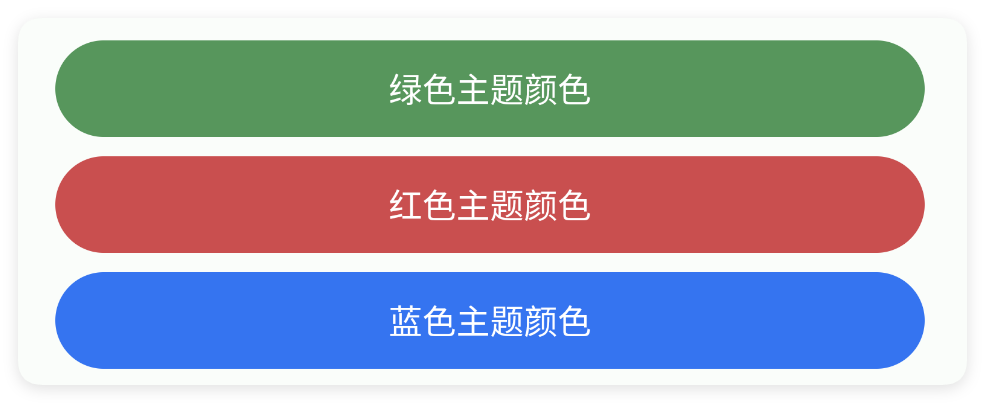

### textColor - 文本颜色

> 设置文本颜色


```html
// 用字符串保存布局；其中的属性就是本节演示的设置。
var layoutXml = `
<ui>
    <statusbar />
    <button style="outline" text="绿色字体颜色" textColor="#57965C" w="max" />
    <button style="outline" text="红色字体颜色" textColor="#C94F4F" w="max" />
    <button style="outline" text="蓝色字体颜色" textColor="#3574F0" w="max" />
</ui>
`;
var ui = $ui.layout(layoutXml); // 解析布局并创建控件。
ui.show(); // 显示界面，观察属性效果。
```


### ripper - 涟漪颜色

> 设置涟漪颜色


```html
// 用字符串保存布局；其中的属性就是本节演示的设置。
var layoutXml = `
<ui>
    <statusbar />
    <button style="outline" ripper="#57965C" text="绿色涟漪颜色" w="max" />
    <button style="outline" ripper="#C94F4F" text="红色涟漪颜色" w="max" />
    <button style="outline" ripper="#3574F0" text="蓝色涟漪颜色" w="max" />
</ui>
`;
var ui = $ui.layout(layoutXml); // 解析布局并创建控件。
ui.show(); // 显示界面，观察属性效果。
```


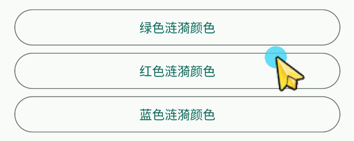

### radius - 弧度

> 设置弧度


```html
// 用字符串保存布局；其中的属性就是本节演示的设置。
var layoutXml = `
<ui>
    <statusbar />
    <button style="outline" radius="5" text="弧度:5" w="max" />
    <button style="outline" radius="10" text="弧度:10" w="max" />
    <button style="outline" radius="15" text="弧度:15" w="max" />
</ui>
`;
var ui = $ui.layout(layoutXml); // 解析布局并创建控件。
ui.show(); // 显示界面，观察属性效果。
```


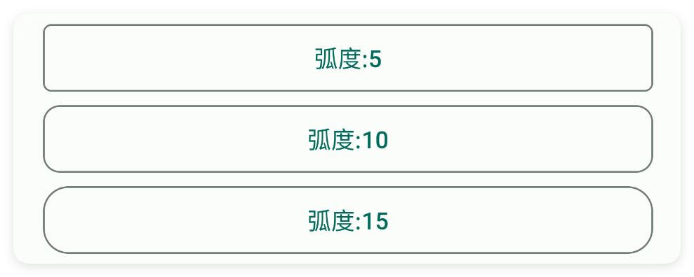

### textSize - 文本尺寸

> 设置文本尺寸


```html
// 用字符串保存布局；其中的属性就是本节演示的设置。
var layoutXml = `
<ui>
    <statusbar />
    <button style="outline" text="文本尺寸:10" textSize="10" w="max" />
    <button style="outline" text="文本尺寸:13" textSize="13" w="max" />
    <button style="outline" text="文本尺寸:16" textSize="16" w="max" />
</ui>
`;
var ui = $ui.layout(layoutXml); // 解析布局并创建控件。
ui.show(); // 显示界面，观察属性效果。
```


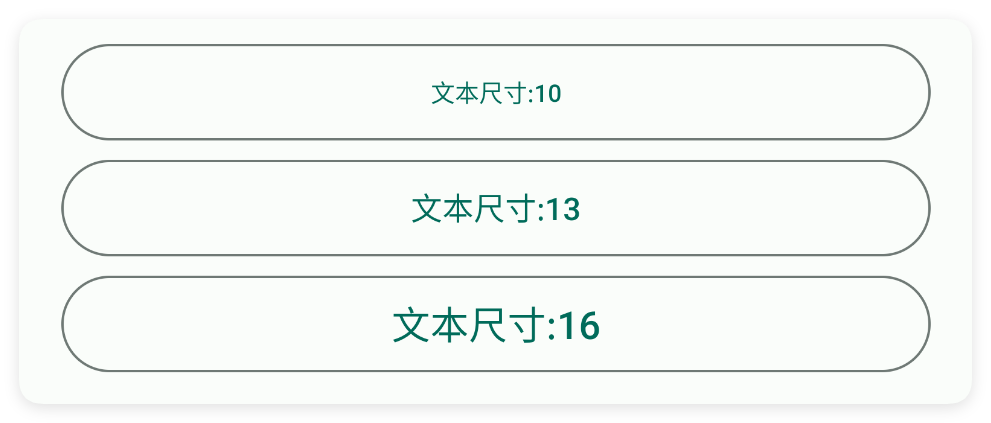

### icon - 图标

> 设置图标
> 
> icon/图标：用于指定图标，可以填写图标库的名称，也可以填写图标的相对路径或者绝对路径


```html
// 用字符串保存布局；其中的属性就是本节演示的设置。
var layoutXml = `
<ui>
    <statusbar />
    <button icon="ic_settings_fill" text="设置图标" w="max" />
</ui>
`;
var ui = $ui.layout(layoutXml); // 解析布局并创建控件。
ui.show(); // 显示界面，观察属性效果。
```


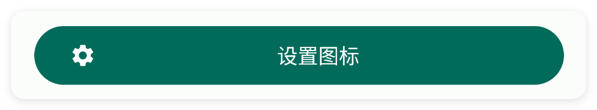

### iconTint - 图标颜色

> 设置图标颜色


```html
// 用字符串保存布局；其中的属性就是本节演示的设置。
var layoutXml = `
<ui>
    <statusbar />
    <button icon="ic_settings_fill" iconTint="#C94F4F" text="设置图标颜色" w="max" />
</ui>
`;
var ui = $ui.layout(layoutXml); // 解析布局并创建控件。
ui.show(); // 显示界面，观察属性效果。
```


### iconSize - 图标尺寸

> 设置图标尺寸


```html
// 用字符串保存布局；其中的属性就是本节演示的设置。
var layoutXml = `
<ui>
    <statusbar />
    <button icon="ic_settings_fill" iconSize="18" text="设置图标尺寸:10" w="max" />
    <button icon="ic_settings_fill" iconSize="20" text="设置图标尺寸:20" w="max" />
    <button icon="ic_settings_fill" iconSize="30" text="设置图标尺寸:30" w="max" />
</ui>
`;
var ui = $ui.layout(layoutXml); // 解析布局并创建控件。
ui.show(); // 显示界面，观察属性效果。
```


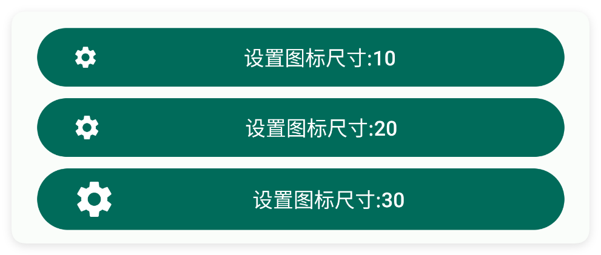

### iconGravity - 图标重力

> 设置图标重力


```html
// 用字符串保存布局；其中的属性就是本节演示的设置。
var layoutXml = `
<ui>
    <statusbar />
    <button icon="ic_settings_fill" iconGravity="start" text="设置图标重力:开始"
        w="max" />
    <button icon="ic_settings_fill" iconGravity="end" text="设置图标重力:结束"
        w="max" />
    <button h="70" icon="ic_settings_fill" iconGravity="top" text="设置图标重力:上方"
        w="max" />
</ui>
`;
var ui = $ui.layout(layoutXml); // 解析布局并创建控件。
ui.show(); // 显示界面，观察属性效果。
```


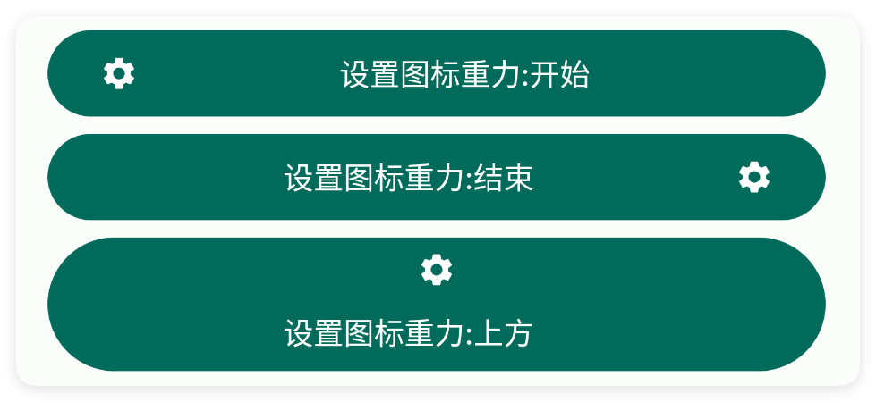

### iconPadding - 图标内边距

> 设置图标内边距


```html
// 用字符串保存布局；其中的属性就是本节演示的设置。
var layoutXml = `
<ui>
    <statusbar />
    <button gravity="start|center" icon="ic_settings_fill" iconPadding="20"
        text="设置图标内边距:20" w="max" />
    <button gravity="start|center" icon="ic_settings_fill" iconPadding="30"
        text="设置图标内边距:30" w="max" />
    <button gravity="start|center" icon="ic_settings_fill" iconPadding="40"
        text="设置图标内边距:40" w="max" />
</ui>
`;
var ui = $ui.layout(layoutXml); // 解析布局并创建控件。
ui.show(); // 显示界面，观察属性效果。
```


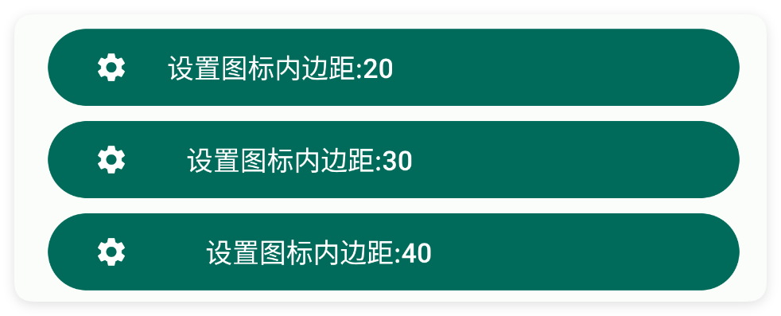

### minW - 最小宽度

> 设置最小宽度
> 
> 单位:dp


```html
// 用字符串保存布局；其中的属性就是本节演示的设置。
var layoutXml = `
<ui>
    <statusbar />
    <button minW="180" text="最小宽度:180" />
    <button minW="200" text="最小宽度:200" />
    <button minW="220" text="最小宽度:220" />
</ui>
`;
var ui = $ui.layout(layoutXml); // 解析布局并创建控件。
ui.show(); // 显示界面，观察属性效果。
```


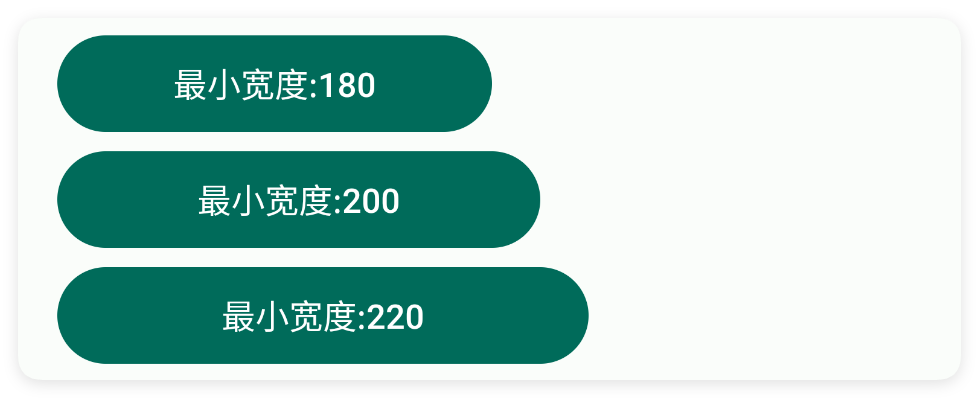

### minH - 最小高度

> 设置最小高度
> 
> 单位:dp


```html
// 用字符串保存布局；其中的属性就是本节演示的设置。
var layoutXml = `
<ui>
    <statusbar />
    <button minH="50" text="最小高度:50" w="max" />
    <button minH="60" text="最小高度:60" w="max" />
    <button minH="70" text="最小高度:70" w="max" />
</ui>
`;
var ui = $ui.layout(layoutXml); // 解析布局并创建控件。
ui.show(); // 显示界面，观察属性效果。
```


### padding - 内边距

> 设置内边距


```html
// 用字符串保存布局；其中的属性就是本节演示的设置。
var layoutXml = `
<ui>
    <statusbar />
    <button padding="10" text="内边距:10" w="max" />
    <button padding="20,10" text="内边距:20,10" w="max" />
    <button padding="10,10,10,20" text="内边距:10,10,10,20" w="max" />
</ui>
`;
var ui = $ui.layout(layoutXml); // 解析布局并创建控件。
ui.show(); // 显示界面，观察属性效果。
```


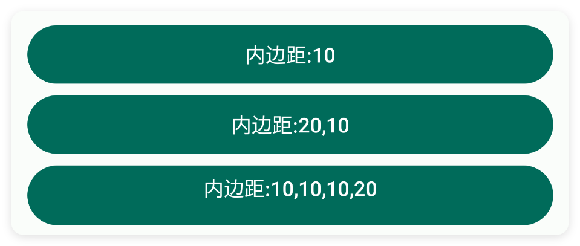

### gravity - 重力

> 设置重力


```html
// 用字符串保存布局；其中的属性就是本节演示的设置。
var layoutXml = `
<ui>
    <statusbar />
    <button gravity="start" minH="80" text="左上角" w="max" />
    <button gravity="end|bottom" minH="80" text="右下角" w="max" />
    <button gravity="center" minH="80" text="设置重力:中间" w="max" />
</ui>
`;
var ui = $ui.layout(layoutXml); // 解析布局并创建控件。
ui.show(); // 显示界面，观察属性效果。
```


### bg - 背景颜色

> 设置背景颜色


```html
// 用字符串保存布局；其中的属性就是本节演示的设置。
var layoutXml = `
<ui>
    <statusbar />
    <button bg="#57965C" text="绿色背景" w="max" />
    <button bg="#C94F4F" text="红色背景" w="max" />
    <button bg="#3574F0" text="蓝色背景" w="max" />
</ui>
`;
var ui = $ui.layout(layoutXml); // 解析布局并创建控件。
ui.show(); // 显示界面，观察属性效果。
```


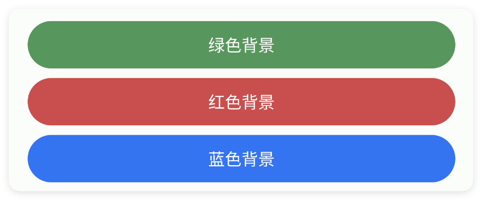

### bgImg - 背景图片

> 设置背景图片


```html
// 用字符串保存布局；其中的属性就是本节演示的设置。
var layoutXml = `
<ui>
    <statusbar />
    <button bgImg="example/$ui - 交互界面/02.button-按钮/img/button_bg.png"
        text="我是按钮" w="max" />
</ui>
`;
var ui = $ui.layout(layoutXml); // 解析布局并创建控件。
ui.show(); // 显示界面，观察属性效果。
```


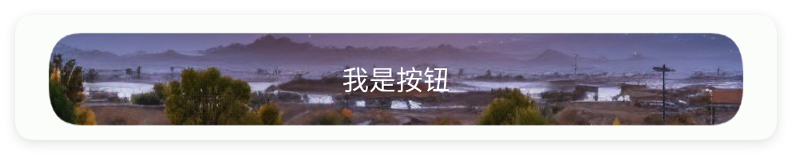

## 三、常用函数


### setGravity(gravity)

> 设置重力

- 参数 : gravity {String} 例如:"center|bottom"


```javascript
//解析布局,获得ui对象
var ui = $ui.layout("./mUi.xml");
//获得控件
var mBut = ui.id("mButton");
//设置重力
mBut.setGravity("center|bottom");
```


### setTypeface(typeface)

> 设置字体

- 参数 : typeface {int} 字体类型(使用AgUi中的常量,例如:$ui.BOLD)


```javascript
//解析布局,获得ui对象
var ui = $ui.layout("./mUi.xml");
//获得控件
var mBut = ui.id("mButton");
//设置字体
mBut.setTypeface($ui.BOLD);//常用值：$ui.NORMAL,$ui.ITALIC,$ui.BOLD,$ui.BOLD_ITALIC
```


### setColor(color)

> 设置按钮背景着色

- 参数 : color Android ARGB 颜色整数


```javascript
//解析布局,获得ui对象
var ui = $ui.layout("./mUi.xml");
//获得控件
var mBut = ui.id("mButton");
//设置红色
mBut.setColor($color.RED);
//设置成主题的颜色(具体颜色请参考$color文档)
//mBut.setColor($color.parse("colorPrimary"));
```


### setColor(color)

> 设置按钮背景着色；支持颜色名、主题颜色名和十六进制颜色值

- 参数 : color 颜色名、主题颜色名或十六进制颜色值


```javascript
//解析布局,获得ui对象
var ui = $ui.layout("./mUi.xml");
//获得控件
var mBut = ui.id("mButton");
//设置主题颜色
mBut.setColor("#1E1F22");
```


### setText(text)

> 设置文字

- 参数 : text {String} 文字


```javascript
//解析布局,获得ui对象
var ui = $ui.layout("./mUi.xml");
//获得控件
var mBut = ui.id("mButton");
//设置文字
mBut.setText("我是按钮");
```


### getText()

> 获得文字
> 
> 如果获取的文本为null则会返回空字符串

- 返回 : {String} 文字


```javascript
//解析布局,获得ui对象
var ui = $ui.layout("./mUi.xml");
//获得控件
var mBut = ui.id("mButton");
//获得文字
var text = mBut.getText();
```


### setTextColor(color)

> 设置文字颜色

- 参数 : color {String} 颜色


```javascript
//解析布局,获得ui对象
var ui = $ui.layout("./mUi.xml");
//获得控件
var mBut = ui.id("mButton");
//设置文字颜色
mBut.setTextColor("#1E1F22");
```


### setTextColor(color)

> 设置文字颜色

- 参数 : color {int} ARGB颜色值，例如 0xFFFF0000 表示红色


```javascript
//解析布局,获得ui对象
var ui = $ui.layout("./mUi.xml");
//获得控件
var mBut = ui.id("mButton");
//设置文字颜色
mBut.setTextColor($color.RED);
```


### setRipper(color)

> 设置涟漪颜色

- 参数 : color {int} 颜色


```javascript
//解析布局,获得ui对象
var ui = $ui.layout("./mUi.xml");
//获得控件
var mBut = ui.id("mButton");
//设置涟漪颜色
mBut.setRipper($color.RED);
```


### setRipper(color)

> 设置涟漪颜色

- 参数 : color {string} 颜色


```javascript
//解析布局,获得ui对象
var ui = $ui.layout("./mUi.xml");
//获得控件
var mBut = ui.id("mButton");
//设置涟漪颜色
mBut.setRipper("#1E1F22");
```


### setRadius(radius)

> 设置弧度

- 参数 : radius {int} 弧度


```javascript
//解析布局,获得ui对象
var ui = $ui.layout("./mUi.xml");
//获得控件
var mBut = ui.id("mButton");
//设置弧度
mBut.setRadius(20);
```


### setTextSize(size)

> 设置字体大小

- 参数 : size {float} 字体大小


```javascript
//解析布局,获得ui对象
var ui = $ui.layout("./mUi.xml");
//获得控件
var mBut = ui.id("mButton");
//设置字体大小(单位:sp)
mBut.setTextSize(20);
```


### setIcon(icon)

> 设置图标

- 参数 : icon {string} 图标


```javascript
//解析布局,获得ui对象
var ui = $ui.layout("./mUi.xml");
//获得控件
var mBut = ui.id("mButton");
//设置图标
mBut.setIcon("logo_ag");
```


### setIconTint(color)

> 设置图标颜色

- 参数 : color {int} 图标颜色


```javascript
//解析布局,获得ui对象
var ui = $ui.layout("./mUi.xml");
//获得控件
var mBut = ui.id("mButton");
//设置图标
mBut.setIcon("logo_ag");
//设置图标颜色
mBut.setIconTint($color.RED);
```


### setIconTint(color)

> 设置图标颜色

- 参数 : color {string} 图标颜色


```javascript
//解析布局,获得ui对象
var ui = $ui.layout("./mUi.xml");
//获得控件
var mBut = ui.id("mButton");
//设置图标
mBut.setIcon("logo_ag");
//设置图标颜色
mBut.setIconTint("#1E1F22");
```


### setIconSize(size)

> 设置图标尺寸

- 参数 : size {int} 图标尺寸


```javascript
//解析布局,获得ui对象
var ui = $ui.layout("./mUi.xml");
//获得控件
var mBut = ui.id("mButton");
//设置图标
mBut.setIcon("logo_ag");
//设置图标尺寸(单位:dp)
mBut.setIconSize(15);
```


### setIconPadding(padding)

> 设置图标内边距

- 参数 : padding {int} 设置图标内边距


```javascript
//解析布局,获得ui对象
var ui = $ui.layout("./mUi.xml");
//获得控件
var mBut = ui.id("mButton");
//设置图标
mBut.setIcon("logo_ag");
//设置图标内边距
mBut.setIconPadding(8);
```


### setIconGravity(gravity)

> 设置图标重力
> 
> 可选值:上方(上|top)、左(开始|start|left)、右(结束|end|right)

- 参数 : gravity {String} 图标重力


```javascript
//解析布局,获得ui对象
var ui = $ui.layout("./mUi.xml");
//获得控件
var mBut = ui.id("mButton");
//设置图标
mBut.setIcon("logo");
//设置图标重力
mBut.setIconGravity("top");
```


