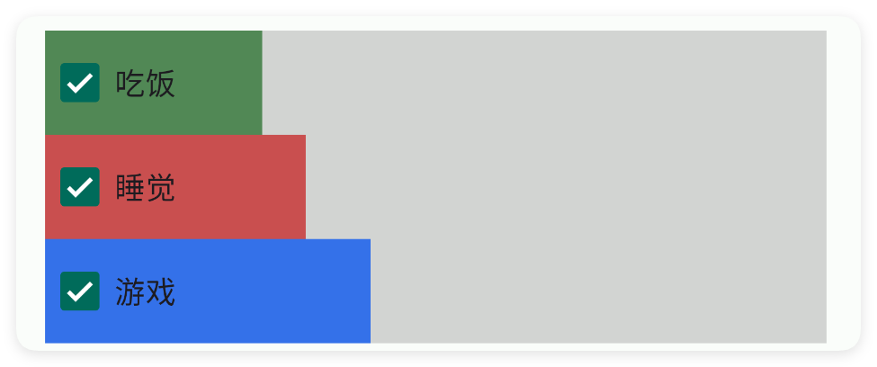
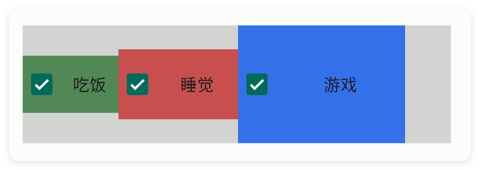
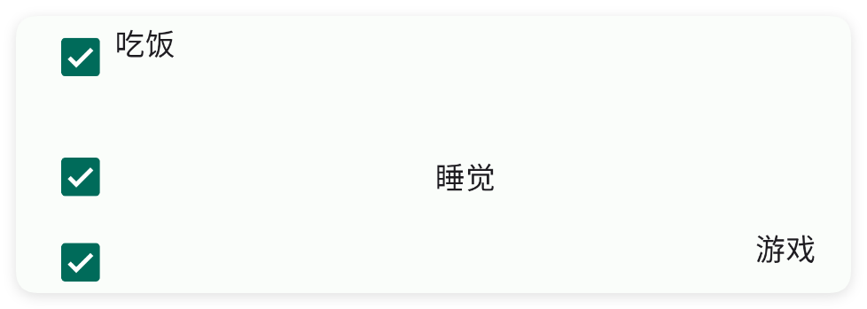
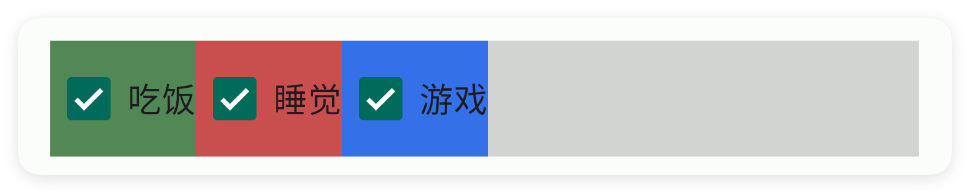

# 多选框

- 更新时间:2026-10-22 10:58:40

> 多选框-check
> 
> 原生类型:{com.google.android.material.checkbox.MaterialCheckBox}
> 
> 多选框控件{XCheck}是属于{XView}的子控件，因此{XView}中的所有方法，多选框控件都可以调用。


<div style="width: 100%; position: relative; padding-bottom: 56.25%; height: 0; overflow: hidden;">
  <iframe 
    src="//player.bilibili.com/player.html?isOutside=true&aid=116222184136428&bvid=BV1gEwJzfEBN&cid=36675258096&p=1" 
    style="position: absolute; top: 0; left: 0; width: 100%; height: 100%; border: none;"
    scrolling="no" 
    frameborder="no" 
    allowfullscreen="true">
  </iframe>
</div>

多选框一般用于：用户同意、配置多种选择、筛选数据等场景。


## 一、基础用法


```html
// 将布局写成字符串，无需另建 ui.xml 文件。
var layoutXml = `
<ui>
    <statusbar />
    <linear w="max" dir="h" gravity="center">
        <check id="mCheck" text="同意协议"/>
    </linear>
</ui>
`;
var ui = $ui.layout(layoutXml);
ui.show(); // 显示界面，后面的事件示例继续使用这个对象。
```

```javascript
// 接着上一段执行，继续使用已创建的界面对象。
//找到界面中的元素并且实现点击事件
ui.id("mCheck").onCheck(function(checked,comButton) {
    if(checked){
        info("我被选中了");
    }else{
        info("没有被选中");
    }
});
```


## 二、常用属性


### text - 文本

> 设置文本


```html
// 用字符串保存布局；其中的属性就是本节演示的设置。
var layoutXml = `
<ui>
    <statusbar />
    <check text="我是文本" />
</ui>
`;
var ui = $ui.layout(layoutXml); // 解析布局并创建控件。
ui.show(); // 显示界面，观察属性效果。
```




### check - 选中

> 设置选中


```html
// 用字符串保存布局；其中的属性就是本节演示的设置。
var layoutXml = `
<ui>
    <statusbar />
    <check check="true" text="选中状态" />
    <check check="false" text="未选中状态" />
</ui>
`;
var ui = $ui.layout(layoutXml); // 解析布局并创建控件。
ui.show(); // 显示界面，观察属性效果。
```


### color - 主题颜色

> 设置主题颜色


```html
// 用字符串保存布局；其中的属性就是本节演示的设置。
var layoutXml = `
<ui>
    <statusbar />
    <linear dir="h" w="max">
        <check check="true" color="#518855" text="吃饭" />
        <check check="true" color="#C94F4F" text="睡觉" />
        <check check="true" color="#3471E9" text="游戏" />
    </linear>
</ui>
`;
var ui = $ui.layout(layoutXml); // 解析布局并创建控件。
ui.show(); // 显示界面，观察属性效果。
```


### tint - 按钮颜色

> 设置按钮颜色


```html
// 用字符串保存布局；其中的属性就是本节演示的设置。
var layoutXml = `
<ui>
    <statusbar />
    <linear dir="h" w="max">
        <check check="true" text="吃饭" tint="#518855" />
        <check check="true" text="睡觉" tint="#C94F4F" />
        <check check="true" text="游戏" tint="#3471E9" />
    </linear>
</ui>
`;
var ui = $ui.layout(layoutXml); // 解析布局并创建控件。
ui.show(); // 显示界面，观察属性效果。
```


### textColor - 文本颜色

> 设置文本颜色


```html
// 用字符串保存布局；其中的属性就是本节演示的设置。
var layoutXml = `
<ui>
    <statusbar />
    <linear dir="h" w="max">
        <check check="true" text="吃饭" textColor="#518855" />
        <check check="true" text="睡觉" textColor="#C94F4F" />
        <check check="true" text="游戏" textColor="#3471E9" />
    </linear>
</ui>
`;
var ui = $ui.layout(layoutXml); // 解析布局并创建控件。
ui.show(); // 显示界面，观察属性效果。
```


### minW - 最小宽度

> 设置最小宽度
> 
> 单位:dp


```html
// 用字符串保存布局；其中的属性就是本节演示的设置。
var layoutXml = `
<ui>
    <statusbar />
    <linear bg="#55808080" dir="v" w="max">
        <check bg="#518855" check="true" minW="100" text="吃饭" />
        <check bg="#C94F4F" check="true" minW="120" text="睡觉" />
        <check bg="#3471E9" check="true" minW="150" text="游戏" />
    </linear>
</ui>
`;
var ui = $ui.layout(layoutXml); // 解析布局并创建控件。
ui.show(); // 显示界面，观察属性效果。
```




### minH - 最小高度

> 设置最小高度
> 
> 单位:dp


```html
// 用字符串保存布局；其中的属性就是本节演示的设置。
var layoutXml = `
<ui>
    <statusbar />
    <linear bg="#55808080" dir="h" gravity="center|bottom" w="max">
        <check bg="#518855" check="true" gravity="bottom" minH="100" text="吃饭" />
        <check bg="#C94F4F" check="true" gravity="bottom" minH="120" text="睡觉" />
        <check bg="#3471E9" check="true" gravity="bottom" minH="150" text="游戏" />
    </linear>
</ui>
`;
var ui = $ui.layout(layoutXml); // 解析布局并创建控件。
ui.show(); // 显示界面，观察属性效果。
```


### padding - 内边距

> 设置内边距


```html
// 用字符串保存布局；其中的属性就是本节演示的设置。
var layoutXml = `
<ui>
    <statusbar />
    <linear bg="#55808080" dir="h" w="max">
        <check bg="#518855" check="true" padding="10" text="吃饭" />
        <check bg="#C94F4F" check="true" padding="20" text="睡觉" />
        <check bg="#3471E9" check="true" padding="40" text="游戏" />
    </linear>
</ui>
`;
var ui = $ui.layout(layoutXml); // 解析布局并创建控件。
ui.show(); // 显示界面，观察属性效果。
```




### gravity - 重力

> 设置重力


```html
// 用字符串保存布局；其中的属性就是本节演示的设置。
var layoutXml = `
<ui>
    <statusbar />
    <check check="true" gravity="start" text="吃饭" w="max" />
    <check check="true" gravity="center" text="睡觉" w="max" />
    <check check="true" gravity="end" text="游戏" w="max" />
</ui>
`;
var ui = $ui.layout(layoutXml); // 解析布局并创建控件。
ui.show(); // 显示界面，观察属性效果。
```




### bg - 背景颜色

> 设置背景颜色


```html
// 用字符串保存布局；其中的属性就是本节演示的设置。
var layoutXml = `
<ui>
    <statusbar />
    <linear bg="#55808080" dir="h" w="max">
        <check bg="#518855" check="true" text="吃饭" />
        <check bg="#C94F4F" check="true" text="睡觉" />
        <check bg="#3471E9" check="true" text="游戏" />
    </linear>
</ui>
`;
var ui = $ui.layout(layoutXml); // 解析布局并创建控件。
ui.show(); // 显示界面，观察属性效果。
```




### bgImg - 背景图片

> 设置背景图片


```html
// 用字符串保存布局；其中的属性就是本节演示的设置。
var layoutXml = `
<ui>
    <statusbar />
    <check bgImg="example/$ui - 交互界面/03.check-复选框/img/bg01.png" check="true"
        margin="3" text="吃饭" textColor="bg" w="max" />
    <check bgImg="example/$ui - 交互界面/03.check-复选框/img/bg02.png" check="true"
        margin="3" text="游戏" textColor="bg" w="max" />
    <check bgImg="example/$ui - 交互界面/03.check-复选框/img/bg03.png" check="true"
        margin="3" text="睡觉" textColor="bg" w="max" />
</ui>
`;
var ui = $ui.layout(layoutXml); // 解析布局并创建控件。
ui.show(); // 显示界面，观察属性效果。
```


### storeKey - 存储布尔值

> 存储布尔值
> 
> 通过storeKey(存储关键字)指定一个存储布尔值的关键字，获取值时可以直接通过$storage($存储)获取布尔值。
> 
> 注意：不同的控件存储的类型不同，对于本控件(复选框)则存储的是布尔值类型，表达当前是否被勾选


```html
// 将布局写成字符串，无需另建 ui.xml 文件。
var layoutXml = `
<!-- 你必须在ui(界面)节点中通过store(存储)指定$storage($存储)的命名空间，等价于使用代码：var storage = $storage.create("MyAppCheck"); -->
<ui store="MyAppCheck">
    <statusbar />
    <!-- 使用storeKey(存储关键字)属性，指定关键字，等价于使用代码：var data = $storage.create("MyAppCheck").getBool("eatFood"); -->
    <!-- 使用storeDef(存储默认值)属性，指定默认值，等价于使用代码：var data = $storage.create("MyAppCheck").getBool("eatFood",true); -->
    <check storeDef="true" storeKey="eatFood" text="吃饭" w="最大" />
    <check storeKey="playGame" text="游戏" w="最大" />
</ui>
`;
var ui = $ui.layout(layoutXml);
ui.show(); // 显示界面，后面的事件示例继续使用这个对象。
```


如果我们已经配置好了应用内存储，则可以直接获取数据：

注意：一、要使用应用内存储，必须在ui(界面)节点指定属性store(存储)的值，该值指定存储的命名空间；
二、不是所有的控件都支持应用内存储；
三、不同的控件存储的数据类型可能都不一致，例如：输入类型的控件存储的是字符串类型，开关、多选框存储的就是布尔类型的数据。


```javascript
//创建(或者加载)存储对象
var storage = $storage.create("MyAppCheck");//名称要一致
//获取数据
var data = storage.getBoolean("playGame",false);//数据类型是布尔值
```


## 三、常用函数


### onCheck(callback)

> 设置选中状态改变的监听（注册一个回调函数）。
> 
> 当用户用手指点击这个多选框、把它从“勾选”变成“取消勾选”（或反过来）时，
> 你传进去的这个回调函数就会被自动调用一次。
> 
> 回调函数会收到两个参数：第一个是布尔值，表示“现在是否被勾选”；第二个是安卓原生控件对象，
> 一般用不到，知道就行。
> 
> 小提示：从 1.5.9 版本开始，回调参数顺序是“(是否勾选, 原生对象)”；更早版本是反过来的，
> 新脚本请按现在的顺序写。

- 参数 : callback {function(isChecked, view)} 回调函数；isChecked 为 true 表示勾选、false 表示取消勾选，view 是安卓原生对象（一般不用）


```javascript
//先用一段 XML 创建界面，里面放一个带 id 的多选框
var ui = $ui.layout('<ui><statusbar/><check id="mCheck" text="同意协议"/></ui>');
ui.show(); //把界面显示出来
var mCheck = ui.id("mCheck"); //根据 id 拿到这个多选框控件
//给多选框注册监听：勾选状态一变就自动执行下面这个函数
mCheck.onCheck(function(isChecked, view) {
    if (isChecked) { //isChecked 是 true 表示现在被勾选了
        ui.toast("你勾选了我"); //弹出一条短提示
    } else { //否则就是取消勾选了
        ui.toast("你取消了勾选");
    }
});
```


### isChecked()

> 判断这个多选框当前是否被勾选（读取它的勾选状态）。
> 
> 这个方法不会改变勾选状态，只是“看一眼”现在是勾上了还是没勾。
> 返回值是一个布尔值：true 表示勾选，false 表示没勾选。

- 返回 : {boolean} true 表示已勾选，false 表示未勾选


```javascript
//先用一段 XML 创建界面，里面放一个带 id 的多选框
var ui = $ui.layout('<ui><statusbar/><check id="mCheck" text="同意协议"/></ui>');
ui.show(); //把界面显示出来
var mCheck = ui.id("mCheck"); //根据 id 拿到这个多选框控件
var is = mCheck.isChecked(); //读取当前勾选状态，得到 true 或 false
if (is) { //如果是 true
    ui.toast("现在是勾选状态");
} else { //否则就是没勾选
    ui.toast("现在没有勾选");
}
```


### check(checked)

> 用代码主动设置这个多选框的勾选状态（不用用户手动点）。
> 
> 传 true 就是帮用户勾上，传 false 就是取消勾选。
> 如果这个多选框之前在 XML 里设置了存储关键字，这次改变也会一并保存到本地。

- 参数 : checked {boolean} 传 true 表示勾选，传 false 表示取消勾选；传 null 会被忽略


```javascript
//先用一段 XML 创建界面，里面放一个带 id 的多选框
var ui = $ui.layout('<ui><statusbar/><check id="mCheck" text="同意协议"/></ui>');
ui.show(); //把界面显示出来
var mCheck = ui.id("mCheck"); //根据 id 拿到这个多选框控件
mCheck.check(true); //用代码把它勾上
//过几秒后再用代码取消勾选，演示动态改变
mCheck.check(false);
```


### setGravity(gravity)

> 设置多选框内容在控件内部的对齐方式（重力）。
> 
> 当多选框本身被拉得比内容宽或高时，就需要决定“那个小方框加文字”靠左、靠右还是居中。
> 常用值：start（靠左）、center（居中）、end（靠右），中间用竖线 | 组合，
> 例如 "center|bottom" 表示水平居中、垂直靠下。

- 参数 : gravity {String} 对齐方式，例如 "center"、"start"、"end"、"center|bottom"


```javascript
//先用一段 XML 创建界面，里面放一个占满宽度的多选框
var ui = $ui.layout('<ui><statusbar/><check id="mCheck" text="靠左显示" w="max"/></ui>');
ui.show(); //把界面显示出来
var mCheck = ui.id("mCheck"); //根据 id 拿到这个多选框控件
mCheck.setGravity("center"); //让内容在控件内部居中显示
```


### setText(text)

> 用代码修改多选框旁边显示的文字。
> 
> 传一段字符串进去，多选框右边那行字就会立刻变成新内容。
> 传 null 会被忽略（什么也不改）。

- 参数 : text {String} 要显示的新文字


```javascript
//先用一段 XML 创建界面，里面放一个带 id 的多选框
var ui = $ui.layout('<ui><statusbar/><check id="mCheck" text="原来的字"/></ui>');
ui.show(); //把界面显示出来
var mCheck = ui.id("mCheck"); //根据 id 拿到这个多选框控件
mCheck.setText("记住密码"); //把旁边的文字改成“记住密码”
```


### getText()

> 读取多选框旁边当前显示的文字。
> 
> 返回一个字符串；如果这个多选框没有文字，会返回空字符串 ""（不会返回 null）。

- 返回 : {String} 多选框旁边的文字；没有文字时返回空字符串 ""


```javascript
//先用一段 XML 创建界面，里面放一个带 id 的多选框
var ui = $ui.layout('<ui><statusbar/><check id="mCheck" text="同意协议"/></ui>');
ui.show(); //把界面显示出来
var mCheck = ui.id("mCheck"); //根据 id 拿到这个多选框控件
var text = mCheck.getText(); //把旁边的文字读出来
ui.toast("现在的文字是：" + text); //弹出来看看
```


### setColor(color)

> 设置多选框那个“小方框”的主题颜色（用颜色字符串表示）。
> 
> 传一个颜色字符串，例如 "#FF0000"（纯红）、"#00FF00"（纯绿）。
> 颜色串写不对（解析失败）时什么也不会改。

- 参数 : color {String} 颜色字符串，例如 "#FF0000"


```javascript
//先用一段 XML 创建界面，里面放一个带 id 的多选框
var ui = $ui.layout('<ui><statusbar/><check id="mCheck" text="吃饭" check="true"/></ui>');
ui.show(); //把界面显示出来
var mCheck = ui.id("mCheck"); //根据 id 拿到这个多选框控件
mCheck.setColor("#518855"); //把小方框涂成墨绿色
```


### setColor(color)

> 设置多选框小方框的主题颜色（用安卓颜色整数表示）。
> 
> 这个版本接收一个数字颜色值，通常配合 $color 里预置好的颜色常量一起用，
> 例如 $color.RED 就是红色的颜色整数。传 null 会被忽略。

- 参数 : color {int} 安卓颜色整数，常用 $color.RED、$color.GREEN 等预置颜色


```javascript
//先用一段 XML 创建界面，里面放一个带 id 的多选框
var ui = $ui.layout('<ui><statusbar/><check id="mCheck" text="吃饭" check="true"/></ui>');
ui.show(); //把界面显示出来
var mCheck = ui.id("mCheck"); //根据 id 拿到这个多选框控件
mCheck.setColor($color.RED); //用预置的红色常量给小方框上色
```


### setTextColor(color)

> 设置多选框旁边那行文字的颜色（用颜色字符串表示）。
> 
> 传一个颜色字符串，例如 "#FF0000"。注意它和 setColor 不同：setColor 改的是小方框颜色，
> 这个改的是旁边文字的颜色。

- 参数 : color {String} 颜色字符串，例如 "#FF0000"


```javascript
//先用一段 XML 创建界面，里面放一个带 id 的多选框
var ui = $ui.layout('<ui><statusbar/><check id="mCheck" text="吃饭"/></ui>');
ui.show(); //把界面显示出来
var mCheck = ui.id("mCheck"); //根据 id 拿到这个多选框控件
mCheck.setTextColor("#518855"); //把旁边的文字涂成墨绿色
```


### setTextColor(color)

> 设置旁边那行文字的颜色（用安卓颜色整数表示）。
> 
> 配合 $color 预置颜色常量使用，例如 $color.RED。传 null 会被忽略。

- 参数 : color {int} 安卓颜色整数，常用 $color.RED 等预置颜色


```javascript
//先用一段 XML 创建界面，里面放一个带 id 的多选框
var ui = $ui.layout('<ui><statusbar/><check id="mCheck" text="吃饭"/></ui>');
ui.show(); //把界面显示出来
var mCheck = ui.id("mCheck"); //根据 id 拿到这个多选框控件
mCheck.setTextColor($color.RED); //把旁边的文字涂成红色
```


### setBg(color)

> 设置多选框整块的背景颜色（用颜色字符串表示）。
> 
> 它改的是整个多选框控件背后那层底色，不是小方框颜色、也不是文字颜色。
> 颜色串写不对时什么也不改。

- 参数 : color {String} 颜色字符串，例如 "#FF0000"


```javascript
//先用一段 XML 创建界面，里面放一个带 id 的多选框
var ui = $ui.layout('<ui><statusbar/><check id="mCheck" text="吃饭"/></ui>');
ui.show(); //把界面显示出来
var mCheck = ui.id("mCheck"); //根据 id 拿到这个多选框控件
mCheck.setBg("#FFE0E0"); //把整块背景涂成浅粉色
```


### setBg(color)

> 设置整块背景颜色（用安卓颜色整数表示）。
> 
> 配合 $color 预置颜色使用，传 null 会被忽略。

- 参数 : color {int} 安卓颜色整数，常用 $color.RED 等预置颜色


```javascript
//先用一段 XML 创建界面，里面放一个带 id 的多选框
var ui = $ui.layout('<ui><statusbar/><check id="mCheck" text="吃饭"/></ui>');
ui.show(); //把界面显示出来
var mCheck = ui.id("mCheck"); //根据 id 拿到这个多选框控件
mCheck.setBg($color.RED); //用预置红色把整块背景涂红
```


