# 小片

- 更新时间:2026-10-22 10:58:40

> 小片-chip
> 
> 原生类型:{com.google.android.material.chip.Chip}
> 
> 可以当作小按钮来使用，也可以当作多选框来使用


<div style="width: 100%; position: relative; padding-bottom: 56.25%; height: 0; overflow: hidden;">
  <iframe 
    src="//player.bilibili.com/player.html?isOutside=true&aid=116224566500656&bvid=BV1UMwpzAEik&cid=36681746955&p=1" 
    style="position: absolute; top: 0; left: 0; width: 100%; height: 100%; border: none;"
    scrolling="no" 
    frameborder="no" 
    allowfullscreen="true">
  </iframe>
</div>

小片：可以用来显示一些小标签什么的，还是蛮好看的。

不过，也可以用来作为按钮使用。


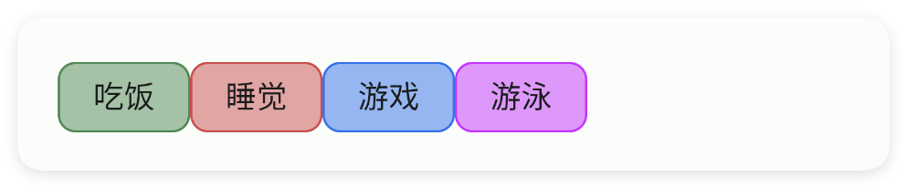

## 一、常用属性


### text - 文本

> 设置文本


```html
// 用字符串保存布局；其中的属性就是本节演示的设置。
var layoutXml = `
<ui>
    <statusbar />
    <chip text="我是文本" />
</ui>
`;
var ui = $ui.layout(layoutXml); // 解析布局并创建控件。
ui.show(); // 显示界面，观察属性效果。
```


### icon - 图标

> 设置图标
> 
> icon/图标：用于指定图标，可以填写图标库的名称，也可以填写图标的相对路径或者绝对路径


```html
// 用字符串保存布局；其中的属性就是本节演示的设置。
var layoutXml = `
<ui>
    <statusbar />
    <chip icon="ic_access_alarms_fill" text="看我图标" />
</ui>
`;
var ui = $ui.layout(layoutXml); // 解析布局并创建控件。
ui.show(); // 显示界面，观察属性效果。
```


### iconTint - 图标颜色

> 设置图标颜色


```html
// 用字符串保存布局；其中的属性就是本节演示的设置。
var layoutXml = `
<ui>
    <statusbar />
    <chip icon="ic_access_alarms_fill" iconTint="#57965C" text="看我图标颜色" />
</ui>
`;
var ui = $ui.layout(layoutXml); // 解析布局并创建控件。
ui.show(); // 显示界面，观察属性效果。
```


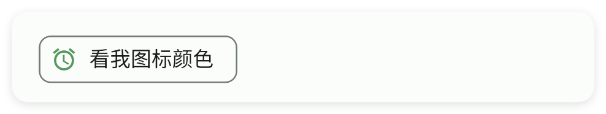

### textColor - 文本颜色

> 设置文本颜色


```html
// 用字符串保存布局；其中的属性就是本节演示的设置。
var layoutXml = `
<ui>
    <statusbar />
    <chip text="看我颜色" textColor="#C94F4F" />
</ui>
`;
var ui = $ui.layout(layoutXml); // 解析布局并创建控件。
ui.show(); // 显示界面，观察属性效果。
```


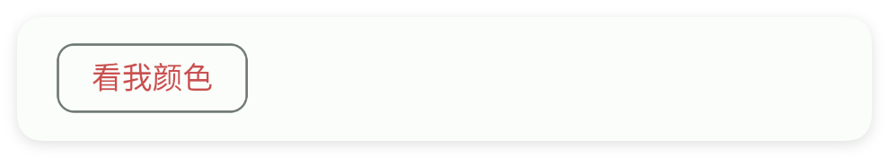

### textSize - 文本尺寸

> 设置文本尺寸
> 
> 单位:sp


```html
// 用字符串保存布局；其中的属性就是本节演示的设置。
var layoutXml = `
<ui>
    <statusbar />
    <chip text="看我尺寸" textSize="10" />
    <chip text="看我尺寸" textSize="15" />
    <chip text="看我尺寸" textSize="18" />
</ui>
`;
var ui = $ui.layout(layoutXml); // 解析布局并创建控件。
ui.show(); // 显示界面，观察属性效果。
```


### radius - 弧度

> 设置弧度


```html
// 用字符串保存布局；其中的属性就是本节演示的设置。
var layoutXml = `
<ui>
    <statusbar />
    <chip radius="5" text="看我弧度" />
    <chip radius="8" text="看我弧度" />
    <chip radius="11" text="看我弧度" />
</ui>
`;
var ui = $ui.layout(layoutXml); // 解析布局并创建控件。
ui.show(); // 显示界面，观察属性效果。
```


### checkable - 是否可以选中

> 设置是否可以选中


```html
// 用字符串保存布局；其中的属性就是本节演示的设置。
var layoutXml = `
<ui>
    <statusbar />
    <chip checkable="true" text="我可以选中" />
</ui>
`;
var ui = $ui.layout(layoutXml); // 解析布局并创建控件。
ui.show(); // 显示界面，观察属性效果。
```



### check - 是否选中

> 设置是否选中


```html
// 用字符串保存布局；其中的属性就是本节演示的设置。
var layoutXml = `
<ui>
    <statusbar />
    <chip check="true" checkable="true" text="我被选中了" />
    <chip check="false" checkable="true" text="我没被选中" />
</ui>
`;
var ui = $ui.layout(layoutXml); // 解析布局并创建控件。
ui.show(); // 显示界面，观察属性效果。
```


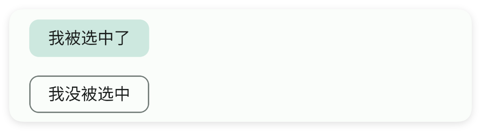

### showCheckIcon - 是否显示选中图标

> 是否显示选中图标


```html
// 用字符串保存布局；其中的属性就是本节演示的设置。
var layoutXml = `
<ui>
    <statusbar />
    <chip check="true" checkable="true" showCheckIcon="true" text="我可以选中" />
</ui>
`;
var ui = $ui.layout(layoutXml); // 解析布局并创建控件。
ui.show(); // 显示界面，观察属性效果。
```



### checkIconTint - 选中图标颜色

> 设置选中图标颜色


```html
// 用字符串保存布局；其中的属性就是本节演示的设置。
var layoutXml = `
<ui>
    <statusbar />
    <chip check="true" checkIconTint="#C94F4F" checkable="true" showCheckIcon="true"
        text="我可以选中" />
</ui>
`;
var ui = $ui.layout(layoutXml); // 解析布局并创建控件。
ui.show(); // 显示界面，观察属性效果。
```


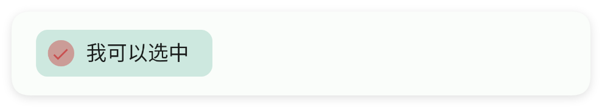

### clickable - 是否可以点击

> 设置是否可以点击


```html
// 用字符串保存布局；其中的属性就是本节演示的设置。
var layoutXml = `
<ui>
    <statusbar />
    <chip clickable="true" text="我可以被点击" />
    <chip clickable="false" text="我不能被点击" />
</ui>
`;
var ui = $ui.layout(layoutXml); // 解析布局并创建控件。
ui.show(); // 显示界面，观察属性效果。
```


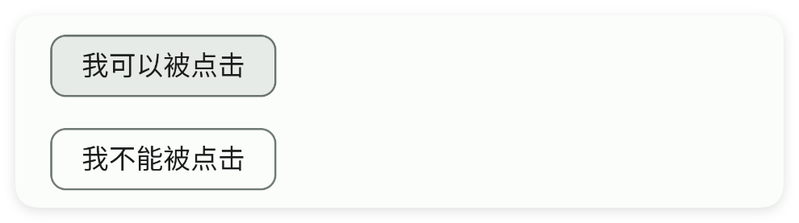

### showCloseIcon - 是否显示关闭按钮

> 是否显示关闭按钮


```html
// 用字符串保存布局；其中的属性就是本节演示的设置。
var layoutXml = `
<ui>
    <statusbar />
    <chip showCloseIcon="true" text="我可以被点击" />
</ui>
`;
var ui = $ui.layout(layoutXml); // 解析布局并创建控件。
ui.show(); // 显示界面，观察属性效果。
```


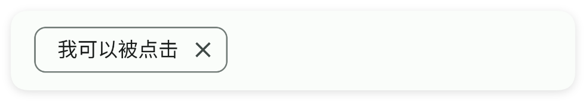

### closeIconTint - 关闭按钮的颜色

> 设置关闭按钮的颜色


```html
// 用字符串保存布局；其中的属性就是本节演示的设置。
var layoutXml = `
<ui>
    <statusbar />
    <chip closeIconTint="#C94F4F" showCloseIcon="true" text="我可以被点击" />
</ui>
`;
var ui = $ui.layout(layoutXml); // 解析布局并创建控件。
ui.show(); // 显示界面，观察属性效果。
```


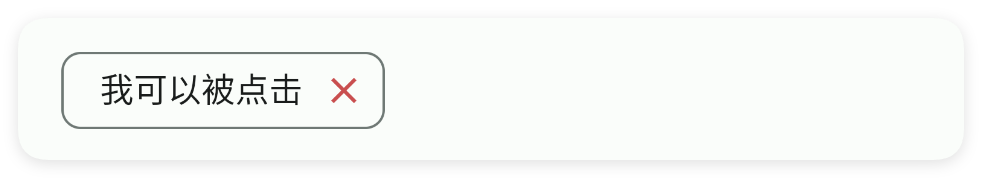

### ripper - 涟漪颜色

> 设置涟漪颜色


```html
// 用字符串保存布局；其中的属性就是本节演示的设置。
var layoutXml = `
<ui>
    <statusbar />
    <chip clickable="true" ripper="#3574F0" text="涟漪颜色" />
</ui>
`;
var ui = $ui.layout(layoutXml); // 解析布局并创建控件。
ui.show(); // 显示界面，观察属性效果。
```


### color - 主题颜色

> 设置主题颜色


```html
// 用字符串保存布局；其中的属性就是本节演示的设置。
var layoutXml = `
<ui>
    <statusbar />
    <chip color="#3574F0" text="主题颜色" />
    <chip color="#57965C" text="主题颜色" />
    <chip color="#C94F4F" text="主题颜色" />
</ui>
`;
var ui = $ui.layout(layoutXml); // 解析布局并创建控件。
ui.show(); // 显示界面，观察属性效果。
```


### minW - 最小宽度

> 设置最小宽度
> 
> 单位:dp


```html
// 用字符串保存布局；其中的属性就是本节演示的设置。
var layoutXml = `
<ui>
    <statusbar />
    <chip minW="60" text="60" />
    <chip minW="100" text="100" />
    <chip minW="130" text="130" />
</ui>
`;
var ui = $ui.layout(layoutXml); // 解析布局并创建控件。
ui.show(); // 显示界面，观察属性效果。
```


### minH - 最小高度

> 设置最小高度
> 
> 单位:dp


```html
// 用字符串保存布局；其中的属性就是本节演示的设置。
var layoutXml = `
<ui>
    <statusbar />
    <linear dir="h" gravity="center|bottom" w="max">
        <!--对于chip而言，gravity属性几乎没有任何效果-->
        <chip gravity="bottom" minH="60" text="60" />
        <chip gravity="bottom" minH="100" text="100" />
        <chip gravity="bottom" minH="130" text="130" />
    </linear>
</ui>
`;
var ui = $ui.layout(layoutXml); // 解析布局并创建控件。
ui.show(); // 显示界面，观察属性效果。
```


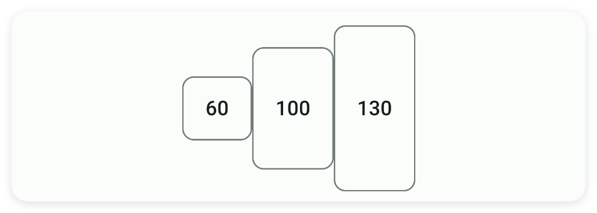

### padding - 内边距

> 设置内边距
> 
> 单位:dp


```html
// 用字符串保存布局；其中的属性就是本节演示的设置。
var layoutXml = `
<ui>
    <statusbar />
    <linear dir="h" w="max">
        <chip padding="10" text="10" />
        <chip padding="20" text="20" />
        <chip padding="30" text="30" />
    </linear>
</ui>
`;
var ui = $ui.layout(layoutXml); // 解析布局并创建控件。
ui.show(); // 显示界面，观察属性效果。
```


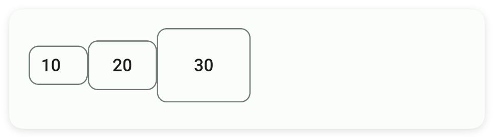

## 二、常用函数


### check(checked)

> 用代码主动设置这个小片的选中状态（不用用户手点）。
> 
> 注意：小片必须先在 XML 里打开“可选中”开关（checkable="true"），它才会像多选框一样能被选中。
> 传 true 勾上，传 false 取消选中；传 null 会被忽略。

- 参数 : checked {boolean} true 表示选中，false 表示取消选中


```javascript
//先用一段 XML 创建界面，里面放一个可选中的小片
var ui = $ui.layout('<ui><statusbar/><chip id="mChip" text="推荐" checkable="true"/></ui>');
ui.show(); //把界面显示出来
var mChip = ui.id("mChip"); //根据 id 拿到这个小片
mChip.check(true); //用代码把它选中
```


### isChecked()

> 判断这个小片当前是否被选中（读取它的选中状态）。
> 
> 只是“看一眼”，不会改变状态。返回 true 表示选中，false 表示没选中。

- 返回 : {boolean} true 表示选中，false 表示未选中


```javascript
//先用一段 XML 创建界面，里面放一个可选中的小片
var ui = $ui.layout('<ui><statusbar/><chip id="mChip" text="推荐" checkable="true"/></ui>');
ui.show(); //把界面显示出来
var mChip = ui.id("mChip"); //根据 id 拿到这个小片
var is = mChip.isChecked(); //读取选中状态
if (is) { //true 表示已选中
    ui.toast("现在是选中状态");
} else { //否则没选中
    ui.toast("现在没选中");
}
```


### onClose(callback)

> 监听小片右上角那个“关闭小叉号”被点击的事件。
> 
> 前提：必须先在 XML 里打开 showCloseIcon="true"，让小叉号显示出来。
> 用户点这个小叉号时，你传进去的回调函数就会被自动调用。

- 参数 : callback {function(view)} 回调函数；view 是安卓原生对象，一般用不到


```javascript
//先用一段 XML 创建界面，里面放一个带关闭按钮的小片
var ui = $ui.layout('<ui><statusbar/><chip id="mChip" text="可关闭" showCloseIcon="true"/></ui>');
ui.show(); //把界面显示出来
var mChip = ui.id("mChip"); //根据 id 拿到这个小片
//注册关闭监听：用户点小叉号时自动执行
mChip.onClose(function(view) {
    ui.toast("你点了关闭");
});
```


### onCheck(callback)

> 监听小片的选中状态变化（注册回调函数）。
> 
> 前提：小片要先打开 checkable="true" 才能被选中。
> 用户点小片、在“选中/取消选中”之间切换时，回调会收到一个布尔值：true 表示现在选中了。

- 参数 : callback {function(isChecked)} 回调函数；isChecked 为 true 表示选中、false 表示取消


```javascript
//先用一段 XML 创建界面，里面放一个可选中的小片
var ui = $ui.layout('<ui><statusbar/><chip id="mChip" text="推荐" checkable="true"/></ui>');
ui.show(); //把界面显示出来
var mChip = ui.id("mChip"); //根据 id 拿到这个小片
//注册选中监听：状态一变就自动执行
mChip.onCheck(function(is) {
    if (is) { //true 表示现在被选中
        ui.toast("选中了");
    } else { //false 表示取消选中
        ui.toast("取消选中了");
    }
});
```


### setText(text)

> 用代码修改小片中间显示的那行文字。

- 参数 : text {String} 要显示的新文字


```javascript
//先用一段 XML 创建界面，里面放一个带 id 的小片
var ui = $ui.layout('<ui><statusbar/><chip id="mChip" text="原来"/></ui>');
ui.show(); //把界面显示出来
var mChip = ui.id("mChip"); //根据 id 拿到这个小片
mChip.setText("我是小片"); //把文字改掉
```


### getText()

> 读出小片中间当前显示的那行文字。
> 
> 返回字符串；如果小片没有文字，返回空字符串 ""。

- 返回 : {String} 小片当前文字；没有文字时返回空字符串 ""


```javascript
//先用一段 XML 创建界面，里面放一个带 id 的小片
var ui = $ui.layout('<ui><statusbar/><chip id="mChip" text="推荐"/></ui>');
ui.show(); //把界面显示出来
var mChip = ui.id("mChip"); //根据 id 拿到这个小片
var text = mChip.getText(); //读出文字
ui.toast("小片文字是：" + text);
```


### setTextColor(color)

> 设置小片中间那行文字的颜色（用颜色字符串表示）。

- 参数 : color {String} 颜色字符串，例如 "#FF0000"


```javascript
//先用一段 XML 创建界面，里面放一个带 id 的小片
var ui = $ui.layout('<ui><statusbar/><chip id="mChip" text="推荐"/></ui>');
ui.show(); //把界面显示出来
var mChip = ui.id("mChip"); //根据 id 拿到这个小片
mChip.setTextColor("#3574F0"); //把文字涂成蓝色
```


### setTextSize(size)

> 设置小片中间文字的字号大小。
> 
> 单位是 sp（和系统字体大小联动），数字越大字越大。

- 参数 : size {float} 字号大小，单位 sp


```javascript
//先用一段 XML 创建界面，里面放一个带 id 的小片
var ui = $ui.layout('<ui><statusbar/><chip id="mChip" text="推荐"/></ui>');
ui.show(); //把界面显示出来
var mChip = ui.id("mChip"); //根据 id 拿到这个小片
mChip.setTextSize(15); //把文字设成 15sp 大小
```


### setRadius(radius)

> 设置小片四个角的圆弧大小（圆角）。
> 
> 单位 dp，数字越大角越圆；设成一个很大的值就会变成胶囊形（两端半圆）。

- 参数 : radius {float} 圆角半径，单位 dp


```javascript
//先用一段 XML 创建界面，里面放一个带 id 的小片
var ui = $ui.layout('<ui><statusbar/><chip id="mChip" text="圆角"/></ui>');
ui.show(); //把界面显示出来
var mChip = ui.id("mChip"); //根据 id 拿到这个小片
mChip.setRadius(20); //把四个角弄得很圆
```


### setIcon(icon)

> 在小片文字左边放一个小图标。
> 
> 参数可以填图标库里的图标名（例如 "ic_favorite_border_fill"），也可以填图片的相对或绝对路径。
> 找不到图标时会打一条警告，什么也不显示。

- 参数 : icon {String} 图标名（图标库里的名字）或图片路径


```javascript
//先用一段 XML 创建界面，里面放一个带 id 的小片
var ui = $ui.layout('<ui><statusbar/><chip id="mChip" text="收藏"/></ui>');
ui.show(); //把界面显示出来
var mChip = ui.id("mChip"); //根据 id 拿到这个小片
mChip.setIcon("ic_favorite_border_fill"); //在文字左边放一个心形图标
```


### setIconTint(color)

> 设置左边那个小图标的颜色（用颜色字符串表示）。

- 参数 : color {String} 颜色字符串，例如 "#FF0000"


```javascript
//先用一段 XML 创建界面，里面放一个带图标的小片
var ui = $ui.layout('<ui><statusbar/><chip id="mChip" icon="ic_favorite_border_fill" text="收藏"/></ui>');
ui.show(); //把界面显示出来
var mChip = ui.id("mChip"); //根据 id 拿到这个小片
mChip.setIconTint("#3574F0"); //把图标涂成蓝色
```


### setCheckable(checkable)

> 打开或关闭小片的“可选中”能力。
> 
> 默认小片只是个普通小按钮，点一下不会有选中状态。
> 传 true 之后，它才会像多选框一样，点一下在“选中/取消”之间切换。

- 参数 : checkable {Boolean} true 表示允许选中，false 表示只是普通按钮


```javascript
//先用一段 XML 创建界面，里面放一个小片
var ui = $ui.layout('<ui><statusbar/><chip id="mChip" text="推荐"/></ui>');
ui.show(); //把界面显示出来
var mChip = ui.id("mChip"); //根据 id 拿到这个小片
mChip.setCheckable(true); //打开“可选中”，现在它能像多选框一样切换了
```


### setShowCheckIcon(show)

> 选中后，是否在小片左边显示一个小小的对勾图标。
> 
> 前提是小片已经打开“可选中”。传 true 显示对勾，传 false 不显示。

- 参数 : show {Boolean} true 表示显示对勾图标，false 表示不显示


```javascript
//先用一段 XML 创建界面，里面放一个可选中的小片
var ui = $ui.layout('<ui><statusbar/><chip id="mChip" text="推荐" checkable="true"/></ui>');
ui.show(); //把界面显示出来
var mChip = ui.id("mChip"); //根据 id 拿到这个小片
mChip.setShowCheckIcon(true); //选中时在左边显示对勾
```


### setCheckIconTint(color)

> 设置那个选中对勾图标的颜色（用颜色字符串表示）。

- 参数 : color {String} 颜色字符串，例如 "#FF0000"


```javascript
//先用一段 XML 创建界面，里面放一个可选中的小片
var ui = $ui.layout('<ui><statusbar/><chip id="mChip" text="推荐" checkable="true"/></ui>');
ui.show(); //把界面显示出来
var mChip = ui.id("mChip"); //根据 id 拿到这个小片
mChip.setCheckIconTint("#57965C"); //把对勾涂成绿色
```


### setClickable(clickable)

> 打开或关闭小片能不能被点击。
> 
> 传 false 之后，用户点这个小片不会有任何反应（变灰、点不动）。

- 参数 : clickable {Boolean} true 表示可以点击，false 表示点不动


```javascript
//先用一段 XML 创建界面，里面放一个小片
var ui = $ui.layout('<ui><statusbar/><chip id="mChip" text="点我"/></ui>');
ui.show(); //把界面显示出来
var mChip = ui.id("mChip"); //根据 id 拿到这个小片
mChip.setClickable(false); //让它暂时点不动
```


### setShowCloseIcon(show)

> 在小片右上角显示或隐藏那个“关闭小叉号”。
> 
> 传 true 显示小叉号；配合 onClose 监听就能知道用户什么时候点了它。

- 参数 : show {Boolean} true 表示显示关闭按钮，false 表示隐藏


```javascript
//先用一段 XML 创建界面，里面放一个小片
var ui = $ui.layout('<ui><statusbar/><chip id="mChip" text="标签"/></ui>');
ui.show(); //把界面显示出来
var mChip = ui.id("mChip"); //根据 id 拿到这个小片
mChip.setShowCloseIcon(true); //在右上角显示小叉号
```


### setCloseIconTint(color)

> 设置右上角那个关闭小叉号的颜色（用颜色字符串表示）。

- 参数 : color {String} 颜色字符串，例如 "#FF0000"


```javascript
//先用一段 XML 创建界面，里面放一个带关闭按钮的小片
var ui = $ui.layout('<ui><statusbar/><chip id="mChip" text="标签" showCloseIcon="true"/></ui>');
ui.show(); //把界面显示出来
var mChip = ui.id("mChip"); //根据 id 拿到这个小片
mChip.setCloseIconTint("#57965C"); //把小叉号涂成绿色
```


### setRipper(color)

> 设置手指按下时那圈“水波纹”涟漪的颜色。
> 
> 用户点小片时会有一圈扩散的波纹效果，这个方法改波纹的颜色。

- 参数 : color {String} 颜色字符串，例如 "#FF0000"


```javascript
//先用一段 XML 创建界面，里面放一个可点击的小片
var ui = $ui.layout('<ui><statusbar/><chip id="mChip" text="点我" clickable="true"/></ui>');
ui.show(); //把界面显示出来
var mChip = ui.id("mChip"); //根据 id 拿到这个小片
mChip.setRipper("#3574F0"); //把波纹涂成蓝色
```


### setColor(color)

> 设置小片的主题颜色（整块的底色和边框色）。
> 
> 传一个颜色字符串，小片未选中时是半透明底色、选中时是实色。

- 参数 : color {String} 颜色字符串，例如 "#FF0000"


```javascript
//先用一段 XML 创建界面，里面放一个小片
var ui = $ui.layout('<ui><statusbar/><chip id="mChip" text="推荐"/></ui>');
ui.show(); //把界面显示出来
var mChip = ui.id("mChip"); //根据 id 拿到这个小片
mChip.setColor("#57965C"); //把整片涂成绿色主题
```


### setMinW(minW)

> 设置小片的最小宽度。
> 
> 单位 dp；哪怕文字很短，小片也不会比这个更窄。

- 参数 : minW {int} 最小宽度，单位 dp


```javascript
//先用一段 XML 创建界面，里面放一个小片
var ui = $ui.layout('<ui><statusbar/><chip id="mChip" text="短"/></ui>');
ui.show(); //把界面显示出来
var mChip = ui.id("mChip"); //根据 id 拿到这个小片
mChip.setMinW(100); //让它至少有 100dp 宽
```


### setMinH(minH)

> 设置小片的最小高度。
> 
> 单位 dp；哪怕文字很小，小片也不会比这个更矮。

- 参数 : minH {int} 最小高度，单位 dp


```javascript
//先用一段 XML 创建界面，里面放一个小片
var ui = $ui.layout('<ui><statusbar/><chip id="mChip" text="短"/></ui>');
ui.show(); //把界面显示出来
var mChip = ui.id("mChip"); //根据 id 拿到这个小片
mChip.setMinH(50); //让它至少有 50dp 高
```


### setPadding(left, top, right, bottom)

> 同时设置小片四周的内边距（文字离边的距离）。
> 
> 单位 dp，四个参数依次是：左、上、右、下。数字越大，文字离小片边缘越远，小片也显得越大。

- 参数 : left {int} 左边距，单位 dp
- 参数 : top {int} 上边距，单位 dp
- 参数 : right {int} 右边距，单位 dp
- 参数 : bottom {int} 下边距，单位 dp


```javascript
//先用一段 XML 创建界面，里面放一个小片
var ui = $ui.layout('<ui><statusbar/><chip id="mChip" text="宽松点"/></ui>');
ui.show(); //把界面显示出来
var mChip = ui.id("mChip"); //根据 id 拿到这个小片
mChip.setPadding(20, 10, 20, 10); //左20 上10 右20 下10
```


