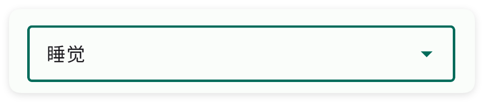
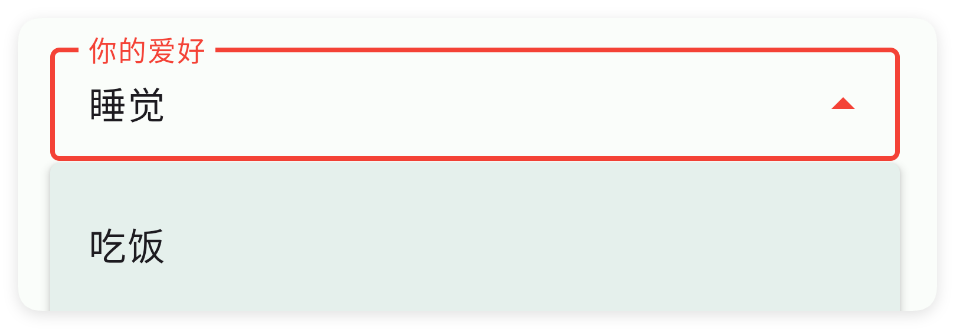
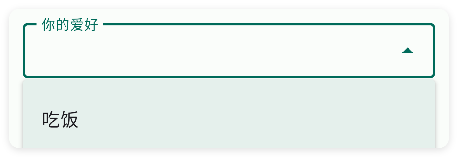
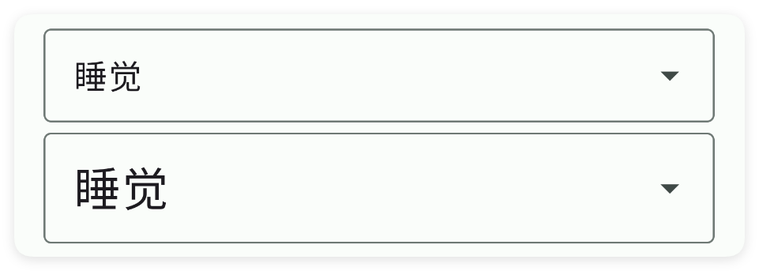
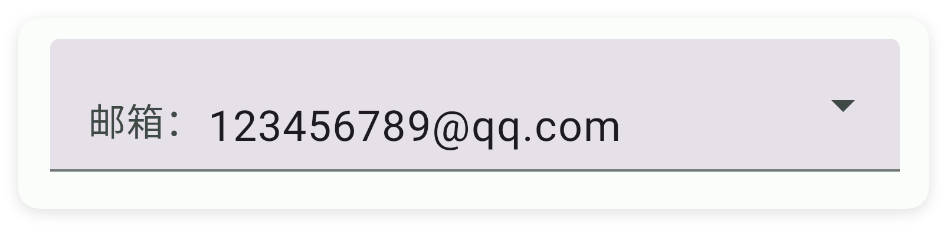
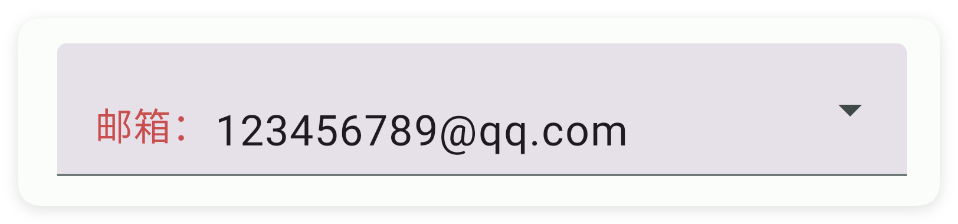
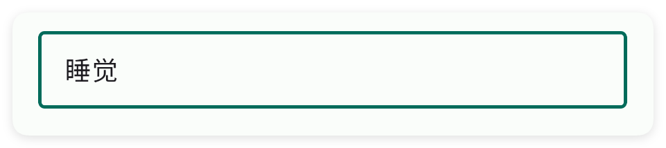
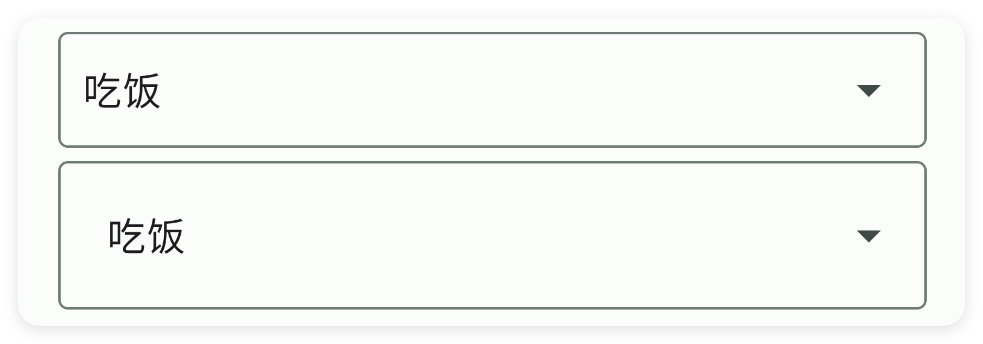
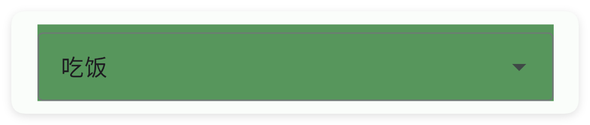

# 下拉框

- 更新时间:2026-10-22 10:58:40

> 下拉框-drop
> 
> 布局原生类型:{com.google.android.material.textfield.TextInputLayout}
> 组件原生类型:{com.google.android.material.textfield.MaterialAutoCompleteTextView}


<div style="width: 100%; position: relative; padding-bottom: 56.25%; height: 0; overflow: hidden;">
  <iframe 
    src="//player.bilibili.com/player.html?isOutside=true&aid=116224616831101&bvid=BV1UuwpzaEKK&cid=36681878033&p=1" 
    style="position: absolute; top: 0; left: 0; width: 100%; height: 100%; border: none;"
    scrolling="no" 
    frameborder="no" 
    allowfullscreen="true">
  </iframe>
</div>

下拉框类似于一个小菜单，点一下才会展开让你选，核心用途就是帮你方便、规范地挑东西。


## 一、基础用法


```html
// 将布局写成字符串，无需另建 ui.xml 文件。
var layoutXml =
    "<ui>\n" +
    "    <statusbar />\n" +
    "    <linear w=\"max\" padding=\"15\" gravity=\"center\" h=\"max\">\n" +
    "        <drop id=\"mDrop\" w=\"max\">\n" +
    "            <!-- 添加选项 -->\n" +
    "            <item text=\"吃饭\" />\n" +
    "            <item text=\"睡觉\" />\n" +
    "            <item text=\"电影\" />\n" +
    "        </drop>\n" +
    "    </linear>\n" +
    "</ui>";
var ui = $ui.layout(layoutXml);
ui.show(); // 显示界面，后面的事件示例继续使用这个对象。
```

```javascript
//解析布局
// 接着上一段执行，继续使用已创建的界面对象。
//为下拉框添加选中事件
ui.id("mDrop").onCheck(function(value, index) {
    info("选中下标为:" + index + "的元素:" + value);
});
```


## 二、常用属性


### item - 子选项

> 设置子选项
> 
> 子选项使用item标签，只有text一个属性


```html
// 用字符串保存布局；其中的属性就是本节演示的设置。
var layoutXml = `
<ui>
    <statusbar />
    <drop w="max">
        <item text="吃饭" />
        <item text="睡觉" />
    </drop>
</ui>
`;
var ui = $ui.layout(layoutXml); // 解析布局并创建控件。
ui.show(); // 显示界面，观察属性效果。
```


### style - 样式

> 设置样式
> 
> 可选:fill,outline


```html
// 用字符串保存布局；其中的属性就是本节演示的设置。
var layoutXml = `
<ui>
    <statusbar />
    <drop style="outline" w="max">
        <item text="吃饭" />
        <item text="睡觉" />
    </drop>
</ui>
`;
var ui = $ui.layout(layoutXml); // 解析布局并创建控件。
ui.show(); // 显示界面，观察属性效果。
```




### color - 主题颜色

> 设置主题颜色


```html
// 用字符串保存布局；其中的属性就是本节演示的设置。
var layoutXml = `
<ui>
    <statusbar />
    <drop style="outline" color="#F44236" def="睡觉" hint="你的爱好" w="max">
        <item text="吃饭" />
        <item text="睡觉" />
    </drop>
</ui>
`;
var ui = $ui.layout(layoutXml); // 解析布局并创建控件。
ui.show(); // 显示界面，观察属性效果。
```




### hint - 提示文字

> 设置提示文字


```html
// 用字符串保存布局；其中的属性就是本节演示的设置。
var layoutXml = `
<ui>
    <statusbar />
    <drop style="outline" hint="你的爱好" w="max">
        <item text="吃饭" />
        <item text="睡觉" />
    </drop>
</ui>
`;
var ui = $ui.layout(layoutXml); // 解析布局并创建控件。
ui.show(); // 显示界面，观察属性效果。
```




### hintColor - 提示颜色

> 设置提示颜色


```html
// 用字符串保存布局；其中的属性就是本节演示的设置。
var layoutXml = `
<ui>
    <statusbar />
    <drop style="outline" hint="你的爱好" hintColor="#C94F4F" text="吃饭" w="max">
        <item text="吃饭" />
        <item text="睡觉" />
    </drop>
</ui>
`;
var ui = $ui.layout(layoutXml); // 解析布局并创建控件。
ui.show(); // 显示界面，观察属性效果。
```


### def - 默认文字

> 设置默认文字


```html
// 用字符串保存布局；其中的属性就是本节演示的设置。
var layoutXml = `
<ui>
    <statusbar />
    <drop style="outline" def="睡觉" hint="你的爱好" w="max">
        <item text="吃饭" />
        <item text="睡觉" />
    </drop>
</ui>
`;
var ui = $ui.layout(layoutXml); // 解析布局并创建控件。
ui.show(); // 显示界面，观察属性效果。
```


### text - 文本

> 设置文本


```html
// 用字符串保存布局；其中的属性就是本节演示的设置。
var layoutXml = `
<ui>
    <statusbar />
    <drop style="outline" hint="你的爱好" text="睡觉" w="max">
        <item text="吃饭" />
        <item text="睡觉" />
    </drop>
</ui>
`;
var ui = $ui.layout(layoutXml); // 解析布局并创建控件。
ui.show(); // 显示界面，观察属性效果。
```


### textColor - 文字的颜色

> 设置文字的颜色


```html
// 用字符串保存布局；其中的属性就是本节演示的设置。
var layoutXml = `
<ui>
    <statusbar />
    <drop style="outline" def="睡觉" hint="你的爱好" textColor="#F44236" w="max">
        <item text="吃饭" />
        <item text="睡觉" />
    </drop>
</ui>
`;
var ui = $ui.layout(layoutXml); // 解析布局并创建控件。
ui.show(); // 显示界面，观察属性效果。
```


### textSize - 文本尺寸

> 设置文本尺寸
> 
> 单位:dp


```html
// 用字符串保存布局；其中的属性就是本节演示的设置。
var layoutXml = `
<ui>
    <statusbar />
    <drop style="outline" def="睡觉" textSize="18" w="max">
        <item text="吃饭" />
        <item text="睡觉" />
    </drop>
    <drop style="outline" def="睡觉" textSize="25" w="max">
        <item text="吃饭" />
        <item text="睡觉" />
    </drop>
</ui>
`;
var ui = $ui.layout(layoutXml); // 解析布局并创建控件。
ui.show(); // 显示界面，观察属性效果。
```




### prefix - 前缀

> 设置前缀


```html
// 用字符串保存布局；其中的属性就是本节演示的设置。
var layoutXml = `
<ui>
    <statusbar />
    <drop prefix="邮箱：" text="123456789@qq.com" textSize="18" w="max">
        <item text="123456789@qq.com" />
        <item text="222333555@qq.com" />
    </drop>
</ui>
`;
var ui = $ui.layout(layoutXml); // 解析布局并创建控件。
ui.show(); // 显示界面，观察属性效果。
```




### prefixColor - 前缀颜色

> 设置前缀颜色


```html
// 用字符串保存布局；其中的属性就是本节演示的设置。
var layoutXml = `
<ui>
    <statusbar />
    <drop prefix="邮箱：" prefixColor="#C94F4F" text="123456789@qq.com" textSize="18"
        w="max">
        <item text="123456789@qq.com" />
        <item text="222333555@qq.com" />
    </drop>
</ui>
`;
var ui = $ui.layout(layoutXml); // 解析布局并创建控件。
ui.show(); // 显示界面，观察属性效果。
```




### suffix - 后缀

> 设置后缀


```html
// 用字符串保存布局；其中的属性就是本节演示的设置。
var layoutXml = `
<ui>
    <statusbar />
    <drop prefix="邮箱：" suffix="@qq.com" text="123456789" textSize="18" w="max">
        <item text="123456789" />
        <item text="222333555" />
    </drop>
</ui>
`;
var ui = $ui.layout(layoutXml); // 解析布局并创建控件。
ui.show(); // 显示界面，观察属性效果。
```


### suffixColor - 后缀颜色

> 设置后缀颜色


```html
// 用字符串保存布局；其中的属性就是本节演示的设置。
var layoutXml = `
<ui>
    <statusbar />
    <drop prefix="邮箱：" suffix="@qq.com" suffixColor="#C94F4F" text="123456789"
        textSize="18" w="max">
        <item text="123456789" />
        <item text="222333555" />
    </drop>
</ui>
`;
var ui = $ui.layout(layoutXml); // 解析布局并创建控件。
ui.show(); // 显示界面，观察属性效果。
```


### hideIcon - 是否隐藏后面的倒三角图标

> 是否隐藏后面的倒三角图标


```html
// 用字符串保存布局；其中的属性就是本节演示的设置。
var layoutXml = `
<ui>
    <statusbar />
    <drop style="outline" hideIcon="true" w="max">
        <item text="吃饭" />
        <item text="睡觉" />
    </drop>
</ui>
`;
var ui = $ui.layout(layoutXml); // 解析布局并创建控件。
ui.show(); // 显示界面，观察属性效果。
```




### gravity - 布局重力

> 设置布局重力


```html
// 用字符串保存布局；其中的属性就是本节演示的设置。
var layoutXml = `
<ui>
    <statusbar />
    <drop style="outline" def="吃饭" gravity="start" w="max">
        <item text="吃饭" />
        <item text="睡觉" />
    </drop>
    <drop style="outline" def="吃饭" gravity="center" w="max">
        <item text="吃饭" />
        <item text="睡觉" />
    </drop>
    <drop style="outline" def="吃饭" gravity="end" w="max">
        <item text="吃饭" />
        <item text="睡觉" />
    </drop>
</ui>
`;
var ui = $ui.layout(layoutXml); // 解析布局并创建控件。
ui.show(); // 显示界面，观察属性效果。
```


### padding - 布局内边距

> 设置布局内边距
> 
> 单位:dp


```html
// 用字符串保存布局；其中的属性就是本节演示的设置。
var layoutXml = `
<ui>
    <statusbar />
    <drop style="outline" def="吃饭" padding="10" w="max">
        <item text="吃饭" />
        <item text="睡觉" />
    </drop>
    <drop style="outline" def="吃饭" padding="20" w="max">
        <item text="吃饭" />
        <item text="睡觉" />
    </drop>
</ui>
`;
var ui = $ui.layout(layoutXml); // 解析布局并创建控件。
ui.show(); // 显示界面，观察属性效果。
```




### bg - 背景颜色

> 设置背景颜色


```html
// 用字符串保存布局；其中的属性就是本节演示的设置。
var layoutXml = `
<ui>
    <statusbar />
    <drop style="outline" def="吃饭" bg="#57965C" w="max">
        <item text="吃饭" />
        <item text="睡觉" />
    </drop>
</ui>
`;
var ui = $ui.layout(layoutXml); // 解析布局并创建控件。
ui.show(); // 显示界面，观察属性效果。
```




### bgImg - 背景图片

> 设置背景图片


```html
// 用字符串保存布局；其中的属性就是本节演示的设置。
var layoutXml = `
<ui>
    <statusbar />
    <drop style="outline" bgImg="example/$ui - 交互界面/05.drop-下拉框/img/img.png" def="吃饭" w="max">
        <item text="吃饭" />
        <item text="睡觉" />
    </drop>
</ui>
`;
var ui = $ui.layout(layoutXml); // 解析布局并创建控件。
ui.show(); // 显示界面，观察属性效果。
```


### storeKey - 应用内存储

> 应用内存储
> 
> 通过storeKey(存储关键字)指定一个存储字符串的关键字，获取值时可以直接通过$storage($存储)获取字符串。
> 
> 注意：不同的控件存储的类型不同，对于本控件(输入框)则存储的是字符串类型，表达当前选中的内容


```html
// 用字符串保存布局；其中的属性就是本节演示的设置。
var layoutXml = `
<ui><statusbar/><!-- 你必须在ui(界面)节点中通过store(存储)指定$storage($存储)的命名空间，等价于使用代码：var storage = $storage.create("MyDrop"); -->
<ui store="MyDrop">
    <statusbar />
    <!-- 使用storeKey(存储关键字)属性，指定关键字，等价于使用代码：var data = $storage.create("MyDrop").getStr("text"); -->
    <!-- 使用storeDef(存储默认值)属性，指定关键字，等价于使用代码：var data = $storage.create("MyDrop").getStr("text","吃饭"); -->
    <drop storeKey="text" storeDef="吃饭">
        <item text="吃饭"/>
        <item text="睡觉"/>
        <item text="游戏"/>
    </drop>
</ui></ui>
`;
var ui = $ui.layout(layoutXml); // 解析布局并创建控件。
ui.show(); // 显示界面，观察属性效果。
```


如果我们已经配置好了应用内存储，则可以直接获取数据：

注意：一、要使用应用内存储，必须在ui(界面)节点指定属性store(存储)的值，该值指定存储的命名空间；
二、不是所有的控件都支持应用内存储；
三、不同的控件存储的数据类型可能都不一致，例如：输入类型的控件存储的是字符串类型，开关、多选框存储的就是布尔类型的数据。


```javascript
//创建(或者加载)存储对象
var storage = $storage.create("MyDrop");//名称要一致
//获取数据
var data = storage.getStr("文本","吃饭");//数据类型是字符串
```


## 三、常用函数


### onCheck(callback)

> 监听用户在下拉框里选中了哪一项。
> 
> 用户点下拉框、从弹出的列表里选了一项时，你传进去的回调函数会被自动调用。
> 回调会收到两个参数：第一个是选中那项的文字内容，第二个是它在列表里的下标（从 0 开始）。

- 参数 : callback {function(title, index)} 回调函数；title 是选中项文字，index 是下标（从 0 开始）


```javascript
//先用一段 XML 创建界面，里面放一个带三个选项的下拉框
var ui = $ui.layout('<ui><statusbar/><drop id="mDrop" w="max"><item text="吃饭"/><item text="睡觉"/><item text="电影"/></drop></ui>');
ui.show(); //把界面显示出来
var drop = ui.id("mDrop"); //根据 id 拿到这个下拉框
//注册选中监听：用户选了某项就自动执行
drop.onCheck(function(title, index) {
    ui.toast("你选了第 " + (index + 1) + " 项：" + title);
});
```


### setText(text)

> 用代码直接设置下拉框当前显示的文字。
> 
> 传一段字符串，下拉框里就会立刻显示这段文字（不要求它一定是选项之一）。

- 参数 : text {String} 要显示的文字


```javascript
//先用一段 XML 创建界面，里面放一个下拉框
var ui = $ui.layout('<ui><statusbar/><drop id="mDrop" w="max"><item text="吃饭"/><item text="睡觉"/></drop></ui>');
ui.show(); //把界面显示出来
var drop = ui.id("mDrop"); //根据 id 拿到这个下拉框
drop.setText("选项1"); //直接显示“选项1”这几个字
```


### getText()

> 读出下拉框当前显示的文字。
> 
> 返回字符串；如果什么都没选，返回空字符串 ""。

- 返回 : {String} 下拉框当前显示的文字；为空时返回空字符串 ""


```javascript
//先用一段 XML 创建界面，里面放一个下拉框
var ui = $ui.layout('<ui><statusbar/><drop id="mDrop" w="max" def="吃饭"><item text="吃饭"/><item text="睡觉"/></drop></ui>');
ui.show(); //把界面显示出来
var drop = ui.id("mDrop"); //根据 id 拿到这个下拉框
var text = drop.getText(); //读出当前显示的文字
ui.toast("当前是：" + text);
```


### flush(items)

> 用代码一次性替换下拉框里的所有选项。
> 
> 传一个字符串数组（例如 ["张三","李四","王五"]），下拉框的列表就会被整个换成这组新选项。
> 这适合“根据上一步的结果动态改变下拉选项”的场景。传空数组会被忽略。

- 参数 : items {String[]} 新的选项文字数组


```javascript
//先用一段 XML 创建界面，里面放一个空下拉框
var ui = $ui.layout('<ui><statusbar/><drop id="mDrop" w="max"/></ui>');
ui.show(); //把界面显示出来
var drop = ui.id("mDrop"); //根据 id 拿到这个下拉框
//用一组新选项替换原来的列表
drop.flush(["张三", "李四", "王五"]);
```


### getIndex()

> 读出用户当前选中的是第几个选项（下标）。
> 
> 下标从 0 开始：第 1 项是 0，第 2 项是 1。如果当前显示的文字并不在选项列表里，返回 -1。

- 返回 : {int} 当前选中项的下标（从 0 开始）；没匹配到选项时返回 -1
- 版本 : 1.9.6


```javascript
//先用一段 XML 创建界面，里面放一个下拉框
var ui = $ui.layout('<ui><statusbar/><drop id="mDrop" w="max"><item text="张三"/><item text="李四"/><item text="王五"/></drop></ui>');
ui.show(); //把界面显示出来
var drop = ui.id("mDrop"); //根据 id 拿到这个下拉框
var index = drop.getIndex(); //读出当前选中的下标
ui.toast("选中的是第 " + (index + 1) + " 项");
```


### setIndex(index)

> 用下标指定让下拉框选中第几个选项。
> 
> 下标从 0 开始：传 0 选第 1 项，传 1 选第 2 项，依次类推。下标超出范围就什么也不做。

- 参数 : index {int} 要选中的下标，从 0 开始
- 版本 : 1.9.6


```javascript
//先用一段 XML 创建界面，里面放一个下拉框
var ui = $ui.layout('<ui><statusbar/><drop id="mDrop" w="max"><item text="张三"/><item text="李四"/><item text="王五"/></drop></ui>');
ui.show(); //把界面显示出来
var drop = ui.id("mDrop"); //根据 id 拿到这个下拉框
drop.setIndex(1); //选中第 2 项（下标 1，也就是“李四”）
```


