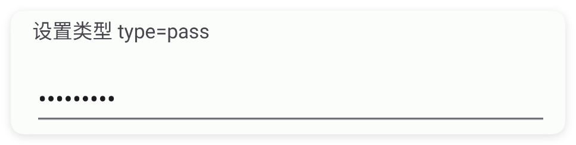
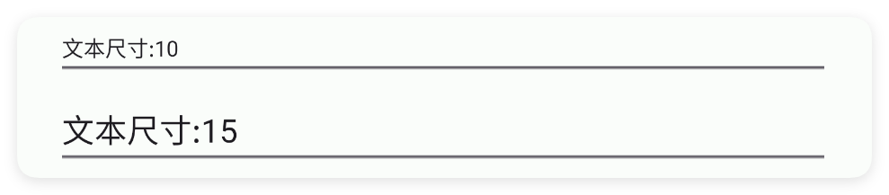

# 编辑框

- 更新时间:2026-10-22 10:58:40

> 编辑框-edit
> 
> 原生类型:{androidx.appcompat.widget.AppCompatEditText}


<div style="width: 100%; position: relative; padding-bottom: 56.25%; height: 0; overflow: hidden;">
  <iframe 
    src="//player.bilibili.com/player.html?isOutside=true&aid=116224683939813&bvid=BV1ztwpzJEfn&cid=36682073516&p=1" 
    style="position: absolute; top: 0; left: 0; width: 100%; height: 100%; border: none;"
    scrolling="no" 
    frameborder="no" 
    allowfullscreen="true">
  </iframe>
</div>

这是一种小巧的输入框

edit比input输入框更加小巧一些，是安卓原生拓展库的组件，而input输入框是M3风格的组件。


```html
// 用字符串保存布局；其中的属性就是本节演示的设置。
var layoutXml = "<ui>\r\n    <statusbar />\r\n    <linear dir=\"h\" w=\"max\">\r\n        <edit text=\"我是\" textColor=\"#57965C\" />\r\n        <edit text=\"一个\" />\r\n        <edit text=\"简约的\" textColor=\"#C94F4F\" />\r\n        <edit text=\"编辑框\" textColor=\"#3574F0\" />\r\n    </linear>\r\n</ui>";
var ui = $ui.layout(layoutXml); // 解析布局并创建控件。
ui.show(); // 显示界面，观察属性效果。
```


## 一、常用属性


### hint - 提示文本

> 设置提示文本


```html
// 用字符串保存布局；其中的属性就是本节演示的设置。
var layoutXml = `
<ui>
    <statusbar />
    <edit hint="提示文本" w="max" />
</ui>
`;
var ui = $ui.layout(layoutXml); // 解析布局并创建控件。
ui.show(); // 显示界面，观察属性效果。
```


### text - 文本

> 设置文本


```html
// 用字符串保存布局；其中的属性就是本节演示的设置。
var layoutXml = `
<ui>
    <statusbar />
    <edit text="我是文本" w="max" />
</ui>
`;
var ui = $ui.layout(layoutXml); // 解析布局并创建控件。
ui.show(); // 显示界面，观察属性效果。
```


### textColor - 文本颜色

> 设置文本颜色


```html
// 用字符串保存布局；其中的属性就是本节演示的设置。
var layoutXml = `
<ui>
    <statusbar />
    <edit text="我是文本" textColor="#C94F4F" w="max" />
</ui>
`;
var ui = $ui.layout(layoutXml); // 解析布局并创建控件。
ui.show(); // 显示界面，观察属性效果。
```


### def - 默认文本

> 设置默认文本


```html
// 用字符串保存布局；其中的属性就是本节演示的设置。
var layoutXml = `
<ui>
    <statusbar />
    <edit def="默认文本" w="max" />
</ui>
`;
var ui = $ui.layout(layoutXml); // 解析布局并创建控件。
ui.show(); // 显示界面，观察属性效果。
```


### type - 输入内容的类型

> 输入内容的类型
> 
> 可选值:
> pass:密码,
> num:数字,
> phone:手机号


```html
// 用字符串保存布局；其中的属性就是本节演示的设置。
var layoutXml = `
<ui>
    <statusbar />
    <!--密码类型-->
    <edit text="123456???" type="pass" w="max" />
    <!--数字类型-->
    <edit text="123" type="num" w="max" />
    <!--手机号码类型-->
    <edit text="15047070177" type="phone" w="max" />
</ui>
`;
var ui = $ui.layout(layoutXml); // 解析布局并创建控件。
ui.show(); // 显示界面，观察属性效果。
```




### size - 文本尺寸

> 设置文本尺寸
> 
> 单位:sp


```html
// 用字符串保存布局；其中的属性就是本节演示的设置。
var layoutXml = `
<ui>
    <statusbar />
    <edit text="文本尺寸:10" textSize="10" w="max" />
    <edit text="文本尺寸:15" textSize="15" w="max" />
</ui>
`;
var ui = $ui.layout(layoutXml); // 解析布局并创建控件。
ui.show(); // 显示界面，观察属性效果。
```




### minW - 最小宽度

> 设置最小宽度
> 
> 单位:dp


```html
// 用字符串保存布局；其中的属性就是本节演示的设置。
var layoutXml = `
<ui>
    <statusbar />
    <edit bg="#5557965C" minW="200" text="最小宽度:200" />
    <edit bg="#55C94F4F" minW="250" text="最小宽度:250" />
</ui>
`;
var ui = $ui.layout(layoutXml); // 解析布局并创建控件。
ui.show(); // 显示界面，观察属性效果。
```


### minH - 最小高度

> 设置最小高度
> 
> 单位:dp


```html
// 用字符串保存布局；其中的属性就是本节演示的设置。
var layoutXml = `
<ui>
    <statusbar />
    <linear dir="h" gravity="center" w="max">
        <edit bg="#5557965C" minH="100" text="最小高度:100" />
        <edit bg="#55C94F4F" minH="150" text="最小高度:150" />
    </linear>
</ui>
`;
var ui = $ui.layout(layoutXml); // 解析布局并创建控件。
ui.show(); // 显示界面，观察属性效果。
```


### gravity - 布局重力

> 设置布局重力


```html
// 用字符串保存布局；其中的属性就是本节演示的设置。
var layoutXml = `
<ui>
    <statusbar />
    <!--为了演示效果，宽度设置到最大 w=max -->
    <edit gravity="start|center" text="我在左边" w="max" />
    <edit gravity="center" text="我在中间" w="max" />
    <edit gravity="end|center" text="我在右边" w="max" />
</ui>
`;
var ui = $ui.layout(layoutXml); // 解析布局并创建控件。
ui.show(); // 显示界面，观察属性效果。
```


### padding - 布局内边距

> 设置布局内边距


```html
// 用字符串保存布局；其中的属性就是本节演示的设置。
var layoutXml = `
<ui>
    <statusbar />
    <edit bg="#5557965C" padding="10,0,20,30" text="看我内边距" />
</ui>
`;
var ui = $ui.layout(layoutXml); // 解析布局并创建控件。
ui.show(); // 显示界面，观察属性效果。
```


### bg - 背景颜色

> 设置背景颜色


```html
// 用字符串保存布局；其中的属性就是本节演示的设置。
var layoutXml = `
<ui>
    <statusbar />
    <edit bg="#5557965C" text="看我背景颜色" w="max" />
    <edit bg="#55C94F4F" text="看我背景颜色" w="max" />
    <edit bg="#553574F0" text="看我背景颜色" w="max" />
</ui>
`;
var ui = $ui.layout(layoutXml); // 解析布局并创建控件。
ui.show(); // 显示界面，观察属性效果。
```


### bgImg - 背景图片

> 设置背景图片


```html
// 用字符串保存布局；其中的属性就是本节演示的设置。
var layoutXml = `
<ui>
    <statusbar />
    <edit bgImg="example/$ui - 交互界面/06.edit-编辑框/img/bg-edit.png"
        text="看我背景图片" textColor="#FFFFFF" w="max" />
</ui>
`;
var ui = $ui.layout(layoutXml); // 解析布局并创建控件。
ui.show(); // 显示界面，观察属性效果。
```


### storeKey - 应用内存储

> 应用内存储
> 
> 通过storeKey(存储关键字)指定一个存储字符串的关键字，获取值时可以直接通过$storage($存储)获取字符串。
> 
> 注意：不同的控件存储的类型不同，对于本控件(编辑框)则存储的是字符串类型，表达当前输入的内容


```html
// 用字符串保存布局；其中的属性就是本节演示的设置。
var layoutXml = `
<ui><statusbar/><!-- 你必须在ui(界面)节点中通过store(存储)指定$storage($存储)的命名空间，等价于使用代码：var storage = $storage.create("MyAppEdit"); -->
<ui store="MyAppEdit">
    <statusbar />
    <!-- 使用storeKey(存储关键字)属性，指定关键字，等价于使用代码：var data = $storage.create("MyAppEdit").getStr("eatFoodStr"); -->
    <!-- 使用storeDef(存储默认值)属性，指定关键字，等价于使用代码：var data = $storage.create("MyAppEdit").getStr("eatFoodStr","吃饭"); -->
    <edit storeKey="eatFoodStr" storeDef="eatFoodStr" text="吃饭" />
    <edit storeKey="playGameStr" storeDef="我爱游戏" text="游戏" />
</ui></ui>
`;
var ui = $ui.layout(layoutXml); // 解析布局并创建控件。
ui.show(); // 显示界面，观察属性效果。
```


如果我们已经配置好了应用内存储，则可以直接获取数据：

注意：一、要使用应用内存储，必须在ui(界面)节点指定属性store(存储)的值，该值指定存储的命名空间；
二、不是所有的控件都支持应用内存储；
三、不同的控件存储的数据类型可能都不一致，例如：输入类型的控件存储的是字符串类型，开关、多选框存储的就是布尔类型的数据。


```javascript
//创建(或者加载)存储对象
var storage = $storage.create("MyAppEdit");//名称要一致
//获取数据
var data = storage.getStr("我爱吃饭","未必");//数据类型是字符串
```


## 二、常用函数


### getText()

> 读出用户在编辑框里输入的全部内容。
> 
> 返回字符串；如果编辑框是空的，返回空字符串 ""（不会返回 null）。

- 返回 : {String} 编辑框里的文字；为空时返回空字符串 ""


```javascript
//先用一段 XML 创建界面，里面放一个带 id 的编辑框
var ui = $ui.layout('<ui><statusbar/><edit id="mEdit" hint="请输入用户名" w="max"/></ui>');
ui.show(); //把界面显示出来
var edit = ui.id("mEdit"); //根据 id 拿到这个编辑框
var text = edit.getText(); //读出用户输入的内容
ui.toast("你输入的是：" + text);
```


### setError(msg)

> 在编辑框下方显示一条红色的错误提示（用于表单校验）。
> 
> 例如用户没填用户名就点登录，你可以调用这个方法，在输入框底下红字提醒“用户名不能为空”。

- 参数 : msg {String} 要显示的错误提示文字


```javascript
//先用一段 XML 创建界面，里面放一个带 id 的编辑框
var ui = $ui.layout('<ui><statusbar/><edit id="mEdit" hint="请输入用户名" w="max"/></ui>');
ui.show(); //把界面显示出来
var edit = ui.id("mEdit"); //根据 id 拿到这个编辑框
//假设用户什么都没填
if (edit.getText() === "") {
    edit.setError("用户名不能为空"); //在输入框下方红字提示
}
```


### setText(text)

> 用代码直接把编辑框里的内容替换成指定文字。
> 
> 这会清空用户原来输入的内容，换成新的文字。

- 参数 : text {String} 要填入的新文字


```javascript
//先用一段 XML 创建界面，里面放一个带 id 的编辑框
var ui = $ui.layout('<ui><statusbar/><edit id="mEdit" w="max"/></ui>');
ui.show(); //把界面显示出来
var edit = ui.id("mEdit"); //根据 id 拿到这个编辑框
edit.setText("默认填好的内容"); //直接把内容填成这串字
```


### onChanged(callback)

> 监听编辑框内容的每一次变化（边打边触发）。
> 
> 用户每敲一个字、删一个字，回调都会被调用一次。回调参数依次是：
> 最新的整段文字、变化发生的位置、被替换掉的旧字数、新输入的字数。
> 一般小白只需要第一个参数（最新文字）。

- 参数 : callback {function(text, start, before, count)} 回调；text 是最新整段文字，start/before/count 是变化位置细节
- 版本 : 1.8.0


```javascript
//先用一段 XML 创建界面，里面放一个带 id 的编辑框
var ui = $ui.layout('<ui><statusbar/><edit id="mEdit" hint="边打边看" w="max"/></ui>');
ui.show(); //把界面显示出来
var edit = ui.id("mEdit"); //根据 id 拿到这个编辑框
//注册监听：内容每变一次就自动执行
edit.onChanged(function(text, start, before, count) {
    log("现在内容是：" + text); //打印最新整段文字
});
```


### onChangedAfter(callback)

> 监听“这次输入结束后”的时机。
> 
> 和 onChanged 的区别：onChanged 边打边触发；这个是一次输入动作结束后才触发，
> 回调只带一个参数——最新的整段文字。适合做“输完再校验”。

- 参数 : callback {function(text)} 回调；text 是最新整段文字
- 版本 : 1.8.0


```javascript
//先用一段 XML 创建界面，里面放一个带 id 的编辑框
var ui = $ui.layout('<ui><statusbar/><edit id="mEdit" hint="输完密码" type="pass" w="max"/></ui>');
ui.show(); //把界面显示出来
var edit = ui.id("mEdit"); //根据 id 拿到这个编辑框
edit.onChangedAfter(function(text) { //输入结束后触发
    log("最终输入：" + text);
});
```


### onChangedBefore(callback)

> 监听“这次输入之前”的时机（内容还没改之前先告诉你）。
> 
> 用户每准备改一次内容，回调会先被调用，这时拿到的还是改之前的旧文字。
> 回调参数依次是：旧的整段文字、变化位置、被替换的旧字数、即将新增的字数。

- 参数 : callback {function(text, start, count, after)} 回调；text 是改之前的旧整段文字
- 版本 : 1.8.0


```javascript
//先用一段 XML 创建界面，里面放一个带 id 的编辑框
var ui = $ui.layout('<ui><statusbar/><edit id="mEdit" hint="看着我变化" w="max"/></ui>');
ui.show(); //把界面显示出来
var edit = ui.id("mEdit"); //根据 id 拿到这个编辑框
edit.onChangedBefore(function(text, start, count, after) { //改之前触发
    log("改之前的旧文字：" + text);
});
```


### setHint(hint)

> 修改编辑框里那行灰色的占位提示文字。
> 
> 用户还没输入时，编辑框里会显示一段灰色提示，比如“请输入用户名”。这个方法改这段提示。

- 参数 : hint {String} 新的占位提示文字
- 版本 : 1.9.3


```javascript
//先用一段 XML 创建界面，里面放一个带 id 的编辑框
var ui = $ui.layout('<ui><statusbar/><edit id="mEdit" w="max"/></ui>');
ui.show(); //把界面显示出来
var edit = ui.id("mEdit"); //根据 id 拿到这个编辑框
edit.setHint("请输入 6-12 位密码"); //改灰色提示
```


### setTextColor(color)

> 设置编辑框里用户输入文字的颜色（用颜色字符串表示）。

- 参数 : color {String} 颜色字符串，例如 "#FF0000"
- 版本 : 1.9.3


```javascript
//先用一段 XML 创建界面，里面放一个带 id 的编辑框
var ui = $ui.layout('<ui><statusbar/><edit id="mEdit" text="我是蓝色字" w="max"/></ui>');
ui.show(); //把界面显示出来
var edit = ui.id("mEdit"); //根据 id 拿到这个编辑框
edit.setTextColor("#3574F0"); //把输入的字涂成蓝色
```


### setSize(size)

> 设置编辑框里文字的字号大小，单位 sp。

- 参数 : size {Number} 字号大小，单位 sp
- 版本 : 1.9.3


```javascript
//先用一段 XML 创建界面，里面放一个带 id 的编辑框
var ui = $ui.layout('<ui><statusbar/><edit id="mEdit" text="看看大小" w="max"/></ui>');
ui.show(); //把界面显示出来
var edit = ui.id("mEdit"); //根据 id 拿到这个编辑框
edit.setSize(20); //把文字设成 20sp
```


### setMinW(width)

> 设置编辑框的最小宽度，单位 dp。
> 
> 哪怕用户还没输入任何字，编辑框也不会比这个更窄。

- 参数 : width {Number} 最小宽度，单位 dp
- 版本 : 1.9.3


```javascript
//先用一段 XML 创建界面，里面放一个带 id 的编辑框
var ui = $ui.layout('<ui><statusbar/><edit id="mEdit" w="max"/></ui>');
ui.show(); //把界面显示出来
var edit = ui.id("mEdit"); //根据 id 拿到这个编辑框
edit.setMinW(200); //至少 200dp 宽
```


### setMinH(height)

> 设置编辑框的最小高度，单位 dp。

- 参数 : height {Number} 最小高度，单位 dp
- 版本 : 1.9.3


```javascript
//先用一段 XML 创建界面，里面放一个带 id 的编辑框
var ui = $ui.layout('<ui><statusbar/><edit id="mEdit" w="max"/></ui>');
ui.show(); //把界面显示出来
var edit = ui.id("mEdit"); //根据 id 拿到这个编辑框
edit.setMinH(120); //至少 120dp 高
```


### setGravity(gravity)

> 设置输入文字在编辑框内部的对齐方式（重力）。
> 
> 常用值：start（靠左）、center（居中）、end（靠右），可用竖线组合，例如 "end|center"。

- 参数 : gravity {String} 对齐方式，例如 "center"、"end|center"
- 版本 : 1.9.3


```javascript
//先用一段 XML 创建界面，里面放一个占满宽度的编辑框
var ui = $ui.layout('<ui><statusbar/><edit id="mEdit" text="靠右" w="max"/></ui>');
ui.show(); //把界面显示出来
var edit = ui.id("mEdit"); //根据 id 拿到这个编辑框
edit.setGravity("end|center"); //文字靠右、垂直居中
```


### setBg(color)

> 设置编辑框整块的背景颜色（用颜色字符串表示）。

- 参数 : color {String} 颜色字符串，例如 "#FF0000"
- 版本 : 1.9.3


```javascript
//先用一段 XML 创建界面，里面放一个带 id 的编辑框
var ui = $ui.layout('<ui><statusbar/><edit id="mEdit" w="max"/></ui>');
ui.show(); //把界面显示出来
var edit = ui.id("mEdit"); //根据 id 拿到这个编辑框
edit.setBg("#EAF0FF"); //把背景涂成淡蓝色
```


