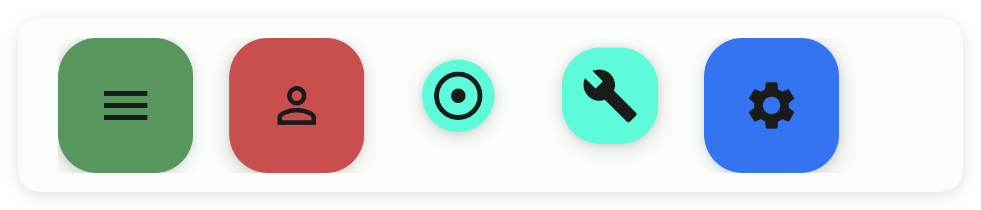
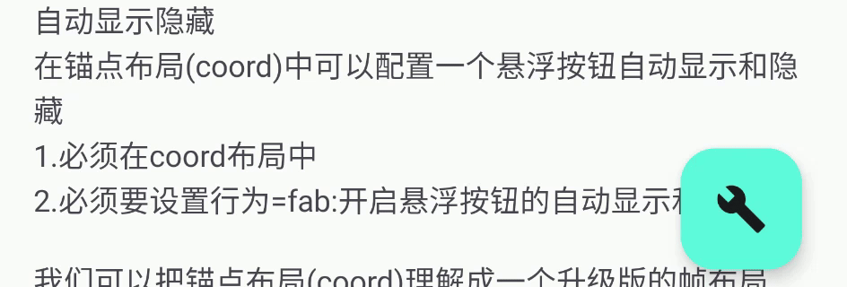
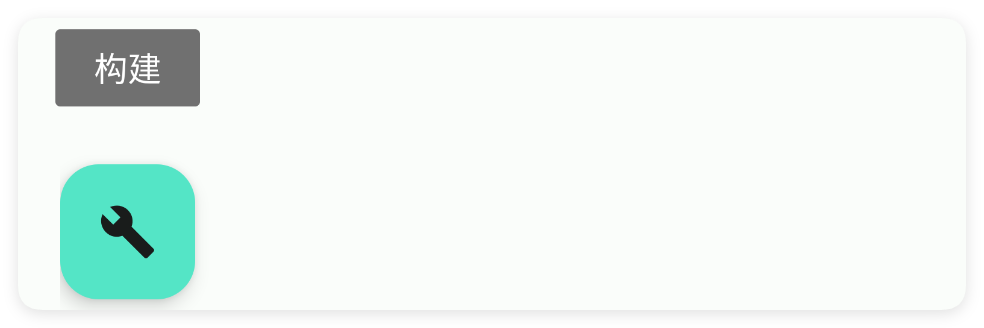

# 悬浮按钮

- 更新时间:2026-10-22 10:58:40

> 悬浮按钮-fab
> 
> 原生类型:{com.google.android.material.floatingactionbutton.FloatingActionButton}


<div style="width: 100%; position: relative; padding-bottom: 56.25%; height: 0; overflow: hidden;">
  <iframe 
    src="//player.bilibili.com/player.html?isOutside=true&aid=116224818289928&bvid=BV1qDwHz1EtH&cid=36682402038&p=1" 
    style="position: absolute; top: 0; left: 0; width: 100%; height: 100%; border: none;"
    scrolling="no" 
    frameborder="no" 
    allowfullscreen="true">
  </iframe>
</div>

一般配合帧布局：将按钮放在帧布局的上层来实现悬浮效果。




## 一、常用属性


### anim - 动画

> 设置动画


```html
// 将布局保存为字符串；标签表示控件，标签中的属性决定显示效果。
var layoutXml = `
<ui>
    <statusbar />
    <coord w="max">
        <appbar-layout w="max">
            <appbar back="true" id="mAppbar" scrollFlags="scroll|enterAlways" subTitle="悬浮按钮"
                title="Fab" w="max" />
        </appbar-layout>
        <nested behavior="appbar" h="max" w="max">
            <linear h="max" padding="20,20,20,100" w="max">
                <text h="1000" text="请滑动界面" />
                <!--自动显示隐藏-->
                <text gravity="center|start" marginTop="20" selectable="true"
                    text="自动显示隐藏\n在锚点布局(coord)中可以配置一个悬浮按钮自动显示和隐藏\n1.必须在coord布局中\n2.必须要设置behavior=fab:意思是开启悬浮按钮的自动显示和隐藏\n\n我们可以把锚点布局(coord)理解成一个升级版的帧布局(frame):通过layoutGravity属性可以控制悬浮按钮的位置" />
            </linear>
        </nested>
        <!--
        在锚点布局(coord)中可以配置一个悬浮按钮自动显示和隐藏
        1.必须在coord布局中
        2.必须要设置behavior="fab":开启悬浮按钮的自动显示和隐藏
        我们可以把锚点布局(coord)理解成一个升级版的帧布局(frame):通过layoutGravity属性可以控制悬浮按钮的位置
        -->
        <fab behavior="fab" icon="ic_build_fill" layoutGravity="end|bottom" margin="25"
            tip="构建" />
    </coord>
</ui>
`;
// 解析布局后得到界面对象，显示它即可查看本节属性的效果。
var ui = $ui.layout(layoutXml);
ui.show();
```




### color - 主题颜色

> 设置主题颜色


```html
// 将布局保存为字符串；标签表示控件，标签中的属性决定显示效果。
var layoutXml = `
<ui>
    <statusbar />
    <linear dir="h" w="max">
        <fab color="#57965C" marginRight="15" />
        <fab color="#C94F4F" marginRight="15" />
        <fab color="#3574F0" marginRight="15" />
        <fab color="#3574F0" />
    </linear>
</ui>
`;
// 解析布局后得到界面对象，显示它即可查看本节属性的效果。
var ui = $ui.layout(layoutXml);
ui.show();
```


### icon - 图标

> 设置图标
> 
> icon/图标：用于指定图标，可以填写图标库的名称，也可以填写图标的相对路径或者绝对路径


```html
// 将布局保存为字符串；标签表示控件，标签中的属性决定显示效果。
var layoutXml = `
<ui>
    <statusbar />
    <fab icon="ic_image_outline" />
</ui>
`;
// 解析布局后得到界面对象，显示它即可查看本节属性的效果。
var ui = $ui.layout(layoutXml);
ui.show();
```


### path - 路径图标

> 设置路径图标


```html
// 将布局保存为字符串；标签表示控件，标签中的属性决定显示效果。
// 若布局引用图片、视频或其他资源，请先准备文件并改成实际可用的路径。
var layoutXml = `
<ui>
    <statusbar />
    <fab path="example/$ui - 交互界面/07.fab-悬浮按钮/img/fab-icon.png" />
</ui>
`;
// 解析布局后得到界面对象，显示它即可查看本节属性的效果。
var ui = $ui.layout(layoutXml);
ui.show();
```


### iconTint - 图标颜色

> 设置图标颜色


```html
// 将布局保存为字符串；标签表示控件，标签中的属性决定显示效果。
var layoutXml = `
<ui>
    <statusbar />
    <linear dir="h" w="max">
        <fab iconTint="#57965C" marginRight="15" />
        <fab iconTint="#C94F4F" marginRight="15" />
        <fab iconTint="#3574F0" marginRight="15" />
        <fab />
    </linear>
</ui>
`;
// 解析布局后得到界面对象，显示它即可查看本节属性的效果。
var ui = $ui.layout(layoutXml);
ui.show();
```


### tip - 提示

> 设置提示
> 
> 安卓8+才支持这个配置


```html
// 将布局保存为字符串；标签表示控件，标签中的属性决定显示效果。
var layoutXml = `
<ui>
    <statusbar />
    <fab icon="ic_build_fill" tip="构建" />
</ui>
`;
// 解析布局后得到界面对象，显示它即可查看本节属性的效果。
var ui = $ui.layout(layoutXml);
ui.show();
```




### radius - 弧度

> 设置弧度


```html
// 将布局保存为字符串；标签表示控件，标签中的属性决定显示效果。
var layoutXml = `
<ui>
    <statusbar />
    <linear dir="h" w="max">
        <fab marginRight="15" radius="10" />
        <fab marginRight="15" radius="15" />
        <fab marginRight="15" radius="20" />
        <fab radius="25" />
    </linear>
</ui>
`;
// 解析布局后得到界面对象，显示它即可查看本节属性的效果。
var ui = $ui.layout(layoutXml);
ui.show();
```


### size - 尺寸

> 设置尺寸


```html
// 将布局保存为字符串；标签表示控件，标签中的属性决定显示效果。
var layoutXml = `
<ui>
    <statusbar />
    <linear dir="h" w="max">
        <fab marginRight="15" size="30" />
        <fab marginRight="15" size="35" />
        <fab marginRight="15" size="40" />
        <fab size="45" />
    </linear>
</ui>
`;
// 解析布局后得到界面对象，显示它即可查看本节属性的效果。
var ui = $ui.layout(layoutXml);
ui.show();
```


## 二、常用函数


### show()

> 显示悬浮按钮


```javascript
//解析布局,获得ui对象
var ui = $ui.layout("./mUi.xml");
//获取控件
var fab = ui.id("mFab");
//显示控件
fab.show();
```


### hide()

> 隐藏悬浮按钮


```javascript
//解析布局,获得ui对象
var ui = $ui.layout("./mUi.xml");
//获取控件
var fab = ui.id("mFab");
//隐藏控件
fab.hide();
```


### setColor(color)

> 设置主题颜色

- 参数 : color {String} 颜色


```javascript
//解析布局,获得ui对象
var ui = $ui.layout("./mUi.xml");
//获取控件
var fab = ui.id("mFab");
//设置主题颜色
fab.setColor("#1E1F22");
```


### setIcon(icon)

> 设置图标

- 参数 : icon {String} 图片名称


```javascript
//解析布局,获得ui对象
var ui = $ui.layout("./mUi.xml");
//获取控件
var fab = ui.id("mFab");
//设置图标
fab.setIcon("logo_ag");
```


### setTip(tip)

> 设置提示信息

- 参数 : tip {String} 提示信息


```javascript
//解析布局,获得ui对象
var ui = $ui.layout("./mUi.xml");
//获取控件
var fab = ui.id("mFab");
//设置提示信息
fab.setTip("开始执行");
```


### setPath(path)

> 设置图标路径

- 参数 : path {String} 图标路径


```javascript
//解析布局,获得ui对象
var ui = $ui.layout("./mUi.xml");
//获取控件
var fab = ui.id("mFab");
//设置图标路径
fab.setPath("/res/icon.png");
```


### setIconTint(color)

> 设置图标颜色

- 参数 : color {String} 图标颜色


```javascript
//解析布局,获得ui对象
var ui = $ui.layout("./mUi.xml");
//获取控件
var fab = ui.id("mFab");
//设置图标颜色
fab.setIconTint("#C94F4F");
```


### setRadius(radius)

> 设置弧度

- 参数 : radius {Number} 圆角弧度


```javascript
//解析布局,获得ui对象
var ui = $ui.layout("./mUi.xml");
//获取控件
var fab = ui.id("mFab");
//设置弧度
fab.setRadius(10);
```


### setSize(size)

> 设置尺寸

- 参数 : size {Number} 尺寸大小


```javascript
//解析布局,获得ui对象
var ui = $ui.layout("./mUi.xml");
//获取控件
var fab = ui.id("mFab");
//设置尺寸
fab.setSize(30);
```


