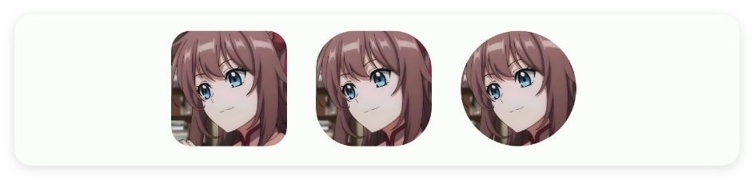
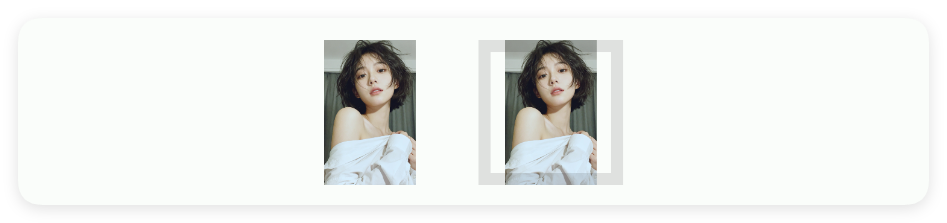
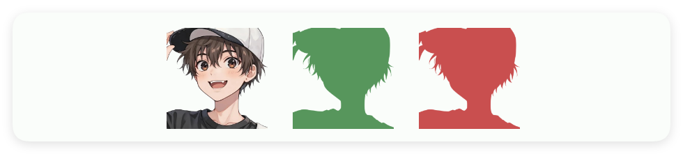
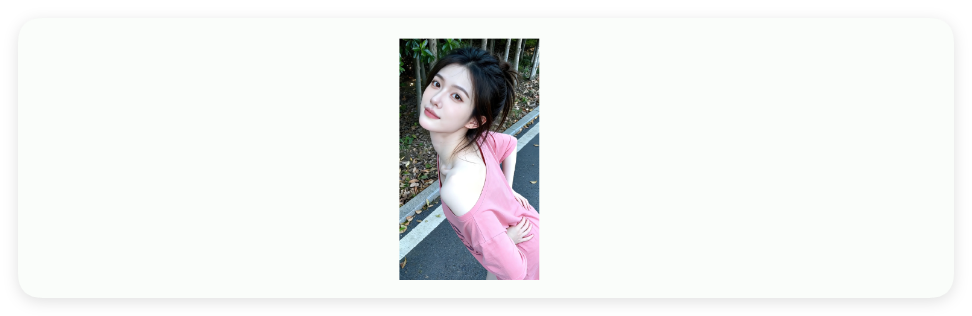
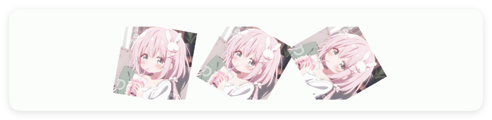
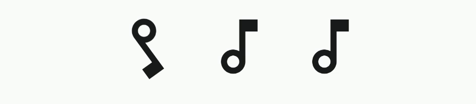
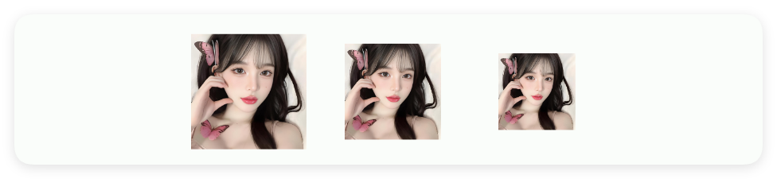

# 图片与图标

- 更新时间:2026-10-22 10:58:40

> 图片-img
> 
> 常用于显示图片或者图标
> 
> 原生类型:{com.google.android.material.imageview.ShapeableImageView}


<div style="width: 100%; position: relative; padding-bottom: 56.25%; height: 0; overflow: hidden;">
  <iframe 
    src="//player.bilibili.com/player.html?isOutside=true&aid=116224885267453&bvid=BV1FywHzSE2q&cid=36682664737&p=1" 
    style="position: absolute; top: 0; left: 0; width: 100%; height: 100%; border: none;"
    scrolling="no" 
    frameborder="no" 
    allowfullscreen="true">
  </iframe>
</div>

图片(图标)：用于显示图片或者图标


## 一、常用属性


### radius - 圆弧半径

> 设置圆弧半径
> 
> 单位:dp


```html
// 用字符串保存布局；标签表示控件，属性控制控件的外观或初始状态。
// 示例用到的本地资源需要提前准备，请把文件路径改为项目中的实际路径。
var layoutXml = `
<ui>
    <statusbar />
    <linear dir="h" gravity="center" w="max">
        
        
        
    </linear>
</ui>
`;
// 解析布局得到界面对象，再显示界面。
var ui = $ui.layout(layoutXml);
ui.show();
```




### url - 图片链接

> 设置图片链接


```html
// 用字符串保存布局；标签表示控件，属性控制控件的外观或初始状态。
// 网络内容需要可用的地址和网络连接；请按实际情况替换示例地址。
// XML 属性中的 & 要写成 &amp;，解析后才会还原为网址中的 &。
var layoutXml = `
<ui>
    <statusbar />
    
</ui>
`;
// 解析布局得到界面对象，再显示界面。
var ui = $ui.layout(layoutXml);
ui.show();
```


### strokeWidth - 边框宽度

> 设置边框宽度
> 
> 单位:dp


```html
// 用字符串保存布局；标签表示控件，属性控制控件的外观或初始状态。
// 示例用到的本地资源需要提前准备，请把文件路径改为项目中的实际路径。
var layoutXml = `
<ui>
    <statusbar />
    <linear dir="h" gravity="center" w="max">
        <!-- 原图 -->
        
        <!-- 设置边框的图 -->
        
    </linear>
</ui>
`;
// 解析布局得到界面对象，再显示界面。
var ui = $ui.layout(layoutXml);
ui.show();
```




### strokeColor - 边框颜色

> 设置边框颜色


```html
// 用字符串保存布局；标签表示控件，属性控制控件的外观或初始状态。
// 示例用到的本地资源需要提前准备，请把文件路径改为项目中的实际路径。
var layoutXml = `
<ui>
    <statusbar />
    <linear dir="h" gravity="center" w="max">
        <!--原图-->
        
        <!--设置边框的图-->
        
        <!--设置边框颜色的图-->
        
    </linear>
</ui>
`;
// 解析布局得到界面对象，再显示界面。
var ui = $ui.layout(layoutXml);
ui.show();
```


### scaleType - 拉伸类型

> 设置拉伸类型
> 
> 可选(忽略大小写,可忽略下划线):FIT_CENTER, FIT_START, FIT_END, FIT_XY, CENTER, CENTER_CROP, CENTER_INSIDE, MATRIX


```html
// 用字符串保存布局；标签表示控件，属性控制控件的外观或初始状态。
var layoutXml = `
<ui>
    <statusbar />
    
</ui>
`;
// 解析布局得到界面对象，再显示界面。
var ui = $ui.layout(layoutXml);
ui.show();
```


### tint - 图片填充颜色

> 设置图片填充颜色


```html
// 用字符串保存布局；标签表示控件，属性控制控件的外观或初始状态。
// 示例用到的本地资源需要提前准备，请把文件路径改为项目中的实际路径。
var layoutXml = `
<ui>
    <statusbar />
    <linear dir="h" gravity="center" w="max">
        <!--原图-->
        
        <!--设置填充颜色的图-->
        
        
    </linear>
</ui>
`;
// 解析布局得到界面对象，再显示界面。
var ui = $ui.layout(layoutXml);
ui.show();
```




### path - 图片本地路径

> 设置图片本地路径


```html
// 用字符串保存布局；标签表示控件，属性控制控件的外观或初始状态。
// 示例用到的本地资源需要提前准备，请把文件路径改为项目中的实际路径。
var layoutXml = `
<ui>
    <statusbar />
    <linear dir="h" gravity="center" w="max">
        
    </linear>
</ui>
`;
// 解析布局得到界面对象，再显示界面。
var ui = $ui.layout(layoutXml);
ui.show();
```




### src - 图片或图标路径

> 设置图片或图标路径
> 
> icon/图标：用于指定图标，可以填写图标库的名称，也可以填写图标的相对路径或者绝对路径


```html
// 用字符串保存布局；标签表示控件，属性控制控件的外观或初始状态。
// 示例用到的本地资源需要提前准备，请把文件路径改为项目中的实际路径。
var layoutXml = `
<ui>
    <statusbar />
    <linear dir="h" gravity="center" w="max">
        <!--使用src来设置图标-->
        
        <!--使用icon来设置图标-->
        
    </linear>
</ui>
`;
// 解析布局得到界面对象，再显示界面。
var ui = $ui.layout(layoutXml);
ui.show();
```


### rotation - 旋转角度

> 设置旋转角度


```html
// 用字符串保存布局；标签表示控件，属性控制控件的外观或初始状态。
// 示例用到的本地资源需要提前准备，请把文件路径改为项目中的实际路径。
var layoutXml = `
<ui>
    <statusbar />
    <linear dir="h" gravity="center" w="max">
        
        
        
    </linear>
</ui>
`;
// 解析布局得到界面对象，再显示界面。
var ui = $ui.layout(layoutXml);
ui.show();
```




### rotateSpeed - 自动旋转的倍速

> 设置自动旋转的倍速


```html
// 用字符串保存布局；标签表示控件，属性控制控件的外观或初始状态。
var layoutXml = `
<ui>
    <statusbar />
    
</ui>
`;
// 解析布局得到界面对象，再显示界面。
var ui = $ui.layout(layoutXml);
ui.show();
```


### rotate - 是否自动旋转

> 是否自动旋转


```html
// 用字符串保存布局；标签表示控件，属性控制控件的外观或初始状态。
// 示例用到的本地资源需要提前准备，请把文件路径改为项目中的实际路径。
var layoutXml = `
<ui>
    <statusbar />
    <linear dir="h" gravity="center" w="max">
        
        
        
    </linear>
</ui>
`;
// 解析布局得到界面对象，再显示界面。
var ui = $ui.layout(layoutXml);
ui.show();
```




### padding - 内边距

> 设置内边距


```html
// 用字符串保存布局；标签表示控件，属性控制控件的外观或初始状态。
// 示例用到的本地资源需要提前准备，请把文件路径改为项目中的实际路径。
var layoutXml = `
<ui>
    <statusbar />
    <linear dir="h" gravity="center" w="max">
        
        
        
    </linear>
</ui>
`;
// 解析布局得到界面对象，再显示界面。
var ui = $ui.layout(layoutXml);
ui.show();
```




### bg - 背景颜色

> 设置背景颜色


```html
// 用字符串保存布局；标签表示控件，属性控制控件的外观或初始状态。
// 示例用到的本地资源需要提前准备，请把文件路径改为项目中的实际路径。
var layoutXml = `
<ui>
    <statusbar />
    
    
</ui>
`;
// 解析布局得到界面对象，再显示界面。
var ui = $ui.layout(layoutXml);
ui.show();
```


### bgImg - 背景图片

> 设置背景图片


```html
// 用字符串保存布局；标签表示控件，属性控制控件的外观或初始状态。
// 示例用到的本地资源需要提前准备，请把文件路径改为项目中的实际路径。
var layoutXml = `
<ui>
    <statusbar />
    
</ui>
`;
// 解析布局得到界面对象，再显示界面。
var ui = $ui.layout(layoutXml);
ui.show();
```


## 二、常用函数


### setRadius(radius)

> 设置弧度

- 参数 : radius 圆角半径，单位为 dp
- 版本 : 1.9.4


```javascript
//解析布局,获得ui对象
var ui = $ui.layout("./mUi.xml");
//获取控件
var mImg = ui.id("mImg");
//设置弧度
mImg.setRadius(30);
```


### setStrokeWidth(strokeWidth)

> 设置边框宽度

- 参数 : strokeWidth 边框宽度，单位为 dp
- 版本 : 1.9.4


```javascript
//解析布局,获得ui对象
var ui = $ui.layout("./mUi.xml");
//获取控件
var mImg = ui.id("mImg");
//设置边框宽度
mImg.setStrokeWidth(10);
```


### setStrokeColor(color)

> 设置边框颜色

- 参数 : color {String} 边框颜色
- 版本 : 1.9.4


```javascript
//解析布局,获得ui对象
var ui = $ui.layout("./mUi.xml");
//获取控件
var mImg = ui.id("mImg");
//设置边框颜色
mImg.setStrokeColor("#C94F4F");
```


### setTint(tint)

> 设置填充颜色

- 参数 : tint {String} 填充颜色
- 版本 : 1.9.4


```javascript
//解析布局,获得ui对象
var ui = $ui.layout("./mUi.xml");
//获取控件
var mImg = ui.id("mImg");
//设置填充颜色
mImg.setTint("#C94F4F");
```


### setBg(color)

> 设置背景颜色

- 参数 : color {String} 背景颜色
- 版本 : 1.9.4


```javascript
//解析布局,获得ui对象
var ui = $ui.layout("./mUi.xml");
//获取控件
var mImg = ui.id("mImg");
//设置背景颜色
mImg.setBg("#C94F4F");
```


### rotate(rotated)

> 图片自动旋转

- 参数 : rotated {boolean} 是否旋转


```javascript
//解析布局,获得ui对象
var ui = $ui.layout("./mUi.xml");
//获取控件
var mImg = ui.id("mImg");
//设置图片自动旋转
mImg.rotate(true);
```


### rotate(rotated, speed)

> 图片自动旋转

- 参数 : rotated {boolean} 是否旋转
- 参数 : speed {float} 旋转速度


```javascript
//解析布局,获得ui对象
var ui = $ui.layout("./mUi.xml");
//获取控件
var mImg = ui.id("mImg");
//设置图片自动旋转
mImg.rotate(true,10);
```


### setRotation(rotation)

> 设置角度

- 参数 : rotation {float} 角度


```javascript
//解析布局,获得ui对象
var ui = $ui.layout("./mUi.xml");
//获取控件
var mImg = ui.id("mImg");
//设置角度
mImg.setRotation(45);
```


### setSrc(src)

> 设置图标

- 参数 : src {string} 设置图片名称,并且加载名称上的图片


```javascript
//解析布局,获得ui对象
var ui = $ui.layout("./mUi.xml");
//获取控件
var mImg = ui.id("mImg");
//设置图标
mImg.setSrc("logo_ag");
```


### setUrl(url)

> 设置图片Url

- 参数 : url {string} 设置图片Url,并且加载Url上的图片


```javascript
//解析布局,获得ui对象
var ui = $ui.layout("./mUi.xml");
//获取控件
var mImg = ui.id("mImg");
//设置图片链接(这里我随便弄了个链接)
mImg.setUrl("https://www.baidu.com/icon.png  ");
```


### setPath(path)

> 设置图片路径

- 参数 : path {string} 设置图片路径,并且加载路径上的图片


```javascript
//解析布局,获得ui对象
var ui = $ui.layout("./mUi.xml");
//获取控件
var mImg = ui.id("mImg");
//设置图片
mImg.setPath("./res/mImg.png");
```


### setImg(bitmap)

> 设置图片

- 参数 : bitmap {bitmap} 设置的图片


```javascript
//解析布局,获得ui对象
var ui = $ui.layout("./mUi.xml");
//获取控件
var mImg = ui.id("mImg");
//设置图片
var img = $img.read("./res/mImg.png");
mImg.setImg(img.getBitmap());
```


### getImg()

> 获取图片

- 返回 : {bitmap} 获取到的图片


```javascript
//解析布局,获得ui对象
var ui = $ui.layout("./mUi.xml");
//获取控件
var mImg = ui.id("mImg");
//获取图片
var bitmap = mImg.getImg();
//构建$img对象
var img = $img.open(bitmap);
```


