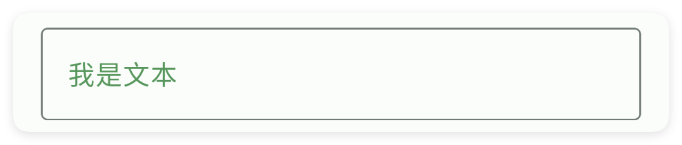
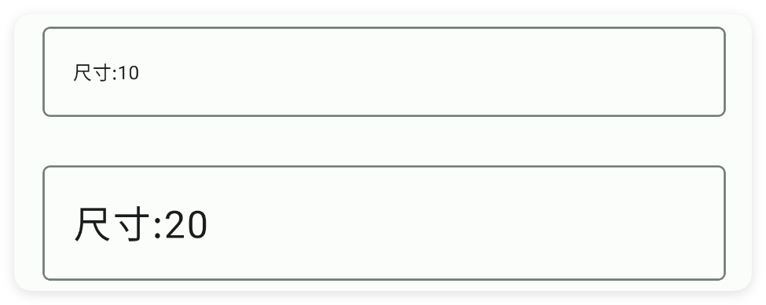
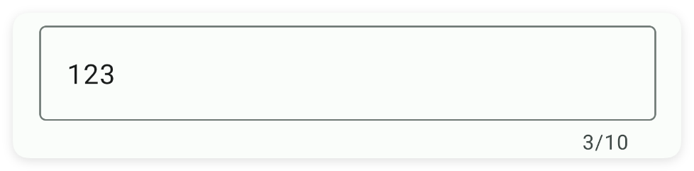
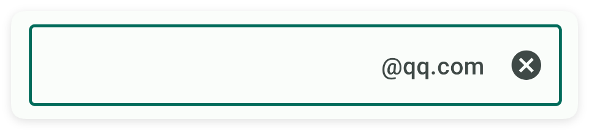
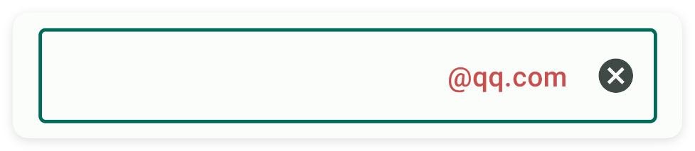
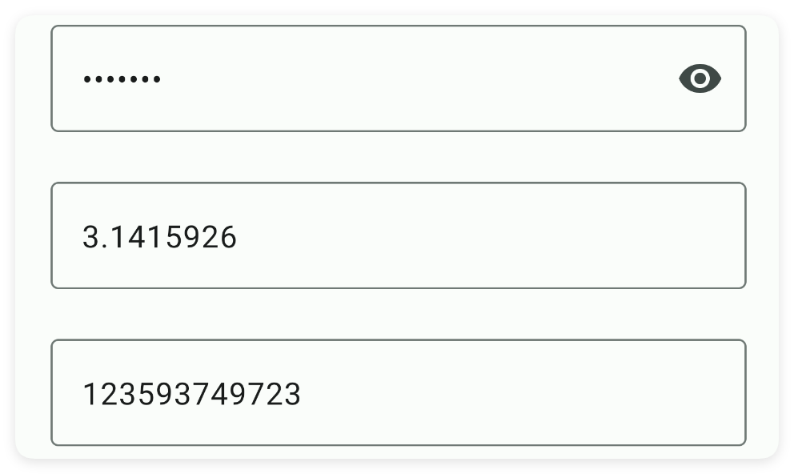
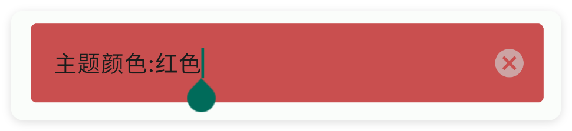
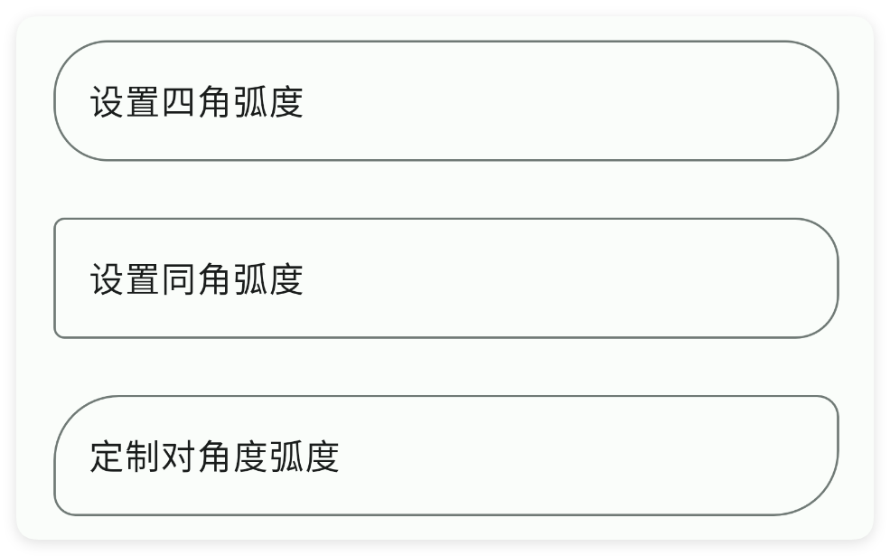
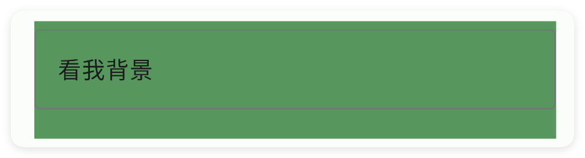

# 输入框

- 更新时间:2026-10-22 10:58:41

> 输入框-input
> 
> 组件原生类型:{com.google.android.material.textfield.TextInputEditText}
> 
> 布局原生类型:{com.google.android.material.textfield.TextInputLayout}


<div style="width: 100%; position: relative; padding-bottom: 56.25%; height: 0; overflow: hidden;">
  <iframe 
    src="//player.bilibili.com/player.html?isOutside=true&aid=116224918820312&bvid=BV1XFwpzBEy7&cid=36682794569&p=1" 
    style="position: absolute; top: 0; left: 0; width: 100%; height: 100%; border: none;"
    scrolling="no" 
    frameborder="no" 
    allowfullscreen="true">
  </iframe>
</div>

输入框：一个可以输入文字的地方。


## 一、基础用法


简单写一个登录的小案例，当点击登录按钮的时候就获取用户输入的信息，当点击取消按钮的时候就清空用户输入的内容：


```html
// 将布局写成字符串，无需另建 ui.xml 文件。
var layoutXml = `
<ui>
    <statusbar />
    <linear w="max" dir="v" gravity="center" h="max" padding="20">
        <input id="count" prefix="账号:" w="max" />
        <input id="pass" prefix="密码:" type="pass" w="max"  />
        <button-group dir="h" w="max">
            <button id="login" text="登录" style="outline" weight="1"/>
            <button id="cancel" text="取消" style="outline" weight="1" textColor="#B44A4A" />
        </button-group>
    </linear>
</ui>
`;
var ui = $ui.layout(layoutXml);
ui.show(); // 显示界面，后面的事件示例继续使用这个对象。
```

```javascript
// 接着上一段执行，继续使用已创建的界面对象。
//[登录]获取用户输入的信息
ui.id("login").click(function() {
    var count = ui.id("count").getText();
    var pass = ui.id("pass").getText();
    alert("账号信息", "账号：" + count + "\n" + "密码：" + pass);
});
//[取消]清空用户输入的内容
ui.id("cancel").click(function() {
    ui.id("count").setText("");
    ui.id("pass").setText("");
    toast("已清空");
});
```


## 二、常用属性


### style - 样式

> 设置样式
> 
> 可选:fill,outline


```html
// 用字符串保存布局；其中的属性就是本节演示的设置。
var layoutXml = `
<ui>
    <statusbar />
    <linear dir="v" gravity="center" w="max">
        <input style="outline" text="轮廓样式" w="max" />
        <input style="fill" text="填充样式" w="max" />
    </linear>
</ui>
`;
var ui = $ui.layout(layoutXml); // 解析布局并创建控件。
ui.show(); // 显示界面，观察属性效果。
```


### hint - 提示文本

> 提示文本


```html
// 用字符串保存布局；其中的属性就是本节演示的设置。
var layoutXml = `
<ui>
    <statusbar />
    <input hint="请输入" w="max" />
</ui>
`;
var ui = $ui.layout(layoutXml); // 解析布局并创建控件。
ui.show(); // 显示界面，观察属性效果。
```


### text - 文本

> 设置文本


```html
// 用字符串保存布局；其中的属性就是本节演示的设置。
var layoutXml = `
<ui>
    <statusbar />
    <input text="我是文本" w="max" />
</ui>
`;
var ui = $ui.layout(layoutXml); // 解析布局并创建控件。
ui.show(); // 显示界面，观察属性效果。
```


### def - 文本

> 设置文本


```html
// 用字符串保存布局；其中的属性就是本节演示的设置。
var layoutXml = `
<ui>
    <statusbar />
    <input def="我是文本" w="max" />
</ui>
`;
var ui = $ui.layout(layoutXml); // 解析布局并创建控件。
ui.show(); // 显示界面，观察属性效果。
```


### textColor - 文本颜色

> 设置文本颜色


```html
// 用字符串保存布局；其中的属性就是本节演示的设置。
var layoutXml = `
<ui>
    <statusbar />
    <input text="我是文本" textColor="#57965C" w="max" />
</ui>
`;
var ui = $ui.layout(layoutXml); // 解析布局并创建控件。
ui.show(); // 显示界面，观察属性效果。
```




### textSize - 文本尺寸

> 设置文本尺寸


```html
// 用字符串保存布局；其中的属性就是本节演示的设置。
var layoutXml = `
<ui>
    <statusbar />
    <linear dir="v" gravity="center" w="max">
        <input text="尺寸:10" textSize="10" w="max" />
        <input text="尺寸:20" textSize="20" w="max" />
    </linear>
</ui>
`;
var ui = $ui.layout(layoutXml); // 解析布局并创建控件。
ui.show(); // 显示界面，观察属性效果。
```




### len - 字数限制

> 设置字数限制


```html
// 用字符串保存布局；其中的属性就是本节演示的设置。
var layoutXml = `
<ui>
    <statusbar />
    <input len="10" text="123" w="max" />
</ui>
`;
var ui = $ui.layout(layoutXml); // 解析布局并创建控件。
ui.show(); // 显示界面，观察属性效果。
```




### maxLines - 最大行数

> 最大行数


```html
// 用字符串保存布局；其中的属性就是本节演示的设置。
var layoutXml = `
<ui>
    <statusbar />
    <input maxLines="5" w="max" />
</ui>
`;
var ui = $ui.layout(layoutXml); // 解析布局并创建控件。
ui.show(); // 显示界面，观察属性效果。
```


### minLines - 最少行数

> 最少行数


```html
// 用字符串保存布局；其中的属性就是本节演示的设置。
var layoutXml = `
<ui>
    <statusbar />
    <input minLines="3" w="max" />
</ui>
`;
var ui = $ui.layout(layoutXml); // 解析布局并创建控件。
ui.show(); // 显示界面，观察属性效果。
```


### singleLine - 单行模式

> 单行模式


```html
// 用字符串保存布局；其中的属性就是本节演示的设置。
var layoutXml = `
<ui>
    <statusbar />
    <text gravity="center" h="50" selectable="true" text="设置单行模式 singleLine=true" />
    <input singleLine="true" w="max" />
</ui>
`;
var ui = $ui.layout(layoutXml); // 解析布局并创建控件。
ui.show(); // 显示界面，观察属性效果。
```


### help - 帮助文字

> 帮助文字


```html
// 用字符串保存布局；其中的属性就是本节演示的设置。
var layoutXml = `
<ui>
    <statusbar />
    <input help="请输入名称" w="max" />
</ui>
`;
var ui = $ui.layout(layoutXml); // 解析布局并创建控件。
ui.show(); // 显示界面，观察属性效果。
```


### prefix - 前缀

> 设置前缀


```html
// 用字符串保存布局；其中的属性就是本节演示的设置。
var layoutXml = `
<ui>
    <statusbar />
    <input prefix="邮箱:" w="max" />
</ui>
`;
var ui = $ui.layout(layoutXml); // 解析布局并创建控件。
ui.show(); // 显示界面，观察属性效果。
```


### prefixColor - 前缀

> 设置前缀


```html
// 用字符串保存布局；其中的属性就是本节演示的设置。
var layoutXml = `
<ui>
    <statusbar />
    <input prefix="邮箱:" prefixColor="#C94F4F" w="max" />
</ui>
`;
var ui = $ui.layout(layoutXml); // 解析布局并创建控件。
ui.show(); // 显示界面，观察属性效果。
```


### suffix - 后缀

> 设置后缀


```html
// 用字符串保存布局；其中的属性就是本节演示的设置。
var layoutXml = `
<ui>
    <statusbar />
    <input suffix="@qq.com" w="max" />
</ui>
`;
var ui = $ui.layout(layoutXml); // 解析布局并创建控件。
ui.show(); // 显示界面，观察属性效果。
```




### suffixColor - 后缀颜色

> 设置后缀颜色


```html
// 用字符串保存布局；其中的属性就是本节演示的设置。
var layoutXml = `
<ui>
    <statusbar />
    <input suffix="@qq.com" suffixColor="#C94F4F" w="max" />
</ui>
`;
var ui = $ui.layout(layoutXml); // 解析布局并创建控件。
ui.show(); // 显示界面，观察属性效果。
```




### type - 输入类型

> 设置输入类型
> 
> 可选:pass,number,phone


```html
// 用字符串保存布局；其中的属性就是本节演示的设置。
var layoutXml = `
<ui>
    <statusbar />
    <linear dir="v" gravity="center" w="max">
        <!--密码-->
        <input text="abcdefg" type="pass" w="max" />
        <!--数字-->
        <input text="3.1415926" type="num" w="max" />
        <!--号码-->
        <input text="123593749723" type="phone" w="max" />
    </linear>
</ui>
`;
var ui = $ui.layout(layoutXml); // 解析布局并创建控件。
ui.show(); // 显示界面，观察属性效果。
```




### color - 主题颜色

> 设置主题颜色


```html
// 用字符串保存布局；其中的属性就是本节演示的设置。
var layoutXml = `
<ui>
    <statusbar />
    <input color="#C94F4F" text="主题颜色:红色" w="max" />
</ui>
`;
var ui = $ui.layout(layoutXml); // 解析布局并创建控件。
ui.show(); // 显示界面，观察属性效果。
```




### strokeColor - 边框颜色

> 设置边框颜色


```html
// 用字符串保存布局；其中的属性就是本节演示的设置。
var layoutXml = `
<ui>
    <statusbar />
    <input strokeColor="#C94F4F" text="边框颜色:红色" w="max" />
</ui>
`;
var ui = $ui.layout(layoutXml); // 解析布局并创建控件。
ui.show(); // 显示界面，观察属性效果。
```


### strokeWidth - 边框宽度

> 设置边框宽度


```html
// 用字符串保存布局；其中的属性就是本节演示的设置。
var layoutXml = `
<ui>
    <statusbar />
    <input strokeWidth="10" text="边框加厚" w="max" />
</ui>
`;
var ui = $ui.layout(layoutXml); // 解析布局并创建控件。
ui.show(); // 显示界面，观察属性效果。
```


### radius - 弧度

> 设置弧度


```html
// 用字符串保存布局；其中的属性就是本节演示的设置。
var layoutXml = `
<ui>
    <statusbar />
    <input radius="25" text="设置四角弧度" w="max" />
    <input radius="5,20" text="设置同角弧度" w="max" />
    <input radius="30,10,10,30" text="定制对角度弧度" w="max" />
</ui>
`;
var ui = $ui.layout(layoutXml); // 解析布局并创建控件。
ui.show(); // 显示界面，观察属性效果。
```




### padding - 布局内边距

> 设置布局内边距


```html
// 用字符串保存布局；其中的属性就是本节演示的设置。
var layoutXml = `
<ui>
    <statusbar />
    <input padding="15" text="内边距:15" w="max" />
    <input padding="25" text="内边距:25" w="max" />
</ui>
`;
var ui = $ui.layout(layoutXml); // 解析布局并创建控件。
ui.show(); // 显示界面，观察属性效果。
```


### gravity - 布局重力

> 布局重力


```html
// 用字符串保存布局；其中的属性就是本节演示的设置。
var layoutXml = `
<ui>
    <statusbar />
    <input gravity="start" text="开始" w="max" />
    <input gravity="end" text="结束" w="max" />
</ui>
`;
var ui = $ui.layout(layoutXml); // 解析布局并创建控件。
ui.show(); // 显示界面，观察属性效果。
```


### bg - 背景颜色

> 设置背景颜色


```html
// 用字符串保存布局；其中的属性就是本节演示的设置。
var layoutXml = `
<ui>
    <statusbar />
    <input bg="#57965C" text="看我背景" w="max" />
</ui>
`;
var ui = $ui.layout(layoutXml); // 解析布局并创建控件。
ui.show(); // 显示界面，观察属性效果。
```




### bgImg - 背景图片

> 设置背景图片


```html
// 用字符串保存布局；其中的属性就是本节演示的设置。
var layoutXml = `
<ui>
    <statusbar />
    <input bgImg="example/$ui - 交互界面/10.input-输入框/img/img.png" text="看我背景"
        w="max" />
</ui>
`;
var ui = $ui.layout(layoutXml); // 解析布局并创建控件。
ui.show(); // 显示界面，观察属性效果。
```


### storeKey - 应用内存储

> 应用内存储
> 
> 通过storeKey(存储关键字)指定一个存储字符串的关键字，获取值时可以直接通过$storage($存储)获取字符串。
> 
> 注意：不同的控件存储的类型不同，对于本控件(输入框)则存储的是字符串类型，表达当前输入的内容


```html
// 用字符串保存布局；其中的属性就是本节演示的设置。
var layoutXml = `
<ui><statusbar/><!-- 你必须在ui(界面)节点中通过store(存储)指定$storage($存储)的命名空间，等价于使用代码：var storage = $storage.create("MyAppInput"); -->
<ui store="MyAppInput">
    <statusbar />
    <!-- 使用storeKey(存储关键字)属性，指定关键字，等价于使用代码：var data = $storage.create("MyAppInput").getStr("eatFoodStr"); -->
    <!-- 使用storeDef(存储默认值)属性，指定关键字，等价于使用代码：var data = $storage.create("MyAppInput").getStr("eatFoodStr","我爱吃饭"); -->
    <input storeKey="eatFoodStr" storeDef="我爱吃饭" text="吃饭" />
    <input storeKey="playGameStr" storeDef="我爱游戏" text="游戏" />
</ui></ui>
`;
var ui = $ui.layout(layoutXml); // 解析布局并创建控件。
ui.show(); // 显示界面，观察属性效果。
```


如果我们已经配置好了应用内存储，则可以直接获取数据：

注意：一、要使用应用内存储，必须在ui(界面)节点指定属性store(存储)的值，该值指定存储的命名空间；
二、不是所有的控件都支持应用内存储；
三、不同的控件存储的数据类型可能都不一致，例如：输入类型的控件存储的是字符串类型，开关、多选框存储的就是布尔类型的数据。


```javascript
//创建(或者加载)存储对象
var storage = $storage.create("MyAppInput");//名称要一致
//获取数据
var data = storage.getStr("我爱吃饭","未必");//数据类型是字符串
```


## 三、常用函数


### setSingleLine(single)

> 打开或关闭“单行模式”。
> 
> 默认输入框可以多行换行。传 true 后，用户只能在一行里输入（按回车不会换行），
> 适合登录框、搜索框这种单行输入。

- 参数 : single {Boolean} true 表示单行模式，false 表示允许多行
- 版本 : 1.9.4


```javascript
//先用一段 XML 创建界面，里面放一个带 id 的输入框
var ui = $ui.layout('<ui><statusbar/><input id="mInput" hint="请输入账号" w="max"/></ui>');
ui.show(); //把界面显示出来
var input = ui.id("mInput"); //根据 id 拿到这个输入框
input.setSingleLine(true); //锁定单行，不能换行
```


### setHint(hint)

> 修改输入框里那行浮动的灰色提示文字。
> 
> 用户还没输入时，输入框上会浮着一行灰色提示，比如“请输入手机号”。这个方法改它。

- 参数 : hint {String} 新的浮动提示文字


```javascript
//先用一段 XML 创建界面，里面放一个带 id 的输入框
var ui = $ui.layout('<ui><statusbar/><input id="mInput" w="max"/></ui>');
ui.show(); //把界面显示出来
var input = ui.id("mInput"); //根据 id 拿到这个输入框
input.setHint("请输入 11 位手机号"); //改浮动提示
```


### setBgColor(color)

> 设置输入框整块的填充背景颜色（用颜色字符串表示）。

- 参数 : color {String} 颜色字符串，例如 "#FF0000"


```javascript
//先用一段 XML 创建界面，里面放一个带 id 的输入框
var ui = $ui.layout('<ui><statusbar/><input id="mInput" w="max"/></ui>');
ui.show(); //把界面显示出来
var input = ui.id("mInput"); //根据 id 拿到这个输入框
input.setBgColor("#FFE0E0"); //把填充底色涂成浅粉
```


### setStrokeColor(color)

> 设置输入框边框的颜色（用颜色字符串表示）。
> 
> 只对外框样式（outline）的输入框效果明显。

- 参数 : color {String} 颜色字符串，例如 "#FF0000"
- 版本 : 1.5.3


```javascript
//先用一段 XML 创建界面，里面放一个带 id 的外框输入框
var ui = $ui.layout('<ui><statusbar/><input id="mInput" style="outline" w="max"/></ui>');
ui.show(); //把界面显示出来
var input = ui.id("mInput"); //根据 id 拿到这个输入框
input.setStrokeColor("#FF0000"); //把边框涂成红色
```


### setStrokeWidth(strokeWidth)

> 设置输入框边框的粗细，单位 dp。

- 参数 : strokeWidth {Number} 边框粗细，单位 dp
- 版本 : 1.5.3


```javascript
//先用一段 XML 创建界面，里面放一个带 id 的外框输入框
var ui = $ui.layout('<ui><statusbar/><input id="mInput" style="outline" w="max"/></ui>');
ui.show(); //把界面显示出来
var input = ui.id("mInput"); //根据 id 拿到这个输入框
input.setStrokeWidth(3); //把边框加粗到 3dp
```


### setRadius(topLeft, topRight, bottomLeft, bottomRight)

> 分别设置输入框四个角的圆角大小，单位 dp。
> 
> 四个参数依次是：左上、右上、左下、右下，可以让每个角圆得不一样。

- 参数 : topLeft {Number} 左上角弧度，单位 dp
- 参数 : topRight {Number} 右上角弧度，单位 dp
- 参数 : bottomLeft {Number} 左下角弧度，单位 dp
- 参数 : bottomRight {Number} 右下角弧度，单位 dp
- 版本 : 1.5.3


```javascript
//先用一段 XML 创建界面，里面放一个带 id 的输入框
var ui = $ui.layout('<ui><statusbar/><input id="mInput" w="max"/></ui>');
ui.show(); //把界面显示出来
var input = ui.id("mInput"); //根据 id 拿到这个输入框
input.setRadius(20, 20, 5, 5); //上两角圆、下两角方
```


### setText(text)

> 用代码直接把输入框内容替换成指定文字。

- 参数 : text {String} 要填入的新文字


```javascript
//先用一段 XML 创建界面，里面放一个带 id 的输入框
var ui = $ui.layout('<ui><statusbar/><input id="mInput" w="max"/></ui>');
ui.show(); //把界面显示出来
var input = ui.id("mInput"); //根据 id 拿到这个输入框
input.setText("默认填好的内容"); //替换成这串字
```


### getText()

> 读出用户在输入框里输入的全部内容。
> 
> 返回字符串；空内容时返回空字符串 ""。

- 返回 : {String} 输入框里的文字；为空时返回空字符串 ""


```javascript
//先用一段 XML 创建界面，里面放一个带 id 的输入框
var ui = $ui.layout('<ui><statusbar/><input id="mInput" hint="用户名" w="max"/></ui>');
ui.show(); //把界面显示出来
var input = ui.id("mInput"); //根据 id 拿到这个输入框
var text = input.getText(); //读出内容
ui.toast("你输入了：" + text);
```


### setError(msg)

> 在输入框下方显示一条红色错误提示（表单校验用）。

- 参数 : msg {String} 要显示的错误提示文字


```javascript
//先用一段 XML 创建界面，里面放一个带 id 的输入框
var ui = $ui.layout('<ui><statusbar/><input id="mInput" hint="用户名" w="max"/></ui>');
ui.show(); //把界面显示出来
var input = ui.id("mInput"); //根据 id 拿到这个输入框
if (input.getText() === "") { //如果用户没填
    input.setError("用户名不能为空"); //红字提示
}
```


### getEditText()

> 拿到输入框内部那个安卓原生的 TextInputEditText 对象。
> 
> 这是安卓原生控件，一般小白用不到；只有需要做一些封装层没提供的高级操作时才会用到它。

- 返回 : {TextInputEditText} 安卓原生输入框对象


```javascript
//先用一段 XML 创建界面，里面放一个带 id 的输入框
var ui = $ui.layout('<ui><statusbar/><input id="mInput" w="max"/></ui>');
ui.show(); //把界面显示出来
var input = ui.id("mInput"); //根据 id 拿到这个输入框
var editText = input.getEditText(); //拿到原生对象
ui.toast("拿到原生输入框对象了");
```


### onChanged(callback)

> 监听输入框内容的每一次变化（边打边触发）。
> 
> 用户每敲一个字就触发一次。回调第一个参数是最新整段文字，后面三个是变化位置细节，一般用不到。

- 参数 : callback {function(text, start, before, count)} 回调；text 是最新整段文字
- 版本 : 1.8.0


```javascript
//先用一段 XML 创建界面，里面放一个带 id 的输入框
var ui = $ui.layout('<ui><statusbar/><input id="mInput" hint="边打边看" w="max"/></ui>');
ui.show(); //把界面显示出来
var input = ui.id("mInput"); //根据 id 拿到这个输入框
input.onChanged(function(text, start, before, count) { //内容一变就执行
    log("现在是：" + text);
});
```


### onChangedAfter(callback)

> 监听“一次输入结束后”的时机。
> 
> 边打边触发用 onChanged；这个是一次输入动作结束后才触发，只带一个参数——最新整段文字。

- 参数 : callback {function(text)} 回调；text 是最新整段文字
- 版本 : 1.8.0


```javascript
//先用一段 XML 创建界面，里面放一个带 id 的输入框
var ui = $ui.layout('<ui><statusbar/><input id="mInput" hint="输完密码" type="pass" w="max"/></ui>');
ui.show(); //把界面显示出来
var input = ui.id("mInput"); //根据 id 拿到这个输入框
input.onChangedAfter(function(text) { //输入结束后触发
    log("最终：" + text);
});
```


### onChangedBefore(callback)

> 监听“内容还没改之前”的时机。
> 
> 用户每准备改一次内容，回调先触发，拿到的还是改之前的旧文字。

- 参数 : callback {function(text, start, count, after)} 回调；text 是改之前的旧整段文字
- 版本 : 1.8.0


```javascript
//先用一段 XML 创建界面，里面放一个带 id 的输入框
var ui = $ui.layout('<ui><statusbar/><input id="mInput" hint="看着我变化" w="max"/></ui>');
ui.show(); //把界面显示出来
var input = ui.id("mInput"); //根据 id 拿到这个输入框
input.onChangedBefore(function(text, start, count, after) { //改之前触发
    log("改之前：" + text);
});
```


### onFocusChange(callback)

> 监听输入框“获得/失去焦点”。
> 
> 用手指点进输入框（弹起键盘）叫获得焦点；点别处收键盘叫失去焦点。
> 回调会收到一个布尔值：true 表示刚获得焦点，false 表示刚失去焦点。

- 参数 : callback {function(hasFocus)} 回调；hasFocus 为 true 表示获得焦点、false 表示失去
- 版本 : 1.8.2


```javascript
//先用一段 XML 创建界面，里面放一个带 id 的输入框
var ui = $ui.layout('<ui><statusbar/><input id="mInput" hint="点我试试" w="max"/></ui>');
ui.show(); //把界面显示出来
var input = ui.id("mInput"); //根据 id 拿到这个输入框
input.onFocusChange(function(hasFocus) { //点进/点出时触发
    if (hasFocus) {
        ui.toast("键盘弹出来了");
    } else {
        ui.toast("键盘收起来了");
    }
});
```


