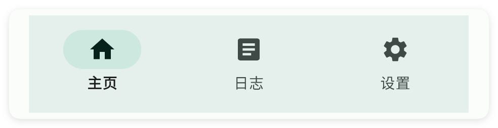
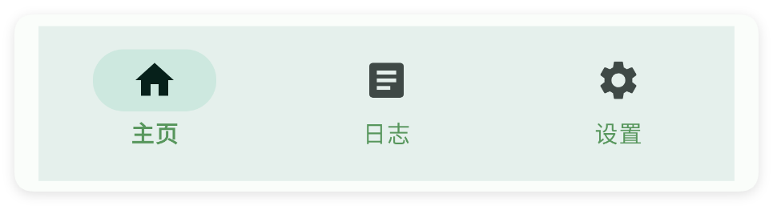
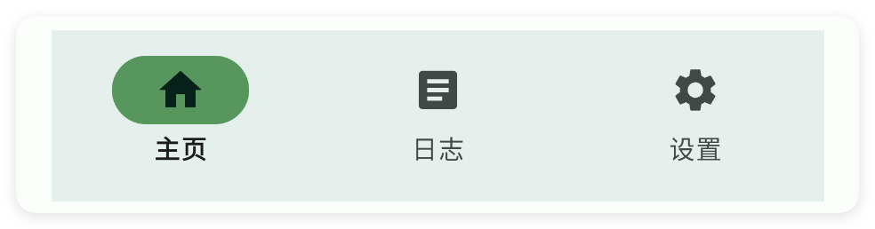

# 导航栏

- 更新时间:2026-10-22 10:58:41

> 导航栏-nav
> 
> 原生类型:{com.google.android.material.bottomnavigation.BottomNavigationView}


导航栏：一般用于与多页布局(pager)联动，实现界面的跳转





```html
// 用字符串保存布局；标签表示控件，属性控制控件的外观或初始状态。
var layoutXml =
    "<ui>\n" +
    "    <statusbar />\n" +
    "    <!-- 我习惯性把导航栏放在底部因此设置重力 gravity=\"bottom\" -->\n" +
    "    <linear w=\"max\" h=\"max\" dir=\"v\" gravity=\"bottom\">\n" +
    "        <nav w=\"max\">\n" +
    "            <menu text=\"主页\" icon=\"ic_home\" />\n" +
    "            <menu text=\"设置\" icon=\"ic_set\" />\n" +
    "            <menu text=\"菜单\" icon=\"ic_menu\" />\n" +
    "        </nav>\n" +
    "    </linear>\n" +
    "</ui>";
// 解析布局得到界面对象，再显示界面。
var ui = $ui.layout(layoutXml);
ui.show();
```


## 一、基础用法


```html
// 用字符串保存布局；标签表示控件，属性控制控件的外观或初始状态。
var layoutXml =
    "<ui>\n" +
    "    <statusbar />\n" +
    "    <!-- 我习惯性把导航栏放在底部因此设置重力 gravity=\"bottom\" -->\n" +
    "    <linear w=\"max\" h=\"max\" dir=\"v\" gravity=\"bottom\">\n" +
    "        <!-- 给导航栏设置id id=\"mNav\" -->\n" +
    "        <nav id=\"mNav\" w=\"max\">\n" +
    "            <menu text=\"菜单1\" icon=\"ic_home\" />\n" +
    "            <menu text=\"菜单2\" icon=\"ic_search\" />\n" +
    "            <menu text=\"菜单3\" icon=\"ic_set\" />\n" +
    "        </nav>\n" +
    "    </linear>\n" +
    "</ui>";
// 解析布局得到界面对象，再显示界面。
var ui = $ui.layout(layoutXml);
ui.show();
```

```javascript
// 接在上一段布局示例后执行，继续使用已经创建的 ui 对象。
//获取控件
var nav = ui.id("mNav");
//监听菜单事件
nav.menu(function(title){
    toast(title);
});
```


## 二、常用属性


### menu - 菜单

> 设置菜单
> 
> icon/图标：用于指定图标，可以填写图标库的名称，也可以填写图标的相对路径或者绝对路径


```html
// 用字符串保存布局；标签表示控件，属性控制控件的外观或初始状态。
var layoutXml = `
<ui>
    <statusbar />
    <!-- 我习惯性把导航栏放在底部因此设置重力 gravity="bottom" -->
    <linear w="max" h="max" dir="v" gravity="bottom">
        <!--
        menu中的showAction属性:
        ifroom:如果有空间,则显示
        always:总是显示
        never:从不显示
        withtext:与文本一起显示
        -->
        <nav w="max">
            <menu text="菜单1" icon="ic_home" showAction="ifroom" />
            <menu text="菜单2" icon="ic_search" showAction="ifroom" />
            <menu text="菜单3" icon="ic_set" showAction="always" />
            <!-- 虽然设置了 showAction="never" 但是对于导航栏来说依旧会显示 对于应用条(toolbar)就不一定显示了-->
            <menu text="菜单4" icon="ic_logger" showAction="never" />
            <menu text="菜单5" icon="ic_menu" showAction="withtext" />
        </nav>
    </linear>
</ui>
`;
// 解析布局得到界面对象，再显示界面。
var ui = $ui.layout(layoutXml);
ui.show();
```


### iconTint - 图标颜色

> 设置图标颜色
> 
> icon/图标：用于指定图标，可以填写图标库的名称，也可以填写图标的相对路径或者绝对路径


```html
// 用字符串保存布局；标签表示控件，属性控制控件的外观或初始状态。
var layoutXml = `
<ui>
    <statusbar />
    <nav iconTint="#57965C" w="max">
        <menu icon="ic_home_fill" text="主页" />
        <menu icon="ic_article_fill" text="日志" />
        <menu icon="ic_settings_fill" text="设置" />
    </nav>
</ui>
`;
// 解析布局得到界面对象，再显示界面。
var ui = $ui.layout(layoutXml);
ui.show();
```


### textColor - 文本颜色

> 设置文本颜色


```html
// 用字符串保存布局；标签表示控件，属性控制控件的外观或初始状态。
var layoutXml = `
<ui>
    <statusbar />
    <nav textColor="#57965C" w="max">
        <menu icon="ic_home_fill" text="主页" />
        <menu icon="ic_article_fill" text="日志" />
        <menu icon="ic_settings_fill" text="设置" />
    </nav>
</ui>
`;
// 解析布局得到界面对象，再显示界面。
var ui = $ui.layout(layoutXml);
ui.show();
```




### checkColor - 选中后图标颜色

> 设置选中后图标颜色


```html
// 用字符串保存布局；标签表示控件，属性控制控件的外观或初始状态。
var layoutXml = `
<ui>
    <statusbar />
    <nav checkColor="#57965C" w="max">
        <menu icon="ic_home_fill" text="主页" />
        <menu icon="ic_article_fill" text="日志" />
        <menu icon="ic_settings_fill" text="设置" />
    </nav>
</ui>
`;
// 解析布局得到界面对象，再显示界面。
var ui = $ui.layout(layoutXml);
ui.show();
```




### bg - 背景颜色

> 设置背景颜色


```html
// 用字符串保存布局；标签表示控件，属性控制控件的外观或初始状态。
var layoutXml = `
<ui>
    <statusbar />
    <nav bg="#57965C" w="max">
        <menu icon="ic_home_fill" text="主页" />
        <menu icon="ic_article_fill" text="日志" />
        <menu icon="ic_settings_fill" text="设置" />
    </nav>
</ui>
`;
// 解析布局得到界面对象，再显示界面。
var ui = $ui.layout(layoutXml);
ui.show();
```


### bgImg - 背景图片

> 设置背景图片


```html
// 用字符串保存布局；标签表示控件，属性控制控件的外观或初始状态。
// 示例用到的本地资源需要提前准备，请把文件路径改为项目中的实际路径。
var layoutXml = `
<ui>
    <statusbar />
    <nav bgImg="example/$ui - 交互界面/14.nav-导航栏/img/img.png" w="max">
        <menu icon="ic_home_fill" text="主页" />
        <menu icon="ic_article_fill" text="日志" />
        <menu icon="ic_settings_fill" text="设置" />
    </nav>
</ui>
`;
// 解析布局得到界面对象，再显示界面。
var ui = $ui.layout(layoutXml);
ui.show();
```


## 三、常用函数


### setBg(color)

> 设置背景颜色

- 参数 : color {int} 颜色值
- 版本 : 1.8.2


```javascript
//解析布局,获得ui对象
var ui = $ui.layout("./mUi.xml");
//获取控件
var nav = ui.id("mNav");
//设置背景颜色
nav.setBg($color.RED);
```


### setBg(color)

> 设置背景颜色

- 参数 : color {string} 颜色字符串
- 版本 : 1.8.2


```javascript
//解析布局,获得ui对象
var ui = $ui.layout("./mUi.xml");
//获取控件
var nav = ui.id("mNav");
//设置背景颜色
nav.setBg("#1E1F22");
```


### setIconTint(color)

> 设置图标颜色

- 参数 : color {int} 颜色值
- 版本 : 1.8.2


```javascript
//解析布局,获得ui对象
var ui = $ui.layout("./mUi.xml");
//获取控件
var nav = ui.id("mNav");
//设置图标颜色
nav.setIconTint($color.RED);
```


### setIconTint(color)

> 设置图标颜色

- 参数 : color {string} 颜色字符串
- 版本 : 1.8.2


```javascript
//解析布局,获得ui对象
var ui = $ui.layout("./mUi.xml");
//获取控件
var nav = ui.id("mNav");
//设置图标颜色
nav.setIconTint("#1E1F22");
```


### setTextColor(color)

> 设置文本颜色

- 参数 : color {int} 颜色值
- 版本 : 1.8.2


```javascript
//解析布局,获得ui对象
var ui = $ui.layout("./mUi.xml");
//获取控件
var nav = ui.id("mNav");
//设置文本颜色
nav.setTextColor($color.RED);
```


### setTextColor(color)

> 设置文本颜色

- 参数 : color {string} 颜色字符串
- 版本 : 1.8.2


```javascript
//解析布局,获得ui对象
var ui = $ui.layout("./mUi.xml");
//获取控件
var nav = ui.id("mNav");
//设置文本颜色
nav.setTextColor("#1E1F22");
```


### setCheckColor(color)

> 设置选中颜色

- 参数 : color {int} 颜色值
- 版本 : 1.8.2


```javascript
//解析布局,获得ui对象
var ui = $ui.layout("./mUi.xml");
//获取控件
var nav = ui.id("mNav");
//设置选中颜色
nav.setCheckColor($color.RED);
```


### setCheckColor(color)

> 设置选中颜色

- 参数 : color {string} 颜色字符串
- 版本 : 1.8.2


```javascript
//解析布局,获得ui对象
var ui = $ui.layout("./mUi.xml");
//获取控件
var nav = ui.id("mNav");
//设置选中颜色
nav.setCheckColor("#1E1F22");
```


### check(index)

> 选中指定菜单

- 参数 : index {int} 菜单索引


```javascript
//解析布局,获得ui对象
var ui = $ui.layout("./mUi.xml");
//获取控件
var nav = ui.id("mNav");
//选中指定菜单
nav.check(0);
```


### menu(callback)

> 监听菜单事件

- 参数 : callback {function(title){}} 菜单点击事件


```javascript
//解析布局,获得ui对象
var ui = $ui.layout("./mUi.xml");
//获取控件
var nav = ui.id("mNav");
//监听菜单事件
nav.menu(function(title){
    toast(title);
});
```


