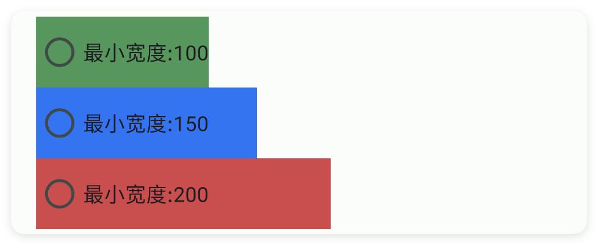
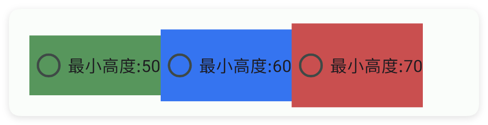
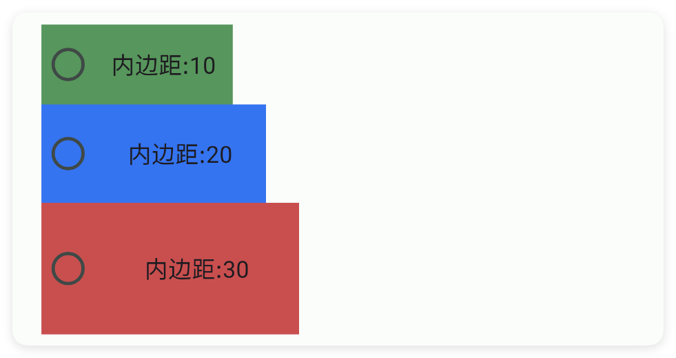
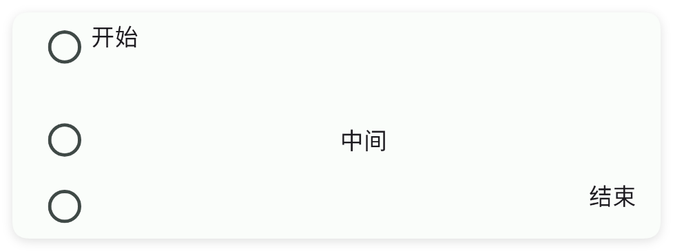
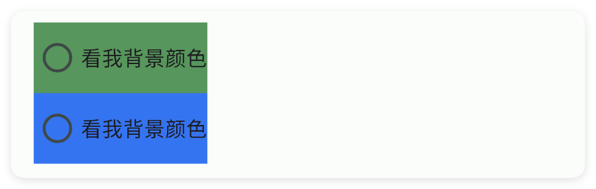

# 单选按钮

- 更新时间:2026-10-22 10:58:42

> 单选按钮-radio
> 
> 原生类型:{com.google.android.material.radiobutton.MaterialRadioButton}


<div style="width: 100%; position: relative; padding-bottom: 56.25%; height: 0; overflow: hidden;">
  <iframe 
    src="//player.bilibili.com/player.html?isOutside=true&aid=116227871611097&bvid=BV17JwtzcEZd&cid=36698457640&p=1" 
    style="position: absolute; top: 0; left: 0; width: 100%; height: 100%; border: none;"
    scrolling="no" 
    frameborder="no" 
    allowfullscreen="true">
  </iframe>
</div>

单选按钮：一般需要配合单选按钮组(radio-group)的配合才能实现互相排斥的效果，这个控件常用在只需要在多个选择中选择一个的情况。


## 一、常用属性


### color - 主题颜色

> 设置主题颜色


```html
// 用字符串保存布局；标签表示控件，属性控制控件的外观或初始状态。
var layoutXml = `
<ui>
    <statusbar />
    <radio-group dir="h" w="max">
        <radio color="#3574F0" text="吃饭" />
        <radio color="#518855" text="睡觉" />
        <radio color="#B44A4A" text="游戏" />
    </radio-group>
</ui>
`;
// 解析布局得到界面对象，再显示界面。
var ui = $ui.layout(layoutXml);
ui.show();
```


### check - 选中状态

> 设置选中状态


```html
// 用字符串保存布局；标签表示控件，属性控制控件的外观或初始状态。
var layoutXml = `
<ui>
    <statusbar />
    <radio-group dir="h" w="max">
        <radio color="#3574F0" text="吃饭" />
        <radio check="true" color="#518855" text="睡觉" />
        <radio color="#B44A4A" text="游戏" />
    </radio-group>
</ui>
`;
// 解析布局得到界面对象，再显示界面。
var ui = $ui.layout(layoutXml);
ui.show();
```


### text - 文本

> 设置文本


```html
// 用字符串保存布局；标签表示控件，属性控制控件的外观或初始状态。
var layoutXml = `
<ui>
    <statusbar />
    <radio-group dir="h" w="max">
        <radio color="#3574F0" text="我是文本1" />
        <radio color="#518855" text="我是文本2" />
    </radio-group>
</ui>
`;
// 解析布局得到界面对象，再显示界面。
var ui = $ui.layout(layoutXml);
ui.show();
```


### textColor - 文本颜色

> 设置文本颜色


```html
// 用字符串保存布局；标签表示控件，属性控制控件的外观或初始状态。
var layoutXml = `
<ui>
    <statusbar />
    <radio-group dir="h" w="max">
        <radio color="#3574F0" text="我是文本1" textColor="#57965C" />
        <radio color="#518855" text="我是文本2" textColor="#C94F4F" />
    </radio-group>
</ui>
`;
// 解析布局得到界面对象，再显示界面。
var ui = $ui.layout(layoutXml);
ui.show();
```


### minW - 最小宽度

> 设置最小宽度


```html
// 用字符串保存布局；标签表示控件，属性控制控件的外观或初始状态。
var layoutXml = `
<ui>
    <statusbar />
    <radio-group dir="v" w="max">
        <radio bg="#57965C" minW="100" text="最小宽度:100" />
        <radio bg="#3574F0" minW="150" text="最小宽度:150" />
        <radio bg="#C94F4F" minW="200" text="最小宽度:200" />
    </radio-group>
</ui>
`;
// 解析布局得到界面对象，再显示界面。
var ui = $ui.layout(layoutXml);
ui.show();
```




### minH - 最小高度

> 设置最小高度


```html
// 用字符串保存布局；标签表示控件，属性控制控件的外观或初始状态。
var layoutXml = `
<ui>
    <statusbar />
    <radio-group dir="h" w="max">
        <radio bg="#57965C" minH="50" text="最小高度:50" />
        <radio bg="#3574F0" minH="60" text="最小高度:60" />
        <radio bg="#C94F4F" minH="70" text="最小高度:70" />
    </radio-group>
</ui>
`;
// 解析布局得到界面对象，再显示界面。
var ui = $ui.layout(layoutXml);
ui.show();
```




### padding - 内边距

> 设置内边距


```html
// 用字符串保存布局；标签表示控件，属性控制控件的外观或初始状态。
var layoutXml = `
<ui>
    <statusbar />
    <radio-group dir="v" w="max">
        <radio bg="#57965C" padding="10" text="内边距:10" />
        <radio bg="#3574F0" padding="20" text="内边距:20" />
        <radio bg="#C94F4F" padding="30" text="内边距:30" />
    </radio-group>
</ui>
`;
// 解析布局得到界面对象，再显示界面。
var ui = $ui.layout(layoutXml);
ui.show();
```




### gravity - 重力

> 设置重力


```html
// 用字符串保存布局；标签表示控件，属性控制控件的外观或初始状态。
var layoutXml = `
<ui>
    <statusbar />
    <!--将宽度设置到最大才能看到效果-->
    <radio-group dir="v" w="max">
        <radio gravity="start" text="开始" w="max" />
        <radio gravity="center" text="中间" w="max" />
        <radio gravity="end" text="结束" w="max" />
    </radio-group>
</ui>
`;
// 解析布局得到界面对象，再显示界面。
var ui = $ui.layout(layoutXml);
ui.show();
```




### bg - 背景颜色

> 设置背景颜色


```html
// 用字符串保存布局；标签表示控件，属性控制控件的外观或初始状态。
var layoutXml = `
<ui>
    <statusbar />
    <radio-group dir="v" w="max">
        <radio bg="#57965C" text="看我背景颜色" />
        <radio bg="#3574F0" text="看我背景颜色" />
    </radio-group>
</ui>
`;
// 解析布局得到界面对象，再显示界面。
var ui = $ui.layout(layoutXml);
ui.show();
```




### bgImg - 背景图片

> 设置背景图片


```html
// 用字符串保存布局；标签表示控件，属性控制控件的外观或初始状态。
// 示例用到的本地资源需要提前准备，请把文件路径改为项目中的实际路径。
var layoutXml = `
<ui>
    <statusbar />
    <radio-group dir="h" w="max">
        <radio bgImg="example/$ui - 交互界面/17.radio-单选按钮/img/img.png" color="bg"
            gravity="center" text="睡觉" textColor="bg" weight="0.2" />
        <radio bgImg="example/$ui - 交互界面/17.radio-单选按钮/img/img_1.png" color="bg"
            gravity="center" text="游戏" textColor="bg" weight="0.2" />
        <radio bgImg="example/$ui - 交互界面/17.radio-单选按钮/img/img_2.png" color="bg"
            gravity="center" text="吃饭" textColor="bg" weight="0.2" />
    </radio-group>
</ui>
`;
// 解析布局得到界面对象，再显示界面。
var ui = $ui.layout(layoutXml);
ui.show();
```


### storeKey - 存储布尔值

> 存储布尔值
> 
> 通过storeKey(存储关键字)指定一个存储布尔值的关键字，获取值时可以直接通过$storage($存储)获取布尔值。
> 
> 注意：不同的控件存储的类型不同，对于本控件(开关)则存储的是布尔值类型，表达当前是否被选中


```html
// 用字符串保存布局；标签表示控件，属性控制控件的外观或初始状态。
var layoutXml = `
<!-- 你必须在ui(界面)节点中通过store(存储)指定$storage($存储)的命名空间，等价于使用代码：var storage = $storage.create("MyAppRadio"); -->
<ui store="MyAppRadio">
    <statusbar />
    <!-- 使用storeKey(存储关键字)属性，指定关键字，等价于使用代码：var data = $storage.create("MyAppRadio").getBool("eat"); -->
    <!-- 使用storeDef(存储默认值)属性，指定默认值，等价于使用代码：var data = $storage.create("MyAppRadio").getBool("eat",true); -->
    <radio storeDef="true" storeKey="eat" text="吃饭" />
    <radio storeDef="false" storeKey="sleep" text="睡觉" />
</ui>
`;
// 解析布局得到界面对象，再显示界面。
var ui = $ui.layout(layoutXml);
ui.show();
```


如果我们已经配置好了应用内存储，则可以直接获取数据：

注意：一、要使用应用内存储，必须在ui(界面)节点指定属性store(存储)的值，该值指定存储的命名空间；
二、不是所有的控件都支持应用内存储；
三、不同的控件存储的数据类型可能都不一致，例如：输入类型的控件存储的是字符串类型，开关、多选框存储的就是布尔类型的数据。


```javascript
//创建(或者加载)存储对象
var storage = $storage.create("MyAppRadio");//名称要一致
//获取数据
var data = storage.getBoolean("eat",false);//数据类型是布尔值
```


## 二、常用函数


### isChecked()

> 看看这个单选按钮现在有没有被选中。

- 返回 : {Boolean} 选中了返回 true，没选中返回 false
- 版本 : 1.8.2


```javascript
//先用一段 XML 创建界面：一个带 id 的单选按钮
var ui = $ui.layout('<ui><statusbar/><radio id="mRadio" text="吃饭"/></ui>');
ui.show(); //把界面显示出来
var radio = ui.id("mRadio"); //根据 id 拿到这个单选按钮
if (radio.isChecked()) {
    log("选中了");
} else {
    log("没选中");
}
```


### check(checked)

> 代码里主动选中或取消这个单选按钮。
> 
> 传 true 表示选中，传 false 表示取消。如果它在同一个单选按钮组里，选中它会自动取消组里其它按钮。

- 参数 : checked {Boolean} true 选中，false 取消


```javascript
var ui = $ui.layout('<ui><statusbar/><radio id="mRadio" text="吃饭"/></ui>');
ui.show(); //把界面显示出来
var radio = ui.id("mRadio"); //根据 id 拿到这个单选按钮
radio.check(true); //代码里让它选中
```


### onCheck(callback)

> 监听用户点这个单选按钮：选中状态一变就回调你传进来的函数，并告诉你现在是选中(true)还是取消(false)。

- 参数 : callback {function} 选中变化回调，参数是 true（选中）或 false（取消）


```javascript
var ui = $ui.layout('<ui><statusbar/><radio id="mRadio" text="吃饭"/></ui>');
ui.show(); //把界面显示出来
var radio = ui.id("mRadio"); //根据 id 拿到这个单选按钮
//监听选中变化
radio.onCheck(function(isChecked) {
    if (isChecked) {
        log("被选中了");
    } else {
        log("被取消了");
    }
});
```


### setGravity(gravity)

> 设置单选按钮里“圆圈+文字”在控件内部的对齐方式。
> 
> 常用值：start（靠左）、center（居中）、end（靠右），可以用竖线组合，例如 "center|bottom"。

- 参数 : gravity {String} 对齐方式，例如 "center"、"start"、"center|bottom"


```javascript
var ui = $ui.layout('<ui><statusbar/><radio id="mRadio" text="居中" w="max"/></ui>');
ui.show(); //把界面显示出来
var radio = ui.id("mRadio"); //根据 id 拿到这个单选按钮
radio.setGravity("center"); //让圆圈和文字整体居中
```


### setText(text)

> 改单选按钮旁边显示的文字。

- 参数 : text {String} 要显示的新文字


```javascript
var ui = $ui.layout('<ui><statusbar/><radio id="mRadio" text="旧文字"/></ui>');
ui.show(); //把界面显示出来
var radio = ui.id("mRadio"); //根据 id 拿到这个单选按钮
radio.setText("新文字"); //改成新文字
```


### getText()

> 读出单选按钮旁边现在显示的文字。

- 返回 : {String} 当前显示的文字；没有文字时返回空字符串


```javascript
var ui = $ui.layout('<ui><statusbar/><radio id="mRadio" text="吃饭"/></ui>');
ui.show(); //把界面显示出来
var radio = ui.id("mRadio"); //根据 id 拿到这个单选按钮
var t = radio.getText(); //读出文字
log("文字是:" + t);
```


### setColor(color)

> 改单选按钮那个圆圈的颜色（用颜色字符串表示）。

- 参数 : color {String} 颜色字符串，例如 "#FF0000"


```javascript
var ui = $ui.layout('<ui><statusbar/><radio id="mRadio" text="吃饭"/></ui>');
ui.show(); //把界面显示出来
var radio = ui.id("mRadio"); //根据 id 拿到这个单选按钮
radio.setColor("#3574F0"); //圆圈涂成蓝色
```


### setTextColor(color)

> 改单选按钮旁边文字的颜色。

- 参数 : color {String} 颜色字符串，例如 "#FF0000"


```javascript
var ui = $ui.layout('<ui><statusbar/><radio id="mRadio" text="吃饭"/></ui>');
ui.show(); //把界面显示出来
var radio = ui.id("mRadio"); //根据 id 拿到这个单选按钮
radio.setTextColor("#FF0000"); //文字涂红
```


