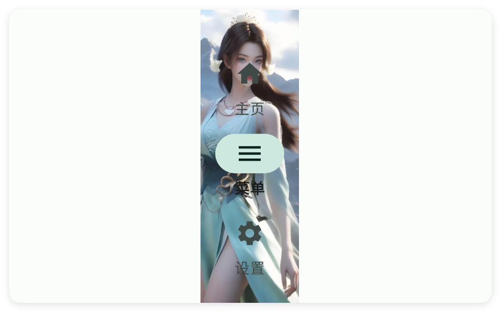

# 轨道

- 更新时间:2026-10-22 10:58:42

> 轨道-rail
> 
> 这个控件和nav导航栏控件很像，只不过是竖向排列的
> 
> 原生类型:{com.google.android.material.navigationrail.NavigationRailView}


<div style="width: 100%; position: relative; padding-bottom: 56.25%; height: 0; overflow: hidden;">
  <iframe 
    src="//player.bilibili.com/player.html?isOutside=true&aid=116230539187708&bvid=BV1G9wKztEGT&cid=36706190262&p=1" 
    style="position: absolute; top: 0; left: 0; width: 100%; height: 100%; border: none;"
    scrolling="no" 
    frameborder="no" 
    allowfullscreen="true">
  </iframe>
</div>

轨道：和导航栏、工具栏、应用条很相似，但是这个组件是竖着的。


## 一、常用属性


### iconTint - 图标颜色

> 设置图标颜色


```html
// 用字符串保存布局；标签表示控件，属性控制控件的外观或初始状态。
var layoutXml = `
<ui>
    <statusbar />
    <rail iconTint="#C94F4F" marginStart="80">
        <menu icon="ic_home_fill" text="主页" />
        <menu icon="ic_menu_fill" text="菜单" />
        <menu icon="ic_settings_fill" text="设置" />
    </rail>
</ui>
`;
// 解析布局得到界面对象，再显示界面。
var ui = $ui.layout(layoutXml);
ui.show();
```


### textColor - 文本颜色

> 设置文本颜色


```html
// 用字符串保存布局；标签表示控件，属性控制控件的外观或初始状态。
var layoutXml = `
<ui>
    <statusbar />
    <rail marginStart="160" textColor="#C94F4F">
        <menu icon="ic_home_fill" text="主页" />
        <menu icon="ic_menu_fill" text="菜单" />
        <menu icon="ic_settings_fill" text="设置" />
    </rail>
</ui>
`;
// 解析布局得到界面对象，再显示界面。
var ui = $ui.layout(layoutXml);
ui.show();
```


### checkColor - 选中后图标颜色

> 设置选中后图标颜色


```html
// 用字符串保存布局；标签表示控件，属性控制控件的外观或初始状态。
var layoutXml = `
<ui>
    <statusbar />
    <rail checkColor="#C94F4F" marginStart="240">
        <menu icon="ic_home_fill" text="主页" />
        <menu icon="ic_menu_fill" text="菜单" />
        <menu icon="ic_settings_fill" text="设置" />
    </rail>
</ui>
`;
// 解析布局得到界面对象，再显示界面。
var ui = $ui.layout(layoutXml);
ui.show();
```


### bg - 背景颜色

> 设置背景颜色


```html
// 用字符串保存布局；标签表示控件，属性控制控件的外观或初始状态。
var layoutXml = `
<ui>
    <statusbar />
    <rail bg="#C94F4F">
        <menu icon="ic_home_fill" text="主页" />
        <menu icon="ic_menu_fill" text="菜单" />
        <menu icon="ic_settings_fill" text="设置" />
    </rail>
</ui>
`;
// 解析布局得到界面对象，再显示界面。
var ui = $ui.layout(layoutXml);
ui.show();
```


### bgImg - 背景图片

> 设置背景图片


```html
// 用字符串保存布局；标签表示控件，属性控制控件的外观或初始状态。
// 示例用到的本地资源需要提前准备，请把文件路径改为项目中的实际路径。
var layoutXml = `
<ui>
    <statusbar />
    <rail bgImg="example/$ui - 交互界面/18.rail-轨道/img/img.png" marginStart="80">
        <menu icon="ic_home_fill" text="主页" />
        <menu icon="ic_menu_fill" text="菜单" />
        <menu icon="ic_settings_fill" text="设置" />
    </rail>
</ui>
`;
// 解析布局得到界面对象，再显示界面。
var ui = $ui.layout(layoutXml);
ui.show();
```




## 二、常用函数


### setBg(color)

> 改轨道栏的背景颜色（用安卓颜色整数表示，通常配合 $color 预置颜色）。

- 参数 : color {Number} 安卓颜色整数，常用 $color.BLACK 等预置颜色
- 版本 : 1.8.2


```javascript
//先用一段 XML 创建界面：一个竖向轨道栏，里面三个菜单
var ui = $ui.layout('<ui><statusbar/><rail id="mRail" w="60"><menu text="主页"/><menu text="菜单"/><menu text="设置"/></rail></ui>');
ui.show(); //把界面显示出来
var rail = ui.id("mRail"); //根据 id 拿到这个轨道栏
rail.setBg($color.BLACK); //背景涂黑
```


### setBg(color)

> 改轨道栏的背景颜色（用颜色字符串表示）。

- 参数 : color {String} 颜色字符串，例如 "#FF0000"
- 版本 : 1.8.2


```javascript
var ui = $ui.layout('<ui><statusbar/><rail id="mRail" w="60"><menu text="主页"/><menu text="菜单"/></rail></ui>');
ui.show(); //把界面显示出来
var rail = ui.id("mRail"); //根据 id 拿到这个轨道栏
rail.setBg("#1E1F22"); //背景涂深灰
```


### setIconTint(color)

> 改轨道栏里菜单图标的颜色（用安卓颜色整数表示）。
> 
> 未选中的图标会自动半透明，选中的是实色。

- 参数 : color {Number} 安卓颜色整数，常用 $color.WHITE 等预置颜色；传 null 表示恢复默认
- 版本 : 1.8.2


```javascript
var ui = $ui.layout('<ui><statusbar/><rail id="mRail" w="60"><menu text="主页"/><menu text="菜单"/></rail></ui>');
ui.show(); //把界面显示出来
var rail = ui.id("mRail"); //根据 id 拿到这个轨道栏
rail.setIconTint($color.WHITE); //图标涂白
```


### setIconTint(color)

> 改轨道栏里菜单图标的颜色（用颜色字符串表示）。

- 参数 : color {String} 颜色字符串，例如 "#FF0000"
- 版本 : 1.8.2


```javascript
var ui = $ui.layout('<ui><statusbar/><rail id="mRail" w="60"><menu text="主页"/><menu text="菜单"/></rail></ui>');
ui.show(); //把界面显示出来
var rail = ui.id("mRail"); //根据 id 拿到这个轨道栏
rail.setIconTint("#FFFFFF"); //图标涂白
```


### setTextColor(color)

> 改轨道栏里菜单文字的颜色（用安卓颜色整数表示）。

- 参数 : color {Number} 安卓颜色整数，常用 $color.WHITE 等预置颜色
- 版本 : 1.8.2


```javascript
var ui = $ui.layout('<ui><statusbar/><rail id="mRail" w="60"><menu text="主页"/><menu text="菜单"/></rail></ui>');
ui.show(); //把界面显示出来
var rail = ui.id("mRail"); //根据 id 拿到这个轨道栏
rail.setTextColor($color.WHITE); //文字涂白
```


### setTextColor(color)

> 改轨道栏里菜单文字的颜色（用颜色字符串表示）。

- 参数 : color {String} 颜色字符串，例如 "#FF0000"
- 版本 : 1.8.2


```javascript
var ui = $ui.layout('<ui><statusbar/><rail id="mRail" w="60"><menu text="主页"/><menu text="菜单"/></rail></ui>');
ui.show(); //把界面显示出来
var rail = ui.id("mRail"); //根据 id 拿到这个轨道栏
rail.setTextColor("#FFFFFF"); //文字涂白
```


### setCheckColor(color)

> 改“被选中那一项”背后高亮条的颜色（用安卓颜色整数表示）。

- 参数 : color {Number} 安卓颜色整数，常用 $color.RED 等预置颜色
- 版本 : 1.8.2


```javascript
var ui = $ui.layout('<ui><statusbar/><rail id="mRail" w="60"><menu text="主页"/><menu text="菜单"/></rail></ui>');
ui.show(); //把界面显示出来
var rail = ui.id("mRail"); //根据 id 拿到这个轨道栏
rail.setCheckColor($color.RED); //选中高亮条涂红
```


### setCheckColor(color)

> 改“被选中那一项”背后高亮条的颜色（用颜色字符串表示）。

- 参数 : color {String} 颜色字符串，例如 "#FF0000"
- 版本 : 1.8.2


```javascript
var ui = $ui.layout('<ui><statusbar/><rail id="mRail" w="60"><menu text="主页"/><menu text="菜单"/></rail></ui>');
ui.show(); //把界面显示出来
var rail = ui.id("mRail"); //根据 id 拿到这个轨道栏
rail.setCheckColor("#FF0000"); //高亮条涂红
```


### check(index)

> 代码里主动选中轨道栏里第几个菜单（下标从 0 开始）。

- 参数 : index {Number} 要选中的菜单下标，从 0 开始


```javascript
var ui = $ui.layout('<ui><statusbar/><rail id="mRail" w="60"><menu text="主页"/><menu text="菜单"/><menu text="设置"/></rail></ui>');
ui.show(); //把界面显示出来
var rail = ui.id("mRail"); //根据 id 拿到这个轨道栏
rail.check(2); //选中第三个（设置）
```


### menu(callback)

> 监听用户点了轨道栏里哪个菜单：点一下就回调，并告诉你那个菜单上写的文字。

- 参数 : callback {function} 点击回调，参数是被点菜单的文字


```javascript
var ui = $ui.layout('<ui><statusbar/><rail id="mRail" w="60"><menu text="主页"/><menu text="菜单"/><menu text="设置"/></rail></ui>');
ui.show(); //把界面显示出来
var rail = ui.id("mRail"); //根据 id 拿到这个轨道栏
//监听点菜单
rail.menu(function(title) {
    log("你点了:" + title);
});
```


