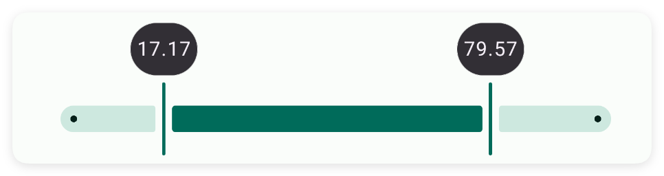
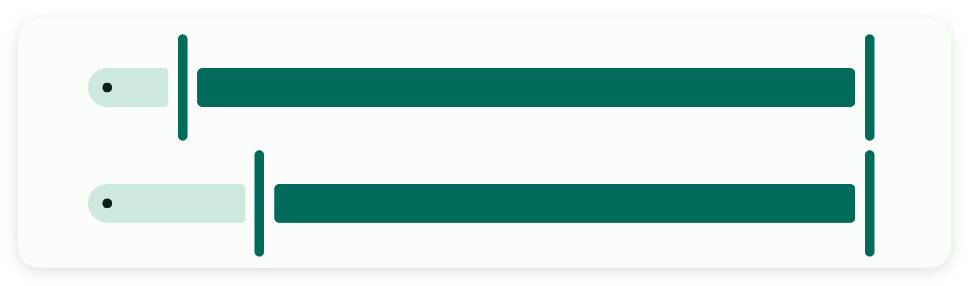
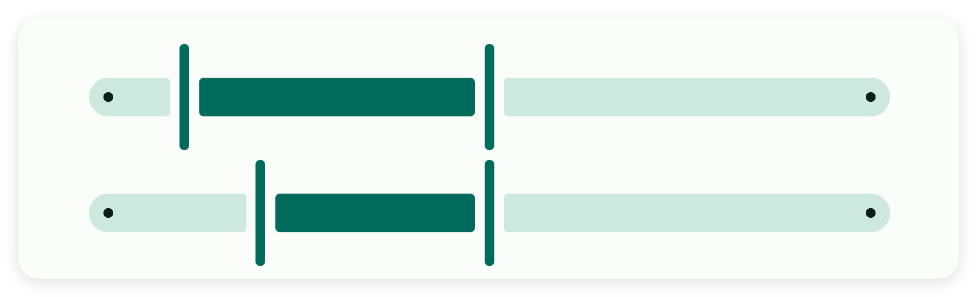
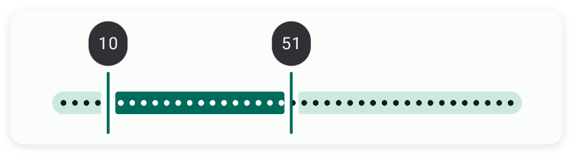
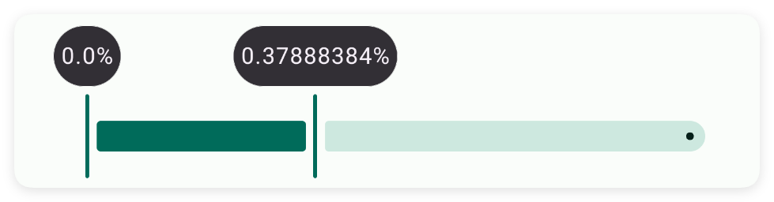
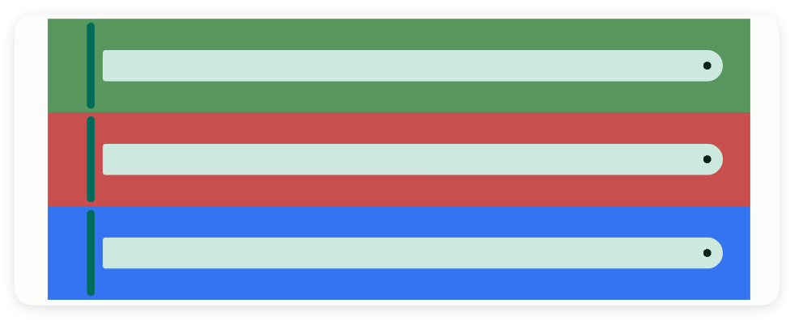
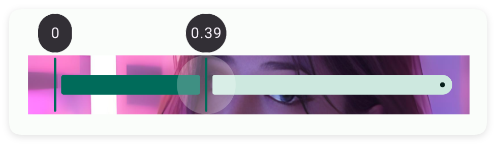

# 范围

- 更新时间:2026-10-22 10:58:42

> 范围-range
> 
> 原生类型:{com.google.android.material.slider.RangeSlider}


<div style="width: 100%; position: relative; padding-bottom: 56.25%; height: 0; overflow: hidden;">
  <iframe 
    src="//player.bilibili.com/player.html?isOutside=true&aid=116230639851454&bvid=BV1VDwKz8EUJ&cid=36706519694&p=1" 
    style="position: absolute; top: 0; left: 0; width: 100%; height: 100%; border: none;"
    scrolling="no" 
    frameborder="no" 
    allowfullscreen="true">
  </iframe>
</div>

范围条：用来选择范围的滑动条。


## 一、常用属性


### from - 开始值

> 设置开始值


```html
// 将布局保存为字符串；标签表示控件，标签中的属性决定显示效果。
var layoutXml = `
<ui>
    <statusbar />
    <range from="0" to="100" w="max" />
</ui>
`;
// 解析布局后得到界面对象，显示它即可查看本节属性的效果。
var ui = $ui.layout(layoutXml);
ui.show();
```




### to - 结束值

> 设置结束值


```html
// 将布局保存为字符串；标签表示控件，标签中的属性决定显示效果。
var layoutXml = `
<ui>
    <statusbar />
    <range from="0" to="100" w="max" />
</ui>
`;
// 解析布局后得到界面对象，显示它即可查看本节属性的效果。
var ui = $ui.layout(layoutXml);
ui.show();
```


### fromValue - 左初始值

> 设置左初始值


```html
// 将布局保存为字符串；标签表示控件，标签中的属性决定显示效果。
var layoutXml = `
<ui>
    <statusbar />
    <range from="0" fromValue="10" to="100" w="max" />
    <range from="0" fromValue="20" to="100" w="max" />
</ui>
`;
// 解析布局后得到界面对象，显示它即可查看本节属性的效果。
var ui = $ui.layout(layoutXml);
ui.show();
```




### toValue - 右初始值

> 设置右初始值


```html
// 将布局保存为字符串；标签表示控件，标签中的属性决定显示效果。
var layoutXml = `
<ui>
    <statusbar />
    <range from="0" fromValue="10" to="100" toValue="50" w="max" />
    <range from="0" fromValue="20" to="100" toValue="50" w="max" />
</ui>
`;
// 解析布局后得到界面对象，显示它即可查看本节属性的效果。
var ui = $ui.layout(layoutXml);
ui.show();
```




### step - 进步值

> 设置进步值


```html
// 将布局保存为字符串；标签表示控件，标签中的属性决定显示效果。
var layoutXml = `
<ui>
    <statusbar />
    <range from="0" fromValue="10" step="1" to="100" toValue="50" w="max" />
</ui>
`;
// 解析布局后得到界面对象，显示它即可查看本节属性的效果。
var ui = $ui.layout(layoutXml);
ui.show();
```




### color - 主题颜色

> 设置主题颜色


```html
// 将布局保存为字符串；标签表示控件，标签中的属性决定显示效果。
var layoutXml = `
<ui>
    <statusbar />
    <range color="#57965C" from="0" fromValue="10" to="100" toValue="50" w="max" />
    <range color="#C94F4F" from="0" fromValue="10" to="100" toValue="50" w="max" />
    <range color="#3574F0" from="0" fromValue="10" to="100" toValue="50" w="max" />
</ui>
`;
// 解析布局后得到界面对象，显示它即可查看本节属性的效果。
var ui = $ui.layout(layoutXml);
ui.show();
```


### label - 标签文字

> 设置标签文字


```html
// 将布局保存为字符串；标签表示控件，标签中的属性决定显示效果。
var layoutXml = `
<ui>
    <statusbar />
    <range label="比例:" w="max" />
</ui>
`;
// 解析布局后得到界面对象，显示它即可查看本节属性的效果。
var ui = $ui.layout(layoutXml);
ui.show();
```


### labelEnd - 标签文字尾部

> 设置标签文字尾部


```html
// 将布局保存为字符串；标签表示控件，标签中的属性决定显示效果。
var layoutXml = `
<ui>
    <statusbar />
    <range labelEnd="%" w="max" />
</ui>
`;
// 解析布局后得到界面对象，显示它即可查看本节属性的效果。
var ui = $ui.layout(layoutXml);
ui.show();
```




### bg - 背景颜色

> 设置背景颜色


```html
// 将布局保存为字符串；标签表示控件，标签中的属性决定显示效果。
var layoutXml = `
<ui>
    <statusbar />
    <range bg="#57965C" w="max" />
    <range bg="#C94F4F" w="max" />
    <range bg="#3574F0" w="max" />
</ui>
`;
// 解析布局后得到界面对象，显示它即可查看本节属性的效果。
var ui = $ui.layout(layoutXml);
ui.show();
```




### bgImg - 背景图片

> 设置背景图片


```html
// 将布局保存为字符串；标签表示控件，标签中的属性决定显示效果。
// 若布局引用图片、视频或其他资源，请先准备文件并改成实际可用的路径。
var layoutXml = `
<ui>
    <statusbar />
    <range bgImg="example/$ui - 交互界面/19.range-范围条/img/img.png" w="max" />
</ui>
`;
// 解析布局后得到界面对象，显示它即可查看本节属性的效果。
var ui = $ui.layout(layoutXml);
ui.show();
```




## 二、常用函数


### onLabel(callback)

> 自定义拖动时弹出的那个小标签上显示什么字。
> 
> 你传一个函数，拖动到某个数值时系统会把当前数值传给你，你返回一段想显示的文字即可。返回空串则显示原始数字。

- 参数 : callback {function} 格式化函数，参数是当前数值，返回要显示的文字


```javascript
//先用一段 XML 创建界面：一个范围条，范围 0 到 100
var ui = $ui.layout('<ui><statusbar/><range id="mRange" w="max" from="0" to="100"/></ui>');
ui.show(); //把界面显示出来
var range = ui.id("mRange"); //根据 id 拿到这个范围条
//拖动时标签显示成 ¥50 这种样子
range.onLabel(function(value) {
    return "¥" + value;
});
```


### onChange(callback)

> 监听用户拖动范围条：左、右两个小圆点一动就回调，并告诉你当前的开始值和结束值。

- 参数 : callback {function} 变化回调，参数依次为当前开始值、当前结束值


```javascript
var ui = $ui.layout('<ui><statusbar/><range id="mRange" w="max" from="0" to="100"/></ui>');
ui.show(); //把界面显示出来
var range = ui.id("mRange"); //根据 id 拿到这个范围条
//监听拖动
range.onChange(function(from, to) {
    log("当前范围:" + from + " ~ " + to);
});
```


### getRange()

> 读出当前用户选的范围，返回一个数组：[开始值, 结束值]。

- 返回 : {Array} 长度为 2 的数组，[开始值, 结束值]


```javascript
var ui = $ui.layout('<ui><statusbar/><range id="mRange" w="max" from="0" to="100"/></ui>');
ui.show(); //把界面显示出来
var range = ui.id("mRange"); //根据 id 拿到这个范围条
range.setData(20, 80); //先设个范围
var r = range.getRange(); //读出来
log("从" + r[0] + "到" + r[1]);
```


### setData(from, to)

> 代码里直接设置左右两个小圆点的位置（开始值和结束值）。
> 
> 结束值必须比开始值大，否则会失败。

- 参数 : from {Number} 左边（开始）的值
- 参数 : to {Number} 右边（结束）的值，必须比 from 大


```javascript
var ui = $ui.layout('<ui><statusbar/><range id="mRange" w="max" from="0" to="100"/></ui>');
ui.show(); //把界面显示出来
var range = ui.id("mRange"); //根据 id 拿到这个范围条
range.setData(20, 80); //左边放 20，右边放 80
```


