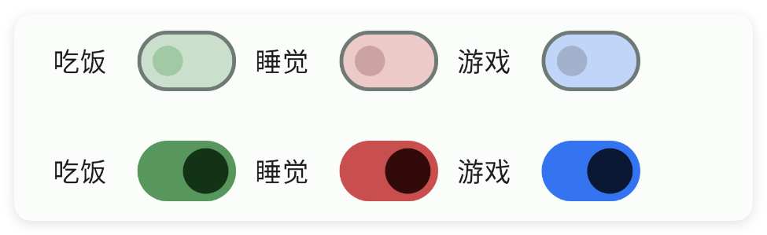
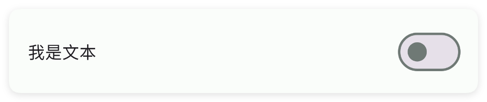
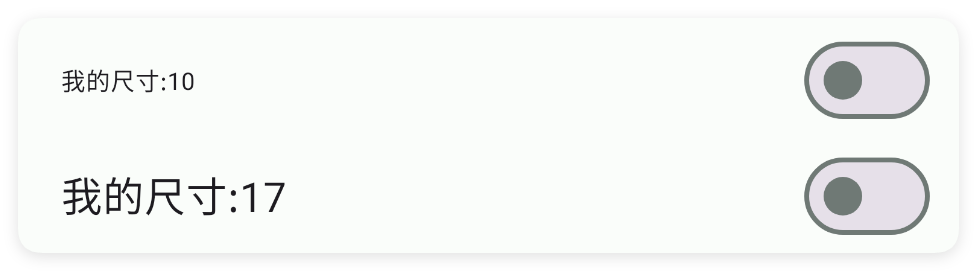

# 开关

- 更新时间:2026-10-22 10:58:42

> 开关-switch
> 
> 原生类型:{com.google.android.material.materialswitch.MaterialSwitch}


<div style="width: 100%; position: relative; padding-bottom: 56.25%; height: 0; overflow: hidden;">
  <iframe 
    src="//player.bilibili.com/player.html?isOutside=true&aid=116230723737632&bvid=BV1bEwKzHEW2&cid=36706845515&p=1" 
    style="position: absolute; top: 0; left: 0; width: 100%; height: 100%; border: none;"
    scrolling="no" 
    frameborder="no" 
    allowfullscreen="true">
  </iframe>
</div>

开关：顾名思义，就是开关的意思，只有打开或者关闭两种状态。


## 一、常用属性


### color - 主题颜色

> 设置主题颜色


```html
// 用字符串保存布局；其中的属性就是本节演示的设置。
var layoutXml = `
<ui>
    <statusbar />
    <linear dir="h" w="max">
        <switch color="#57965C" margin="5" text="吃饭" />
        <switch color="#C94F4F" margin="5" text="睡觉" />
        <switch color="#3574F0" margin="5" text="游戏" />
    </linear>
    <linear dir="h" w="max">
        <switch check="true" color="#57965C" margin="5" text="吃饭" />
        <switch check="true" color="#C94F4F" margin="5" text="睡觉" />
        <switch check="true" color="#3574F0" margin="5" text="游戏" />
    </linear>
</ui>
`;
var ui = $ui.layout(layoutXml); // 解析布局并创建控件。
ui.show(); // 显示界面，观察属性效果。
```




### text - 文本

> 设置文本


```html
// 用字符串保存布局；其中的属性就是本节演示的设置。
var layoutXml = `
<ui>
    <statusbar />
    <switch text="我是文本" w="max" />
</ui>
`;
var ui = $ui.layout(layoutXml); // 解析布局并创建控件。
ui.show(); // 显示界面，观察属性效果。
```




### textSize - 文本尺寸

> 设置文本尺寸


```html
// 用字符串保存布局；其中的属性就是本节演示的设置。
var layoutXml = `
<ui>
    <statusbar />
    <switch text="我的尺寸:10" textSize="10" w="max" />
    <switch text="我的尺寸:17" textSize="17" w="max" />
</ui>
`;
var ui = $ui.layout(layoutXml); // 解析布局并创建控件。
ui.show(); // 显示界面，观察属性效果。
```




### textColor - 文本颜色

> 设置文本颜色


```html
// 用字符串保存布局；其中的属性就是本节演示的设置。
var layoutXml = `
<ui>
    <statusbar />
    <switch text="看我颜色" textColor="#C94F4F" w="max" />
    <switch text="看我颜色" textColor="#3574F0" w="max" />
</ui>
`;
var ui = $ui.layout(layoutXml); // 解析布局并创建控件。
ui.show(); // 显示界面，观察属性效果。
```


### check - 是否选中

> 设置是否选中


```html
// 用字符串保存布局；其中的属性就是本节演示的设置。
var layoutXml = `
<ui>
    <statusbar />
    <switch check="false" text="没选择" w="max" />
    <switch check="true" text="选中" w="max" />
</ui>
`;
var ui = $ui.layout(layoutXml); // 解析布局并创建控件。
ui.show(); // 显示界面，观察属性效果。
```


### minW - 最小宽度

> 设置最小宽度


```html
// 用字符串保存布局；其中的属性就是本节演示的设置。
var layoutXml = `
<ui>
    <statusbar />
    <linear dir="v" w="max">
        <!--为了看清效果，这里设置背景颜色-->
        <switch bg="#57965C" margin="5" minW="200" text="最小宽度:200" />
        <switch bg="#C94F4F" margin="5" minW="250" text="最小宽度:250" />
    </linear>
</ui>
`;
var ui = $ui.layout(layoutXml); // 解析布局并创建控件。
ui.show(); // 显示界面，观察属性效果。
```


### minH - 最小高度

> 设置最小高度


```html
// 用字符串保存布局；其中的属性就是本节演示的设置。
var layoutXml = `
<ui>
    <statusbar />
    <linear dir="h" w="max">
        <!--为了看清效果，这里设置背景颜色-->
        <switch bg="#57965C" margin="5" minH="60" text="最小高度:60" />
        <switch bg="#C94F4F" margin="5" minH="80" text="最小高度:80" />
    </linear>
</ui>
`;
var ui = $ui.layout(layoutXml); // 解析布局并创建控件。
ui.show(); // 显示界面，观察属性效果。
```


### padding - 内边距

> 设置内边距


```html
// 用字符串保存布局；其中的属性就是本节演示的设置。
var layoutXml = `
<ui>
    <statusbar />
    <linear dir="v" w="max">
        <!--为了看清效果，这里设置背景颜色-->
        <switch bg="#57965C" margin="5" padding="10" text="内边距:10" />
        <switch bg="#C94F4F" margin="5" padding="20" text="内边距:20" />
    </linear>
</ui>
`;
var ui = $ui.layout(layoutXml); // 解析布局并创建控件。
ui.show(); // 显示界面，观察属性效果。
```


### gravity - 重力

> 设置重力


```html
// 用字符串保存布局；其中的属性就是本节演示的设置。
var layoutXml = `
<ui>
    <statusbar />
    <linear dir="v" w="max">
        <switch gravity="start" margin="5" text="开始" w="max" />
        <switch gravity="center" margin="5" text="中间" w="max" />
        <switch gravity="end" margin="5" text="结束" w="max" />
    </linear>
</ui>
`;
var ui = $ui.layout(layoutXml); // 解析布局并创建控件。
ui.show(); // 显示界面，观察属性效果。
```


### bg - 背景颜色

> 设置背景颜色


```html
// 用字符串保存布局；其中的属性就是本节演示的设置。
var layoutXml = `
<ui>
    <statusbar />
    <linear dir="h" w="max">
        <switch bg="#57965C" margin="5" text="吃饭" />
        <switch bg="#C94F4F" margin="5" text="睡觉" />
        <switch bg="#3574F0" margin="5" text="游戏" />
    </linear>
</ui>
`;
var ui = $ui.layout(layoutXml); // 解析布局并创建控件。
ui.show(); // 显示界面，观察属性效果。
```


### bgImg - 背景图片

> 设置背景图片


```html
// 用字符串保存布局；其中的属性就是本节演示的设置。
var layoutXml = `
<ui>
    <statusbar />
    <linear dir="v" w="max">
        <!--
        textColor="bg" 是一种动态设置文本颜色的方式，表示当前字体颜色是背景颜色。
        -->
        <switch bgImg="example/$ui - 交互界面/03.check-复选框/img/bg01.png" margin="2"
            text="吃饭" textColor="bg" w="250" />
        <switch bgImg="example/$ui - 交互界面/03.check-复选框/img/bg02.png" margin="2"
            text="睡觉" textColor="bg" w="250" />
        <switch bgImg="example/$ui - 交互界面/03.check-复选框/img/bg03.png" margin="2"
            text="游戏" textColor="bg" w="250" />
    </linear>
</ui>
`;
var ui = $ui.layout(layoutXml); // 解析布局并创建控件。
ui.show(); // 显示界面，观察属性效果。
```


### storeKey - 存储布尔值

> 存储布尔值
> 
> 通过storeKey(存储关键字)指定一个存储布尔值的关键字，获取值时可以直接通过$storage($存储)获取布尔值。
> 
> 注意：不同的控件存储的类型不同，对于本控件(开关)则存储的是布尔值类型，表达当前是否被打开


```html
// 将布局写成字符串，无需另建 ui.xml 文件。
var layoutXml = `
<!-- 你必须在ui(界面)节点中通过store(存储)指定$storage($存储)的命名空间，等价于使用代码：var storage = $storage.create("MyAppSwitch"); -->
<ui store="MyAppSwitch">
    <statusbar />
    <!-- 使用storeKey(存储关键字)属性，指定关键字，等价于使用代码：var eat = $storage.create("MyAppSwitch").getBool("loveEat"); -->
    <!-- 使用storeDef(存储默认值)属性，指定默认值，等价于使用代码：var eat = $storage.create("MyAppSwitch").getBool("loveEat",true); -->
    <switch storeDef="true" storeKey="loveEat" text="热爱干饭" />
</ui>
`;
var ui = $ui.layout(layoutXml);
ui.show(); // 显示界面，后面的事件示例继续使用这个对象。
```


如果我们已经配置好了应用内存储，则可以直接获取数据：

注意：一、要使用应用内存储，必须在ui(界面)节点指定属性store(存储)的值，该值指定存储的命名空间；
二、不是所有的控件都支持应用内存储；
三、不同的控件存储的数据类型可能都不一致，例如：输入类型的控件存储的是字符串类型，开关、多选框存储的就是布尔类型的数据。


```javascript
//创建(或者加载)存储对象
var storage = $storage.create("MyAppSwitch");//名称要一致
//获取数据
var data = storage.getBoolean("loveEat",false);//数据类型是布尔值
```


## 二、常用函数


### check(checked)

> 代码里直接把开关拨到打开或关闭。true 是打开，false 是关闭。

- 参数 : checked {Boolean} true 打开，false 关闭


```javascript
var ui = $ui.layout('<ui><statusbar/><switch id="mSwitch" text="WiFi"/></ui>');
ui.show(); //把界面显示出来
var sw = ui.id("mSwitch"); //根据 id 拿到这个开关
sw.check(true); //拨到打开
```


### isChecked()

> 读出开关现在是打开还是关闭。返回 true 表示打开。

- 返回 : {boolean} true 表示打开，false 表示关闭
- 版本 : 1.8.2


```javascript
var ui = $ui.layout('<ui><statusbar/><switch id="mSwitch" text="WiFi"/></ui>');
ui.show(); //把界面显示出来
var sw = ui.id("mSwitch"); //根据 id 拿到这个开关
if (sw.isChecked()) {
    log("开关是打开的");
}
```


### onCheck(callback)

> 监听用户拨动开关：一开一关都回调，并告诉你现在是开还是关（true/false）。
> 
> 传 null 可取消监听。

- 参数 : callback {function} 状态变化回调，参数 true 打开 / false 关闭；传 null 取消


```javascript
var ui = $ui.layout('<ui><statusbar/><switch id="mSwitch" text="WiFi"/></ui>');
ui.show(); //把界面显示出来
var sw = ui.id("mSwitch"); //根据 id 拿到这个开关
sw.onCheck(function(checked) {
    if (checked) {
        log("打开了");
    } else {
        log("关闭了");
    }
});
```


### setGravity(gravity)

> 设置开关在它那一行里靠哪边对齐（左/中/右、上/中/下）。

- 参数 : gravity {String} 对齐方式，例如 "center"、"left"、"right|bottom"


```javascript
var ui = $ui.layout('<ui><statusbar/><switch id="mSwitch" w="max" text="居中"/></ui>');
ui.show(); //把界面显示出来
var sw = ui.id("mSwitch"); //根据 id 拿到这个开关
sw.setGravity("center"); //文字和开关整体居中
```


### setText(text)

> 代码里改开关旁边显示的那行字。

- 参数 : text {String} 要显示的文字


```javascript
var ui = $ui.layout('<ui><statusbar/><switch id="mSwitch" text="旧字"/></ui>');
ui.show(); //把界面显示出来
var sw = ui.id("mSwitch"); //根据 id 拿到这个开关
sw.setText("是否开启省电模式"); //改成新字
```


### getText()

> 读出开关旁边现在显示的那行字。

- 返回 : {String} 开关旁边的文字，没有则为空串


```javascript
var ui = $ui.layout('<ui><statusbar/><switch id="mSwitch" text="省电模式"/></ui>');
ui.show(); //把界面显示出来
var sw = ui.id("mSwitch"); //根据 id 拿到这个开关
var text = sw.getText(); //读出来
log("开关旁边写的是:" + text);
```


### setColor(color)

> 代码里把开关的主题色（打开时那道横条和小圆点）换成指定颜色（颜色字符串）。

- 参数 : color {String} 颜色字符串，例如 "#3574F0"


```javascript
var ui = $ui.layout('<ui><statusbar/><switch id="mSwitch" text="WiFi"/></ui>');
ui.show(); //把界面显示出来
var sw = ui.id("mSwitch"); //根据 id 拿到这个开关
sw.setColor("#3574F0"); //主题色变蓝
```


### setTextColor(color)

> 代码里把开关旁边那行字的颜色换成指定颜色（颜色字符串）。

- 参数 : color {String} 颜色字符串，例如 "#FF0000"


```javascript
var ui = $ui.layout('<ui><statusbar/><switch id="mSwitch" text="WiFi"/></ui>');
ui.show(); //把界面显示出来
var sw = ui.id("mSwitch"); //根据 id 拿到这个开关
sw.setTextColor("#FF0000"); //文字变红
```


