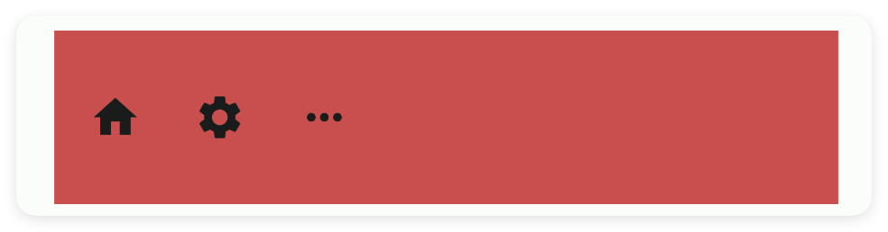
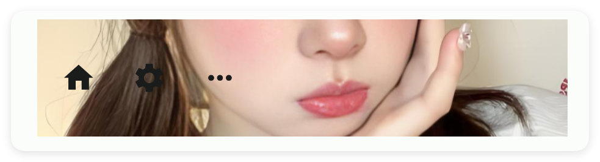
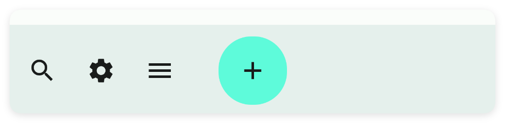
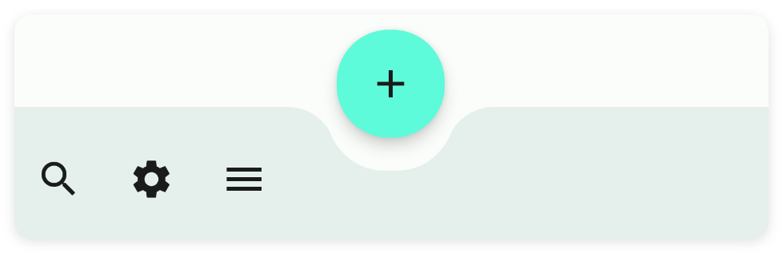
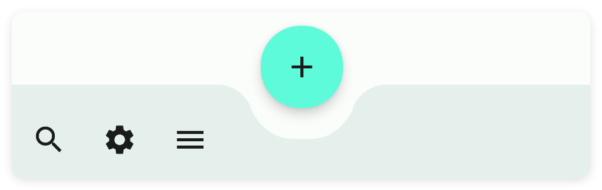
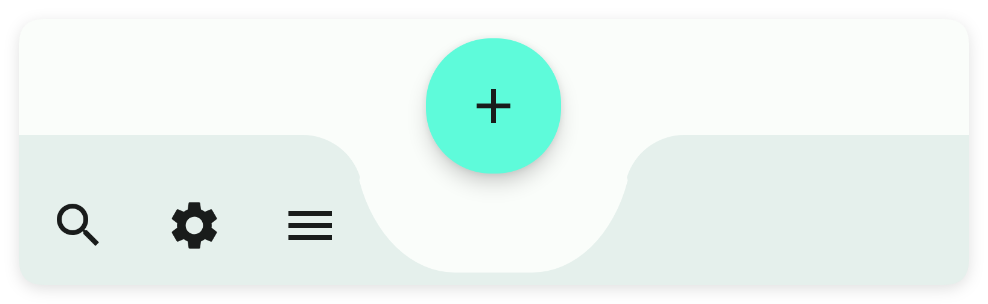
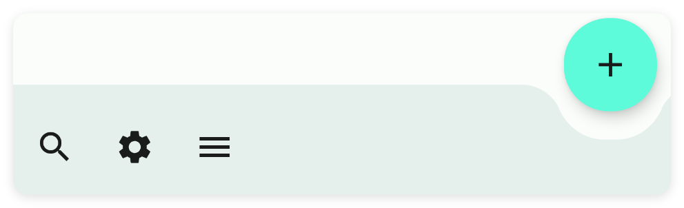
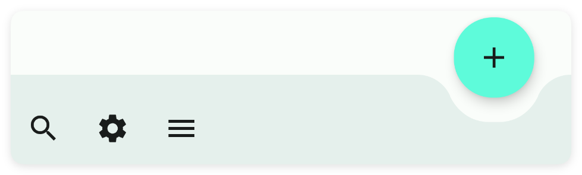
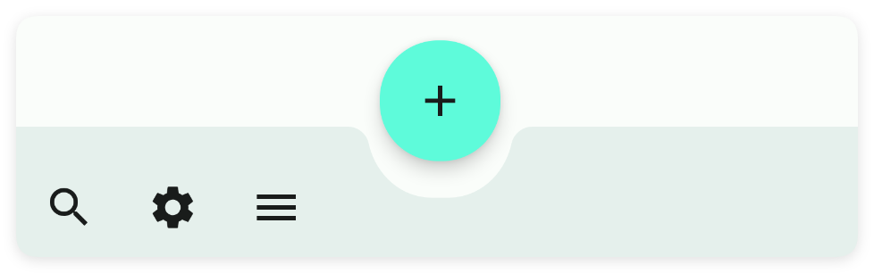

# 工具栏

- 更新时间:2026-10-22 10:58:42

> 工具栏-toolbar
> 
> 原生类型:{com.google.android.material.bottomappbar.BottomAppBar}


<div style="width: 100%; position: relative; padding-bottom: 56.25%; height: 0; overflow: hidden;">
  <iframe 
    src="//player.bilibili.com/player.html?isOutside=true&aid=116230807687629&bvid=BV1ybwKzyEt9&cid=36707238993&p=1" 
    style="position: absolute; top: 0; left: 0; width: 100%; height: 100%; border: none;"
    scrolling="no" 
    frameborder="no" 
    allowfullscreen="true">
  </iframe>
</div>

一般放在布局的最下方作为工具条


## 一、常用属性


### bg - 背景颜色

> 设置背景颜色
> 
> icon/图标：用于指定图标，可以填写图标库的名称，也可以填写图标的相对路径或者绝对路径


```html
// 用字符串保存布局；标签表示控件，属性控制控件的外观或初始状态。
var layoutXml = `
<ui>
    <statusbar />
    <toolbar w="max" bg="#C94F4F">
        <menu icon="ic_home_fill" text="主页" />
        <menu icon="ic_settings_fill" text="设置" />
        <menu icon="ic_more_horiz_fill" text="更多" />
    </toolbar>
</ui>
`;
// 解析布局得到界面对象，再显示界面。
var ui = $ui.layout(layoutXml);
ui.show();
```




### bgImg - 背景图片

> 设置背景图片


```html
// 用字符串保存布局；标签表示控件，属性控制控件的外观或初始状态。
// 示例用到的本地资源需要提前准备，请把文件路径改为项目中的实际路径。
var layoutXml = `
<ui>
    <statusbar />
    <toolbar w="max" bgImg="example/$ui - 交互界面/26.toolbar-工具条/img/img.png">
        <menu icon="ic_home_fill" text="主页" />
        <menu icon="ic_settings_fill" text="设置" />
        <menu icon="ic_more_horiz_fill" text="更多" />
    </toolbar>
</ui>
`;
// 解析布局得到界面对象，再显示界面。
var ui = $ui.layout(layoutXml);
ui.show();
```




## 二、锚定系统

在M3的布局中有一种很有趣的锚定系统，它允许多个组件通过锚定来进行布局的调整，类似于船舶停靠在码头。

在这里我将实现最常用的fab(悬浮按钮)和toolbar(应用条)的锚定系统，值得提醒的是：有一件比较遗憾的事情，目前锚点系统中，只有toolbar(工具条)可以和fab(悬浮按钮)组成联动效果。


示例代码：


```html
// 用字符串保存布局；标签表示控件，属性控制控件的外观或初始状态。
var layoutXml = `
<ui>
    <statusbar />
    <!--
    anchor属性是所有控件都有的属性，但是使用anchorLayout属性必须要被coord锚点布局包才可以
    -->
    <coord h="max" w="max">
        <!--应用标题栏-->
        <appbar-layout w="max">
            <!--
            back:开启返回按钮
            scrollFlags:配置滚动布局滚动时的动画标记
            -->
            <appbar back="true" id="mAppbar" scrollFlags="scroll|enterAlways" subTitle="工具条"
                title="Toolbar" w="max" />
        </appbar-layout>
        <!--
        anchor="nested" 指的是:给滑动布局(nested)取一个驿站名称为'nested'
        behavior="appbar" 只要是在 coord 中的布局都可以设置 behavior 属性，该属性只有两个值：fab(悬浮按钮)和appbar(应用条)
        当(behavior)行为设置为(appbar)应用条时，(nested)滑动布局会自动拼接到(appbar)应用标下方，而不会覆盖应用条。
        -->
        <nested anchor="nested" behavior="appbar" bg="bg" h="max" w="max">
            <!--
            marginBottom="75" 刚好显示在工具条(toolbar)上面，免得工具条(toolbar)遮盖到线性布局(linear)的内容
            -->
            <linear dir="v" gravity="center" marginBottom="75" w="max">
                <text h="210" text="文本1" />
                <text h="210" text="文本2" />
                <text h="210" text="文本3" />
                <text h="210" text="文本4" />
                <text h="210" text="文本5" />
            </linear>
        </nested>
        <!--
        anchorLayout="nested" 指的是:锚定到名称为'nested'的布局上
        anchor="toolbar" 给工具条(toolbar)取一个驿站名称为'toolbar'
        anchorGravity="center|bottom" 只有被coord(锚点布局)包裹的子控件可以设置这个属性，用来指定相对于锚点布局的对齐方式
        fabMode="out" 用来配置停靠在(toolbar)工具条上(fab)悬浮按钮的停靠方式，有两种值：in(内部) 和 out(外部)
        -->
        <toolbar anchor="toolbar" anchorGravity="center|bottom" anchorLayout="nested"
            fabAnim="slide" fabGravity="center" fabMode="out" fabRadius="25" h="75"
            layout_gravity="bottom" w="max">
            <menu icon="ic_search_fill" text="搜搜" />
            <menu icon="ic_settings_fill" text="设置" />
            <menu icon="ic_menu_fill" text="菜单" />
        </toolbar>
        <!--
        这里我让(fab)悬浮按钮锚定到(toolbar)工作条的布局上，同时在(toolbar)工作条的布局上设置悬浮按钮的样式，
        然而(toolbar)工作条能够专门和(fab)悬浮按一起联动，实现凹陷的效果。
        anchorLayout="toolbar" 锚定到名称为'toolbar'的布局上
        -->
        <fab anchorLayout="toolbar" icon="ic_add_outline" iconTint="txt" radius="27" />
        <!--
        在上面的布局中，锚定的顺序是 fab(悬浮按钮) -> toolbar(工具条) ->  linear(线性布局)
        这一切都必须在coord(锚点布局)中，否则锚定关系将无效
        -->
    </coord>
</ui>
`;
// 解析布局得到界面对象，再显示界面。
var ui = $ui.layout(layoutXml);
ui.show();
```


### 设置按钮模式


```html
// 用字符串保存布局；标签表示控件，属性控制控件的外观或初始状态。
var layoutXml = `
<ui>
    <statusbar />
    <coord h="max" w="max">
        <appbar-layout w="max">
            <appbar back="true" id="mAppbar" scrollFlags="scroll|enterAlways" subTitle="工具条"
                title="Toolbar" w="max" />
        </appbar-layout>
        <nested anchor="nested" behavior="appbar" bg="bg" h="max" w="max">
            <linear dir="v" gravity="center" marginBottom="75" w="max">
                <text h="210" text="文本1" />
                <text h="210" text="文本2" />
                <text h="210" text="文本3" />
                <text h="210" text="文本4" />
                <text h="210" text="文本5" />
            </linear>
        </nested>
        <!--
        设置按钮模式：fabMode="out"
        -->
        <toolbar anchor="toolbar" anchorGravity="center|bottom" anchorLayout="nested"
            fabAnim="slide" fabGravity="center" fabMode="out" fabRadius="25" h="75"
            layout_gravity="bottom" w="max">
            <menu icon="ic_search_fill" text="搜搜" />
            <menu icon="ic_settings_fill" text="设置" />
            <menu icon="ic_menu_fill" text="菜单" />
        </toolbar>
        <fab anchorLayout="toolbar" icon="ic_add_outline" iconTint="txt" radius="27" />
    </coord>
</ui>
`;
// 解析布局得到界面对象，再显示界面。
var ui = $ui.layout(layoutXml);
ui.show();
```


#### 按钮模式：(in)内部


```html
// 用字符串保存布局；标签表示控件，属性控制控件的外观或初始状态。
var layoutXml = `
<ui>
    <statusbar />
    <toolbar fabMode="in" w="max" />
</ui>
`;
// 解析布局得到界面对象，再显示界面。
var ui = $ui.layout(layoutXml);
ui.show();
```




#### 按钮模式：(out)外部


```html
// 用字符串保存布局；标签表示控件，属性控制控件的外观或初始状态。
var layoutXml = `
<ui>
    <statusbar />
    <toolbar fabMode="out" w="max" />
</ui>
`;
// 解析布局得到界面对象，再显示界面。
var ui = $ui.layout(layoutXml);
ui.show();
```


### 设置按钮重力


```html
// 用字符串保存布局；标签表示控件，属性控制控件的外观或初始状态。
var layoutXml = `
<ui>
    <statusbar />
    <coord h="max" w="max">
        <appbar-layout w="max">
            <appbar back="true" id="mAppbar" scrollFlags="scroll|enterAlways" subTitle="工具条"
                title="Toolbar" w="max" />
        </appbar-layout>
        <nested anchor="nested" behavior="appbar" bg="bg" h="max" w="max">
            <linear dir="v" gravity="center" marginBottom="75" w="max">
                <text h="210" text="文本1" />
                <text h="210" text="文本2" />
                <text h="210" text="文本3" />
                <text h="210" text="文本4" />
                <text h="210" text="文本5" />
            </linear>
        </nested>
        <!--
        设置按钮重力：fabGravity="center"
        -->
        <toolbar anchor="toolbar" anchorGravity="center|bottom" anchorLayout="nested"
            fabAnim="slide" fabGravity="center" fabMode="out" fabRadius="25" h="75"
            layout_gravity="bottom" w="max">
            <menu icon="ic_search_fill" text="搜搜" />
            <menu icon="ic_settings_fill" text="设置" />
            <menu icon="ic_menu_fill" text="菜单" />
        </toolbar>
        <fab anchorLayout="toolbar" icon="ic_add_outline" iconTint="txt" radius="27" />
    </coord>
</ui>
`;
// 解析布局得到界面对象，再显示界面。
var ui = $ui.layout(layoutXml);
ui.show();
```


#### 按钮重力：(center)中间


```html
// 用字符串保存布局；标签表示控件，属性控制控件的外观或初始状态。
var layoutXml = `
<ui>
    <statusbar />
    <toolbar fabGravity="center" w="max" />
</ui>
`;
// 解析布局得到界面对象，再显示界面。
var ui = $ui.layout(layoutXml);
ui.show();
```




#### 按钮重力：(end)结束


```html
// 用字符串保存布局；标签表示控件，属性控制控件的外观或初始状态。
var layoutXml = `
<ui>
    <statusbar />
    <toolbar fabGravity="end" w="max" />
</ui>
`;
// 解析布局得到界面对象，再显示界面。
var ui = $ui.layout(layoutXml);
ui.show();
```


### 设置按钮外边距(中间)

该属性需要指定fabGravity(按钮重力)=center(中间)


```html
// 用字符串保存布局；标签表示控件，属性控制控件的外观或初始状态。
var layoutXml = `
<ui>
    <statusbar />
    <coord h="max" w="max">
        <appbar-layout w="max">
            <appbar back="true" id="mAppbar" scrollFlags="scroll|enterAlways" subTitle="工具条"
                title="Toolbar" w="max" />
        </appbar-layout>
        <nested anchor="nested" behavior="appbar" bg="bg" h="max" w="max">
            <linear dir="v" gravity="center" marginBottom="75" w="max">
                <text h="210" text="文本1" />
                <text h="210" text="文本2" />
                <text h="210" text="文本3" />
                <text h="210" text="文本4" />
                <text h="210" text="文本5" />
            </linear>
        </nested>
        <!--
        设置按钮外边距：fabMargin="10"
        -->
        <toolbar anchor="toolbar" anchorGravity="center|bottom" anchorLayout="nested"
            fabAnim="slide" fabGravity="center" fabMargin="10" fabMode="out" fabRadius="25" h="75"
            layout_gravity="bottom" w="max">
            <menu icon="ic_search_fill" text="搜搜" />
            <menu icon="ic_settings_fill" text="设置" />
            <menu icon="ic_menu_fill" text="菜单" />
        </toolbar>
        <fab anchorLayout="toolbar" icon="ic_add_outline" iconTint="txt" radius="27" />
    </coord>
</ui>
`;
// 解析布局得到界面对象，再显示界面。
var ui = $ui.layout(layoutXml);
ui.show();
```


#### 按钮外边距：10


```html
// 用字符串保存布局；标签表示控件，属性控制控件的外观或初始状态。
var layoutXml = `
<ui>
    <statusbar />
    <toolbar fabMargin="10" w="max" />
</ui>
`;
// 解析布局得到界面对象，再显示界面。
var ui = $ui.layout(layoutXml);
ui.show();
```




#### 按钮外边距：30


```html
// 用字符串保存布局；标签表示控件，属性控制控件的外观或初始状态。
var layoutXml = `
<ui>
    <statusbar />
    <toolbar fabMargin="30" w="max" />
</ui>
`;
// 解析布局得到界面对象，再显示界面。
var ui = $ui.layout(layoutXml);
ui.show();
```




### 设置按钮外边距(结束)

该属性需要指定fabGravity(按钮重力)=end(结束)


```html
// 用字符串保存布局；标签表示控件，属性控制控件的外观或初始状态。
var layoutXml = `
<ui>
    <statusbar />
    <coord h="max" w="max">
        <appbar-layout w="max">
            <appbar back="true" id="mAppbar" scrollFlags="scroll|enterAlways" subTitle="工具条"
                title="Toolbar" w="max" />
        </appbar-layout>
        <nested anchor="nested" behavior="appbar" bg="bg" h="max" w="max">
            <linear dir="v" gravity="center" marginBottom="75" w="max">
                <text h="210" text="文本1" />
                <text h="210" text="文本2" />
                <text h="210" text="文本3" />
                <text h="210" text="文本4" />
                <text h="210" text="文本5" />
            </linear>
        </nested>
        <!--
        设置按钮外边距：fabEndMargin="10"
        -->
        <toolbar anchor="toolbar" anchorGravity="center|bottom" anchorLayout="nested"
            fabAnim="slide" fabGravity="end" fabEndMargin="10" fabMode="out" fabRadius="25" h="75"
            layout_gravity="bottom" w="max">
            <menu icon="ic_search_fill" text="搜搜" />
            <menu icon="ic_settings_fill" text="设置" />
            <menu icon="ic_menu_fill" text="菜单" />
        </toolbar>
        <fab anchorLayout="toolbar" icon="ic_add_outline" iconTint="txt" radius="27" />
    </coord>
</ui>
`;
// 解析布局得到界面对象，再显示界面。
var ui = $ui.layout(layoutXml);
ui.show();
```


#### 按钮结束外边距：10


```html
// 用字符串保存布局；标签表示控件，属性控制控件的外观或初始状态。
var layoutXml = `
<ui>
    <statusbar />
    <toolbar fabEndMargin="10" w="max" />
</ui>
`;
// 解析布局得到界面对象，再显示界面。
var ui = $ui.layout(layoutXml);
ui.show();
```




#### 按钮结束外边距：30


```html
// 用字符串保存布局；标签表示控件，属性控制控件的外观或初始状态。
var layoutXml = `
<ui>
    <statusbar />
    <toolbar fabEndMargin="30" w="max" />
</ui>
`;
// 解析布局得到界面对象，再显示界面。
var ui = $ui.layout(layoutXml);
ui.show();
```




### 设置按钮弧度


```html
// 用字符串保存布局；标签表示控件，属性控制控件的外观或初始状态。
var layoutXml = `
<ui>
    <statusbar />
    <coord h="max" w="max">
        <appbar-layout w="max">
            <appbar back="true" id="mAppbar" scrollFlags="scroll|enterAlways" subTitle="工具条"
                title="Toolbar" w="max" />
        </appbar-layout>
        <nested anchor="nested" behavior="appbar" bg="bg" h="max" w="max">
            <linear dir="v" gravity="center" marginBottom="75" w="max">
                <text h="210" text="文本1" />
                <text h="210" text="文本2" />
                <text h="210" text="文本3" />
                <text h="210" text="文本4" />
                <text h="210" text="文本5" />
            </linear>
        </nested>
        <!--
        设置按钮弧度：fabRadius="25"
        -->
        <toolbar anchor="toolbar" anchorGravity="center|bottom" anchorLayout="nested"
            fabAnim="slide" fabGravity="center" fabMode="out" fabRadius="25" h="75"
            layout_gravity="bottom" w="max">
            <menu icon="ic_search_fill" text="搜搜" />
            <menu icon="ic_settings_fill" text="设置" />
            <menu icon="ic_menu_fill" text="菜单" />
        </toolbar>
        <fab anchorLayout="toolbar" icon="ic_add_outline" iconTint="txt" radius="27" />
    </coord>
</ui>
`;
// 解析布局得到界面对象，再显示界面。
var ui = $ui.layout(layoutXml);
ui.show();
```


#### 按钮弧度：10


```html
// 用字符串保存布局；标签表示控件，属性控制控件的外观或初始状态。
var layoutXml = `
<ui>
    <statusbar />
    <toolbar fabRadius="10" w="max" />
</ui>
`;
// 解析布局得到界面对象，再显示界面。
var ui = $ui.layout(layoutXml);
ui.show();
```




#### 按钮弧度：30


```html
// 用字符串保存布局；标签表示控件，属性控制控件的外观或初始状态。
var layoutXml = `
<ui>
    <statusbar />
    <toolbar fabRadius="30" w="max" />
</ui>
`;
// 解析布局得到界面对象，再显示界面。
var ui = $ui.layout(layoutXml);
ui.show();
```


## 三、常用函数


### menu(callback)

> 监听菜单事件

- 参数 : callback {function(title){}} 菜单点击事件


```javascript
//监听菜单事件
toolbar.menu(function(title){
    console.log(title);
});
```


